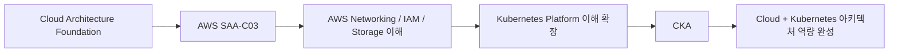

# AWS Certified Solutions Architect - Associate(SAA-C03) 시험가이드 및 준비 문서

아래는 **AWS Certified Solutions Architect - Associate(SAA-C03) 시험가이드 및 준비 문서**를 바로 저장해서 쓸 수 있도록 **Markdown 문서 형태**로 정리한 버전입니다.

공식 시험가이드, 샘플 문제 유형, 실전 풀이 패턴, CKA와의 차이, 그리고 두 시험을 같이 준비할 때의 추천 순서까지 포함했습니다.

> 참고: AWS와 CKA 시험 정책, 버전, 비용, 출제 범위는 수시로 변경될 수 있습니다. 실제 응시 전에는 반드시 **AWS Certification 공식 페이지**, **AWS SAA-C03 Exam Guide**, **Linux Foundation/CNCF CKA 공식 페이지**에서 최신 정보를 재확인하시는 것을 권장드립니다.

## 1. 최종 결론

### 최종 추천

**AWS SAA-C03을 먼저 보고, 이후 CKA를 보는 것을 추천드립니다.**

이유는 명확합니다.

1. **SAA는 클라우드 아키텍처 전체 그림을 잡는 시험**입니다.

   VPC, IAM, EC2, S3, RDS, Route 53, CloudFront, Auto Scaling, Load Balancer, SQS, Lambda, 비용 최적화 등 클라우드 설계의 기본 판단 기준을 먼저 익힐 수 있습니다.

2. **CKA는 Kubernetes 운영 실기 시험**입니다.

   이미 Kubernetes에 익숙하더라도 시험은 CLI 기반 실습, 장애 조치, kubeadm, RBAC, 네트워크, 스토리지, Troubleshooting 중심이라 별도 훈련이 필요합니다.

3. **SAA를 먼저 취득하면 EKS/K8s 아키텍처 판단력이 좋아집니다.**

   예를 들어 EKS 자체보다 실제 운영에서는 IAM, VPC, ALB/NLB, Route 53, ACM, CloudWatch, EBS/EFS, NAT Gateway, PrivateLink, 비용 구조를 같이 이해해야 합니다.

4. **시험 난이도와 준비 방식 측면에서 SAA가 먼저 성취하기 좋습니다.**

   SAA는 객관식 기반이라 학습 범위는 넓지만 실전 문제풀이로 합격선까지 끌어올리기 좋습니다.

   CKA는 실기형이라 실제 명령어 숙련도와 시간 압박 대응력이 필요합니다.

단, 예외가 있습니다.

| 상황 | 먼저 추천 |
|---|---|
| AWS 경험이 거의 없고 클라우드 아키텍처 역량을 먼저 잡고 싶음 | **SAA 먼저** |
| 현재 업무가 EKS/K8s 운영·구축·장애대응 중심 | **CKA 먼저도 가능** |
| 제안서/RFP/아키텍처 설계 역할 중심 | **SAA 먼저** |
| Kubernetes 플랫폼 엔지니어 역량 증명이 급함 | **CKA 먼저** |
| 두 시험을 모두 3~4개월 내 취득 목표 | **SAA → CKA 순서 추천** |

---

# 2. AWS SAA-C03 시험 개요

## 2.1 시험명

**AWS Certified Solutions Architect - Associate**

시험 코드: **SAA-C03**

## 2.2 시험 목적

AWS Well-Architected Framework 기반으로 다음 역량을 검증합니다.

- 비즈니스 요구사항에 맞는 AWS 서비스 조합 능력
- 안전한 아키텍처 설계
- 장애에 강한 아키텍처 설계
- 고성능 아키텍처 설계
- 비용 최적화 아키텍처 설계
- 기존 아키텍처를 분석하고 개선하는 능력

즉, 단순히 AWS 서비스 이름을 외우는 시험이 아니라 **요구사항을 보고 가장 적절한 아키텍처 선택지를 고르는 시험**입니다.

---

# 3. 응시 조건 및 시험 정보

## 3.1 필수 응시 조건

**없습니다.**

학력, 경력, 하위 자격증, Cloud Practitioner 보유 여부와 관계없이 바로 응시 가능합니다.

## 3.2 AWS 권장 조건

AWS 공식 기준으로는 대략 다음 경험을 권장합니다.

- AWS 기반 클라우드 솔루션 설계 경험 1년 이상
- 또는 일반 IT/인프라/개발 경험 1~3년 이상
- 네트워크, 컴퓨팅, 스토리지, 데이터베이스, 보안 기본 개념 이해

## 3.3 시험 기본 정보

| 항목 | 내용 |
|---|---|
| 시험 코드 | SAA-C03 |
| 문항 수 | 총 65문항 |
| 채점 문항 | 50문항 |
| 비채점 문항 | 15문항 |
| 문제 유형 | 단일 선택형, 다중 선택형 |
| 시험 시간 | 130분 |
| 비영어권 시간 연장 | 신청 시 보통 30분 추가 가능 |
| 합격 점수 | 720점 / 1000점 |
| 응시 비용 | 150 USD 수준, 세금 별도 |
| 응시 방식 | Pearson VUE 온라인 또는 시험센터 |
| 유효 기간 | 3년 |

---

# 4. 시험 도메인 및 출제 비중

AWS SAA-C03은 4개 도메인으로 구성됩니다.

| 도메인 | 비중 | 핵심 키워드 |
|---|---:|---|
| Domain 1. Design Secure Architectures | 30% | IAM, KMS, VPC 보안, WAF, Shield, Secrets Manager, 암호화 |
| Domain 2. Design Resilient Architectures | 26% | Multi-AZ, DR, Auto Scaling, SQS, SNS, Route 53, 백업 |
| Domain 3. Design High-Performing Architectures | 24% | 캐싱, 고성능 DB, CloudFront, EBS/EFS/S3, Lambda, ECS/EKS |
| Domain 4. Design Cost-Optimized Architectures | 20% | Savings Plans, Reserved, Spot, S3 Lifecycle, NAT 비용, 서버리스 |

## 4.1 가장 중요한 도메인

가장 비중이 높은 것은 **보안 아키텍처 30%**입니다.

하지만 SAA는 도메인별로 별도 합격선이 있는 구조가 아니라, 전체 점수 기준입니다.

따라서 특정 도메인을 버리면 안 됩니다.

---

# 5. SAA-C03에서 실제로 나오는 문제 스타일

SAA-C03 문제는 대부분 다음 구조입니다.

```text
어떤 회사가 현재 A 구조를 사용 중이다.
요구사항은 B, C, D이다.
가장 비용 효율적이거나, 가장 운영 부담이 적거나, 가장 고가용성인 방법은 무엇인가?
```

즉, 문제의 핵심은 **서비스 암기**가 아니라 **요구사항 해석**입니다.

---

# 6. 자주 출제되는 문제 유형과 풀이법

## 6.1 네트워크/VPC 유형

### 자주 나오는 문제

- Private Subnet의 EC2가 인터넷 패치를 받아야 함
- 인터넷에서는 직접 접근되면 안 됨
- S3에 인터넷을 거치지 않고 접근해야 함
- 온프레미스와 AWS를 연결해야 함
- VPC 간 통신 또는 중앙 네트워크 허브 필요

### 풀이 패턴

| 요구사항 | 정답 후보 |
|---|---|
| Private Subnet에서 인터넷 outbound 필요 | NAT Gateway |
| Private Subnet에서 S3/DynamoDB private 접근 | Gateway VPC Endpoint |
| AWS 서비스에 PrivateLink 방식 접근 | Interface VPC Endpoint |
| 온프레미스와 AWS 암호화 연결 | Site-to-Site VPN |
| 안정적 전용선 연결 | Direct Connect |
| 다수 VPC/온프레미스 중앙 연결 | Transit Gateway |
| VPC 2개 단순 연결 | VPC Peering |

### 대표 함정

| 함정 보기 | 왜 틀리는가 |
|---|---|
| Private Subnet Route Table에 Internet Gateway 연결 | Private Subnet 인스턴스는 Public IP 없이 직접 인터넷 불가 |
| NAT Gateway를 Private Subnet에 배치 | NAT Gateway는 Public Subnet에 있어야 함 |
| S3 접근을 위해 NAT Gateway 사용 | 가능은 하지만 보안/비용상 Gateway Endpoint가 더 적합한 경우 많음 |
| VPC Peering으로 전이 라우팅 | VPC Peering은 transitive routing 불가 |

---

## 6.2 IAM/보안 유형

### 자주 나오는 문제

- 여러 AWS 계정의 권한 관리
- 최소 권한 원칙
- 임시 자격 증명
- 온프레미스 AD 연동
- S3 버킷 접근 제한
- KMS 암호화 키 관리
- Secret 자동 교체

### 풀이 패턴

| 요구사항 | 정답 후보 |
|---|---|
| AWS 계정 간 접근 | IAM Role + STS AssumeRole |
| 여러 계정 중앙 관리 | AWS Organizations |
| 계정 단위 정책 제한 | SCP |
| 직원 SSO | IAM Identity Center |
| 온프레미스 AD 연동 | AD Connector 또는 AWS Managed Microsoft AD |
| 애플리케이션 사용자 인증 | Amazon Cognito |
| 비밀값 저장 및 자동 교체 | AWS Secrets Manager |
| 파라미터 저장, 단순 설정값 | SSM Parameter Store |
| 암호화 키 관리 | AWS KMS |
| HSM 수준 전용 키 관리 | CloudHSM |

### 대표 함정

| 함정 | 설명 |
|---|---|
| IAM User를 대량 생성 | 장기 자격 증명 관리 부담, 보안상 비권장 |
| Cognito를 직원 AWS 콘솔 로그인 용도로 사용 | Cognito는 앱 사용자 인증에 적합 |
| Parameter Store를 RDS 자동 Rotation 용도로 선택 | 자동 Rotation은 Secrets Manager가 적합 |
| KMS 키만 만들고 S3 암호화 정책 누락 | 실제 암호화 적용 위치 확인 필요 |

---

## 6.3 S3/스토리지 유형

### 자주 나오는 문제

- 정적 웹사이트 호스팅
- 객체 수명주기 관리
- 장기 보관
- 자주 접근하지 않는 데이터
- 온프레미스 파일 서버 확장
- EBS/EFS/FSx 선택
- Cross-Region Replication
- Object Lock

### 풀이 패턴

| 요구사항 | 정답 후보 |
|---|---|
| 객체 저장, 무제한 확장 | S3 |
| 정적 웹사이트 | S3 Static Website + CloudFront |
| 자주 접근하지 않지만 즉시 접근 필요 | S3 Standard-IA |
| 아카이브 | S3 Glacier Flexible Retrieval |
| 장기/최저 비용 보관 | S3 Glacier Deep Archive |
| 수명주기 기반 비용 절감 | S3 Lifecycle |
| 온프레미스 파일 인터페이스로 S3 사용 | S3 File Gateway |
| Linux 공유 파일시스템 | EFS |
| Windows SMB 파일 서버 | FSx for Windows File Server |
| Lustre/HPC | FSx for Lustre |
| 블록 스토리지 | EBS |
| EC2 여러 대에서 공유 파일 | EFS |
| 단일 EC2 고성능 디스크 | EBS |

### 대표 함정

| 함정 | 설명 |
|---|---|
| EBS를 여러 EC2가 일반 공유 파일시스템처럼 사용 | 기본적으로 EBS는 단일 인스턴스 연결 중심 |
| EFS를 Windows SMB 용도로 선택 | Windows SMB는 FSx for Windows |
| Glacier Deep Archive를 즉시 조회 용도로 선택 | 복원 시간이 오래 걸림 |
| S3 Standard를 장기 보관 대량 데이터에 계속 사용 | 비용 최적화 실패 |

---

## 6.4 EC2/Auto Scaling/Load Balancer 유형

### 자주 나오는 문제

- 트래픽 급증 대응
- Multi-AZ 고가용성
- 비용 절감
- 무중단 배포
- 상태 저장 데이터 처리
- 인스턴스 구매 옵션 선택

### 풀이 패턴

| 요구사항 | 정답 후보 |
|---|---|
| 웹 트래픽 L7 분산 | Application Load Balancer |
| TCP/UDP 고성능 L4 분산 | Network Load Balancer |
| 방화벽/보안 어플라이언스 트래픽 | Gateway Load Balancer |
| EC2 자동 확장 | Auto Scaling Group |
| 예측 가능한 장기 워크로드 | Reserved Instances 또는 Savings Plans |
| 중단 가능 배치 작업 | Spot Instances |
| 중단 불가 단기 작업 | On-Demand Instances |
| 메모리 상태 유지하며 중지 | EC2 Hibernate |
| AMI 기반 복제 | Launch Template + ASG |

### 대표 함정

| 함정 | 설명 |
|---|---|
| 중단되면 안 되는 작업에 Spot 사용 | Spot은 회수 가능성 있음 |
| ALB로 TCP 초저지연 처리 | NLB가 더 적합 |
| Auto Scaling을 CPU만 기준으로 선택 | SQS 기반 처리라면 Queue depth가 더 적합 |
| Multi-AZ 없이 단일 AZ 구성 | 고가용성 요구사항 위반 |

---

## 6.5 데이터베이스 유형

### 자주 나오는 문제

- RDS Multi-AZ와 Read Replica 차이
- Aurora Replica
- DynamoDB 선택
- ElastiCache 선택
- Redshift/Athena 선택
- 마이그레이션 도구 선택

### 풀이 패턴

| 요구사항 | 정답 후보 |
|---|---|
| 관계형 DB | RDS |
| MySQL/PostgreSQL 호환 고성능 | Aurora |
| 장애 조치 고가용성 | RDS Multi-AZ |
| 읽기 부하 분산 | Read Replica |
| 초저지연 Key-Value | DynamoDB |
| 세션/캐시 | ElastiCache |
| Redis 호환 캐시 | ElastiCache for Redis |
| SQL로 S3 데이터 조회 | Athena |
| 데이터웨어하우스 | Redshift |
| DB 마이그레이션 | AWS DMS |
| 이기종 DB 스키마 변환 | AWS SCT |

### 대표 함정

| 함정 | 설명 |
|---|---|
| Multi-AZ를 읽기 확장으로 선택 | Multi-AZ Standby는 일반 읽기 처리용 아님 |
| Read Replica를 자동 장애조치 HA로 착각 | 주목적은 읽기 확장 |
| S3 JSON 로그 분석에 Redshift 선택 | 단순 ad-hoc SQL이면 Athena가 더 적합 |
| DynamoDB에 복잡한 조인 요구 | NoSQL 특성상 부적합 |

---

## 6.6 메시징/이벤트/서버리스 유형

### 자주 나오는 문제

- 서비스 간 결합도 낮추기
- 폭주 트래픽 흡수
- 이벤트 기반 처리
- 순서 보장
- Fan-out 구조
- 서버리스 아키텍처

### 풀이 패턴

| 요구사항 | 정답 후보 |
|---|---|
| 큐 기반 비동기 처리 | SQS |
| 메시지 순서 보장 | SQS FIFO |
| 다수 구독자에게 Fan-out | SNS |
| 이벤트 라우팅 | EventBridge |
| 워크플로우 오케스트레이션 | Step Functions |
| API 제공 | API Gateway |
| 서버리스 컴퓨팅 | Lambda |
| 컨테이너 서버리스 | Fargate |

### 대표 함정

| 함정 | 설명 |
|---|---|
| 순서 보장이 필요한데 SQS Standard 선택 | SQS FIFO 필요 |
| Fan-out인데 SQS 단독 사용 | SNS + SQS 조합이 적합 |
| 복잡한 상태 워크플로우를 Lambda만으로 구성 | Step Functions가 적합 |
| 장시간 실행 작업에 Lambda 선택 | Lambda 제한 시간 고려 필요 |

---

## 6.7 비용 최적화 유형

### 자주 나오는 문제

- EC2 구매 옵션
- S3 Storage Class
- NAT Gateway 비용
- 데이터 전송 비용
- 서버리스 비용
- 사용량 기반 확장

### 풀이 패턴

| 요구사항 | 정답 후보 |
|---|---|
| 장기 안정 사용량 | Savings Plans |
| 특정 인스턴스 장기 사용 | Reserved Instances |
| 중단 가능 워크로드 | Spot |
| 미사용 시 자동 축소 | Auto Scaling |
| 객체 수명주기 | S3 Lifecycle |
| S3 KMS 비용 절감 | S3 Bucket Key |
| NAT 비용 절감 | VPC Endpoint 검토 |
| CloudFront 캐싱 | 데이터 전송 및 지연 최적화 |

### 대표 함정

| 함정 | 설명 |
|---|---|
| 모든 비용 문제를 Spot으로 해결 | 중단 가능 여부 확인 필요 |
| Private Subnet에서 S3 접근을 NAT로만 처리 | VPC Endpoint가 보안/비용상 유리 |
| S3 Standard 장기 보관 | Glacier 계열 검토 필요 |
| Lambda가 항상 저렴하다고 판단 | 고빈도/장시간 실행은 비용 검토 필요 |

---

# 7. 문제를 푸는 실전 접근법

## 7.1 문제풀이 기본 순서

SAA 문제는 다음 순서로 푸는 것이 좋습니다.

```text
1. 요구사항 키워드를 먼저 찾는다.
2. 제약조건을 확인한다.
3. 가장 강한 조건을 기준으로 후보를 줄인다.
4. 운영 부담, 비용, 성능, 보안 중 무엇을 우선하는지 판단한다.
5. 명백히 틀린 보기를 제거한다.
6. 남은 2개 중 AWS Best Practice에 가까운 것을 고른다.
```

---

## 7.2 문제 키워드별 정답 방향

| 문제 키워드 | 정답 방향 |
|---|---|
| least operational overhead | Managed Service, Serverless |
| most cost-effective | Spot, Savings Plans, Lifecycle, Endpoint |
| highly available | Multi-AZ, ALB, ASG, RDS Multi-AZ |
| fault tolerant | Multi-AZ/Multi-Region, decoupling |
| decouple | SQS, SNS, EventBridge |
| ordered processing | SQS FIFO |
| real-time streaming | Kinesis |
| ad-hoc SQL on S3 | Athena |
| data warehouse | Redshift |
| cache | ElastiCache, CloudFront |
| global low latency | CloudFront, Global Accelerator |
| private access to AWS service | VPC Endpoint |
| secure secret rotation | Secrets Manager |
| encryption with customer-managed key | KMS CMK |
| on-prem file access to S3 | Storage Gateway |
| lift-and-shift server migration | Application Migration Service |
| database migration | DMS |
| schema conversion | SCT |

---

## 7.3 SAA 문제에서 자주 쓰는 제거법

### 1) "운영 부담 최소"인데 EC2 직접 구축이면 의심

예:

- 직접 EC2에 DB 설치
- 직접 파일 서버 구성
- 직접 스크립트로 Rotation 구현
- 직접 Queue Poller 관리

이런 보기는 보통 정답 가능성이 낮습니다.

AWS는 관리형 서비스 사용을 선호합니다.

---

### 2) "비용 최적화"인데 과도한 서비스면 의심

예:

- 단순 S3 로그 조회에 Redshift
- 단순 파일 이전에 Direct Connect
- 작은 비정기 처리에 상시 EC2
- S3 접근 때문에 NAT Gateway만 사용

요구사항 대비 과한 서비스는 제거 후보입니다.

---

### 3) "고가용성"인데 단일 AZ이면 거의 오답

고가용성 요구가 있으면 최소한 다음을 봐야 합니다.

- Multi-AZ
- Auto Scaling Group across AZs
- Load Balancer
- RDS Multi-AZ
- S3/managed service
- Route 53 Failover

---

### 4) "보안" 문제에서는 Public Internet 우회 여부 확인

다음 키워드가 나오면 Endpoint 계열을 강하게 의심합니다.

- private connectivity
- without traversing the public internet
- private subnet
- no internet access
- secure access to S3/DynamoDB

---

# 8. 대표 출제 시나리오와 풀이 예시

## 예시 1. Private Subnet EC2가 인터넷 패치를 받아야 함

### 요구사항

- EC2는 Private Subnet에 있음
- 인터넷에서 EC2로 직접 접근되면 안 됨
- EC2는 OS 패치를 위해 인터넷 outbound 필요

### 정답 방향

- Public Subnet에 NAT Gateway 생성
- Private Subnet Route Table에서 `0.0.0.0/0`을 NAT Gateway로 라우팅

### 틀린 보기

- Private Subnet에 Internet Gateway 연결
- EC2에 Elastic IP 부여
- NAT Gateway를 Private Subnet에 생성

---

## 예시 2. 애플리케이션이 S3에 인터넷 없이 접근해야 함

### 요구사항

- Private Subnet 애플리케이션
- S3 접근 필요
- Public Internet 경유 금지
- 비용 효율적이어야 함

### 정답 방향

- **S3 Gateway VPC Endpoint**
- Route Table에 Endpoint 경로 추가
- 필요 시 Bucket Policy에서 `aws:SourceVpce` 조건 적용

### 헷갈리는 보기

- NAT Gateway 사용

  가능은 하지만 인터넷 경유 및 비용 측면에서 부적합

- Interface Endpoint 사용

  일부 AWS 서비스에는 적합하지만 S3는 일반적으로 Gateway Endpoint가 비용 효율적

---

## 예시 3. DB 쓰기 부하가 너무 높음

### 요구사항

- 웹 서버가 RDS에 직접 대량 쓰기
- 트래픽 피크 때 DB가 못 버팀
- 데이터 유실 없어야 함
- 다운타임 없어야 함

### 정답 방향

- 웹 서버 → SQS → Worker → DB
- SQS로 비동기 처리
- Worker 수를 Queue depth 기반으로 Auto Scaling

### 틀린 보기

- RDS Multi-AZ로 쓰기 성능 증가

  Multi-AZ는 HA 목적이지 쓰기 확장 목적이 아님

- EventBridge 스케줄로 DB 크기 변경

  피크가 예측 불가능하면 부적합

---

## 예시 4. S3에 있는 JSON 로그를 SQL로 조회

### 요구사항

- 로그는 S3에 JSON으로 저장됨
- 단순 ad-hoc SQL 조회
- 기존 구조 변경 최소화
- 운영 부담 최소화

### 정답 방향

- **Amazon Athena**
- 필요 시 Glue Data Catalog 사용

### 틀린 보기

- Redshift에 적재

  대규모 DW 분석에는 적합하지만 운영 부담 증가

- EMR Spark Cluster

  과한 구성

---

## 예시 5. EC2 작업이 중단되면 안 됨

### 요구사항

- 월말에만 처리량 증가
- 작업은 시작되면 중단되면 안 됨
- 비용 효율적이어야 함

### 정답 방향

- **On-Demand Instances 추가 사용**

### 헷갈리는 보기

- Spot Instances

  가장 저렴하지만 중단 가능성이 있으므로 오답

- Reserved 추가 구매

  일시적 피크에는 비효율적

---

# 9. SAA-C03 학습 범위

## 9.1 반드시 알아야 하는 핵심 서비스

| 영역 | 핵심 서비스 |
|---|---|
| Compute | EC2, Auto Scaling, Lambda, ECS, EKS, Fargate, Elastic Beanstalk |
| Storage | S3, EBS, EFS, FSx, Storage Gateway, Backup |
| Database | RDS, Aurora, DynamoDB, ElastiCache, Redshift |
| Network | VPC, Subnet, Route Table, IGW, NAT Gateway, VPC Endpoint, ALB, NLB, Route 53, CloudFront, Direct Connect, VPN, Transit Gateway |
| Security | IAM, IAM Identity Center, KMS, Secrets Manager, WAF, Shield, GuardDuty, Security Hub, ACM |
| Integration | SQS, SNS, EventBridge, Step Functions, API Gateway |
| Analytics | Athena, Glue, Kinesis, EMR, OpenSearch |
| Management | CloudWatch, CloudTrail, Config, Systems Manager, Trusted Advisor, Organizations |

---

# 10. 학습 계획

## 10.1 권장 준비 기간

| 현재 수준 | 권장 기간 |
|---|---|
| AWS 거의 처음 | 8~10주 |
| 인프라/네트워크 경험 있음 | 6~8주 |
| AWS 실무 경험 있음 | 3~5주 |
| 기존 Cloud Practitioner 취득 | 4~6주 |
| 실무 + 문제풀이 경험 충분 | 2~3주 집중 가능 |

---

## 10.2 6주 표준 학습 계획

### Week 1. AWS 기본기 + IAM + VPC

- AWS Global Infrastructure
- Region / AZ / Edge Location
- IAM User, Group, Role, Policy
- STS
- Organizations, SCP
- VPC, Subnet, Route Table
- IGW, NAT Gateway
- Security Group, NACL
- VPC Endpoint

### Week 2. Compute + Load Balancing + Auto Scaling

- EC2 구매 옵션
- AMI, EBS, Instance Store
- Auto Scaling Group
- Launch Template
- ALB/NLB/GWLB
- Lambda
- ECS/EKS/Fargate 개념

### Week 3. Storage + Database

- S3 Storage Class
- S3 Lifecycle
- S3 Versioning, Replication, Object Lock
- EBS Volume Type
- EFS, FSx
- RDS, Aurora
- DynamoDB
- ElastiCache
- Redshift, Athena

### Week 4. Resilience + Integration + Serverless

- Multi-AZ
- Multi-Region
- DR 전략

  - Backup & Restore

  - Pilot Light

  - Warm Standby

  - Active-Active

- SQS, SNS
- EventBridge
- Step Functions
- API Gateway

### Week 5. Security + Cost Optimization

- KMS
- ACM
- WAF, Shield
- GuardDuty, Security Hub
- Secrets Manager
- CloudTrail, Config
- Savings Plans
- Reserved Instances
- Spot Instances
- S3 비용 최적화
- NAT Gateway 비용 최적화

### Week 6. 실전 문제풀이

- 모의고사 3~5회
- 오답노트 작성
- 틀린 문제를 서비스별로 분류
- 공식 샘플 문제 재풀이
- 약한 영역 집중 보강

---

# 11. 강의 수강 시 Skip 기준

사용자께서 첨부하신 강의 안내 기준을 반영하면 다음과 같습니다.

## 11.1 AWS 강의 경험이 없는 경우

**Skip하지 않는 것을 추천드립니다.**

특히 다음 섹션은 반드시 들어야 합니다.

- AWS 기본 개념
- IAM
- EC2
- VPC
- S3
- RDS
- Route 53
- Load Balancer
- Auto Scaling
- SQS/SNS
- Serverless
- Security
- Cost Optimization

## 11.2 Cloud Practitioner 강의를 이미 수강한 경우

강의자가 안내한 기준으로는 **섹션 3, 4, 5, 12를 건너뛰어도 된다**고 되어 있습니다.

다만 실전 기준으로는 다음처럼 판단하는 것이 좋습니다.

| 섹션 | Skip 가능 여부 | 실전 판단 |
|---|---|---|
| 기본 AWS 개념 | 가능 | 이미 확실하면 Skip |
| IAM 기본 | 부분 Skip | SAA에서는 IAM Role/Policy가 중요하므로 복습 권장 |
| EC2 기본 | 부분 Skip | Spot, ASG, ELB, EBS는 반드시 복습 |
| 아키텍처 기본 | 비추천 | SAA 문제풀이의 기반이므로 복습 권장 |

## 11.3 Developer Associate 강의 수강자

강의 안내에 따르면 EC2 Spot 관련 강의 정도만 추가로 보면 된다고 되어 있습니다.

하지만 SAA는 Developer보다 다음 영역이 더 강합니다.

- VPC 설계
- 고가용성 아키텍처
- 비용 최적화
- DR 전략
- Storage 선택
- Database 선택
- 네트워크 라우팅
- 보안 아키텍처

따라서 Developer 경험이 있어도 **VPC, RDS, S3, Route 53, DR, Cost 영역은 별도로 학습**하는 것이 안전합니다.

---

# 12. 모의고사 활용 전략

## 12.1 모의고사 목표 점수

| 점수 | 상태 |
|---:|---|
| 60% 이하 | 기본 개념 부족 |
| 65~72% | 위험 구간 |
| 73~80% | 합격 가능성은 있으나 불안정 |
| 80~85% | 실전 응시 가능 |
| 85% 이상 2~3회 연속 | 안정권 |

실전 추천 기준은 다음입니다.

> **모의고사 65문항 기준 80% 이상을 2회 이상 안정적으로 받으면 응시 가능**

> **85% 이상이면 비교적 안정권**

---

## 12.2 오답노트 작성 방식

단순히 정답만 외우면 안 됩니다.

아래 형식으로 정리해야 합니다.

```markdown
## 오답 번호
- 문제 키워드:
- 내가 고른 답:
- 정답:
- 틀린 이유:
- 핵심 개념:
- 다시 나오면 판단 기준:
```

예시:

```markdown
## S3 Gateway Endpoint 문제
- 문제 키워드: private subnet, S3, no internet, cost-effective
- 내가 고른 답: NAT Gateway
- 정답: Gateway VPC Endpoint
- 틀린 이유: NAT Gateway는 인터넷 경유 및 비용 발생
- 핵심 개념: S3/DynamoDB는 Gateway Endpoint 사용 가능
- 다시 나오면 판단 기준: private S3 access + cost-effective = Gateway Endpoint
```

---

# 13. 시험장에서의 문제풀이 전략

## 13.1 시간 배분

65문항 / 130분입니다.

문항당 평균 2분입니다.

| 단계 | 시간 |
|---|---:|
| 1차 풀이 | 90분 |
| Flag 문제 재검토 | 30분 |
| 최종 검토 | 10분 |

## 13.2 문제 풀이 순서

1. 문제의 마지막 문장을 먼저 봅니다.

   - "MOST cost-effective"

   - "LEAST operational overhead"

   - "HIGHLY available"

   - "MOST secure"

   - "without downtime"

2. 본문에서 제약조건을 찾습니다.

   - public internet 금지

   - 중단 불가

   - 순서 보장

   - 실시간

   - 장기 보관

   - 수동 운영 최소화

3. 보기에서 명백한 오답 제거
4. 남은 2개 중 AWS Best Practice 선택

---

# 14. AWS SAA-C03와 Kubernetes CKA 비교

## 14.1 핵심 차이

| 구분 | AWS SAA-C03 | CKA |
|---|---|---|
| 시험 성격 | 클라우드 아키텍처 설계 | Kubernetes 운영 실기 |
| 문제 유형 | 객관식/다중 선택 | CLI 기반 Hands-on |
| 시험 대상 | Solutions Architect | Kubernetes Administrator |
| 핵심 역량 | 서비스 선택, 설계 판단 | kubectl, YAML, 장애 해결 |
| 벤더 종속성 | AWS 종속 | 벤더 중립 Kubernetes |
| 실습 필요성 | 있으면 좋음 | 필수 |
| 암기 비중 | 서비스 특성/제약 이해 | 명령어, 리소스 구조 숙련 |
| 난이도 체감 | 범위가 넓음 | 실기 압박이 큼 |
| 문제풀이 방식 | Best Answer 선택 | 실제 클러스터 수정 |
| 합격 핵심 | 서비스별 의사결정 패턴 | 속도, 정확도, 실습 반복 |

---

## 14.2 출제 영역 비교

### AWS SAA-C03

| 도메인 | 비중 |
|---|---:|
| Secure Architectures | 30% |
| Resilient Architectures | 26% |
| High-Performing Architectures | 24% |
| Cost-Optimized Architectures | 20% |

### CKA

| 도메인 | 비중 |
|---|---:|
| Troubleshooting | 30% |
| Cluster Architecture, Installation & Configuration | 25% |
| Services & Networking | 20% |
| Workloads & Scheduling | 15% |
| Storage | 10% |

---

# 15. SAA와 CKA의 실무적 차이

## 15.1 SAA는 "무엇을 선택할 것인가"의 시험

예를 들어 SAA는 이런 질문을 합니다.

```text
트래픽이 급증한다.
DB가 병목이다.
운영 부담은 최소화해야 한다.
어떤 AWS 서비스를 조합할 것인가?
```

정답은 다음처럼 판단합니다.

```text
SQS로 decouple
Worker Auto Scaling
DB write rate 제어
필요 시 DynamoDB 또는 Aurora 검토
```

즉, SAA는 **아키텍처 선택 능력**을 봅니다.

---

## 15.2 CKA는 "직접 고칠 수 있는가"의 시험

CKA는 이런 식입니다.

```text
특정 Namespace의 Pod가 Pending 상태이다.
원인을 찾아 정상 Running 상태로 만들어라.
```

실제 수행은 다음과 같습니다.

```bash
kubectl get pod -n app
kubectl describe pod <pod> -n app
kubectl get nodes
kubectl describe node <node>
kubectl edit deployment <name> -n app
kubectl apply -f ...
```

즉, CKA는 **실제 운영 능력**을 봅니다.

---

# 16. 두 시험을 함께 준비할 때 추천 순서

## 최종 추천 순서

```text
1단계: AWS SAA-C03
2단계: Kubernetes CKA
```

## 이유

### 1. SAA가 클라우드 설계 기반을 먼저 잡아줌

Kubernetes를 운영하더라도 실제 클라우드 환경에서는 다음을 알아야 합니다.

- VPC/Subnet 설계
- IAM Role
- Load Balancer
- TLS/ACM
- DNS/Route 53
- EBS/EFS
- CloudWatch
- NAT Gateway 비용
- Private Endpoint
- Multi-AZ
- Backup/DR

이 기반 없이 K8s만 잘해도 클라우드 아키텍처 판단이 약해질 수 있습니다.

---

### 2. CKA는 집중 실습형이라 마지막에 몰아서 준비하는 게 효율적

CKA는 "감"이 중요합니다.

- kubectl 명령 속도
- YAML 수정 속도
- namespace/context 실수 방지
- `describe`, `logs`, `events` 분석
- static pod 수정
- kubeadm, etcd backup/restore
- network policy
- ingress/gateway
- PV/PVC

이런 것은 오래 늘어지게 공부하기보다 **3~5주 집중 실습**이 효율적입니다.

---

### 3. SAA는 문제풀이 누적형이라 병행 학습에 유리

SAA는 출퇴근/자투리 시간에 문제풀이가 가능합니다.

반면 CKA는 터미널 실습 환경이 필요합니다.

따라서 현실적인 병행 전략은 다음입니다.

```text
평일 자투리 시간: SAA 이론/문제풀이
주말 집중 시간: CKA 실습
```

하지만 시험 응시는 **SAA 먼저 → CKA**가 좋습니다.

---

# 17. 두 시험 동시 준비 로드맵

## 17.1 12주 로드맵

| 주차 | 목표 | SAA | CKA |
|---|---|---|---|
| 1주차 | 클라우드 기본기 | IAM, VPC | kubectl 기본 |
| 2주차 | Compute | EC2, ASG, ELB | Pod, Deployment |
| 3주차 | Storage/DB | S3, EBS, RDS | ConfigMap, Secret |
| 4주차 | Network 심화 | Route 53, CloudFront | Service, Ingress |
| 5주차 | 보안 | KMS, WAF, Secrets | RBAC |
| 6주차 | Resilience | DR, Multi-AZ | Scheduling |
| 7주차 | 비용 최적화 | RI, Spot, Lifecycle | Storage PV/PVC |
| 8주차 | SAA 모의고사 | 모의고사 1~2회 | Troubleshooting 기초 |
| 9주차 | SAA 마무리 | 모의고사 3~5회 | 가볍게 유지 |
| 10주차 | SAA 응시 | 시험 응시 | CKA 집중 시작 |
| 11주차 | CKA 실습 | 유지 | Killer.sh/Killercoda |
| 12주차 | CKA 응시 | 없음 | 실전 모의고사 후 응시 |

---

# 18. SAA 합격 기준으로 보는 준비 완료 체크리스트

## 18.1 개념 체크

아래 항목을 설명할 수 있어야 합니다.

- [ ] NAT Gateway와 Internet Gateway 차이
- [ ] Security Group과 NACL 차이
- [ ] Gateway Endpoint와 Interface Endpoint 차이
- [ ] ALB와 NLB 차이
- [ ] RDS Multi-AZ와 Read Replica 차이
- [ ] S3 Storage Class별 사용처
- [ ] SQS Standard와 FIFO 차이
- [ ] SNS와 SQS 조합 패턴
- [ ] Lambda와 Fargate 차이
- [ ] CloudFront와 Global Accelerator 차이
- [ ] KMS, Secrets Manager, Parameter Store 차이
- [ ] Reserved Instance, Savings Plans, Spot 차이
- [ ] Backup & Restore, Pilot Light, Warm Standby, Active-Active 차이

## 18.2 문제풀이 체크

- [ ] 모의고사 65문항 기준 80% 이상 2회
- [ ] 틀린 문제를 서비스별로 분류함
- [ ] "least operational overhead" 문제 패턴 이해
- [ ] "most cost-effective" 문제 패턴 이해
- [ ] "highly available" 문제 패턴 이해
- [ ] "private access/no internet" 문제 패턴 이해
- [ ] 다중 선택형에서 정답 개수 실수 없음

---

# 19. CKA 준비 완료 체크리스트

CKA는 SAA와 전혀 다릅니다.

아래 작업을 실제 명령어로 할 수 있어야 합니다.

- [ ] kubeadm으로 클러스터 구성 흐름 이해
- [ ] etcd backup/restore
- [ ] RBAC Role/RoleBinding 생성
- [ ] Deployment rolling update/rollback
- [ ] ConfigMap/Secret 주입
- [ ] Liveness/Readiness Probe 설정
- [ ] HPA 구성
- [ ] Taint/Toleration 설정
- [ ] Node Affinity 설정
- [ ] Service ClusterIP/NodePort/LoadBalancer 이해
- [ ] Ingress/Gateway API 구성
- [ ] NetworkPolicy 작성
- [ ] CoreDNS 문제 분석
- [ ] PV/PVC/StorageClass 구성
- [ ] CrashLoopBackOff 원인 분석
- [ ] ImagePullBackOff 원인 분석
- [ ] Pending Pod 원인 분석
- [ ] Node NotReady 원인 분석
- [ ] `kubectl logs`, `describe`, `top`, `events` 능숙하게 사용

---

# 20. 최종 학습 자료 추천

## 20.1 AWS SAA-C03

우선순위는 다음입니다.

1. **AWS 공식 Exam Guide**
2. **AWS 공식 Sample Questions**
3. **AWS Skill Builder**
4. **Tutorials Dojo SAA-C03 Practice Exam**
5. **Udemy SAA-C03 강의**
6. **AWS Well-Architected Framework**
7. **AWS FAQs / 공식 문서**

## 20.2 CKA

우선순위는 다음입니다.

1. **Linux Foundation CKA 공식 페이지**
2. **CNCF CKA Curriculum**
3. **Kubernetes 공식 문서**
4. **Killer.sh Simulator**
5. **Killercoda CKA labs**
6. **KodeKloud CKA 과정**
7. **kubectl cheat sheet**
8. **Gateway API / Helm 공식 문서**

---

# 21. 주의사항

## 21.1 Exam Dump 사용 금지

ExamTopics, GitHub dump, 실제 시험 복원 문제 등은 주의해야 합니다.

이유는 다음과 같습니다.

- 실제 시험 NDA 위반 가능성
- 정답 오류가 많음
- 최신 시험과 불일치 가능
- 실무 역량 향상에 도움이 적음
- 계정 제재 가능성

문제풀이 자료는 **공식 샘플 문제, 합법적인 Practice Exam, 자체 제작 문제** 위주로 사용하는 것이 안전합니다.

---

# 22. 최종 요약

## AWS SAA-C03

- 객관식 기반 클라우드 아키텍처 시험
- 핵심은 서비스 암기가 아니라 요구사항 기반 서비스 선택
- 보안, 고가용성, 성능, 비용 최적화가 핵심
- VPC, IAM, S3, RDS, EC2, ALB, Route 53, SQS, Lambda는 반드시 잡아야 함
- 모의고사 80~85% 이상이면 응시 가능

## CKA

- Kubernetes 실기 시험
- CLI, YAML, Troubleshooting이 핵심
- Troubleshooting 비중이 가장 큼
- 실습 없이는 합격 어려움
- 시간 압박 대응 훈련 필수

## 두 시험 순서

**최종 추천: SAA-C03 먼저 → CKA 나중**

이 순서가 클라우드 아키텍처 기반을 먼저 잡고, 이후 Kubernetes 운영 실무 역량을 증명하는 가장 안정적인 루트입니다.



작성자 기준 **아키텍처팀에서 RFP/제안/플랫폼 설계까지 보는 역할**이므로, 단순 운영자 관점의 CKA보다 먼저 **SAA로 클라우드 아키텍처 의사결정 체계**를 잡고, 이후 **CKA로 Kubernetes 실무 신뢰도**를 보강하는 흐름이 가장 좋습니다.
