# AWS SAA-C03 Practice Exam — Detailed Set 2

## 도메인 구성

| 도메인 | 실제 비중 | Set 2 반영 |
|---|---:|---:|
| Domain 1. Design Secure Architectures | 30% | 4문항 |
| Domain 2. Design Resilient Architectures | 26% | 3문항 |
| Domain 3. Design High-Performing Architectures | 24% | 3문항 |
| Domain 4. Design Cost-Optimized Architectures | 20% | 2문항 |

> 아래 문제는 학습용 예상 문제입니다. 실제 시험 문제 또는 덤프가 아닙니다.

---

# Q13. Domain 1 — Design Secure Architectures

## Question

**A company stores sensitive documents in an Amazon S3 bucket. The compliance team requires that all objects are encrypted at rest. The company wants AWS to manage the encryption keys with the least operational overhead.**

**Which solution should a solutions architect recommend?**

A. Use server-side encryption with Amazon S3 managed keys, SSE-S3.

B. Use server-side encryption with customer-provided keys, SSE-C.

C. Use client-side encryption before uploading objects to Amazon S3.

D. Store the objects in Amazon EBS volumes with encryption enabled.

---

## 정답

**A. Use server-side encryption with Amazon S3 managed keys, SSE-S3.**

---

## 상세 해설

이 문제는 **S3 암호화 방식 구분** 문제입니다.

문제의 핵심 조건은 다음입니다.

| 조건 | 의미 |
|---|---|
| S3에 민감 문서 저장 | 객체 스토리지 암호화 필요 |
| Encryption at rest | 저장 시 암호화 |
| AWS가 키 관리 | 고객이 직접 키 관리하지 않음 |
| 최소 운영 부담 | 가장 단순한 관리형 암호화 필요 |

이 조건에 가장 적합한 방식은 **SSE-S3**입니다.

---

## S3 암호화 방식 비교

| 방식 | 키 관리 주체 | 특징 |
|---|---|---|
| SSE-S3 | Amazon S3 | 가장 단순, 운영 부담 최소 |
| SSE-KMS | AWS KMS | KMS 키 정책/감사/제어 가능 |
| SSE-C | 고객 | 고객이 키를 직접 제공 |
| Client-side encryption | 고객 애플리케이션 | 업로드 전 직접 암호화 |

---

## SSE-S3 동작 구조

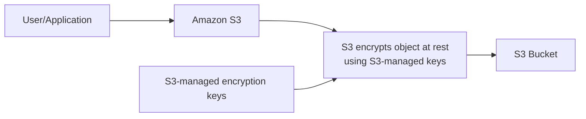

SSE-S3를 사용하면 사용자는 별도로 KMS 키 정책, 키 Rotation, 키 권한 등을 관리하지 않아도 됩니다.

S3가 자동으로 객체를 암호화해서 저장합니다.

---

## 왜 A가 정답인가?

문제에서 다음 표현이 중요합니다.

```text
AWS to manage the encryption keys
least operational overhead
```

이 두 조건을 동시에 만족하는 가장 단순한 선택지는 **SSE-S3**입니다.

---

## 오답 설명

### B. SSE-C

SSE-C는 **customer-provided keys**입니다.

즉, 고객이 암호화 키를 직접 제공합니다.

이 경우 고객은 다음을 직접 관리해야 합니다.

- 키 생성
- 키 보관
- 키 분실 방지
- 키 전달
- 키 Rotation
- 키 폐기

운영 부담이 큽니다.

---

### C. Client-side encryption

Client-side encryption은 애플리케이션이 S3에 업로드하기 전에 직접 암호화합니다.

장점은 고객이 완전히 키를 통제할 수 있다는 점입니다.

하지만 문제에서는 AWS가 키를 관리하기를 원합니다.

따라서 조건과 반대입니다.

---

### D. EBS 암호화

EBS는 EC2에 연결하는 블록 스토리지입니다.

문제는 S3 Bucket에 저장된 객체 암호화입니다.

스토리지 서비스 자체가 다릅니다.

---

## 초보자용 기억법

> S3에서 "가장 쉬운 암호화" → **SSE-S3**

> S3에서 "KMS 감사/권한 제어 필요" → **SSE-KMS**

> S3에서 "고객이 직접 키 제공" → **SSE-C**

> S3에서 "업로드 전 앱에서 암호화" → **Client-side encryption**

---

# Q14. Domain 1 — Design Secure Architectures

## Question

**A company stores confidential files in Amazon S3. The security team requires detailed audit logs of encryption key usage and wants to control access to the encryption keys through IAM policies and key policies.**

**Which encryption option should the company use?**

A. SSE-S3

B. SSE-KMS with a customer managed AWS KMS key

C. SSE-C

D. Amazon S3 Object Lock

---

## 정답

**B. SSE-KMS with a customer managed AWS KMS key**

---

## 상세 해설

이 문제는 Q13과 비슷해 보이지만 핵심 조건이 다릅니다.

이번 문제의 핵심은 다음입니다.

| 조건 | 의미 |
|---|---|
| detailed audit logs of encryption key usage | 키 사용 내역 추적 필요 |
| control access through IAM policies and key policies | 키 접근 제어 필요 |
| confidential files in S3 | S3 객체 암호화 필요 |

이 경우에는 **SSE-KMS with customer managed KMS key**가 적합합니다.

---

## SSE-KMS가 제공하는 것

SSE-KMS를 사용하면 AWS KMS를 통해 키를 관리합니다.

특히 Customer Managed Key를 사용하면 다음이 가능합니다.

- Key Policy 작성
- IAM Policy로 접근 제어
- CloudTrail을 통한 KMS API 사용 감사
- 키 사용 권한 분리
- 키 비활성화 또는 삭제 예약
- Rotation 설정

---

## 구조 도식

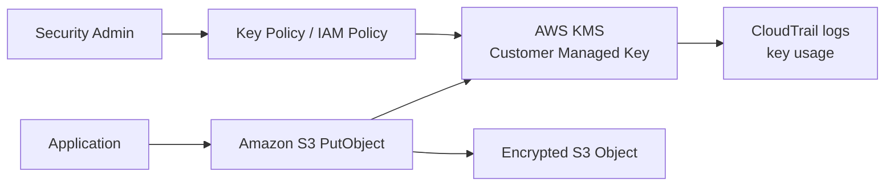

---

## 왜 B가 정답인가?

문제에서 가장 중요한 단어는 다음입니다.

```text
audit logs
control access to encryption keys
key policies
```

이 키워드가 나오면 SSE-S3보다 SSE-KMS가 적합합니다.

SSE-S3는 매우 단순하지만, KMS 수준의 세밀한 키 감사와 키 정책 제어는 제공하지 않습니다.

---

## 오답 설명

### A. SSE-S3

SSE-S3는 운영 부담이 가장 낮은 암호화 방식입니다.

하지만 키 사용 감사와 Key Policy 제어는 제한적입니다.

즉, 다음 요구사항에는 부족합니다.

```text
detailed audit logs of encryption key usage
key policies
```

---

### C. SSE-C

SSE-C는 고객이 키를 직접 제공하는 방식입니다.

AWS KMS Key Policy를 사용할 수 없습니다.

또한 KMS 기반 키 사용 감사 요구에도 맞지 않습니다.

---

### D. S3 Object Lock

S3 Object Lock은 암호화 기능이 아닙니다.

객체를 삭제하거나 덮어쓰지 못하게 하는 WORM, Write Once Read Many 기능입니다.

예를 들어 다음 요구에 적합합니다.

```text
객체를 7년 동안 삭제하지 못하게 해야 한다
규제상 변경 불가능한 보관이 필요하다
```

하지만 암호화 키 감사와는 다릅니다.

---

## 초보자용 핵심 비교

| 요구사항 | 정답 |
|---|---|
| 그냥 S3 암호화, 가장 쉬운 방식 | SSE-S3 |
| KMS 키 감사/권한 제어 필요 | SSE-KMS |
| 고객이 키 직접 제공 | SSE-C |
| 객체 삭제 방지/불변성 | S3 Object Lock |

---

# Q15. Domain 1 — Design Secure Architectures

## Question

**A company has an Amazon S3 bucket that must be accessed only by EC2 instances in a specific VPC through a VPC endpoint. The bucket must deny requests that do not come through the endpoint.**

**Which solution should a solutions architect recommend?**

A. Configure a security group on the S3 bucket to allow traffic only from the VPC.

B. Create an S3 gateway VPC endpoint and add a bucket policy that uses the `aws:SourceVpce` condition key.

C. Create a NAT gateway and configure the S3 bucket policy to allow the NAT gateway Elastic IP address.

D. Enable S3 Transfer Acceleration and restrict access to the acceleration endpoint.

---

## 정답

**B. Create an S3 gateway VPC endpoint and add a bucket policy that uses the `aws:SourceVpce` condition key.**

---

## 상세 해설

이 문제는 **S3 접근 경로를 VPC Endpoint로 강제**하는 문제입니다.

핵심 요구사항은 다음입니다.

| 조건 | 의미 |
|---|---|
| EC2 instances in a specific VPC | 특정 VPC 내부 리소스 |
| through a VPC endpoint | VPC Endpoint 경유 필수 |
| deny requests that do not come through the endpoint | Endpoint를 거치지 않으면 거부 |

S3는 Security Group을 붙이는 서비스가 아닙니다.

S3 접근 제어는 주로 다음으로 처리합니다.

- Bucket Policy
- IAM Policy
- ACL, 현재는 비권장 경향
- VPC Endpoint Policy

특정 VPC Endpoint를 통해 들어온 요청만 허용하려면 Bucket Policy에서 다음 조건 키를 사용합니다.

```text
aws:SourceVpce
```

---

## 구조 도식

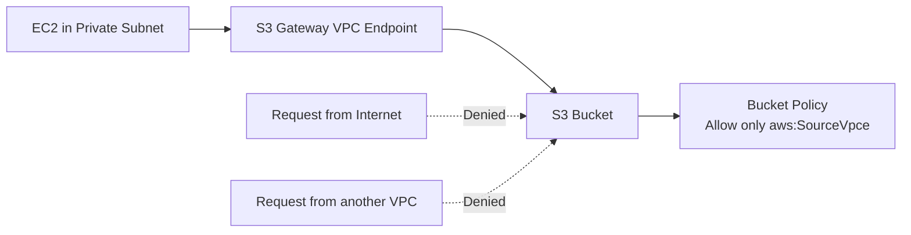

---

## 예시 정책 개념

```json
{
  "Effect": "Deny",
  "Principal": "*",
  "Action": "s3:*",
  "Resource": [
    "arn:aws:s3:::example-bucket",
    "arn:aws:s3:::example-bucket/*"
  ],
  "Condition": {
    "StringNotEquals": {
      "aws:SourceVpce": "vpce-1234567890abcdef"
    }
  }
}
```

이 정책은 다음 의미입니다.

> 이 VPC Endpoint에서 온 요청이 아니면 거부한다.

---

## 오답 설명

### A. S3 버킷에 Security Group 설정

S3 Bucket에는 Security Group을 붙일 수 없습니다.

Security Group은 EC2, ENI, RDS, ELB 같은 네트워크 인터페이스 기반 리소스에 적용합니다.

---

### C. NAT Gateway Elastic IP 허용

NAT Gateway를 거쳐 S3에 접근할 수는 있지만, 다음 문제가 있습니다.

- 트래픽이 Public Internet 경로를 사용
- NAT Gateway 비용 발생
- 문제에서 VPC Endpoint 경유를 요구함

즉, 보안 요구와 비용 측면 모두 부적합합니다.

---

### D. S3 Transfer Acceleration

S3 Transfer Acceleration은 글로벌 업로드 성능 개선 기능입니다.

VPC 내부 Private Access와는 관련이 없습니다.

---

## 초보자용 기억법

| 조건 | 조건 키 |
|---|---|
| 같은 AWS Organization만 허용 | `aws:PrincipalOrgID` |
| 특정 VPC Endpoint만 허용 | `aws:SourceVpce` |
| 특정 VPC만 허용 | `aws:SourceVpc` |
| 특정 IP만 허용 | `aws:SourceIp` |

---

# Q16. Domain 1 — Design Secure Architectures

## Question

**A company runs a web application on Amazon EC2 instances behind an Application Load Balancer. The application must use HTTPS. The company wants to manage TLS certificates with the least operational overhead.**

**Which solution should a solutions architect recommend?**

A. Generate self-signed certificates on each EC2 instance and configure the application to use HTTPS.

B. Use AWS Certificate Manager to provision a public certificate and attach it to the Application Load Balancer listener.

C. Store TLS certificates in AWS Secrets Manager and configure each EC2 instance to retrieve them.

D. Use AWS KMS to create a key pair and configure HTTPS on each EC2 instance.

---

## 정답

**B. Use AWS Certificate Manager to provision a public certificate and attach it to the Application Load Balancer listener.**

---

## 상세 해설

이 문제는 **HTTPS 인증서 관리** 문제입니다.

핵심 조건은 다음입니다.

| 조건 | 의미 |
|---|---|
| Web application | HTTPS 필요 |
| Behind Application Load Balancer | ALB Listener에서 TLS 종료 가능 |
| Manage TLS certificates | 인증서 발급/갱신/관리 |
| Least operational overhead | 관리형 인증서 서비스 필요 |

AWS에서 TLS 인증서를 관리하는 대표 서비스는 **AWS Certificate Manager, ACM**입니다.

ACM으로 public certificate를 발급하고 ALB HTTPS Listener에 연결하면, 인증서 갱신도 자동화됩니다.

---

## 구조 도식

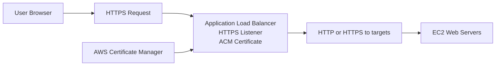

일반적으로 TLS 종료를 ALB에서 수행하면 EC2마다 인증서를 배포할 필요가 줄어듭니다.

---

## 왜 B가 정답인가?

- ACM은 인증서 발급 지원
- ALB에 직접 연결 가능
- 인증서 자동 갱신 가능
- EC2에 인증서 배포 불필요
- 운영 부담 최소

---

## 오답 설명

### A. Self-signed certificate

Self-signed 인증서는 브라우저에서 신뢰되지 않습니다.

또한 각 EC2 인스턴스마다 인증서를 관리해야 하므로 운영 부담이 큽니다.

---

### C. Secrets Manager에 인증서 저장

Secrets Manager에 인증서를 저장할 수는 있지만, 문제는 최소 운영 부담입니다.

EC2마다 인증서를 가져오고 갱신하고 웹서버에 반영하는 작업이 필요합니다.

ALB + ACM이 훨씬 단순합니다.

---

### D. KMS로 Key Pair 생성

KMS는 암호화 키 관리 서비스입니다.

TLS 인증서 발급 서비스가 아닙니다.

---

## 초보자용 기억법

> HTTPS 인증서 관리 → **ACM**

> ALB HTTPS Listener → **ACM 인증서 연결**

> 암호화 키 관리 → **KMS**

---

# Q17. Domain 2 — Design Resilient Architectures

## Question

**A company runs a stateless web application on EC2 instances in a single Availability Zone. The application experiences variable traffic throughout the day. The company wants the application to remain available if an Availability Zone fails.**

**Which solution should a solutions architect recommend?**

A. Deploy the application on larger EC2 instances in the existing Availability Zone.

B. Deploy the application in an Auto Scaling group across multiple Availability Zones behind an Application Load Balancer.

C. Create a read replica of each EC2 instance in another Availability Zone.

D. Use Amazon S3 Cross-Region Replication for the EC2 instance root volumes.

---

## 정답

**B. Deploy the application in an Auto Scaling group across multiple Availability Zones behind an Application Load Balancer.**

---

## 상세 해설

이 문제는 **Stateless Web Application의 고가용성** 문제입니다.

핵심 키워드:

```text
stateless web application
single Availability Zone
variable traffic
remain available if an AZ fails
```

Stateless 애플리케이션은 인스턴스 자체에 상태를 저장하지 않으므로 여러 AZ에 쉽게 분산할 수 있습니다.

가장 일반적인 고가용성 구성은 다음입니다.

```text
Application Load Balancer + Auto Scaling Group + Multiple AZs
```

---

## 구조 도식

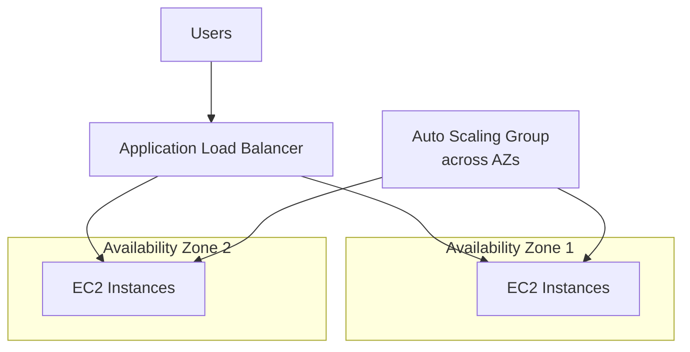

---

## 각 구성요소 역할

| 구성요소 | 역할 |
|---|---|
| ALB | 트래픽을 여러 EC2로 분산 |
| ASG | 트래픽에 따라 인스턴스 수 자동 조정 |
| Multi-AZ | AZ 장애 시에도 다른 AZ에서 서비스 유지 |

---

## 오답 설명

### A. 기존 AZ에서 큰 EC2 사용

Scale-up은 성능을 올릴 수 있지만 AZ 장애에는 무력합니다.

문제는 성능만이 아니라 다음입니다.

```text
if an Availability Zone fails
```

---

### C. EC2 Read Replica

EC2에는 RDS처럼 Read Replica 개념이 없습니다.

EC2 인스턴스는 AMI나 Launch Template으로 복제 구성할 수 있지만 "Read Replica"라는 개념은 DB에 해당합니다.

---

### D. S3 Cross-Region Replication for EC2 root volumes

EC2 Root Volume은 EBS입니다.

S3 Cross-Region Replication은 S3 객체 복제 기능입니다.

EC2 Root Volume 복제와는 맞지 않습니다.

---

## 초보자용 기억법

> Stateless Web HA → **ALB + ASG + Multi-AZ**

---

# Q18. Domain 2 — Design Resilient Architectures

## Question

**A company runs a critical application that uses an Amazon RDS for MySQL database. The company wants the database to automatically fail over to another Availability Zone if the primary database instance fails. The application does not need to scale read traffic.**

**Which solution should a solutions architect recommend?**

A. Enable Multi-AZ deployment for the RDS database.

B. Create a read replica in the same Availability Zone.

C. Create an Amazon ElastiCache cluster in front of the database.

D. Export RDS snapshots to Amazon S3 every hour.

---

## 정답

**A. Enable Multi-AZ deployment for the RDS database.**

---

## 상세 해설

이 문제는 **RDS Multi-AZ와 Read Replica 구분** 문제입니다.

핵심 조건은 다음입니다.

| 조건 | 의미 |
|---|---|
| automatically fail over | 자동 장애 조치 필요 |
| another Availability Zone | Multi-AZ 필요 |
| does not need to scale read traffic | Read Replica가 핵심 아님 |

RDS에서 고가용성과 자동 장애 조치를 제공하는 기능은 **Multi-AZ Deployment**입니다.

---

## RDS Multi-AZ 구조

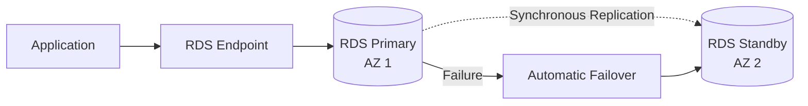

애플리케이션은 동일한 RDS Endpoint를 사용합니다.

Primary 장애가 발생하면 AWS가 Standby를 Primary로 승격합니다.

---

## Multi-AZ와 Read Replica 비교

| 구분 | Multi-AZ | Read Replica |
|---|---|---|
| 목적 | 고가용성/자동 장애 조치 | 읽기 성능 확장 |
| 복제 방식 | 동기식 | 비동기식 |
| 자동 Failover | 가능 | 기본 목적 아님 |
| 읽기 트래픽 처리 | Standby는 보통 읽기용 아님 | 읽기 처리 가능 |

---

## 오답 설명

### B. Read Replica

Read Replica는 읽기 부하 분산에 적합합니다.

하지만 문제에서 명확히 말합니다.

```text
does not need to scale read traffic
```

또한 자동 장애 조치 목적이면 Multi-AZ가 더 적합합니다.

---

### C. ElastiCache

ElastiCache는 캐싱으로 읽기 성능을 개선할 수 있습니다.

하지만 DB 장애 시 자동 Failover를 제공하는 RDS 고가용성 기능은 아닙니다.

---

### D. RDS Snapshot Export

스냅샷은 백업과 분석 용도입니다.

장애가 발생했을 때 즉시 자동 Failover를 제공하지 않습니다.

---

## 초보자용 기억법

> DB 장애 조치 → **RDS Multi-AZ**

> DB 읽기 확장 → **Read Replica**

> DB 읽기 캐싱 → **ElastiCache**

---

# Q19. Domain 2 — Design Resilient Architectures

## Question

**A company processes image uploads. Users upload images to an Amazon S3 bucket. Each image must be processed by an AWS Lambda function. The company wants a durable and decoupled architecture that can retry processing if the Lambda function temporarily fails.**

**Which solution should a solutions architect recommend?**

A. Configure S3 Event Notifications to send messages to an Amazon SQS queue. Configure Lambda to poll the SQS queue.

B. Configure the S3 bucket to invoke the Lambda function synchronously and disable retries.

C. Configure Amazon CloudFront to trigger the Lambda function when users upload images.

D. Configure the Lambda function to scan the S3 bucket every minute for new files.

---

## 정답

**A. Configure S3 Event Notifications to send messages to an Amazon SQS queue. Configure Lambda to poll the SQS queue.**

---

## 상세 해설

이 문제는 **S3 이벤트 처리 + 내구성 + 재시도** 문제입니다.

현재 요구사항:

| 조건 | 의미 |
|---|---|
| 이미지 업로드 | S3 Event 발생 |
| Lambda 처리 | 이벤트 기반 서버리스 |
| durable | 이벤트 유실 방지 |
| decoupled | S3와 Lambda 직접 결합 줄이기 |
| retry if Lambda fails | 실패 시 재처리 필요 |

S3가 바로 Lambda를 호출할 수도 있습니다.

하지만 내구성과 재처리 제어를 강화하려면 중간에 **SQS Queue**를 두는 것이 좋습니다.

---

## 구조 도식

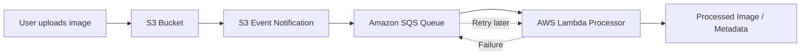

---

## 왜 SQS가 중요한가?

SQS를 중간에 두면 다음 장점이 있습니다.

- Lambda가 일시적으로 실패해도 메시지가 Queue에 남음
- 재시도 가능
- 처리량 조절 가능
- S3와 Lambda의 결합도 감소
- DLQ, Dead Letter Queue 구성 가능

---

## 오답 설명

### B. S3가 Lambda를 동기 호출하고 재시도 비활성화

S3 Event Notification은 비동기 이벤트 기반입니다.

그리고 재시도를 비활성화하면 일시적 장애 시 이벤트 유실 가능성이 커집니다.

---

### C. CloudFront Trigger

CloudFront는 콘텐츠 배포 서비스입니다.

파일 업로드 이벤트 처리의 중심 서비스가 아닙니다.

---

### D. Lambda가 S3를 매분 스캔

Polling 방식은 비효율적입니다.

- 불필요한 List 호출 증가
- 지연 발생
- 비용 증가
- 중복 처리 가능성

이벤트 기반으로 처리하는 것이 더 적합합니다.

---

## 초보자용 기억법

> S3 업로드 후 안정적 처리 → **S3 Event → SQS → Lambda**

> 단순 즉시 처리 → **S3 Event → Lambda**

> 실패 재처리/버퍼링 중요 → **SQS 추가**

---

# Q20. Domain 3 — Design High-Performing Architectures

## Question

**A company runs a high-performance computing workload that requires a shared file system with very high throughput and sub-millisecond latencies. The workload runs on Linux-based EC2 instances and uses a Lustre client.**

**Which storage service should the company use?**

A. Amazon EFS

B. Amazon FSx for Lustre

C. Amazon S3 Glacier

D. Amazon FSx for Windows File Server

---

## 정답

**B. Amazon FSx for Lustre**

---

## 상세 해설

이 문제는 **파일 스토리지 서비스 선택** 문제입니다.

핵심 키워드는 다음입니다.

```text
high-performance computing
very high throughput
sub-millisecond latencies
Linux-based EC2
Lustre client
```

이 키워드 중 가장 결정적인 것은 **Lustre client**입니다.

Lustre는 HPC, Machine Learning, Media Rendering, Financial Simulation 같은 고성능 파일 시스템 워크로드에서 사용됩니다.

AWS에서 Lustre 파일 시스템을 완전관리형으로 제공하는 서비스가 **Amazon FSx for Lustre**입니다.

---

## 파일 스토리지 비교

| 서비스 | 적합한 상황 |
|---|---|
| Amazon EFS | Linux NFS 공유 파일시스템, 범용 |
| FSx for Lustre | HPC, 고성능 처리, Lustre |
| FSx for Windows File Server | Windows SMB |
| S3 | 객체 스토리지 |
| S3 Glacier | 아카이브 |

---

## 구조 도식

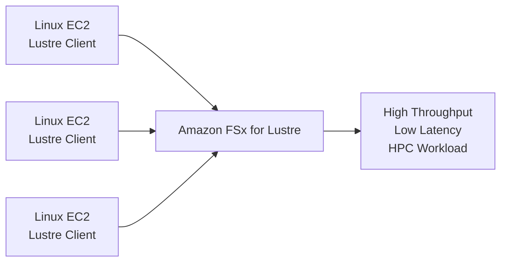

---

## 오답 설명

### A. Amazon EFS

EFS는 Linux 환경의 공유 파일 시스템으로 매우 자주 쓰입니다.

하지만 문제에서 **Lustre client**와 **HPC급 고성능**을 요구하므로 FSx for Lustre가 더 정확합니다.

EFS는 범용 NFS 파일 시스템입니다.

---

### C. S3 Glacier

S3 Glacier는 아카이브 스토리지입니다.

고성능 파일 시스템이 아닙니다.

---

### D. FSx for Windows File Server

Windows SMB 파일 공유용입니다.

문제는 Linux + Lustre입니다.

---

## 초보자용 기억법

> Linux 공유 파일 → **EFS**

> Windows 공유 파일 → **FSx for Windows**

> Lustre/HPC → **FSx for Lustre**

> NetApp ONTAP 필요 → **FSx for NetApp ONTAP**

---

# Q21. Domain 3 — Design High-Performing Architectures

## Question

**A company runs a gaming leaderboard application. The application requires single-digit millisecond latency at any scale. The workload uses key-value access patterns and must handle unpredictable traffic spikes.**

**Which database service and capacity mode should a solutions architect recommend?**

A. Amazon RDS for MySQL with Provisioned IOPS

B. Amazon DynamoDB with on-demand capacity mode

C. Amazon Redshift with concurrency scaling

D. Amazon Aurora Serverless v2

---

## 정답

**B. Amazon DynamoDB with on-demand capacity mode**

---

## 상세 해설

이 문제는 **NoSQL Key-Value + 초저지연 + 예측 불가능 트래픽** 문제입니다.

핵심 키워드:

```text
gaming leaderboard
single-digit millisecond latency
key-value access patterns
unpredictable traffic spikes
```

이 조합이면 **DynamoDB**가 매우 강한 후보입니다.

DynamoDB는 완전관리형 NoSQL 데이터베이스로, Key-Value 및 Document 데이터 모델에 적합합니다.

단일 자릿수 millisecond latency를 목표로 설계되어 있습니다.

트래픽이 예측 불가능하면 **On-Demand Capacity Mode**가 적합합니다.

---

## DynamoDB Capacity Mode 비교

| 모드 | 적합한 상황 |
|---|---|
| Provisioned | 트래픽 예측 가능, 비용 최적화 |
| On-Demand | 트래픽 예측 어려움, 갑작스러운 스파이크 |
| Provisioned + Auto Scaling | 예측 가능하지만 변동 있음 |

---

## 구조 도식

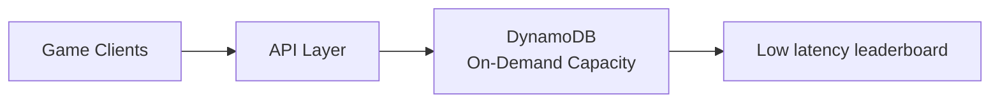

---

## 오답 설명

### A. RDS MySQL with Provisioned IOPS

RDS는 관계형 데이터베이스입니다.

복잡한 SQL, 트랜잭션, 조인에는 좋습니다.

하지만 문제는 Key-Value 기반의 초저지연 대규모 트래픽입니다.

Leaderboard처럼 특정 사용자/점수 키 기반 조회에는 DynamoDB가 더 적합합니다.

---

### C. Redshift

Redshift는 데이터웨어하우스입니다.

분석 쿼리, BI, 대규모 집계에 적합합니다.

실시간 게임 Leaderboard의 단일 자릿수 ms 응답에는 적합하지 않습니다.

---

### D. Aurora Serverless v2

Aurora Serverless v2는 관계형 DB를 자동 확장하는 데 좋습니다.

하지만 Key-Value 초저지연 워크로드에는 DynamoDB가 더 직접적인 정답입니다.

---

## 초보자용 기억법

> Key-Value + 초저지연 + 대규모 확장 → **DynamoDB**

> 예측 불가 트래픽 → **On-Demand**

> 예측 가능 트래픽 → **Provisioned + Auto Scaling**

---

# Q22. Domain 3 — Design High-Performing Architectures

## Question

**A company has users around the world who connect to a latency-sensitive application hosted behind Network Load Balancers in multiple AWS Regions. The company wants to route users to the nearest healthy endpoint over the AWS global network and improve TCP/UDP performance.**

**Which service should the company use?**

A. Amazon CloudFront

B. AWS Global Accelerator

C. Amazon Route 53 simple routing

D. AWS Direct Connect

---

## 정답

**B. AWS Global Accelerator**

---

## 상세 해설

이 문제는 **CloudFront와 Global Accelerator 구분** 문제입니다.

핵심 키워드:

```text
latency-sensitive application
Network Load Balancers
multiple AWS Regions
nearest healthy endpoint
AWS global network
TCP/UDP performance
```

이 조건이면 **AWS Global Accelerator**가 적합합니다.

Global Accelerator는 Anycast 고정 IP를 제공하고, AWS 글로벌 네트워크를 통해 사용자를 가장 가까운 정상 엔드포인트로 라우팅합니다.

특히 TCP/UDP 애플리케이션 성능 개선에 적합합니다.

---

## CloudFront vs Global Accelerator

| 구분 | CloudFront | Global Accelerator |
|---|---|---|
| 주 용도 | HTTP/HTTPS 콘텐츠 캐싱 | TCP/UDP 글로벌 가속 |
| 캐싱 | 가능 | 없음 |
| 대상 | 정적/동적 웹 콘텐츠 | ALB, NLB, EC2, Elastic IP |
| IP | CloudFront 도메인 | Anycast 고정 IP |
| 적합 | 이미지, JS, CSS, 웹 콘텐츠 | 게임, VoIP, TCP/UDP 앱, 글로벌 API |

---

## 구조 도식

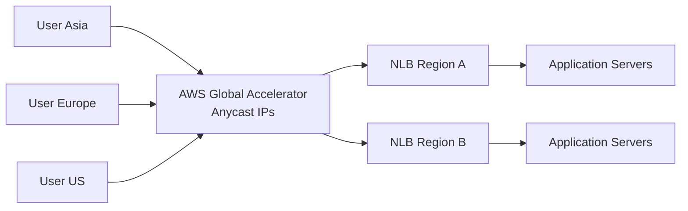

---

## 오답 설명

### A. CloudFront

CloudFront는 CDN입니다.

정적 콘텐츠 캐싱, HTTP/HTTPS 웹 콘텐츠 전송에 매우 좋습니다.

하지만 문제에서 TCP/UDP, NLB, latency-sensitive global application을 말하고 있으므로 Global Accelerator가 더 적합합니다.

---

### C. Route 53 Simple Routing

Simple Routing은 단순 DNS 응답입니다.

Health 기반 글로벌 성능 최적화, AWS 글로벌 네트워크 가속을 제공하지 않습니다.

Route 53 Latency Routing이나 Failover Routing은 일부 요구에 도움이 될 수 있지만, TCP/UDP 성능 개선과 Anycast 고정 IP는 Global Accelerator 영역입니다.

---

### D. Direct Connect

Direct Connect는 온프레미스 데이터센터와 AWS 간 전용선입니다.

전 세계 인터넷 사용자 대상 글로벌 가속 서비스가 아닙니다.

---

## 초보자용 기억법

> 웹 콘텐츠 캐싱 → **CloudFront**

> 글로벌 TCP/UDP 성능 개선 → **Global Accelerator**

> DNS 기반 라우팅 → **Route 53**

> 회사망과 AWS 전용선 → **Direct Connect**

---

# Q23. Domain 4 — Design Cost-Optimized Architectures

## Question

**A company stores log files in Amazon S3. The logs are frequently accessed for the first 30 days. After 30 days, the logs are rarely accessed but must be retained for 7 years for compliance. Retrieval time of several hours is acceptable after the first 30 days.**

**Which solution is the MOST cost-effective?**

A. Store all logs in S3 Standard for 7 years.

B. Use an S3 Lifecycle policy to transition logs to S3 Glacier Flexible Retrieval after 30 days.

C. Use S3 Intelligent-Tiering for all logs and disable archive tiers.

D. Store all logs on Amazon EFS and create daily backups.

---

## 정답

**B. Use an S3 Lifecycle policy to transition logs to S3 Glacier Flexible Retrieval after 30 days.**

---

## 상세 해설

이 문제는 **S3 Lifecycle 비용 최적화** 문제입니다.

핵심 조건:

| 조건 | 의미 |
|---|---|
| first 30 days frequently accessed | 처음 30일은 S3 Standard 적합 |
| after 30 days rarely accessed | 이후 저비용 스토리지로 이동 |
| retained for 7 years | 장기 보관 |
| retrieval time of several hours acceptable | Glacier 계열 가능 |
| MOST cost-effective | 수명주기 정책 사용 |

따라서 30일 후 Glacier Flexible Retrieval로 전환하는 Lifecycle Policy가 적합합니다.

---

## 구조 도식

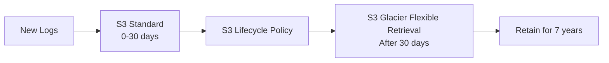

---

## 왜 Glacier Flexible Retrieval인가?

Glacier Flexible Retrieval은 자주 접근하지 않는 아카이브 데이터를 저렴하게 보관하는 데 적합합니다.

복원 시간이 몇 분~몇 시간 걸릴 수 있지만, 문제에서 "several hours acceptable"이라고 했으므로 적합합니다.

---

## 오답 설명

### A. S3 Standard에 7년 보관

S3 Standard는 자주 접근하는 데이터에는 좋지만, 7년 동안 거의 접근하지 않는 로그를 계속 Standard에 두면 비용이 높습니다.

---

### C. S3 Intelligent-Tiering

접근 패턴이 불명확하면 좋은 선택입니다.

하지만 이 문제는 접근 패턴이 명확합니다.

```text
30일 이후 거의 접근하지 않음
몇 시간 복원 허용
```

이 경우 Lifecycle로 Glacier로 보내는 것이 더 비용 최적화에 직접적입니다.

---

### D. EFS + Backup

EFS는 공유 파일 시스템입니다.

장기 로그 아카이브 저장소로는 S3 Glacier 계열이 훨씬 적합합니다.

---

## 초보자용 기억법

> 접근 패턴 명확 → **S3 Lifecycle**

> 접근 패턴 불명확 → **S3 Intelligent-Tiering**

> 장기 보관 + 복원 시간 허용 → **Glacier**

---

# Q24. Domain 4 — Design Cost-Optimized Architectures

## Question

**A company runs containerized batch jobs on Amazon ECS. The jobs are fault-tolerant and can be interrupted. The company wants to reduce compute costs as much as possible.**

**Which solution should a solutions architect recommend?**

A. Run ECS tasks on On-Demand EC2 instances only.

B. Run ECS tasks on EC2 Spot Instances or use Fargate Spot.

C. Run ECS tasks on Dedicated Hosts.

D. Purchase Reserved Instances for peak capacity.

---

## 정답

**B. Run ECS tasks on EC2 Spot Instances or use Fargate Spot.**

---

## 상세 해설

이 문제는 **중단 가능한 컨테이너 배치 작업의 비용 최적화** 문제입니다.

핵심 키워드:

```text
containerized batch jobs
fault-tolerant
can be interrupted
reduce compute costs as much as possible
```

이런 조건에서는 Spot이 가장 강력한 정답 후보입니다.

Spot은 AWS의 남는 컴퓨팅 용량을 저렴하게 사용하는 방식입니다.

단, AWS가 용량을 회수할 수 있으므로 작업이 중단될 수 있습니다.

문제에서는 명확히 말합니다.

```text
can be interrupted
fault-tolerant
```

따라서 Spot을 사용할 수 있습니다.

---

## 선택 가능한 구성

### ECS on EC2 Spot

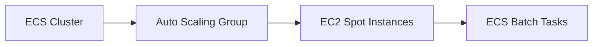

### Fargate Spot

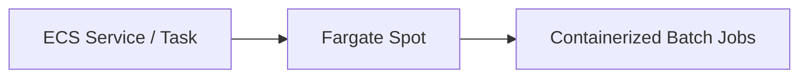

---

## 왜 B가 정답인가?

- 작업이 중단 가능
- 배치 작업
- Fault-tolerant
- 비용 최소화 요구

이 조건이면 Spot이 가장 비용 효율적입니다.

---

## 오답 설명

### A. On-Demand만 사용

On-Demand는 안정적이지만 비용이 높습니다.

중단 가능 작업에서는 Spot이 더 적합합니다.

---

### C. Dedicated Hosts

Dedicated Hosts는 전용 물리 서버가 필요한 경우 사용합니다.

예:

- 소켓/코어 기반 라이선스
- 규제 요구
- 물리 서버 격리 필요

배치 비용 절감 목적에는 부적합합니다.

---

### D. Peak Capacity 기준 Reserved Instances 구매

Reserved Instances는 장기적으로 지속 사용되는 용량에 적합합니다.

Peak 기준으로 RI를 구매하면 평상시에 과다 비용이 발생할 수 있습니다.

---

## 초보자용 기억법

> 중단 가능 + 비용 최소화 → **Spot**

> 중단 불가 + 일시적 피크 → **On-Demand**

> 장기 지속 사용 → **Savings Plans / Reserved Instances**

---

# Set 2 정답표

| 번호 | 도메인 | 정답 |
|---:|---|---|
| Q13 | Secure | A |
| Q14 | Secure | B |
| Q15 | Secure | B |
| Q16 | Secure | B |
| Q17 | Resilient | B |
| Q18 | Resilient | A |
| Q19 | Resilient | A |
| Q20 | High-Performing | B |
| Q21 | High-Performing | B |
| Q22 | High-Performing | B |
| Q23 | Cost-Optimized | B |
| Q24 | Cost-Optimized | B |

---

# Set 2 핵심 요약

| 주제 | 정답 패턴 |
|---|---|
| S3 암호화, AWS가 키 관리, 최소 운영 | SSE-S3 |
| S3 암호화, 키 감사/정책 제어 | SSE-KMS + Customer Managed Key |
| S3를 VPC Endpoint로만 접근 | S3 Gateway Endpoint + `aws:SourceVpce` |
| HTTPS 인증서 관리 | ACM + ALB Listener |
| Stateless Web App 고가용성 | ALB + ASG + Multi-AZ |
| RDS 자동 장애 조치 | RDS Multi-AZ |
| S3 이벤트 안정적 처리 | S3 Event → SQS → Lambda |
| Lustre/HPC 파일시스템 | FSx for Lustre |
| Key-Value, 초저지연, 예측 불가 트래픽 | DynamoDB On-Demand |
| 글로벌 TCP/UDP 성능 | Global Accelerator |
| 로그 장기 보관 비용 최적화 | S3 Lifecycle → Glacier |
| 중단 가능한 배치 컨테이너 | Spot / Fargate Spot |

---

# Set 1 + Set 2에서 특히 자주 헷갈리는 비교표

## 1. SSE-S3 vs SSE-KMS vs SSE-C

| 구분 | SSE-S3 | SSE-KMS | SSE-C |
|---|---|---|---|
| 키 관리 | S3 | KMS | 고객 |
| 운영 부담 | 가장 낮음 | 중간 | 높음 |
| 감사/CloudTrail | 제한적 | 강함 | KMS 감사 아님 |
| Key Policy | 없음 | 있음 | 없음 |
| 시험 키워드 | least overhead | audit, key policy | customer-provided key |

---

## 2. RDS Multi-AZ vs Read Replica

| 구분 | RDS Multi-AZ | Read Replica |
|---|---|---|
| 목적 | 고가용성 | 읽기 확장 |
| 장애 조치 | 자동 Failover | 수동 승격 가능 |
| 읽기 처리 | 일반적으로 안 함 | 가능 |
| 복제 방식 | 동기식 | 비동기식 |
| 시험 키워드 | automatic failover | read-heavy |

---

## 3. CloudFront vs Global Accelerator

| 구분 | CloudFront | Global Accelerator |
|---|---|---|
| 목적 | CDN 캐싱 | 글로벌 네트워크 가속 |
| 프로토콜 | HTTP/HTTPS 중심 | TCP/UDP |
| 캐싱 | 가능 | 불가 |
| 대상 | 웹 콘텐츠 | ALB/NLB/EC2/EIP |
| 시험 키워드 | static content, images, CSS | TCP/UDP, NLB, static IP |

---

## 4. NAT Gateway vs VPC Endpoint

| 구분 | NAT Gateway | VPC Endpoint |
|---|---|---|
| 목적 | Private Subnet의 인터넷 outbound | AWS 서비스에 private 접근 |
| Public Internet 경유 | 예 | 아니오 |
| 비용 | NAT 처리 비용 발생 | 서비스별 비용 구조 |
| S3 접근 최적화 | 비추천 | Gateway Endpoint 추천 |
| 시험 키워드 | OS patch, internet access | S3 private access, reduce NAT cost |
