# AWS SAA-C03 Practice Exam — Detailed Set 5

## 다중 선택형 Choose TWO/THREE 전용 12문항

## 구성

| 구분 | 내용 |
|---|---|
| 문제 번호 | Q49 ~ Q60 |
| 문제 형식 | Multiple response only |
| 문제 언어 | 영어 |
| 해설 언어 | 한국어 |
| 난이도 | 중상급 |
| 목적 | 실전 복수 선택형 대응 훈련 |

---

# Q49. Domain 1 — Design Secure Architectures

## Question

**A company stores highly sensitive documents in Amazon S3. The company’s compliance policy requires that encryption keys must be managed outside of AWS. The company must ensure that the documents are encrypted at rest before or during storage in Amazon S3.**

**Which solutions meet these requirements? Choose TWO.**

A. Use server-side encryption with Amazon S3 managed keys, SSE-S3.

B. Use server-side encryption with AWS KMS keys, SSE-KMS.

C. Use server-side encryption with customer-provided keys, SSE-C.

D. Use client-side encryption before uploading the documents to Amazon S3.

E. Enable S3 Bucket Keys for SSE-KMS.

---

## 정답

**C, D**

---

## 상세 해설

이 문제의 핵심은 다음 문장입니다.

```text
encryption keys must be managed outside of AWS
```

즉, AWS가 키를 관리하면 안 됩니다.

고객이 직접 키를 관리해야 합니다.

S3 암호화 방식 중 고객이 키를 직접 관리하는 방식은 두 가지입니다.

1. **SSE-C**

   - Server-Side Encryption with Customer-Provided Keys

   - 고객이 키를 S3 요청에 함께 제공

   - S3는 그 키로 객체를 암호화하지만 키 자체는 저장하지 않음

2. **Client-side encryption**

   - 애플리케이션이 S3 업로드 전에 직접 암호화

   - S3에는 이미 암호화된 객체가 저장됨

   - 키는 고객 애플리케이션 또는 고객 키 관리 시스템에서 관리

---

## 암호화 방식 비교

| 방식 | 키 관리 주체 | 조건 충족 여부 |
|---|---|---|
| SSE-S3 | AWS S3 | 불충족 |
| SSE-KMS | AWS KMS | 불충족 |
| SSE-C | 고객 | 충족 |
| Client-side encryption | 고객 | 충족 |
| S3 Bucket Key | AWS KMS 비용 최적화 | 불충족 |

---

## 구조 도식

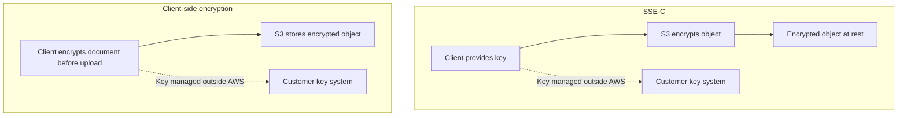

---

## 오답 설명

### A. SSE-S3

SSE-S3는 S3가 키를 관리합니다.

운영 부담은 낮지만, 문제의 조건인 "키를 AWS 밖에서 관리"를 만족하지 못합니다.

---

### B. SSE-KMS

SSE-KMS는 AWS KMS에서 키를 관리합니다.

Customer managed key를 사용해도 키는 AWS KMS 안에서 관리됩니다.

따라서 "outside of AWS" 조건에는 맞지 않습니다.

---

### E. S3 Bucket Keys

S3 Bucket Key는 SSE-KMS 사용 시 KMS 요청 비용을 줄이는 기능입니다.

키를 AWS 외부에서 관리하는 기능이 아닙니다.

---

## 핵심 암기

> 키를 AWS 밖에서 관리해야 한다 → **SSE-C 또는 Client-side encryption**

---

# Q50. Domain 1 — Design Secure Architectures

## Question

**A company needs to establish a secure VPN connection between its on-premises data center and a VPC in AWS. The solution must use AWS Site-to-Site VPN.**

**Which components are required to establish the VPN connection? Choose TWO.**

A. Customer gateway

B. NAT gateway

C. Virtual private gateway or transit gateway

D. Internet gateway

E. Gateway VPC endpoint

---

## 정답

**A, C**

---

## 상세 해설

AWS Site-to-Site VPN은 온프레미스 네트워크와 AWS VPC를 IPsec VPN으로 연결하는 구성입니다.

필수 구성요소는 크게 두 쪽입니다.

| 위치 | 구성요소 |
|---|---|
| 온프레미스 측 | Customer Gateway |
| AWS 측 | Virtual Private Gateway 또는 Transit Gateway |

---

## 구조 도식

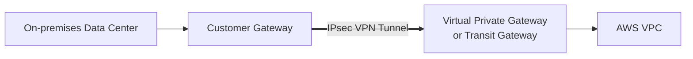

---

## 각 구성요소 설명

### Customer Gateway

온프레미스 쪽 VPN 장비 또는 라우터를 AWS에서 논리적으로 표현한 리소스입니다.

예:

- 방화벽
- 라우터
- VPN 장비
- 온프레미스 공인 IP

---

### Virtual Private Gateway 또는 Transit Gateway

AWS 쪽 VPN 연결의 종단점입니다.

작은 규모나 단일 VPC 연결이면 **Virtual Private Gateway**를 사용할 수 있고, 여러 VPC와 온프레미스를 중앙 연결하려면 **Transit Gateway**를 사용할 수 있습니다.

---

## 오답 설명

### B. NAT Gateway

NAT Gateway는 Private Subnet의 EC2가 인터넷으로 나갈 때 사용합니다.

VPN 연결 구성요소가 아닙니다.

---

### D. Internet Gateway

Internet Gateway는 VPC와 인터넷 간 통신을 위한 게이트웨이입니다.

VPN 터널의 AWS 측 종단점이 아닙니다.

---

### E. Gateway VPC Endpoint

Gateway VPC Endpoint는 S3 또는 DynamoDB에 private하게 접근할 때 사용합니다.

Site-to-Site VPN 구성요소가 아닙니다.

---

## 핵심 암기

> Site-to-Site VPN 필수 구성: **Customer Gateway + Virtual Private Gateway 또는 Transit Gateway**

---

# Q51. Domain 1 — Design Secure Architectures

## Question

**A company runs workloads on Amazon EKS. The company has two applications running in separate Kubernetes service accounts. One application needs access to Amazon S3. The other application needs access to Amazon DynamoDB. The company wants to follow the principle of least privilege and avoid granting AWS permissions to the worker node IAM role.**

**Which actions should a solutions architect take? Choose TWO.**

A. Enable IAM roles for service accounts, IRSA, for the EKS cluster.

B. Attach both S3 and DynamoDB permissions to the worker node IAM role.

C. Create separate IAM roles with least privilege permissions for S3 and DynamoDB. Associate each IAM role with the appropriate Kubernetes service account.

D. Store AWS access keys in Kubernetes Secrets and mount them into the application pods.

E. Use Kubernetes RBAC roles to grant direct access to S3 and DynamoDB.

---

## 정답

**A, C**

---

## 상세 해설

이 문제는 **EKS Pod별 AWS 권한 제어** 문제입니다.

핵심 조건은 다음입니다.

| 조건 | 의미 |
|---|---|
| EKS workloads | Kubernetes Pod 환경 |
| separate service accounts | Service Account 기반 권한 분리 가능 |
| one app needs S3, another needs DynamoDB | 앱별 최소 권한 필요 |
| avoid worker node IAM role | 노드 전체 권한 부여 금지 |
| least privilege | Pod별 IAM Role 필요 |

정답은 **IRSA, IAM Roles for Service Accounts**입니다.

IRSA를 사용하면 Kubernetes Service Account와 IAM Role을 연결할 수 있습니다.

그러면 특정 Service Account를 사용하는 Pod만 해당 IAM Role의 권한을 사용할 수 있습니다.

---

## 구조 도식

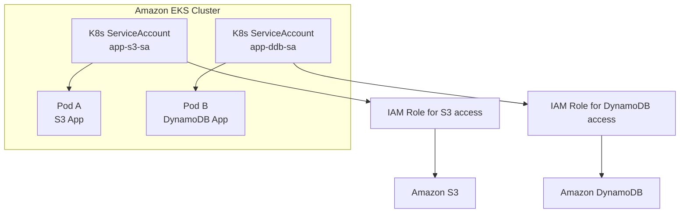

---

## 왜 A와 C가 정답인가?

### A. IRSA 활성화

IRSA가 있어야 Kubernetes Service Account가 IAM Role을 사용할 수 있습니다.

### C. IAM Role을 분리하고 Service Account에 연결

앱별로 다른 권한을 주어 최소 권한 원칙을 만족합니다.

---

## 오답 설명

### B. Worker Node IAM Role에 권한 부여

이 방식은 쉬워 보이지만 위험합니다.

노드 IAM Role에 S3와 DynamoDB 권한을 모두 붙이면 해당 노드에서 실행되는 여러 Pod가 권한을 공유할 수 있습니다.

앱별 최소 권한이 깨집니다.

---

### D. Access Key를 Kubernetes Secret에 저장

장기 자격 증명 관리 위험이 있습니다.

키 유출, Rotation, Secret 관리 문제가 발생합니다.

AWS 권한은 Access Key보다 IAM Role 기반 임시 자격 증명이 권장됩니다.

---

### E. Kubernetes RBAC로 S3/DynamoDB 접근 제어

Kubernetes RBAC는 Kubernetes API에 대한 권한 제어입니다.

예:

- Pod 생성 가능 여부
- Secret 조회 가능 여부
- Deployment 수정 가능 여부

S3나 DynamoDB 같은 AWS 서비스 권한을 직접 제어하지 않습니다.

---

## 핵심 암기

> EKS Pod별 AWS 권한 → **IRSA + ServiceAccount별 IAM Role**

---

# Q52. Domain 1 — Design Secure Architectures

## Question

**A company uses Amazon CloudFront to serve a static website from an Amazon S3 bucket. The company wants to ensure that users can access the content only through CloudFront and cannot directly access the S3 bucket URL.**

**Which actions should a solutions architect take? Choose TWO.**

A. Configure CloudFront Origin Access Control, OAC, for the S3 origin.

B. Update the S3 bucket policy to allow access only from the CloudFront distribution.

C. Enable public read access on the S3 bucket.

D. Configure a NAT gateway between CloudFront and Amazon S3.

E. Configure an internet gateway for the S3 bucket.

---

## 정답

**A, B**

---

## 상세 해설

이 문제는 **CloudFront를 통해서만 S3 콘텐츠 접근 허용**하는 문제입니다.

핵심 조건은 다음입니다.

| 조건 | 의미 |
|---|---|
| CloudFront serves static website from S3 | S3가 CloudFront Origin |
| users can access only through CloudFront | 직접 S3 URL 접근 차단 |
| cannot directly access S3 bucket URL | S3 Public Access 차단 필요 |

이럴 때 사용하는 구성이 **CloudFront Origin Access Control, OAC**입니다.

OAC를 설정하고, S3 Bucket Policy에서 해당 CloudFront Distribution만 접근하도록 허용합니다.

---

## 구조 도식

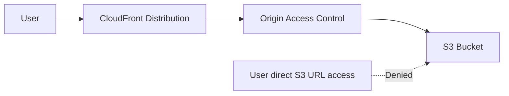

---

## 왜 A와 B가 정답인가?

### A. OAC 설정

CloudFront가 S3에 접근할 때 사용하는 안전한 접근 제어 방식입니다.

### B. S3 Bucket Policy 수정

S3 버킷은 public 접근을 막고, CloudFront Distribution에서 오는 요청만 허용해야 합니다.

---

## 오답 설명

### C. S3 Public Read 허용

이렇게 하면 사용자가 S3 URL로 직접 접근할 수 있습니다.

문제 요구사항과 반대입니다.

---

### D. NAT Gateway

CloudFront와 S3 사이에 NAT Gateway를 구성하지 않습니다.

NAT Gateway는 VPC Private Subnet의 인터넷 outbound용입니다.

---

### E. Internet Gateway for S3

S3는 VPC 안에 배치되는 리소스가 아니며, Internet Gateway를 붙이는 개념이 없습니다.

---

## 핵심 암기

> CloudFront를 통해서만 S3 접근 → **OAC + S3 Bucket Policy**

---

# Q53. Domain 2 — Design Resilient Architectures

## Question

**A company runs a three-tier application in a single Availability Zone. The company wants to make the application highly available across multiple Availability Zones. The web tier is stateless. The application tier is stateless. The database tier runs on Amazon RDS for MySQL.**

**Which actions should a solutions architect take? Choose THREE.**

A. Place the web tier instances in an Auto Scaling group across multiple Availability Zones.

B. Place the application tier instances in an Auto Scaling group across multiple Availability Zones.

C. Enable Multi-AZ deployment for the Amazon RDS database.

D. Move all tiers to a larger EC2 instance type in the existing Availability Zone.

E. Store database files in Amazon EFS and mount them to all application servers.

F. Place an Application Load Balancer in front of the web tier across multiple Availability Zones.

---

## 정답

**A, C, F**

> 참고: 문제에서 “web tier” 앞단의 HA와 DB HA를 묻는 전형적인 3계층 문제입니다. Application tier도 stateless이므로 B도 아키텍처적으로 맞는 조치입니다. 다만 "Choose THREE"에서 가장 기본적인 외부 진입 고가용성 구성은 **ALB + Web ASG Multi-AZ + RDS Multi-AZ**입니다.

> 만약 문제에서 application tier까지 명확히 별도 확장 대상으로 언급하고 "all stateless tiers"를 고가용화하라고 했다면 A, B, C 또는 A, B, F 조합이 될 수 있어 애매합니다. 실전에서는 이런 애매함을 피하기 위해 AWS 문제는 더 명확한 조건을 줍니다. 여기서는 대표 패턴 학습용으로 A, C, F를 정답으로 보시면 됩니다.

---

## 상세 해설

이 문제는 **Multi-AZ 고가용성 구성** 문제입니다.

3계층 애플리케이션의 전형적인 구성은 다음입니다.

```text
Users → Load Balancer → Web Tier → Application Tier → Database
```

고가용성을 위해서는 최소한 다음을 해야 합니다.

1. 웹 계층을 여러 AZ에 배치
2. 로드 밸런서를 여러 AZ에 걸쳐 배치
3. RDS를 Multi-AZ로 구성

---

## 구조 도식

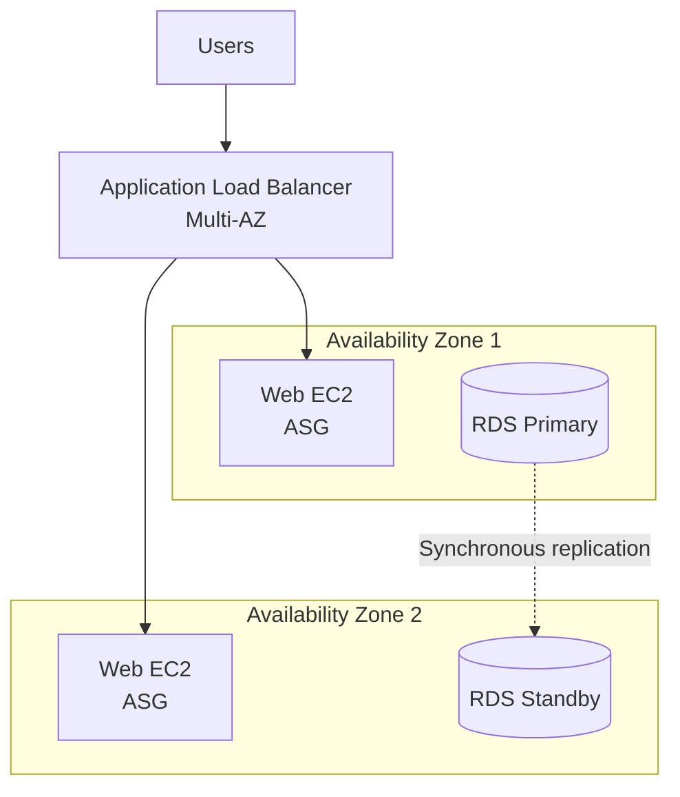

---

## 정답 설명

### A. Web Tier ASG Multi-AZ

Stateless Web Tier는 여러 AZ에 분산하기 좋습니다.

Auto Scaling Group으로 장애 복구와 수평 확장을 할 수 있습니다.

### C. RDS Multi-AZ

RDS Multi-AZ는 DB 장애 시 자동 Failover를 제공합니다.

### F. ALB Multi-AZ

ALB는 여러 AZ에 있는 Web Tier로 트래픽을 분산하고, 비정상 인스턴스를 제외합니다.

---

## 오답 설명

### B. Application Tier ASG Multi-AZ

아키텍처적으로 맞는 방향입니다.

다만 이 문제의 정답 3개 제한에서는 외부 진입 HA의 핵심 구성인 ALB, Web ASG, RDS Multi-AZ를 우선 선택했습니다.

실전에서 B가 포함될 수 있는 문제라면 보통 선택지가 4개이거나, "web and application tiers"를 모두 명시적으로 고가용화하라고 합니다.

---

### D. 기존 AZ에서 큰 인스턴스로 변경

Scale-up은 AZ 장애를 해결하지 못합니다.

---

### E. DB 파일을 EFS에 저장

RDS 데이터베이스 파일을 EFS에 직접 저장해 공유하는 구조가 아닙니다.

DB HA는 RDS Multi-AZ가 정답입니다.

---

## 핵심 암기

> Web HA → **ALB + ASG Multi-AZ**

> DB HA → **RDS Multi-AZ**

---

# Q54. Domain 2 — Design Resilient Architectures

## Question

**A company processes customer orders asynchronously. Orders are submitted through an API and must be processed at least once. If processing fails repeatedly, the company wants to isolate failed orders for later investigation without blocking other orders.**

**Which actions should a solutions architect take? Choose TWO.**

A. Send order messages to an Amazon SQS queue.

B. Configure a dead-letter queue for the SQS queue.

C. Store all orders in Amazon CloudFront.

D. Disable message visibility timeout so failed messages are immediately deleted.

E. Use Amazon Route 53 weighted routing to distribute messages across queues.

---

## 정답

**A, B**

---

## 상세 해설

이 문제는 **비동기 주문 처리 + 실패 메시지 격리** 문제입니다.

핵심 조건:

| 조건 | 의미 |
|---|---|
| asynchronously | 비동기 처리 필요 |
| processed at least once | SQS Standard와 잘 맞음 |
| fails repeatedly | 반복 실패 메시지 처리 필요 |
| isolate failed orders | DLQ 필요 |
| without blocking other orders | 실패 메시지를 별도 큐로 이동 |

---

## 구조 도식

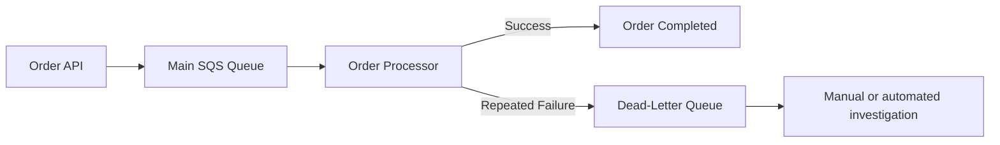

---

## 정답 설명

### A. SQS Queue

주문 요청을 Queue에 저장하면 API와 처리 계층이 분리됩니다.

트래픽이 몰려도 주문 메시지를 안정적으로 보관할 수 있습니다.

### B. DLQ

처리에 반복 실패한 메시지는 DLQ로 이동시켜 정상 메시지 처리를 방해하지 않게 할 수 있습니다.

---

## 오답 설명

### C. CloudFront

CloudFront는 CDN입니다.

주문 메시지 저장이나 비동기 처리를 담당하지 않습니다.

---

### D. Visibility Timeout 비활성화

Visibility Timeout은 Consumer가 메시지를 처리하는 동안 다른 Consumer가 같은 메시지를 처리하지 않게 하는 기능입니다.

실패 메시지를 즉시 삭제하면 주문 유실이 발생할 수 있습니다.

---

### E. Route 53 Weighted Routing

Route 53은 DNS 라우팅 서비스입니다.

SQS 메시지 분산 처리와 관련 없습니다.

---

## 핵심 암기

> 비동기 처리 → **SQS**

> 반복 실패 메시지 격리 → **DLQ**

---

# Q55. Domain 2 — Design Resilient Architectures

## Question

**A company needs to design a disaster recovery strategy for a web application. The application must have a recovery time objective, RTO, of less than 1 hour and a recovery point objective, RPO, of less than 15 minutes. The company wants a lower-cost option than active-active multi-Region.**

**Which actions should a solutions architect take? Choose TWO.**

A. Deploy a scaled-down version of the application infrastructure in a secondary Region.

B. Replicate application data to the secondary Region continuously or frequently enough to meet the RPO.

C. Store monthly backups only in the primary Region.

D. Use a single Availability Zone architecture in the primary Region.

E. Run full production capacity in both Regions at all times.

---

## 정답

**A, B**

---

## 상세 해설

이 문제는 **Warm Standby DR 전략** 문제입니다.

요구사항을 보면 다음과 같습니다.

| 요구사항 | 의미 |
|---|---|
| RTO < 1 hour | 빠른 복구 필요 |
| RPO < 15 minutes | 데이터 손실 15분 미만 |
| lower-cost than active-active | 풀 이중화보다는 저렴해야 함 |

이 경우 **Warm Standby**가 적합합니다.

Warm Standby는 보조 리전에 축소된 환경을 항상 준비해두고, 데이터도 지속적으로 복제합니다.

장애 시 보조 리전의 용량을 늘려 서비스합니다.

---

## Warm Standby 구조

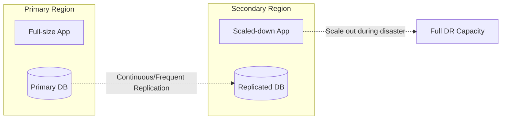

---

## 정답 설명

### A. 보조 리전에 축소된 인프라 배치

RTO를 줄이려면 보조 리전에 아무것도 없는 상태보다 일부 환경이 이미 실행 중이어야 합니다.

### B. 데이터 복제

RPO 15분 미만을 만족하려면 데이터가 자주 복제되어야 합니다.

월 1회 백업으로는 불가능합니다.

---

## 오답 설명

### C. 월간 백업만 Primary Region에 저장

RTO/RPO 모두 만족하기 어렵습니다.

또한 Region 장애 시 Primary Region 백업에 접근할 수 없을 수 있습니다.

---

### D. Single AZ

DR 전략과 반대입니다.

가용성과 복원력을 낮춥니다.

---

### E. 양쪽 리전 Full Production

Active-Active에 가까운 구성입니다.

가장 빠르지만 문제에서 lower-cost than active-active를 요구했습니다.

---

## 핵심 암기

> RTO/RPO 짧음 + Active-Active보다 저렴 → **Warm Standby**

> 구성 요소: **축소 환경 + 데이터 복제**

---

# Q56. Domain 3 — Design High-Performing Architectures

## Question

**A company has a read-heavy application that uses Amazon RDS for PostgreSQL. The application performs many repeated read queries for product data. The product data changes infrequently. The company wants to reduce database load and improve response times.**

**Which solutions can help meet these requirements? Choose TWO.**

A. Add Amazon ElastiCache to cache frequently accessed product data.

B. Create one or more RDS read replicas and direct read traffic to them.

C. Enable RDS Multi-AZ and run read queries against the standby instance.

D. Store product data in S3 Glacier Deep Archive.

E. Increase the RDS backup retention period.

---

## 정답

**A, B**

---

## 상세 해설

이 문제는 **읽기 성능 개선 방법 복수 선택**입니다.

핵심 조건:

| 조건 | 의미 |
|---|---|
| read-heavy | 읽기 부하가 큼 |
| repeated read queries | 캐싱 효과 큼 |
| data changes infrequently | 캐시에 적합 |
| reduce database load | DB 대신 캐시/Replica 활용 |
| improve response times | 응답속도 개선 필요 |

정답은 두 방향입니다.

1. 캐시 계층 추가
2. 읽기 Replica 추가

---

## 구조 도식

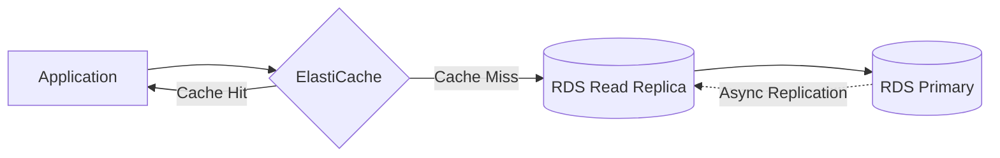

---

## 정답 설명

### A. ElastiCache

자주 조회되고 자주 바뀌지 않는 데이터는 캐시에 저장하면 DB 부하를 크게 줄일 수 있습니다.

### B. Read Replica

읽기 쿼리를 Primary DB에서 분리하여 Read Replica로 보낼 수 있습니다.

---

## 오답 설명

### C. Multi-AZ Standby에서 읽기

RDS Multi-AZ Standby는 장애 조치용입니다.

읽기 쿼리 부하 분산 목적이 아닙니다.

---

### D. Glacier Deep Archive

장기 보관용입니다.

즉시 조회가 필요한 제품 데이터에는 부적합합니다.

---

### E. Backup Retention 증가

백업 보존 기간은 성능 개선과 관련이 없습니다.

---

## 핵심 암기

> 읽기 성능 개선 → **ElastiCache 또는 Read Replica**

> 장애 조치 → **Multi-AZ**

---

# Q57. Domain 3 — Design High-Performing Architectures

## Question

**A company runs a latency-sensitive multiplayer gaming application over UDP. Users are located globally. The backend runs behind Network Load Balancers in multiple AWS Regions. The company wants static Anycast IP addresses and routing to the nearest healthy regional endpoint.**

**Which actions should a solutions architect take? Choose TWO.**

A. Configure AWS Global Accelerator.

B. Add the Network Load Balancers as Global Accelerator endpoints.

C. Configure Amazon CloudFront with the Network Load Balancers as origins.

D. Use S3 Transfer Acceleration for UDP traffic.

E. Configure AWS Direct Connect connections for all internet users.

---

## 정답

**A, B**

---

## 상세 해설

이 문제는 **UDP 글로벌 게임 트래픽 최적화** 문제입니다.

핵심 키워드:

```text
latency-sensitive
multiplayer gaming
UDP
Network Load Balancers
multiple AWS Regions
static Anycast IP
nearest healthy regional endpoint
```

이 조합은 **AWS Global Accelerator**가 정답입니다.

---

## 구조 도식

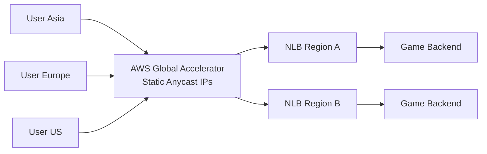

---

## 정답 설명

### A. Global Accelerator 구성

Global Accelerator는 Anycast IP를 제공하고 AWS 글로벌 네트워크를 통해 가까운 정상 엔드포인트로 라우팅합니다.

### B. NLB를 Endpoint로 추가

Global Accelerator는 NLB, ALB, EC2, Elastic IP 등을 엔드포인트로 사용할 수 있습니다.

UDP 게임 애플리케이션에는 NLB 조합이 잘 맞습니다.

---

## 오답 설명

### C. CloudFront

CloudFront는 HTTP/HTTPS 콘텐츠 배포와 캐싱에 적합합니다.

UDP 기반 멀티플레이어 게임 트래픽에는 Global Accelerator가 적합합니다.

---

### D. S3 Transfer Acceleration

S3 업로드/다운로드 가속 기능입니다.

UDP 게임 트래픽과 관련 없습니다.

---

### E. Direct Connect

Direct Connect는 기업망과 AWS 간 전용 연결입니다.

전 세계 일반 인터넷 사용자에게 적용할 수 없습니다.

---

## 핵심 암기

> UDP/TCP 글로벌 애플리케이션 + Anycast IP → **Global Accelerator + NLB**

---

# Q58. Domain 3 — Design High-Performing Architectures

## Question

**A company stores raw data in Amazon S3. The company wants to create a data catalog so that analysts can query the data with Amazon Athena. The company also wants to automatically discover the schema of new datasets added to S3.**

**Which services should be used? Choose TWO.**

A. AWS Glue Data Catalog

B. AWS Glue crawlers

C. Amazon ElastiCache

D. Amazon CloudFront

E. Amazon Inspector

---

## 정답

**A, B**

---

## 상세 해설

이 문제는 **Athena + Glue Data Catalog + Glue Crawler** 문제입니다.

Athena는 S3 데이터를 SQL로 조회합니다.

하지만 SQL로 조회하려면 테이블 정의, 컬럼, 데이터 타입 같은 메타데이터가 필요합니다.

이 메타데이터를 저장하는 곳이 **AWS Glue Data Catalog**입니다.

S3 데이터를 스캔해서 스키마를 자동으로 추론하는 기능이 **AWS Glue Crawler**입니다.

---

## 구조 도식

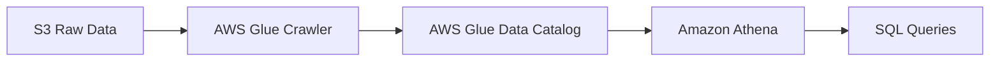

---

## 정답 설명

### A. Glue Data Catalog

Athena가 참조하는 메타데이터 카탈로그입니다.

### B. Glue Crawlers

S3 데이터를 스캔해 스키마를 자동으로 발견하고 Glue Data Catalog에 테이블을 생성/갱신합니다.

---

## 오답 설명

### C. ElastiCache

캐시 서비스입니다.

데이터 카탈로그나 스키마 탐색과 관련 없습니다.

---

### D. CloudFront

CDN 서비스입니다.

S3 데이터 분석 메타데이터 관리와 관련 없습니다.

---

### E. Inspector

취약점 관리 서비스입니다.

스키마 탐색과 관련 없습니다.

---

## 핵심 암기

> Athena가 S3를 SQL로 조회하려면 → **Glue Data Catalog**

> S3 데이터 스키마 자동 발견 → **Glue Crawler**

---

# Q59. Domain 4 — Design Cost-Optimized Architectures

## Question

**A company stores user-uploaded files in Amazon S3. Files are accessed frequently for the first 30 days. After 30 days, files are rarely accessed. After 1 year, files must be retained for compliance but are almost never accessed. Retrieval after 1 year can take up to 12 hours.**

**Which actions should a solutions architect take to optimize costs? Choose TWO.**

A. Create an S3 Lifecycle policy to transition objects to S3 Standard-IA or S3 Glacier Instant Retrieval after 30 days.

B. Create an S3 Lifecycle policy to transition objects to S3 Glacier Deep Archive after 1 year.

C. Keep all objects in S3 Standard for their entire retention period.

D. Move all objects to Amazon EFS after 30 days.

E. Disable versioning and delete all objects after 30 days.

---

## 정답

**A, B**

---

## 상세 해설

이 문제는 **S3 Lifecycle 다단계 비용 최적화** 문제입니다.

파일 접근 패턴이 명확합니다.

| 기간 | 접근 패턴 | 적합한 스토리지 |
|---|---|---|
| 0~30일 | 자주 접근 | S3 Standard |
| 30일 이후 | 드물게 접근 | S3 Standard-IA 또는 Glacier Instant Retrieval |
| 1년 이후 | 거의 접근 안 함, 12시간 복원 허용 | Glacier Deep Archive |

---

## Lifecycle 구조

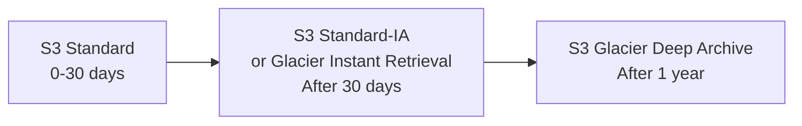

---

## 정답 설명

### A. 30일 후 저빈도 접근 티어 이동

30일 후 드물게 접근하므로 Standard보다 저렴한 IA 계열 또는 Glacier Instant Retrieval이 적합합니다.

### B. 1년 후 Deep Archive 이동

1년 후 거의 접근하지 않고 12시간 복원이 허용되므로 Deep Archive가 비용 최적입니다.

---

## 오답 설명

### C. 계속 S3 Standard

비용이 높습니다.

접근 패턴이 명확하므로 Lifecycle을 사용하는 것이 좋습니다.

---

### D. EFS로 이동

EFS는 파일 시스템입니다.

장기 객체 보관 비용 최적화에는 S3 Lifecycle이 적합합니다.

---

### E. 30일 후 삭제

컴플라이언스 보관 요구사항을 위반합니다.

---

## 핵심 암기

> 접근 패턴 명확 → **S3 Lifecycle**

> 장기 보관 + 복원 시간 허용 → **Glacier Deep Archive**

---

# Q60. Domain 4 — Design Cost-Optimized Architectures

## Question

**A company has EC2 instances in private subnets that frequently access both Amazon S3 and Amazon DynamoDB. The traffic currently goes through a NAT gateway. The company wants to reduce NAT gateway data processing costs while keeping the traffic private.**

**Which actions should a solutions architect take? Choose TWO.**

A. Create a gateway VPC endpoint for Amazon S3.

B. Create a gateway VPC endpoint for Amazon DynamoDB.

C. Create a NAT gateway in every Availability Zone and route S3 and DynamoDB traffic through the NAT gateways.

D. Assign public IP addresses to the EC2 instances.

E. Enable S3 Transfer Acceleration.

---

## 정답

**A, B**

---

## 상세 해설

이 문제는 **NAT Gateway 비용 절감 + S3/DynamoDB Endpoint** 문제입니다.

Private Subnet의 EC2가 S3와 DynamoDB에 자주 접근하는데 NAT Gateway를 거치면 NAT 데이터 처리 비용이 발생합니다.

S3와 DynamoDB는 Gateway VPC Endpoint를 지원합니다.

---

## 구조 도식

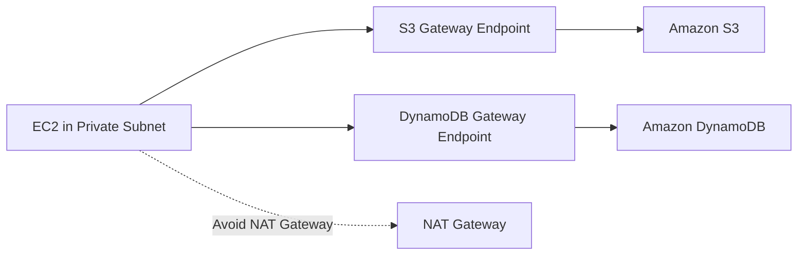

---

## 왜 A와 B가 정답인가?

Gateway Endpoint를 사용하면 S3/DynamoDB 트래픽이 NAT Gateway를 거치지 않습니다.

따라서 NAT 데이터 처리 비용을 줄일 수 있고, 트래픽도 private하게 유지됩니다.

---

## 오답 설명

### C. NAT Gateway를 AZ마다 생성

고가용성 측면에서는 도움이 될 수 있지만 비용은 더 늘어납니다.

S3/DynamoDB 트래픽 비용 절감 목적에는 Endpoint가 적합합니다.

---

### D. Public IP 부여

Private Subnet의 보안 구조를 깨며, private traffic 요구사항에 맞지 않습니다.

---

### E. S3 Transfer Acceleration

글로벌 S3 업로드 속도 개선용입니다.

NAT Gateway 비용 절감과 DynamoDB 접근에는 관련 없습니다.

---

## 핵심 암기

> S3와 DynamoDB는 **Gateway VPC Endpoint**

> NAT 비용 절감에 매우 자주 출제됩니다.

---

# Set 5 정답표

| 번호 | 정답 개수 | 도메인 | 정답 |
|---:|---:|---|---|
| Q49 | TWO | Secure | C, D |
| Q50 | TWO | Secure | A, C |
| Q51 | TWO | Secure | A, C |
| Q52 | TWO | Secure | A, B |
| Q53 | THREE | Resilient | A, C, F |
| Q54 | TWO | Resilient | A, B |
| Q55 | TWO | Resilient | A, B |
| Q56 | TWO | High-Performing | A, B |
| Q57 | TWO | High-Performing | A, B |
| Q58 | TWO | High-Performing | A, B |
| Q59 | TWO | Cost-Optimized | A, B |
| Q60 | TWO | Cost-Optimized | A, B |

---

# Set 5 핵심 요약

| 주제 | 정답 패턴 |
|---|---|
| S3 키를 AWS 외부에서 관리 | SSE-C + Client-side encryption |
| Site-to-Site VPN 구성 | Customer Gateway + VGW/TGW |
| EKS Pod별 권한 | IRSA + ServiceAccount별 IAM Role |
| CloudFront만 S3 접근 허용 | OAC + Bucket Policy |
| Web App Multi-AZ HA | ALB + ASG + RDS Multi-AZ |
| 비동기 주문 처리 | SQS + DLQ |
| Warm Standby DR | 축소 인프라 + 데이터 복제 |
| Read-heavy RDS 성능 | ElastiCache + Read Replica |
| 글로벌 UDP/TCP 성능 | Global Accelerator + NLB Endpoint |
| Athena용 스키마 관리 | Glue Data Catalog + Glue Crawler |
| S3 장기 보관 비용 최적화 | Lifecycle + Glacier Deep Archive |
| S3/DynamoDB NAT 비용 절감 | Gateway VPC Endpoints |

---

# 복수 선택형 실전 풀이 요령

## 1. Choose TWO/THREE를 먼저 확인

문제를 읽기 전에 다음을 먼저 보셔야 합니다.

```text
Choose TWO.
Choose THREE.
```

정답 개수를 놓치면 아는 문제도 틀립니다.

---

## 2. “맞는 말”과 “요구사항을 만족하는 말”을 구분

복수 선택형에서는 어떤 보기가 기술적으로 맞더라도, 문제의 요구사항과 다르면 오답입니다.

예:

```text
NAT Gateway는 Private Subnet outbound에 맞는 말
하지만 S3/DynamoDB NAT 비용 절감 문제에서는 Endpoint가 정답
```

---

## 3. 서비스 목적을 정확히 구분

| 헷갈리는 조합 | 구분 |
|---|---|
| Multi-AZ vs Read Replica | 장애 조치 vs 읽기 확장 |
| CloudFront vs Global Accelerator | 캐싱 CDN vs TCP/UDP 가속 |
| Secrets Manager vs Parameter Store | Secret Rotation vs 설정값 |
| NAT Gateway vs VPC Endpoint | 인터넷 outbound vs AWS 서비스 private access |
| DataSync vs Snowball | 온라인 반복 전송 vs 오프라인 대량 이전 |
| Athena vs Redshift | S3 직접 쿼리 vs 데이터웨어하우스 |

---

## 4. 다중 선택형에서 자주 나오는 정답 조합

| 시나리오 | 정답 조합 |
|---|---|
| S3를 CloudFront로만 접근 | OAC + Bucket Policy |
| Site-to-Site VPN | Customer Gateway + VGW/TGW |
| SQS 실패 메시지 처리 | SQS + DLQ |
| EKS Pod IAM 권한 | IRSA + IAM Role per ServiceAccount |
| S3/DynamoDB NAT 비용 절감 | S3 Gateway Endpoint + DynamoDB Gateway Endpoint |
| Athena 스키마 자동화 | Glue Crawler + Glue Data Catalog |
| Warm Standby | 축소 환경 + 데이터 복제 |
