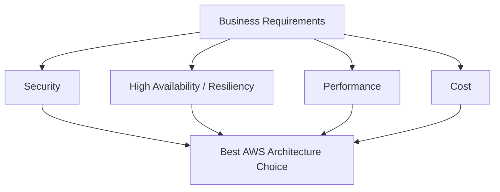
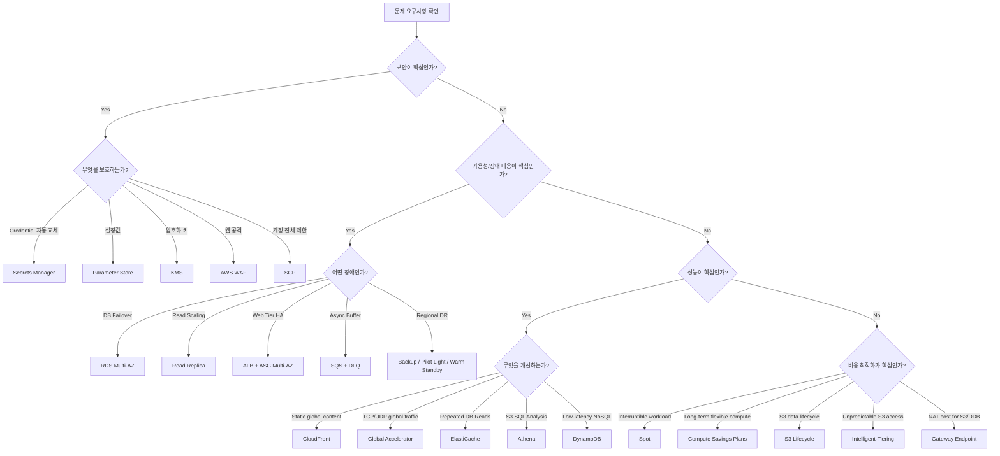

# AWS SAA-C03 60문항 기반 약점 분석표 + 시험 직전 핵심 암기표

현재까지 만든 **Set 1~5 총 60문항**을 기준으로 정리했습니다.

다만 실제로 각 문항에 선택한 답안은 아직 없으므로, 아래의 “약점 분석”은 **오답 결과 기반 개인 분석이 아니라**, 60문항에서 반복 출제된 영역과 **일반적으로 오답률이 높은 판단 포인트**를 기준으로 한 **학습 우선순위 분석표**입니다.

---

# 0. 먼저 정정할 사항: Q53의 선택지 모호성

Set 5의 **Q53은 `Choose THREE`인데 Application Tier의 Multi-AZ 배치(B)도 고가용성 관점에서 타당**합니다.

문제 의도는 `ALB + Web ASG Multi-AZ + RDS Multi-AZ`의 대표 HA 패턴을 묻는 것이었지만, Application Tier도 Stateless라고 명시했기 때문에 B를 배제할 근거가 충분하지 않습니다.

## 실전 판단 원칙

실제 AWS 시험은 보통 이처럼 모호하게 출제하지 않고, 다음 중 하나를 더 명확히 제시합니다.

- “외부 사용자 접근을 위한 Web Tier 고가용성”만 묻는다.
- “모든 Stateless Tier를 Multi-AZ로 구성”하라고 한다.
- “Choose FOUR”로 출제한다.
- Application Tier가 별도 Load Balancer 또는 Queue 뒤에 있음을 명시한다.

### 따라서 Q53의 학습 결론은 다음으로 수정하면 됩니다.

```text
3-Tier Multi-AZ HA의 원칙:
- Web Tier: ALB + ASG Multi-AZ
- Application Tier: Stateless이면 ASG Multi-AZ 또는 ECS/EKS Multi-AZ
- Database: RDS Multi-AZ
```

이 문항은 점수 판단용보다 **아키텍처 원칙 학습용**으로 보시는 것이 맞습니다.

---

# 1. 60문항 출제 분포

| 도메인 | 공식 비중 | 60문항 반영 | 문항 번호 |
|---|---:|---:|---|
| Domain 1. Design Secure Architectures | 30% | 20문항 | Q1~Q4, Q13~Q16, Q25~Q28, Q37~Q40, Q49~Q52 |
| Domain 2. Design Resilient Architectures | 26% | 15문항 | Q5~Q7, Q17~Q19, Q29~Q31, Q41~Q43, Q53~Q55 |
| Domain 3. Design High-Performing Architectures | 24% | 15문항 | Q8~Q10, Q20~Q22, Q32~Q34, Q44~Q46, Q56~Q58 |
| Domain 4. Design Cost-Optimized Architectures | 20% | 10문항 | Q11~Q12, Q23~Q24, Q35~Q36, Q47~Q48, Q59~Q60 |
| **합계** | **100%** | **60문항** | - |

## 학습 우선순위 결론

```text
1순위: Security + Networking
2순위: Resiliency + RDS/SQS/DR
3순위: S3/Database/Analytics/Global Delivery
4순위: Cost Optimization
```

SAA-C03은 단순 서비스 암기보다 다음 4개 축의 **트레이드오프 판단**이 핵심입니다.



---

# 2. 도메인별 약점 분석표

## 2.1 Domain 1 — Design Secure Architectures

### 출제 핵심

| 세부 영역 | 관련 문항 | 중요도 |
|---|---|---:|
| IAM Role / 임시 자격 증명 | Q1 | 매우 높음 |
| Organizations / SCP / OrgID | Q2, Q27 | 매우 높음 |
| Secrets Manager / Parameter Store / KMS | Q3, Q37 | 매우 높음 |
| VPC Endpoint / S3 접근 제어 | Q4, Q15, Q26, Q39 | 매우 높음 |
| WAF / 웹 공격 방어 | Q4, Q15 | 높음 |
| EKS IRSA | Q16, Q51 | 높음 |
| S3 암호화 | Q13, Q14, Q49 | 매우 높음 |
| ACM / TLS 인증서 | Q16 | 높음 |
| Cognito / API Gateway JWT | Q28, Q40 | 중간~높음 |
| CloudFront OAC | Q52 | 높음 |
| Config / GuardDuty / CloudTrail 차이 | Q38 | 매우 높음 |

---

### 보안 도메인 약점 진단 질문

아래 질문 중 하나라도 바로 답이 안 나오면 해당 영역을 보강해야 합니다.

| 자가진단 질문 | 정답 키워드 |
|---|---|
| EC2가 S3에 접근해야 하는데 Access Key를 저장하면 안 된다면? | IAM Role |
| RDS 비밀번호를 자동으로 교체하려면? | Secrets Manager |
| 일반 애플리케이션 설정값 저장은? | Parameter Store |
| 암호화 키 자체를 관리하는 서비스는? | KMS |
| SQL Injection/XSS를 막으려면? | AWS WAF |
| 계정 Administrator도 특정 작업을 못 하게 하려면? | SCP |
| 설정 위반을 탐지하고 자동 수정하려면? | AWS Config + SSM Automation |
| S3를 CloudFront로만 접근하게 하려면? | OAC + Bucket Policy |
| Private EC2가 Secrets Manager에 인터넷 없이 접근하려면? | Interface VPC Endpoint |
| EKS Pod별로 AWS 권한을 다르게 주려면? | IRSA |
| 소셜 로그인 사용자가 S3에 직접 업로드하려면? | Cognito Identity Pool 또는 Presigned URL |

---

### Security 오답 유발 포인트

| 헷갈리는 선택 | 올바른 판단 |
|---|---|
| EC2에 IAM User Access Key 저장 | IAM Role 사용 |
| Secret을 KMS에 저장 | KMS는 키 관리, Secret은 Secrets Manager |
| 모든 설정을 Secrets Manager에 저장 | 일반 설정은 Parameter Store가 적절 |
| GuardDuty로 위험 설정을 자동 수정 | Config + Remediation 사용 |
| IAM Policy만으로 계정 관리자 통제 | Organizations SCP 사용 |
| Security Group을 S3 Bucket에 연결 | S3는 Bucket Policy/IAM Policy 사용 |
| S3 Private Access에 NAT Gateway 사용 | S3 Gateway Endpoint 우선 검토 |
| Secrets Manager private 접근에 Gateway Endpoint 사용 | Interface Endpoint 사용 |
| WAF와 Shield를 동일하게 이해 | WAF=웹 공격, Shield=DDoS |
| Cognito User Pool과 Identity Pool 혼동 | User Pool=인증, Identity Pool=임시 AWS 권한 |

---

## 2.2 Domain 2 — Design Resilient Architectures

### 출제 핵심

| 세부 영역 | 관련 문항 | 중요도 |
|---|---|---:|
| ALB + ASG + Multi-AZ | Q5, Q17, Q53 | 매우 높음 |
| SQS 기반 Decoupling | Q6, Q19, Q30, Q54 | 매우 높음 |
| DR 전략 | Q7, Q31, Q42, Q55 | 매우 높음 |
| RDS Multi-AZ vs Read Replica | Q18, Q43, Q56 | 매우 높음 |
| Stateless Application / Session Externalization | Q29 | 높음 |
| DLQ | Q30, Q54 | 높음 |
| Queue Depth Scaling | Q41 | 높음 |
| Route 53 Failover | Q42 | 높음 |
| S3 Event → SQS → Lambda | Q19 | 높음 |

---

### Resiliency 도메인 약점 진단 질문

| 자가진단 질문 | 정답 키워드 |
|---|---|
| Stateless Web App을 AZ 장애에도 운영하려면? | ALB + ASG Multi-AZ |
| DB 자동 장애 조치를 하려면? | RDS Multi-AZ |
| 읽기 성능을 확장하려면? | Read Replica |
| DB 쓰기 폭주를 흡수하고 유실을 막으려면? | SQS |
| SQS에서 계속 실패하는 메시지를 분리하려면? | DLQ |
| Queue 대기 작업량에 따라 Worker를 확장하려면? | ApproximateNumberOfMessagesVisible |
| Primary Region 장애 시 Secondary Region으로 DNS 전환하려면? | Route 53 Failover |
| 수분 내 DR 복구, Active-Active보다 저렴하게 하려면? | Warm Standby |
| 가장 저렴한 Cross-Region DB DR은? | Snapshot Copy + Restore |
| ALB 환경에서 EC2 로컬 세션 때문에 로그아웃된다면? | ElastiCache/DynamoDB로 Session Externalization |

---

### DR 전략 핵심 비교

| 전략 | 평소 상태 | 비용 | RTO | RPO | 대표 상황 |
|---|---|---:|---:|---:|---|
| Backup & Restore | 백업만 보관 | 낮음 | 김 | 백업 주기 수준 | 비용 최우선 |
| Pilot Light | 핵심 서비스만 실행 | 낮음~중간 | 중간 | 짧게 가능 | 핵심 DB만 유지 |
| Warm Standby | 축소 환경 실행 | 중간 | 짧음 | 짧게 가능 | 1시간 이내 복구 |
| Active-Active | 양쪽 Full 운영 | 높음 | 매우 짧음 | 매우 짧음 | 미션 크리티컬 |

---

### Resiliency 오답 유발 포인트

| 흔한 오답 | 왜 틀리는가 |
|---|---|
| Multi-AZ를 읽기 확장 용도로 선택 | Multi-AZ는 HA/Failover 목적 |
| Read Replica를 자동 Failover라고 생각 | 주목적은 읽기 확장 |
| DB 병목에 CloudFront 적용 | CloudFront는 콘텐츠 캐싱, DB Write 병목 해결 불가 |
| Queue 기반 Worker Scaling에 CPU만 사용 | Queue Depth가 실제 처리량 수요를 더 직접 반영 |
| SQS 실패 메시지를 삭제 | 주문/이벤트 유실 위험 |
| DLQ 없이 무한 재시도 | Poison Message가 정상 처리 방해 |
| Sticky Session만으로 세션 문제 해결 | 인스턴스 교체 시 세션 유실 |
| EC2 Scale-up으로 AZ 장애 해결 | 단일 AZ 장애 문제는 남음 |
| Route 53 Weighted를 Failover 대체로 사용 | 장애 시 전환은 Failover Routing |
| Snapshot Backup을 HA로 혼동 | 백업은 DR, Multi-AZ는 HA |

---

## 2.3 Domain 3 — Design High-Performing Architectures

### 출제 핵심

| 세부 영역 | 관련 문항 | 중요도 |
|---|---|---:|
| Aurora Replica / Reader Endpoint | Q8 | 높음 |
| CloudFront | Q9, Q44 | 매우 높음 |
| Athena | Q10, Q46 | 매우 높음 |
| FSx for Lustre | Q20 | 중간~높음 |
| DynamoDB / On-Demand | Q21, Q33 | 매우 높음 |
| Global Accelerator | Q22, Q57 | 높음 |
| ElastiCache | Q32, Q56 | 매우 높음 |
| DataSync | Q34 | 높음 |
| Aurora Serverless v2 | Q45 | 높음 |
| Glue Data Catalog / Crawler | Q58 | 높음 |

---

### Performance 도메인 약점 진단 질문

| 자가진단 질문 | 정답 키워드 |
|---|---|
| Aurora에서 읽기 부하를 분산하려면? | Aurora Replica + Reader Endpoint |
| 전 세계 사용자에게 정적 파일을 빠르게 제공하려면? | CloudFront |
| S3 JSON/Parquet 데이터를 서버리스 SQL로 조회하려면? | Athena |
| S3 스키마를 자동 탐색하려면? | Glue Crawler |
| Athena 테이블 메타데이터 저장소는? | Glue Data Catalog |
| Key-Value, 초저지연, 자동 확장 DB는? | DynamoDB |
| UDP/TCP 글로벌 트래픽, Anycast IP는? | Global Accelerator |
| 반복 조회가 많고 변경이 적은 데이터는? | ElastiCache |
| Linux HPC/Lustre 파일 시스템은? | FSx for Lustre |
| NFS/SMB에서 S3로 증분 온라인 이전은? | DataSync |
| 관계형 DB가 유휴와 급증을 반복하면? | Aurora Serverless v2 |

---

### CloudFront vs Global Accelerator

| 비교 항목 | CloudFront | Global Accelerator |
|---|---|---|
| 핵심 목적 | CDN, 콘텐츠 캐싱 | 글로벌 네트워크 가속 |
| 주요 프로토콜 | HTTP/HTTPS | TCP/UDP |
| 캐싱 | 가능 | 불가 |
| Origin/Endpoint | S3, ALB, HTTP Origin | ALB, NLB, EC2, Elastic IP |
| 대표 사례 | 이미지, CSS, JS, 동영상 | 게임, VoIP, 글로벌 API |
| 핵심 키워드 | static content, cache | Anycast IP, UDP, NLB |

---

### Athena vs Redshift vs EMR vs Glue

| 서비스 | 주 역할 | 대표 키워드 |
|---|---|---|
| Athena | S3 직접 SQL Query | Serverless, ad hoc SQL |
| Redshift | 데이터웨어하우스 | BI, 대규모 분석, DW |
| EMR | Hadoop/Spark 처리 | Big Data Processing |
| Glue | ETL + Data Catalog | ETL, Crawler, Schema |
| OpenSearch | 검색/로그 검색 | Full-text Search |

---

### Performance 오답 유발 포인트

| 흔한 오답 | 올바른 판단 |
|---|---|
| CloudFront를 UDP 게임 서비스에 선택 | Global Accelerator + NLB |
| Global Accelerator를 정적 파일 캐싱에 선택 | CloudFront |
| Athena 대신 RDS에 S3 로그 복사 | S3 직접 ad hoc SQL이면 Athena |
| Read Replica 없이 DB CPU 문제에 Multi-AZ | 읽기 확장은 Replica/Cache |
| Aurora Multi-AZ를 Reader Endpoint로 착각 | Aurora Replica/Reader Endpoint |
| EFS를 HPC Lustre 용도에 선택 | FSx for Lustre |
| Snowball을 증분 온라인 파일 동기화에 선택 | DataSync |
| DynamoDB 대신 Redshift를 API DB로 선택 | API Key-Value 저지연은 DynamoDB |
| Glue Crawler 없이 Athena Schema 자동 발견 기대 | Crawler + Data Catalog 사용 |
| S3 Glacier를 즉시 조회 데이터 저장소로 선택 | Standard/IA/Intelligent-Tiering 검토 |

---

## 2.4 Domain 4 — Design Cost-Optimized Architectures

### 출제 핵심

| 세부 영역 | 관련 문항 | 중요도 |
|---|---|---:|
| Compute Savings Plans | Q11, Q48 | 매우 높음 |
| Gateway VPC Endpoint로 NAT 비용 절감 | Q12, Q60 | 매우 높음 |
| S3 Intelligent-Tiering | Q23, Q47 | 매우 높음 |
| Spot / Fargate Spot | Q24 | 높음 |
| Scheduled Scaling | Q35 | 높음 |
| S3 Bucket Keys | Q36 | 높음 |
| S3 Lifecycle / Glacier Deep Archive | Q59 | 매우 높음 |

---

### Cost 도메인 약점 진단 질문

| 자가진단 질문 | 정답 키워드 |
|---|---|
| 장기 지속 사용, 인스턴스/리전 유연성 필요 | Compute Savings Plans |
| 중단 가능한 Batch/Container | Spot / Fargate Spot |
| 업무시간이 명확한 EC2 트래픽 | Scheduled Scaling |
| S3/DynamoDB가 NAT Gateway를 많이 통과 | Gateway VPC Endpoint |
| S3 SSE-KMS KMS 호출 비용 절감 | S3 Bucket Keys |
| 접근 패턴 불명확 + 즉시 접근 | Intelligent-Tiering |
| 장기 보관 + 복원 시간 허용 | Glacier / Deep Archive |
| 접근 패턴이 명확함 | S3 Lifecycle |

---

### EC2 구매 옵션 요약

| 옵션 | 비용 | 중단 가능성 | 유연성 | 적합한 상황 |
|---|---:|---:|---:|---|
| On-Demand | 높음 | 없음 | 높음 | 단기, 예측 불가 |
| Spot | 매우 낮음 | 있음 | 중간 | Batch, 중단 가능 |
| Standard RI | 낮음 | 없음 | 낮음 | 특정 인스턴스 고정 |
| Compute Savings Plans | 낮음 | 없음 | 높음 | 지속 사용, 유연성 필요 |
| Dedicated Host | 높음 | 없음 | 낮음 | BYOL, 규제 |

---

### S3 스토리지 선택 요약

| 데이터 특성 | 우선 검토 |
|---|---|
| 자주 접근 | S3 Standard |
| 예측 불가 접근 패턴 | Intelligent-Tiering |
| 드물게 접근, 즉시 조회 | Standard-IA |
| 밀리초 단위 즉시 조회 아카이브 | Glacier Instant Retrieval |
| 분~시간 단위 복원 허용 | Glacier Flexible Retrieval |
| 매우 장기 보관, 가장 저렴 | Glacier Deep Archive |
| 접근 패턴이 기간별로 명확 | Lifecycle Policy |

---

### Cost 오답 유발 포인트

| 흔한 오답 | 올바른 판단 |
|---|---|
| 장기 사용이면 무조건 RI | 유연성 필요하면 Savings Plans |
| Spot이 항상 가장 저렴하니 항상 정답 | 중단 불가 작업에는 부적합 |
| NAT Gateway를 더 추가하면 비용 절감 | 고가용성은 좋아질 수 있어도 비용은 증가 |
| S3/DynamoDB 접근도 NAT 사용 | Gateway Endpoint 우선 검토 |
| Intelligent-Tiering과 Lifecycle 혼동 | 예측 불가=Intelligent-Tiering, 명확=Lifecycle |
| 즉시 조회 요구인데 Glacier Deep Archive | Deep Archive는 복원 시간 김 |
| SSE-KMS 비용 절감에 암호화 해제 | S3 Bucket Keys 사용 |
| 업무시간 외 EC2도 계속 실행 | Scheduler/Scheduled Scaling/Stop-Start 검토 |

---

# 3. 서비스별 약점 분석표

아래 표는 60문항에서 반복적으로 등장한 서비스와, 시험 직전 반드시 구분해야 할 판단 기준입니다.

## 3.1 IAM / Security / Governance

| 서비스/기능 | 핵심 역할 | 자주 나오는 문제 표현 | 함정 |
|---|---|---|---|
| IAM Role | AWS 리소스 임시 권한 | no access keys, EC2 access S3 | IAM User 키 저장 |
| IAM Identity Center | 직원 SSO/멀티 계정 접근 | workforce, employees, AWS accounts | Cognito와 혼동 |
| Cognito User Pool | 앱 사용자 인증 | sign-up, login, JWT | AWS 임시 권한 자체 발급 아님 |
| Cognito Identity Pool | 앱 사용자 AWS 임시 권한 | social login, temporary credentials | User Pool과 혼동 |
| SCP | Organizations 권한 상한 | even admins cannot | IAM Policy보다 상위 경계 |
| AWS Config | 구성 준수 평가 | detect noncompliance | 예방 자체는 아님 |
| SSM Automation | 자동 교정 | remediate automatically | Config와 조합 |
| CloudTrail | API 호출 기록 | audit API activity | 보안 차단 도구 아님 |
| GuardDuty | 위협 탐지 | malicious activity | 정책 위반 자동 교정 아님 |
| WAF | 웹 공격 차단 | SQLi, XSS | Shield와 혼동 |
| Shield | DDoS 보호 | DDoS attack | WAF와 역할 다름 |

---

## 3.2 Network / Connectivity

| 서비스/기능 | 핵심 역할 | 대표 키워드 | 함정 |
|---|---|---|---|
| Internet Gateway | VPC 인터넷 연결 | public subnet | Private EC2 직접 노출 |
| NAT Gateway | Private Subnet 인터넷 Outbound | patch download | S3 Private Access에는 비효율 |
| Gateway Endpoint | S3/DynamoDB Private Access | reduce NAT cost | 다른 AWS 서비스에는 불가 |
| Interface Endpoint | 대부분 AWS 서비스 PrivateLink | Secrets Manager, SSM | S3에 무조건 Interface 선택 |
| Site-to-Site VPN | On-prem ↔ AWS IPsec | encrypted tunnel | Direct Connect와 혼동 |
| Direct Connect | 전용 회선 | dedicated private connectivity | 일반 사용자 가속용 아님 |
| Transit Gateway | 대규모 허브 연결 | many VPCs, hybrid hub | 단일 VPC 연결에는 과할 수 있음 |
| Route 53 Failover | 장애 시 DNS 전환 | primary unhealthy | Weighted와 혼동 |
| Global Accelerator | TCP/UDP 글로벌 가속 | Anycast, NLB, gaming | CloudFront와 혼동 |
| CloudFront | CDN 캐싱 | static content, cache | UDP/게임 가속에는 부적합 |

---

## 3.3 Compute / Container

| 서비스/기능 | 핵심 역할 | 대표 키워드 | 함정 |
|---|---|---|---|
| EC2 Auto Scaling | 인스턴스 자동 증감 | variable traffic | 단일 AZ에만 구성 |
| ALB | L7 HTTP/HTTPS 분산 | path-based, web app | TCP/UDP에는 NLB |
| NLB | L4 TCP/UDP 분산 | low latency, gaming | HTTP 기능 기대 |
| Lambda | 서버리스 함수 | event-driven | 긴 실행/상태 유지 작업 |
| ECS Fargate | 서버리스 컨테이너 | no server management | 장시간/특수 인프라 요구 |
| Fargate Spot | 중단 가능한 컨테이너 | fault tolerant batch | 중단 불가 운영 서비스 |
| EKS IRSA | Pod별 AWS 권한 | ServiceAccount, least privilege | Node Role에 권한 몰기 |

---

## 3.4 Storage

| 서비스 | 핵심 역할 | 대표 키워드 | 함정 |
|---|---|---|---|
| S3 | 객체 스토리지 | files, objects, static content | DB 파일시스템으로 사용 |
| EBS | EC2 블록 스토리지 | boot volume, database disk | 다중 EC2 공유 파일 시스템 |
| EFS | Linux NFS 공유 파일 | multiple Linux instances | HPC Lustre 용도 |
| FSx for Windows | Windows SMB 공유 파일 | Windows file share | Linux NFS |
| FSx for Lustre | HPC 고성능 파일 | Lustre, throughput | 일반 Linux 공유 파일 |
| DataSync | 파일 데이터 온라인 이전 | NFS/SMB to S3/EFS | DB Migration |
| Snowball | 오프라인 대용량 이전 | poor network, PB/TB offline | 반복 증분 온라인 동기화 |
| S3 Lifecycle | 기간 기반 Storage Class 이동 | after 30 days | 접근 패턴 불명확 |
| Intelligent-Tiering | 접근 패턴 자동 최적화 | unpredictable access | 복원 시간 허용 아카이브 |

---

## 3.5 Database / Analytics

| 서비스 | 핵심 역할 | 대표 키워드 | 함정 |
|---|---|---|---|
| RDS Multi-AZ | DB HA/자동 Failover | high availability | 읽기 확장 |
| Read Replica | 읽기 확장 | read-heavy, reporting | 자동 Failover |
| Aurora Replica | Aurora 읽기 확장 | reader endpoint | Multi-AZ와 혼동 |
| Aurora Serverless v2 | 관계형 DB 자동 용량 조절 | intermittent relational workload | NoSQL 대체 |
| DynamoDB | NoSQL Key-Value | low latency, unpredictable traffic | 복잡한 조인 |
| DynamoDB On-Demand | 예측 불가 트래픽 | sudden spikes | 예측 가능한 대규모 지속 사용 |
| ElastiCache | 인메모리 캐시 | repeated reads, session | 영구 시스템 오브 레코드 |
| Athena | S3 SQL 분석 | serverless ad hoc SQL | 운영 DB |
| Glue Data Catalog | 메타데이터 저장 | Athena table schema | 데이터 변환 엔진 자체 |
| Glue Crawler | 스키마 자동 탐색 | discover schema | Query 실행 서비스 |
| Redshift | 데이터웨어하우스 | BI, warehouse | 단순 S3 ad hoc 분석 |
| EMR | Hadoop/Spark | large-scale batch | 단순 서버리스 SQL |

---

# 4. 오답 유발 포인트 Top 20

아래 20개는 시험 직전 반드시 외워야 할 구분입니다.

| 순위 | 오답 유발 포인트 | 정답 판단 |
|---:|---|---|
| 1 | Multi-AZ vs Read Replica | HA/Failover vs Read Scaling |
| 2 | NAT Gateway vs VPC Endpoint | 인터넷 Outbound vs AWS Private Access |
| 3 | CloudFront vs Global Accelerator | CDN Cache vs TCP/UDP Acceleration |
| 4 | Secrets Manager vs Parameter Store | Auto Rotation Secret vs Config |
| 5 | KMS vs Secrets Manager | Encryption Key vs Secret Storage |
| 6 | WAF vs Shield | SQLi/XSS vs DDoS |
| 7 | Config vs SCP | Detect/Remediate vs Prevent |
| 8 | IAM Role vs IAM User Access Key | Temporary Credentials vs Long-Term Credentials |
| 9 | Cognito User Pool vs Identity Pool | Login vs AWS Temporary Credentials |
| 10 | SQS vs SNS | Queue/Buffer vs Fan-out/Notification |
| 11 | SQS Standard vs FIFO | At-least-once/Best-effort order vs Ordered/Exactly-once processing |
| 12 | EFS vs FSx for Lustre | Linux Shared File vs HPC/Lustre |
| 13 | EBS vs EFS | Block Storage vs Shared File Storage |
| 14 | DataSync vs Snowball | Online Incremental vs Offline Bulk Transfer |
| 15 | Athena vs Redshift | Serverless S3 SQL vs Data Warehouse |
| 16 | Intelligent-Tiering vs Lifecycle | Unpredictable Access vs Defined Schedule |
| 17 | Glacier Flexible vs Deep Archive | Faster Retrieval vs Lowest Cost |
| 18 | Savings Plans vs Reserved Instances | Flexible Commitment vs Specific Configuration |
| 19 | Spot vs On-Demand | Interruptible vs Cannot Be Interrupted |
| 20 | Warm Standby vs Active-Active | Reduced Running DR vs Full Multi-Region Production |

---

# 5. 시험 직전 핵심 암기표

## 5.1 “문제 키워드 → 서비스” 즉답표

| 문제 키워드 | 가장 먼저 떠올릴 서비스/패턴 |
|---|---|
| EC2가 S3 접근, 키 저장 금지 | IAM Role |
| DB 비밀번호 자동 변경 | Secrets Manager |
| 일반 설정값 | Parameter Store |
| 암호화 키 정책/감사 | KMS |
| SQL Injection, XSS | WAF |
| DDoS | Shield |
| 위협 탐지 | GuardDuty |
| API 감사 로그 | CloudTrail |
| 설정 규정 준수 점검 | Config |
| 계정 관리자도 특정 작업 금지 | SCP |
| S3를 CloudFront로만 접근 | OAC + Bucket Policy |
| S3 임시 업로드 링크 | Presigned URL |
| 소셜 로그인 후 AWS 권한 | Cognito Identity Pool |
| Private EC2 인터넷 접근 | NAT Gateway |
| Private EC2 → S3 | Gateway Endpoint |
| Private EC2 → DynamoDB | Gateway Endpoint |
| Private EC2 → Secrets Manager/SSM | Interface Endpoint |
| On-prem ↔ VPC VPN | Customer Gateway + VGW/TGW |
| Web App HA | ALB + ASG Multi-AZ |
| DB Auto Failover | RDS Multi-AZ |
| DB Read Scaling | Read Replica |
| DB Read Cache | ElastiCache |
| Traffic Spike, DB Write 보호 | SQS |
| SQS 반복 실패 메시지 | DLQ |
| SQS Worker 확장 | Queue Depth |
| Primary 장애 시 DNS 전환 | Route 53 Failover |
| Global Static Content | CloudFront |
| UDP/TCP Global Acceleration | Global Accelerator |
| S3에서 SQL Query | Athena |
| Athena Schema 자동 탐색 | Glue Crawler |
| Key-Value, 밀리초 지연 | DynamoDB |
| Linux 공유 파일 시스템 | EFS |
| Lustre/HPC | FSx for Lustre |
| Windows SMB 파일 공유 | FSx for Windows |
| NFS/SMB 온라인 이전 | DataSync |
| 대량 오프라인 데이터 이전 | Snowball |
| 지속 사용 + 유연한 할인 | Compute Savings Plans |
| 중단 가능한 Batch | Spot |
| 예측 가능한 시간대 확장 | Scheduled Scaling |
| S3 SSE-KMS KMS 비용 절감 | S3 Bucket Keys |
| 접근 패턴 불명확 | Intelligent-Tiering |
| 장기 저비용 아카이브 | Glacier Deep Archive |

---

## 5.2 SAA-C03 의사결정 트리



---

# 6. 도메인별 최종 학습 우선순위

## 1순위: Security + Networking

SAA-C03에서 가장 먼저 안정화해야 할 영역입니다.

### 반드시 암기/이해

- IAM Role
- IAM Identity Center
- Organizations / SCP
- KMS / Secrets Manager / Parameter Store
- WAF / Shield / GuardDuty / Config / CloudTrail
- NAT Gateway
- Gateway Endpoint / Interface Endpoint
- S3 Bucket Policy 조건 키

  - `aws:SourceVpce`

  - `aws:SourceVpc`

  - `aws:SourceIp`

  - `aws:PrincipalOrgID`

---

## 2순위: RDS + SQS + DR

### 반드시 구분

```text
RDS Multi-AZ = 장애 조치
Read Replica = 읽기 확장
ElastiCache = 반복 읽기 캐시
SQS = 비동기 버퍼
DLQ = 반복 실패 메시지 격리
```

---

## 3순위: S3 + CloudFront + Athena + DynamoDB

### 반드시 구분

```text
CloudFront = 정적 콘텐츠 캐싱
Athena = S3 SQL Query
Glue Crawler = Schema 자동 탐색
DynamoDB = Low latency NoSQL
Intelligent-Tiering = 접근 패턴 불명확
Lifecycle = 접근 패턴 명확
```

---

## 4순위: 비용 최적화

### 반드시 암기

```text
Spot = 중단 가능
On-Demand = 단기/중단 불가
Savings Plans = 장기 + 유연성
Reserved Instance = 장기 + 특정 구성 고정
Gateway Endpoint = NAT 비용 절감
S3 Bucket Key = SSE-KMS 요청 비용 절감
```

---

# 7. 시험 직전 30분 체크리스트

## 보안

- [ ] EC2/Lambda/EKS Pod에 Access Key를 저장하지 않고 IAM Role을 사용한다.
- [ ] DB Password Rotation은 Secrets Manager다.
- [ ] 일반 설정값은 Parameter Store다.
- [ ] KMS는 키 관리 서비스다.
- [ ] SQLi/XSS는 WAF, DDoS는 Shield다.
- [ ] 관리자도 막으려면 SCP다.
- [ ] 구성 위반 탐지/자동 수정은 Config + Remediation이다.

## 네트워크

- [ ] Internet outbound는 NAT Gateway다.
- [ ] S3/DynamoDB Private Access는 Gateway Endpoint다.
- [ ] Secrets Manager/SSM Private Access는 Interface Endpoint다.
- [ ] VPN은 Customer Gateway + VGW/TGW다.
- [ ] S3 Bucket 접근 조건은 Bucket Policy로 제어한다.

## 가용성

- [ ] Web HA는 ALB + ASG + Multi-AZ다.
- [ ] RDS Multi-AZ는 HA다.
- [ ] Read Replica는 읽기 확장이다.
- [ ] Queue 기반 비동기 처리는 SQS다.
- [ ] 반복 실패 메시지는 DLQ다.
- [ ] Route 53 Failover는 장애 시 DNS 전환이다.

## 성능

- [ ] 정적 글로벌 콘텐츠는 CloudFront다.
- [ ] 글로벌 TCP/UDP는 Global Accelerator다.
- [ ] 반복 DB 조회는 ElastiCache다.
- [ ] S3 SQL은 Athena다.
- [ ] Key-Value 저지연은 DynamoDB다.
- [ ] Lustre HPC는 FSx for Lustre다.

## 비용

- [ ] 중단 가능하면 Spot이다.
- [ ] 장기 유연성은 Savings Plans다.
- [ ] 접근 패턴 불명확 S3는 Intelligent-Tiering이다.
- [ ] 명확한 기간별 이동은 Lifecycle이다.
- [ ] 장기 아카이브는 Glacier Deep Archive다.
- [ ] S3/DynamoDB NAT 비용 절감은 Gateway Endpoint다.

---

# 8. 최종 권고 학습 방법

이제 60문항을 단순히 다시 푸는 것보다 아래 방식으로 복습하는 것을 권장드립니다.

## Step 1. 문제를 도메인별로 다시 풀기

| 순서 | 대상 |
|---:|---|
| 1 | Security 20문항 |
| 2 | Resiliency 15문항 |
| 3 | Performance 15문항 |
| 4 | Cost 10문항 |
| 5 | 전체 60문항 랜덤 순서 재풀이 |

---

## Step 2. 오답노트는 서비스가 아니라 “판단 기준”으로 작성

좋지 않은 오답노트:

```text
SQS = Queue
RDS Multi-AZ = HA
```

좋은 오답노트:

```text
문제에 "DB Write Spike + no data loss + decouple"이 나오면 SQS를 선택한다.
문제에 "automatic failover"가 나오면 Multi-AZ를 선택한다.
문제에 "read-heavy + reporting + stale data acceptable"이 나오면 Read Replica를 선택한다.
```

---

## Step 3. 실전 응시 전 목표

| 기준 | 권장 상태 |
|---|---|
| 60문항 재풀이 | 최소 80% 이상 |
| 핵심 비교표 암기 | Multi-AZ/Replica, CloudFront/GA, Endpoint 구분 가능 |
| 다중 선택형 | 정답 개수와 요구조건을 동시에 확인 |
| 오답 설명 | 왜 다른 보기가 틀렸는지 설명 가능 |
| 시간 관리 | 평균 문항당 약 2분 내외 |

---

# 최종 한 줄 요약

> **SAA-C03은 AWS 서비스를 많이 아는 시험이 아니라, 보안·가용성·성능·비용 조건이 충돌할 때 “요구사항에 가장 맞는 관리형 AWS 아키텍처”를 선택하는 시험입니다.**
