# AWS SAA-C03 필승 해법

> 외워서 푸는 시험이 아니라, **요구사항을 해독하고 가장 알맞은 설계를 고르는** 시험을 이기는 법

---

## 0. 이 문서를 어떻게 쓸 것인가

이 문서는 문제집이 아니라 하나의 **합격 시스템**입니다. SAA-C03은 서비스 이름을 많이 아는 사람이 아니라, 보안·가용성·성능·비용 조건이 서로 부딪힐 때 "이 상황에서는 이 서비스가 가장 알맞다"고 판단하는 사람이 통과하는 시험입니다. 그래서 문서도 세 층으로 나누었습니다.

첫째 층은 **시험 구조와 풀이 기술**(Part 1~3)입니다. 시험이 어떻게 채점되는지, AWS가 어떤 답을 좋아하는지, 지문에서 어떤 단서를 읽어야 하는지를 다룹니다. 이 부분은 한 번 정독하고, 시험 전날 한 번 더 읽으시길 권합니다.

둘째 층은 **핵심 분야 딥다이브**(Part 4)입니다. 서비스를 하나하나 나열하지 않고, "왜 이 서비스가 존재하는가"부터 설명한 뒤 시험에서 갈리는 판단 포인트를 짚습니다. 이미 잘 아는 분야는 건너뛰고, 약한 분야만 골라 읽으셔도 됩니다.

셋째 층은 **실전 훈련**(Part 5~8)입니다. 헷갈리는 서비스 쌍의 비교, 새로 출제한 24문항(복수 선택 포함)과 상세 해설, 학습 로드맵과 시험 당일 전략을 담았습니다. 문제는 해설을 가리고 먼저 풀어 보세요.

### 0.1 이 문서의 사실 검증 범위

정확성이 중요하므로, 무엇을 어떻게 확인했는지 먼저 밝혀 둡니다.

- **공식 AWS 시험 가이드(SAA-C03)에서 직접 확인한 내용**: 총 문항 구성(채점 50문항 + 비채점 15문항), 문제 유형, 오답 감점 없음, 점수 체계(100~1,000점, 합격 최소 720점), 보상 채점 방식, 도메인별 비중, 각 도메인의 Task 구성, 시험 범위 안·밖 서비스 목록.
- **AWS 공식 문서에서 오래 정착된 표준 동작**: 서비스별 설명은 이런 안정적인 내용 위주로 작성했습니다. 다만 서비스 한도나 가격처럼 자주 바뀌는 수치는 의도적으로 최소화했습니다. 이 대화에서 서비스별 세부 수치를 공식 문서와 하나하나 대조한 것은 아니므로, 수치가 시험 합불을 가를 만큼 중요하다고 느껴지면 공식 문서로 재확인하세요.
- **개인 권장 기준**: "모의고사 80% 이상" 같은 목표치는 AWS가 정한 합격 기준이 아니라 학습 안전 마진을 위한 제 권장입니다. 본문에서 그때마다 표시했습니다.

---

## Part 1. 시험 해부

### 1.1 숫자로 보는 시험

| 항목 | 내용 |
|---|---|
| 총 문항 수 | 65문항 (채점 50 + 비채점 15) |
| 비채점 문항 | 향후 문제 출제 평가용이며 **시험 화면에서 구분되지 않음** |
| 문제 유형 | 객관식(정답 1개, 오답 3개) / 복수 선택(5개 이상의 보기 중 정답 2개 이상) |
| 오답 감점 | **없음**. 풀지 않은 문제는 오답 처리 |
| 점수 | 100~1,000점의 환산 점수, **합격 최소 720점** |
| 채점 모델 | 보상(compensatory) 채점: 도메인별 과락 없이 **전체 점수만** 통과하면 합격 |
| 대상 응시자 | AWS 서비스로 클라우드 솔루션을 설계해 본 경험 1년 이상을 가정 |

시험 시간(130분으로 안내되어 왔습니다), 응시료, 응시 언어 같은 운영 정보는 공식 시험 가이드 PDF에는 없고 예약 페이지에 있으므로, 응시 전에 공식 페이지에서 직접 확인하세요.

### 1.2 이 숫자들이 주는 전략적 의미

**비채점 15문항이 섞여 있다는 사실**은 심리적으로 큰 도움이 됩니다. 시험 중 "이건 도저히 모르겠다"는 문제를 만나면, 그것이 채점되지 않는 문제일 가능성이 상당히 있습니다. 어느 것이 비채점인지 알 수 없으니 모든 문제를 성실히 풀되, 한 문제에 3분 넘게 매달리는 것은 가장 비싼 실수입니다. 모르는 문제는 소거법으로 후보를 줄이고, 표시해 두고 넘어가세요.

**오답 감점이 없다**는 사실은 규칙이 단순합니다. 어떤 경우에도 빈칸을 남기지 마세요. 시간이 다 되어 가면 남은 문제는 소거법으로 후보를 줄이고 반드시 답을 찍습니다.

**보상 채점**은 한 도메인이 약해도 다른 도메인에서 메울 수 있다는 뜻입니다. 하지만 "약점을 방치해도 된다"는 뜻은 아닙니다. 비중이 가장 큰 보안(30%)과 복원력(26%)을 먼저 단단히 만든 뒤, 성능과 비용을 보완하는 순서가 효율적입니다.

**720점은 72%가 아닙니다.** 환산 점수는 시험 회차마다 난이도가 조금씩 다를 수 있어 이를 보정하는 방식이므로, 몇 문제를 맞혀야 합격인지는 정확히 환산할 수 없습니다. 그래서 학습 중에는 "연습 시험에서 80% 이상을 안정적으로 넘긴다"처럼 **여유를 둔 자체 목표**를 세우는 것이 안전합니다. 이 80%는 어디까지나 제 권장 기준입니다.

### 1.3 도메인 비중

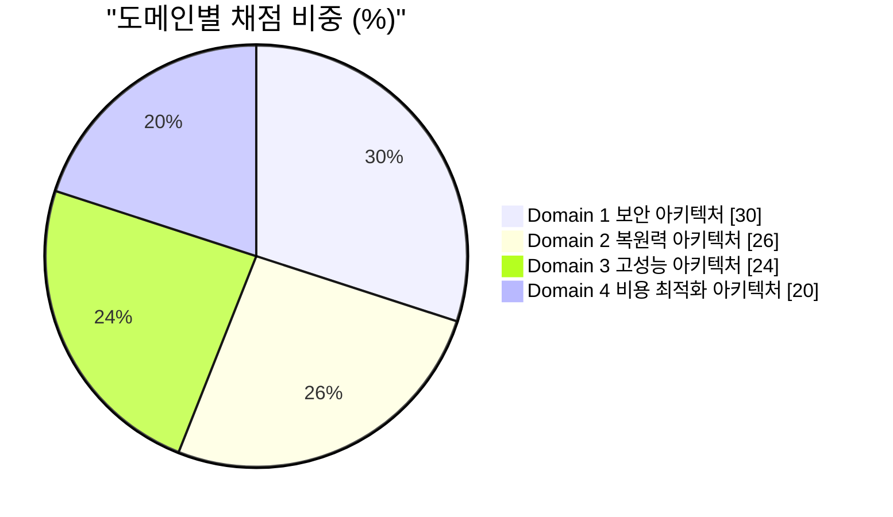

채점 문항이 50개이므로 단순 환산하면 도메인별로 대략 15 / 13 / 12 / 10문항입니다. 다만 정확히 이 개수로 나온다는 보장은 없으니 감각용으로만 쓰세요.

### 1.4 공식 Task로 보는 "무엇을 묻는가"

공식 가이드는 각 도메인을 Task 단위로 쪼갭니다. 이것을 알면 "시험이 나에게 어떤 행동을 요구하는지"가 보입니다.

**Domain 1 (보안)** 은 세 가지 Task로 이뤄집니다. 1.1은 AWS 리소스에 대한 안전한 접근 설계(IAM, 다중 계정 전략, SCP, Control Tower, 역할 전환, 페더레이션), 1.2는 안전한 워크로드와 애플리케이션 설계(VPC 보안 구성요소, 서브넷 분리, Shield·WAF·Secrets Manager 연동, VPN·Direct Connect), 1.3은 적절한 데이터 보안 통제(KMS 저장 데이터 암호화, ACM과 TLS 전송 중 암호화, 키 정책, 백업과 복제, 수명주기, 키·인증서 교체)입니다.

**Domain 2 (복원력)** 는 두 가지입니다. 2.1은 확장 가능하고 느슨하게 결합된 설계(SQS 같은 메시징, 이벤트 기반 설계, 무상태 대 상태 유지, 캐싱, 컨테이너와 서버리스, API 관리), 2.2는 고가용성·내결함성 설계(재해 복구 전략, RPO/RTO, 장애 조치, RDS Proxy, 서비스 한도와 스로틀링, 불변 인프라, X-Ray 같은 가시성)입니다.

**Domain 3 (고성능)** 은 다섯 가지입니다. 3.1 스토리지, 3.2 탄력적 컴퓨팅, 3.3 데이터베이스, 3.4 네트워크(CloudFront, Global Accelerator, 로드 밸런싱, VPN·Direct Connect·PrivateLink), 3.5 데이터 수집과 변환(Athena, Lake Formation, DataSync, Storage Gateway, Glue, Kinesis, EMR, CSV를 Parquet으로 변환하는 것까지)입니다.

**Domain 4 (비용 최적화)** 는 스토리지, 컴퓨팅, 데이터베이스, 네트워크 네 가지입니다. 구매 옵션(Spot, 예약 인스턴스, Savings Plans), S3 수명주기와 스토리지 계층, NAT 게이트웨이 구성(AZ마다 하나 대 공유 하나), 데이터 전송 경로 비용(VPC 엔드포인트 등), Cost Explorer·Budgets·Cost and Usage Report 같은 관리 도구, 비용 할당 태그와 통합 결제가 자주 언급됩니다.

### 1.5 공부하지 않아도 되는 범위 (공식 "범위 밖" 목록)

효율의 핵심은 **안 볼 것을 정하는 것**입니다. 공식 가이드는 범위 밖 서비스를 명시합니다. 대표적으로 개발 도구(AWS CDK, CodeBuild, CodeDeploy, CodeCommit, CodeArtifact, CloudShell, Fault Injection Service), IoT 전 서비스, Amazon GameLift, Amazon Lightsail, Amazon MWAA, AWS Cloud Map, 미디어 서비스(Elemental 제품군), Amazon Personalize, Amazon Braket, AWS Ground Station 등이 있습니다. 이런 서비스는 시험 대비 학습 시간을 쓸 필요가 없습니다.

반대로 범위 안에 있는 것은 폭이 넓습니다. 분석(Athena, EMR, Glue, Kinesis, Lake Formation, MSK, OpenSearch, Redshift, Amazon Quick), 애플리케이션 통합(AppFlow, EventBridge, Amazon MQ, SNS, SQS, Step Functions), 컴퓨팅(EC2, Auto Scaling, Batch, Beanstalk, Outposts, Wavelength 등), 컨테이너(ECS, EKS, ECR), 데이터베이스(Aurora, DocumentDB, DynamoDB, ElastiCache, Keyspaces, Neptune, RDS, Redshift), 보안(ACM, CloudHSM, Cognito, Detective, Directory Service, Firewall Manager, GuardDuty, IAM Identity Center, Inspector, KMS, Macie, Network Firewall, RAM, Secrets Manager, Security Hub, Shield, WAF, IAM), 네트워킹(Client VPN, CloudFront, Direct Connect, ELB, Global Accelerator, PrivateLink, Route 53, Site-to-Site VPN, Transit Gateway, VPC), 스토리지(Backup, EBS, EFS, FSx, S3, Glacier, Storage Gateway) 등입니다. 머신러닝 서비스(Comprehend, Lex, Polly, Rekognition, SageMaker AI, Textract, Transcribe, Translate)도 범위 안이지만, 시험에서는 "이 용도에는 이 서비스" 수준의 매칭으로 충분합니다.

### 1.6 시험 가이드는 바뀝니다

공식 가이드는 개정될 때 **실제 시험에 반영되기 약 한 달 전에 먼저 공개**된다고 명시하고 있습니다. 응시 한 달쯤 전에 공식 가이드의 변경 이력(Change History)과 "범위 안·밖 서비스 변경" 항목을 한 번 확인하는 습관이 안전합니다.

---

## Part 2. 정답의 DNA: AWS가 좋아하는 답의 성격

SAA-C03의 보기는 대부분 "기술적으로 동작은 하는" 것들입니다. 그래서 동작 여부가 아니라 **AWS가 권장하는 설계 철학에 얼마나 부합하는가**로 승부가 갈립니다. 이 철학을 몸에 익히면 모르는 문제에서도 정답 후보를 좁힐 수 있습니다. 아래 일곱 가지 원칙은 AWS Well-Architected의 여섯 기둥(운영 우수성, 보안, 안정성, 성능 효율성, 비용 최적화, 지속 가능성)에서 나온 것이고, 시험이 반복해서 묻는 패턴입니다.

**첫째, 직접 운영보다 관리형을 택합니다.** "운영 부담을 최소화"라는 문구가 보이면 EC2에 직접 설치하는 선택지는 거의 탈락입니다. Lambda, Fargate, Aurora, DynamoDB, SQS, 관리형 Kafka(MSK) 같은 서비스는 패치, 확장, 장애 조치를 AWS가 맡아 줍니다. 공동 책임 모델의 관점에서도, 서비스가 관리형일수록 고객이 책임질 영역이 줄어듭니다.

**둘째, 구성 요소를 느슨하게 결합합니다.** 구성 요소가 서로 직접 호출하면 하나가 느려지거나 죽을 때 연쇄적으로 무너집니다. 사이에 SQS(큐), SNS(알림), EventBridge(이벤트 버스)를 두면 각 구성 요소가 독립적으로 확장되고 실패해도 다른 쪽이 영향받지 않습니다.

**셋째, 장기 자격 증명을 쓰지 않고 최소 권한을 줍니다.** Access Key를 코드나 환경 변수에 넣는 선택지는 거의 항상 오답입니다. IAM 역할, STS 임시 자격 증명, Presigned URL, Cognito Identity Pool처럼 "임시이고 범위가 좁은" 방식이 정답입니다.

**넷째, 장애 범위에 맞는 이중화를 선택합니다.** 인스턴스 장애는 Auto Scaling, **AZ 장애는 Multi-AZ**, **리전 장애는 Multi-Region(재해 복구)** 입니다. 문제가 어떤 규모의 장애를 말하는지 먼저 정하고, 그에 맞는 수준을 고릅니다. 과한 이중화는 비용 위반이고, 모자란 이중화는 가용성 위반입니다.

**다섯째, 목적에 맞게 설계된(purpose-built) 서비스를 씁니다.** 키-값 저지연은 DynamoDB, S3 데이터에 대한 서버리스 SQL은 Athena, 정적 콘텐츠 전송은 CloudFront, 오프라인 대용량 이전은 Snow Family처럼, 용도가 정확히 맞는 서비스가 정답입니다. 범용 서비스로 억지로 해결하는 선택지는 거의 오답입니다.

**여섯째, 요구사항을 전부 충족하는 가장 단순한 해법을 고릅니다.** 요구하지 않은 기능까지 얹은 설계는 과잉 설계입니다. 반대로 요구사항 한 줄이라도 어기면 아무리 매력적이어도 탈락입니다.

**일곱째, 기존 애플리케이션을 바꾸지 않아도 되는 "그대로 끼워 넣는(drop-in)" 서비스를 선호합니다.** "최소한의 코드 변경", "레거시 애플리케이션을 수정할 수 없음"이라는 문구가 나오면 DAX(DynamoDB 앞 캐시), RDS Proxy(연결 풀링), Storage Gateway(온프레미스 프로토콜을 S3로 연결), Aurora(MySQL/PostgreSQL 호환), Application Migration Service(서버 그대로 이전) 같은 선택지를 먼저 떠올리세요.

---

## Part 3. 문제 푸는 기술

### 3.1 다섯 단계 풀이 루틴

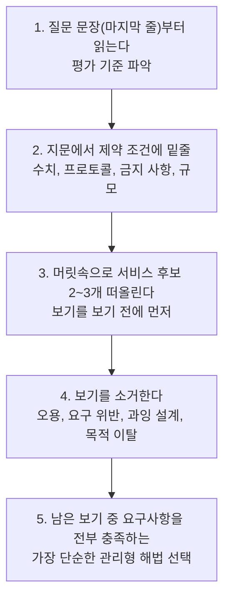

핵심은 **보기를 보기 전에 질문부터 읽는 것**입니다. 긴 시나리오를 처음부터 끝까지 읽고 나면 정작 무엇을 평가하는지 잊기 쉽습니다. "Which solution will meet these requirements MOST cost-effectively?"라는 마지막 문장을 먼저 읽으면, 시나리오를 읽는 동안 "비용"이라는 렌즈로 정보를 걸러낼 수 있습니다.

### 3.2 질문 속 "평가 기준"이 정답의 방향을 정한다

| 질문 속 표현 | 정답의 방향 |
|---|---|
| least operational overhead / minimal management | 관리형·서버리스 서비스. 직접 서버를 운영하는 선택지는 탈락 |
| most cost-effective / lowest cost | 요구를 충족하는 범위에서 가장 저렴한 옵션. 단, 가용성·복구 시간을 깨는 저가 옵션은 탈락 |
| most secure / least privilege | IAM 역할, 최소 권한, 암호화, 사설 연결, 관리형 보안 서비스 |
| highly available | Multi-AZ, ELB + Auto Scaling |
| fault tolerant | 단일 장애점 제거 + 자동 장애 조치 |
| minimal changes to the application | drop-in 서비스(DAX, RDS Proxy, Storage Gateway, Aurora 호환, MGN) |
| near-real-time / streaming | Kinesis Data Streams, Firehose, MSK |
| decouple / absorb spikes / buffer | SQS, SNS, EventBridge |
| scale automatically / unpredictable traffic | Auto Scaling, Lambda, DynamoDB 온디맨드, Aurora Serverless |
| lowest latency for global users | CloudFront(캐싱) 또는 Global Accelerator(TCP/UDP, 고정 IP) |
| immediate (millisecond) access | S3 Standard, Standard-IA, Glacier Instant Retrieval 등 즉시 접근 클래스 |

### 3.3 지문 속 단서 해독표

| 지문의 단서 | 의미하는 것 |
|---|---|
| "without exposing credentials", "no long-term keys" | IAM 역할 / STS / Presigned URL / Cognito Identity Pool |
| "must not traverse the public internet" | VPC 엔드포인트(PrivateLink, Gateway), Direct Connect |
| "even administrators", "cannot be overridden" | Organizations의 SCP |
| "detect and remediate noncompliant resources" | AWS Config + SSM Automation |
| "unpredictable access pattern" (S3) | S3 Intelligent-Tiering |
| "legacy application that cannot be modified" | 코드 변경이 필요 없는 서비스 |
| "on-premises NFS/SMB to S3, repeatable" | DataSync 또는 File Gateway |
| "static IP addresses", "allow-list" | NLB(Elastic IP), Global Accelerator |
| "Windows file shares, Active Directory" | FSx for Windows File Server |
| "HPC", "Lustre" | FSx for Lustre |
| "users logged out when instance replaced" | 세션 상태 외부화(ElastiCache, DynamoDB) |
| "sudden write spikes overload the database" | SQS로 쓰기 버퍼링 |
| "messages repeatedly fail" | DLQ |
| "many accounts, central governance" | Organizations, Control Tower, SCP, RAM |
| "bastion host 없이 서버 접속" | Systems Manager Session Manager |

### 3.4 오답의 네 가지 얼굴

보기를 지울 때는 **왜 틀렸는지**를 네 가지 유형으로 분류하세요. 분류가 되면 판단이 빨라집니다.

**유형 1. 서비스 오용입니다.** 용도가 전혀 다른 서비스를 끌어온 보기입니다. "SQS 큐에 S3 버저닝을 켠다", "KMS에 비밀번호를 저장한다", "GuardDuty로 설정 위반을 차단한다" 같은 것들입니다. 서비스의 본래 목적을 알면 바로 지울 수 있습니다.

**유형 2. 요구사항 위반입니다.** 훌륭해 보이지만 지문의 조건 한 줄을 어깁니다. Public IP를 붙이는 방법은 "인터넷에서 직접 접근 불가" 조건을 깨고, SSE-C로 바꾸는 방법은 "SSE-KMS를 계속 사용" 조건을 깹니다. **조건 하나를 어기면 나머지가 아무리 좋아도 오답**입니다.

**유형 3. 과잉 설계·운영 부담입니다.** 가능은 하지만 직접 만들고 운영해야 하는 보기입니다. 예를 들어 EC2에 Kafka를 설치하는 것은 Kinesis나 MSK가 있는데도 운영 부담만 키웁니다.

**유형 4. 목적 이탈입니다.** 비슷해 보이지만 목적이 다른 서비스입니다. Multi-AZ(고가용성)와 읽기 전용 복제본(읽기 확장), 백업(복구)과 고가용성, CloudFront(캐싱)와 Global Accelerator(네트워크 가속)가 대표적입니다. 이 구분이 시험에서 가장 많이 반복되는 함정입니다.

여기에 **"기술적으로 가능하지만 최선은 아닌" 보기**가 항상 한두 개 섞여 있습니다. 문제에 "most appropriate", "best", "MOST cost-effective"가 있으면 "동작하는가"가 아니라 "가장 알맞은가"를 물은 것입니다.

### 3.5 실전 해독 연습

> A company hosts a web application on a single EC2 instance in one Availability Zone. The MySQL database runs on the same instance. The company wants to improve availability and reduce administration effort without major code changes. Which solution will meet these requirements?

**1단계: 질문부터 읽습니다.** 평가 기준은 세 가지입니다. 가용성 향상, 관리 노력 감소, 큰 코드 변경 없음.

**2단계: 제약에 밑줄을 칩니다.** 단일 인스턴스, 단일 AZ(이중화가 없다는 신호), DB가 같은 인스턴스(웹과 DB를 분리해야 한다는 신호), 코드 변경 최소화(MySQL 호환을 유지해야 한다는 신호).

**3단계: 후보를 떠올립니다.** 웹 계층은 ALB + Auto Scaling(여러 AZ), 데이터베이스는 RDS for MySQL Multi-AZ 또는 Aurora MySQL 호환.

**4단계: 소거합니다.** "더 큰 인스턴스로 변경"은 AZ가 하나라는 문제를 해결하지 못합니다(목적 이탈). "EBS 스냅샷을 자주 생성"은 백업이지 가용성이 아닙니다(목적 이탈). "DynamoDB로 이전"은 코드 변경이 커서 조건을 어깁니다(요구사항 위반). "EC2 두 대에 MySQL 복제를 직접 구성"은 운영 부담이 큽니다(과잉 설계).

**5단계: 선택합니다.** 웹 계층을 ALB와 여러 AZ의 Auto Scaling 그룹으로, 데이터베이스를 RDS Multi-AZ(또는 Aurora)로 옮기는 선택지가 세 기준을 모두 만족합니다.

이 문제를 푸는 데 새로운 지식은 거의 필요 없었다는 점에 주목하세요. **풀이 루틴이 지식의 빈틈을 메웁니다.**

### 3.6 복수 선택 문제 요령

공식 가이드는 복수 선택 문제를 "5개 이상의 보기 중 정답이 2개 이상"이라고 정의합니다. 대개 문제 끝에 "Choose TWO"처럼 개수가 표시됩니다.

먼저 **각 보기를 독립적으로 참/거짓 판정**하세요. 그다음 요구사항을 충족하는 조합을 찾습니다. 서로 짝을 이뤄야 완성되는 해법(예를 들어 "S3 게이트웨이 엔드포인트 생성"과 "버킷 정책에서 엔드포인트 외 접근 거부")은 둘 다 정답일 가능성이 높습니다. 서로 모순되는 보기는 둘 다 정답일 수 없습니다. 확신하는 정답 하나가 있으면 나머지 하나는 그것과 **어울리는 보기**를 고르면 됩니다.

### 3.7 시간 관리

65문항을 130분에 풀면 평균 2분입니다. 권장하는 방식은 **첫 순회에서 문제당 1.5분 안팎**을 목표로 하는 것입니다. 65 × 1.5분 = 약 97분이므로 약 30분이 검토용으로 남습니다. 1.5분 안에 확신이 서지 않으면 가장 유력한 보기를 일단 선택해 두고 검토 표시를 한 뒤 넘어갑니다. 검토 시간에 답을 바꿀 때는 "처음 놓친 제약 조건을 발견했는가"처럼 **명확한 이유가 있을 때만** 바꾸세요. 막연한 불안감으로 바꾼 답은 대개 처음 답보다 못합니다. (시험 시간 130분은 안내되어 온 값이므로 예약 시 확인하세요. 영어가 모국어가 아닌 응시자를 위한 시간 연장 제도와 한국어 응시 가능 여부도 공식 안내에서 직접 확인하시기 바랍니다.)

### 3.8 모르는 문제를 만났을 때

첫째, 서비스 용도가 완전히 틀린 보기부터 지웁니다. 둘째, 남은 두 개 중에서는 Part 2의 일곱 원칙(관리형, 느슨한 결합, 임시 자격 증명, 알맞은 이중화, 목적 특화, 단순함, drop-in)에 더 부합하는 쪽을 고릅니다. 셋째, 어떤 경우에도 답을 비워 두지 않습니다.

### 3.9 영어 지문 읽기 팁

- 지문 앞부분의 "A company wants to..."는 배경이고, 평가는 **제약 조건과 마지막 질문**이 결정합니다. 배경은 빨리 읽고 제약에 힘을 쓰세요.
- "while", "without", "must", "only", "at least", "minimum" 뒤에 오는 말이 결정적 조건입니다.
- 단위에 주의하세요. MB와 Mb, TB와 Tb, Gbps와 GBps는 8배 차이입니다.
- 시험 화면에는 **서비스 약칭과 정식 명칭 대응표를 보여 주는 도움말(Help) 기능**이 있습니다(공식 가이드 명시). 서비스 이름이 낯설면 활용하세요.
- 보기 앞부분이 길면 보기의 **동사와 핵심 서비스명**부터 보세요. 대부분의 구분은 거기서 갈립니다.

---

## Part 4. 핵심 분야 딥다이브

여기서는 서비스를 "기능 목록"이 아니라 **"왜 존재하는가 → 언제 쓰는가 → 시험이 어디서 함정을 파는가"** 순서로 설명합니다. 비유는 이해를 돕기 위한 것이고, 판단 포인트는 시험 그대로입니다.

### 4.1 IAM과 다중 계정 거버넌스 (Domain 1의 심장)

#### 누가, 무엇을, 어떻게 할 수 있는가

IAM은 "누가(Principal) 어떤 리소스에 어떤 행동(Action)을 할 수 있는가"를 정하는 서비스입니다. 구성요소는 네 가지입니다. **사용자**는 장기 자격 증명을 가진 개인이나 프로그램, **그룹**은 사용자를 묶어 권한을 한 번에 주는 단위, **정책**은 허용·거부 규칙을 적은 JSON 문서, **역할(Role)** 은 누구든(사람, 서비스, 다른 계정) 잠시 "맡을 수 있는" 임시 신분입니다.

가장 쉬운 비유는 건물 출입증입니다. 사용자는 이름이 박힌 **영구 사원증**이고, 역할은 방문자에게 그때그때 발급하는 **일회용 출입증**입니다. 영구 사원증(Access Key)을 복사해서 여기저기 붙여 두면 분실과 도용의 위험이 커집니다. 그래서 시험은 "EC2가 S3에 접근해야 한다" 같은 상황에서 **IAM 역할(인스턴스 프로파일)** 을 정답으로 삼고, "Access Key를 인스턴스에 저장"은 거의 언제나 오답으로 둡니다. Lambda는 실행 역할, ECS는 작업 역할, EKS 파드는 IRSA(서비스 어카운트용 IAM 역할)나 Pod Identity로 같은 원리를 적용합니다.

역할에는 정책이 두 종류 붙습니다. **권한 정책(permissions policy)** 은 "이 역할로 무엇을 할 수 있는가"이고, **신뢰 정책(trust policy)** 은 "누가 이 역할을 맡을 수 있는가"입니다. 역할을 맡는 행위는 AWS STS의 AssumeRole 같은 API로 이뤄지고, 결과로 만료 시간이 있는 임시 자격 증명이 나옵니다. 웹 ID(소셜 로그인)나 SAML 페더레이션은 각각 AssumeRoleWithWebIdentity, AssumeRoleWithSAML로 같은 구조를 따릅니다.

#### 정책 평가의 규칙

정책이 여러 개 겹칠 때의 결론은 세 줄로 요약됩니다. **기본은 모두 거부**입니다. **명시적 거부(Deny)는 어떤 허용(Allow)보다 우선**합니다. 거부가 없고 허용이 하나라도 있어야 허용됩니다.

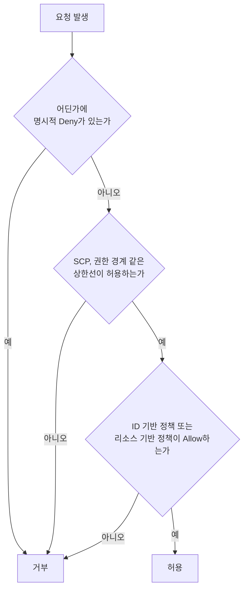

이 흐름에서 SCP와 권한 경계는 **권한을 주는 것이 아니라 상한을 정하는 것**임을 꼭 기억하세요. SCP에 허용이 있어도 IAM 정책에 허용이 없으면 여전히 못 합니다. 반대로 IAM 정책에서 관리자 권한을 줘도 SCP가 막으면 못 합니다.

#### 정책의 종류와 용도

| 정책 종류 | 어디에 붙나 | 역할 |
|---|---|---|
| ID 기반 정책 | 사용자, 그룹, 역할 | 이 주체가 무엇을 할 수 있는지 |
| 리소스 기반 정책 | S3 버킷, SQS 큐, KMS 키 등 | 이 리소스에 누가 접근할 수 있는지 (다른 계정 허용 가능) |
| 권한 경계(Permissions Boundary) | 사용자, 역할 | 한 계정 안에서 그 주체가 가질 수 있는 최대 권한 |
| SCP | Organizations의 OU나 계정 | 계정 전체가 가질 수 있는 최대 권한 |

SCP에서 시험이 자주 노리는 사실이 둘 있습니다. SCP는 **권한을 부여하지 않고 제한만** 하며, **관리 계정(management account)에는 적용되지 않습니다.** "계정의 관리자도 CloudTrail을 끌 수 없게 하라"는 문제의 정답이 SCP인 이유는, 계정 안의 관리자는 자기 계정의 IAM 정책을 마음대로 고칠 수 있지만 조직 차원의 상한은 고칠 수 없기 때문입니다.

#### 교차 계정 접근의 두 가지 방법

다른 계정의 리소스에 접근하는 방법은 크게 둘입니다. 첫째, **역할 위임**입니다. 리소스가 있는 계정에 역할을 만들고 신뢰 정책으로 상대 계정의 주체를 믿도록 한 뒤, 상대가 AssumeRole로 그 역할을 맡아 그 역할의 권한으로 동작합니다. 둘째, **리소스 기반 정책**입니다. 버킷 정책 등에서 상대 계정의 주체를 직접 허용합니다. 이 경우 상대 계정 쪽 ID 정책도 해당 접근을 허용해야 합니다. 두 방법 모두 장기 키를 주고받지 않는다는 점이 공통의 장점입니다.

#### 사람과 앱 사용자: 누구를 인증하는가

| 대상 | 서비스 | 한 줄 설명 |
|---|---|---|
| 회사 직원이 여러 AWS 계정·앱에 로그인 | IAM Identity Center | 중앙 SSO, 외부 IdP나 AD와 연동 |
| 온프레미스 Active Directory 연동 | AWS Directory Service (Managed Microsoft AD, AD Connector) | 기존 디렉터리와 연결 |
| 모바일·웹 앱의 최종 사용자 로그인 | Amazon Cognito User Pool | 가입·로그인·토큰(JWT) 발급, 소셜·SAML·OIDC 연동 |
| 앱 사용자에게 AWS 리소스 임시 접근 부여 | Amazon Cognito Identity Pool | 인증된 사용자에게 STS 임시 자격 증명 발급 |

"앱에 로그인"과 "AWS 리소스에 접근"을 구분하는 것이 열쇠입니다. User Pool은 **누구인지 확인(인증)** 하는 곳이고, Identity Pool은 **확인된 사람에게 AWS 자격 증명을 내주는** 곳입니다. 그리고 S3에 파일 하나를 올리게 해 주는 것이 전부라면, 백엔드가 만들어 주는 **Presigned URL**이 더 가볍습니다. Presigned URL은 만든 쪽의 권한을 대신 위임하는 임시 URL이어서, 만든 자격 증명의 수명을 넘어 유효할 수 없습니다.

#### 다중 계정 전략

계정이 늘어나면 거버넌스가 핵심이 됩니다. **AWS Organizations**는 계정을 OU 트리로 묶고 통합 결제와 SCP를 제공합니다. **AWS Control Tower**는 그 위에 모범 사례 기반의 **랜딩 존**, 새 계정을 일관되게 만드는 Account Factory, 예방형(SCP 기반)·탐지형(Config 기반) 가드레일, 중앙 로그 보관을 자동으로 구성합니다. **AWS RAM(Resource Access Manager)** 은 서브넷, Transit Gateway 같은 리소스를 계정 간에 공유합니다. 루트 사용자는 일상 업무에 쓰지 않고, MFA를 걸고, 액세스 키를 만들지 않는 것이 기본 원칙입니다.

---

### 4.2 VPC와 네트워크 보안 (Domain 1·3의 토대)

#### VPC는 "AWS 안의 내 전용 부지"

VPC는 내가 정한 IP 대역(CIDR)을 가진 논리적으로 격리된 네트워크입니다. 그 안을 **서브넷**으로 나누는데, 서브넷은 하나의 AZ 안에만 존재합니다. 서브넷이 "공용(public)"인지 "사설(private)"인지는 이름이 아니라 **라우팅 테이블**이 결정합니다. 인터넷 게이트웨이(IGW)로 가는 경로가 있으면 공용, 없으면 사설입니다.

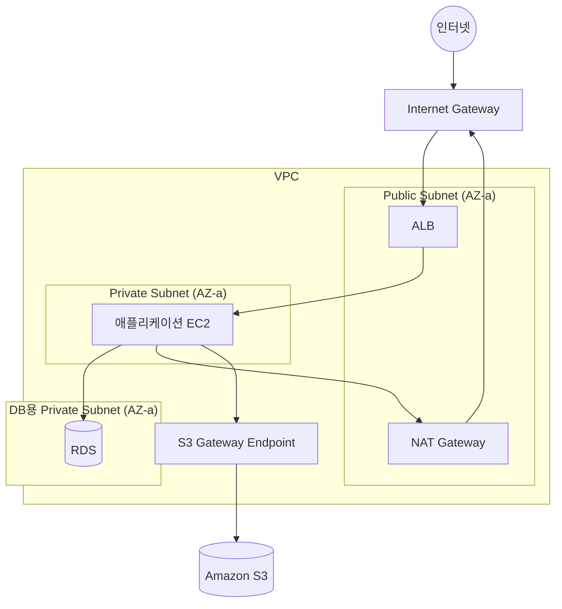

전형적인 3계층 구조입니다. 사용자 요청은 공용 서브넷의 ALB로 들어오고, 애플리케이션과 DB는 사설 서브넷에 숨깁니다. 사설 서브넷의 서버가 패치를 받으려고 인터넷으로 **나가야** 할 때만 NAT 게이트웨이를 거칩니다. 인터넷에서 사설 서브넷으로 **먼저 들어오는** 것은 불가능합니다.

#### 보안 그룹과 네트워크 ACL

둘 다 방화벽이지만 성격이 다릅니다. 보안 그룹은 **인스턴스(ENI) 단위의 상태 저장(stateful)** 방화벽입니다. "허용" 규칙만 있고, 들어온 요청에 대한 응답은 자동으로 허용됩니다. 다른 보안 그룹을 출처로 지정할 수 있어 계층 간 접근 제어에 편리합니다. 네트워크 ACL은 **서브넷 단위의 상태 비저장(stateless)** 방화벽입니다. 허용과 거부 규칙을 둘 다 쓸 수 있고, 규칙 번호가 낮은 것부터 평가해 처음 일치하는 규칙을 적용하며, 응답 트래픽도 별도 규칙이 필요합니다.

| 구분 | 보안 그룹 | 네트워크 ACL |
|---|---|---|
| 적용 단위 | 인스턴스(ENI) | 서브넷 |
| 상태 | 저장(응답 자동 허용) | 비저장(응답도 규칙 필요) |
| 규칙 종류 | 허용만 | 허용과 거부 |
| 평가 방식 | 모든 규칙을 종합 | 번호 순서, 첫 일치 적용 |
| 특정 IP 차단 | 불가(허용만 가능) | 가능 |

"특정 IP 주소를 **차단**해야 한다"가 보이면 네트워크 ACL이 정답 후보입니다. 보안 그룹은 거부 규칙이 없기 때문입니다. 다만 웹 공격 패턴(SQL 인젝션 등) 차단은 L7이므로 WAF의 영역입니다.

#### NAT 게이트웨이

NAT 게이트웨이는 사설 서브넷의 인스턴스가 **인터넷으로 나가는 통로**입니다. 공용 서브넷에 두고 탄력적 IP를 붙이며, 사설 서브넷의 라우팅 테이블에 `0.0.0.0/0 → NAT 게이트웨이`를 추가합니다. 두 가지를 기억하세요. NAT 게이트웨이는 **하나의 AZ 안에 있는 리소스**이므로, AZ 장애에 대비하려면 AZ마다 하나씩 두는 것이 고가용성 구성입니다. 반면 비용 최적화 관점에서는 비프로덕션 환경에서 하나를 공유해 줄이는 선택이 가능합니다. 또한 시험은 "NAT 게이트웨이 대 NAT 인스턴스"의 비용·운영 비교를 묻기도 하는데, NAT 인스턴스는 직접 관리해야 하므로 운영 부담이 큽니다.

#### VPC 엔드포인트: 인터넷을 거치지 않고 AWS 서비스에 접근

| 구분 | 게이트웨이 엔드포인트 | 인터페이스 엔드포인트(PrivateLink) |
|---|---|---|
| 지원 서비스 | **S3, DynamoDB** | 그 외 대부분의 AWS 서비스(Secrets Manager, Systems Manager, CloudWatch, ECR, STS 등)와 PrivateLink 기반 서비스 |
| 구현 방식 | 라우팅 테이블 항목 | 서브넷에 생성되는 ENI(사설 IP) |
| 요금 | 추가 요금 없음 | 시간당 요금과 처리 데이터 요금 |

핵심 구분은 단순합니다. **S3와 DynamoDB는 게이트웨이, 나머지는 인터페이스**입니다. 그리고 "S3 트래픽이 NAT 게이트웨이를 통과해 비용이 많이 든다"는 상황의 정답은 거의 항상 **S3 게이트웨이 엔드포인트**입니다. 엔드포인트와 버킷 정책의 조건 키(`aws:SourceVpce`, `aws:SourceVpc`)를 결합하면 "이 VPC 안에서만 버킷에 접근 가능"을 강제할 수 있습니다. 또한 PrivateLink는 서비스 제공자(NLB 뒤)가 VPC 간·계정 간에 서비스를 **피어링이나 인터넷 없이** 사설로 노출하는 방법으로도 쓰입니다.

#### 네트워크를 연결하는 선택지

| 요구 | 선택 | 핵심 특징 |
|---|---|---|
| VPC 두 개를 연결 | VPC 피어링 | 전이적 라우팅 불가, CIDR 겹치면 불가 |
| 많은 VPC와 온프레미스를 허브로 연결 | Transit Gateway | 허브 앤 스포크, 확장성 |
| 온프레미스와 암호화된 연결을 빠르게 | Site-to-Site VPN | 인터넷 위 IPsec, 연결마다 터널 2개(이중화), 빠르게 구성 |
| 일관된 지연, 큰 대역폭, 전용 회선 | Direct Connect | 전용선, 구축에 시간 소요, **기본적으로 암호화되지 않음** |
| 개별 원격 사용자가 VPC 접속 | Client VPN | 사람 단말을 위한 VPN |
| 서비스를 다른 VPC·계정에 사설 노출 | PrivateLink | 피어링 없이 서비스 단위 노출 |

Direct Connect가 기본적으로 암호화되지 않는다는 점은 시험의 단골 함정입니다. "전용선인데 암호화가 필수"라면 Direct Connect 위에 VPN을 함께 쓰는 구성을 떠올리세요. 또 Direct Connect는 구축에 시간이 걸리므로 "며칠 안에 연결해야 한다"면 Site-to-Site VPN이 정답입니다. 가용성을 높이려면 Direct Connect를 주 경로로, VPN을 백업 경로로 두는 구성이 자주 나옵니다. 마지막으로 VPC Flow Logs는 VPC 안의 IP 트래픽 메타데이터를 CloudWatch Logs나 S3에 기록해, 누가 누구와 통신했는지 분석할 때 쓰입니다.

---

### 4.3 데이터 보호와 보안 서비스 지도 (Domain 1.3)

#### 암호화는 두 방향: 저장 중과 전송 중

**저장 데이터(at rest)** 암호화의 중심은 **AWS KMS**입니다. **전송 중(in transit)** 암호화의 중심은 **TLS**이고, 그 인증서를 발급·관리하는 서비스가 **AWS Certificate Manager(ACM)** 입니다.

KMS가 하는 일을 쉽게 말하면, **"암호화 키의 금고 관리소"** 입니다. 데이터를 직접 보관하는 서비스가 아니라 키를 만들고, 접근을 통제하고, 사용 내역을 기록합니다. 몇 가지 개념을 정리합니다.

- **키 종류**: AWS 소유 키, AWS 관리형 키, 고객 관리형 키(CMK). 키 정책을 직접 정해 접근자와 사용 조건을 세밀하게 통제하려면 고객 관리형 키입니다.
- **키 정책이 근본**입니다. KMS 키의 접근은 키 정책이 기준이고, IAM 정책은 키 정책이 허용하는 범위 안에서 작동합니다.
- **봉투 암호화(envelope encryption)** : 큰 데이터는 "데이터 키"로 암호화하고, 그 데이터 키를 KMS 키로 암호화해 함께 저장합니다. KMS는 데이터 자체가 아니라 데이터 키를 다루므로 큰 데이터에도 효율적입니다.
- **감사**: 키 사용 호출은 CloudTrail에 기록됩니다. "누가 언제 복호화했는지 감사"가 요구되면 SSE-KMS가 답입니다.
- **교체**: 고객 관리형 키는 자동 교체를 켤 수 있습니다.
- 키는 **리전 단위**입니다. 다른 리전에서 쓰려면 멀티 리전 키나 별도 키가 필요합니다.
- **CloudHSM**은 고객이 단독으로 쓰는 전용 하드웨어 보안 모듈입니다. 키에 대한 **완전한 통제나 특정 규정 준수 요구**가 있을 때 선택하고, 일반적인 암호화는 KMS로 충분합니다.

#### S3 암호화 옵션

| 방식 | 키는 누가 관리 | 특징 |
|---|---|---|
| SSE-S3 | S3가 관리 | 가장 단순. 2023년 초부터 신규 객체에 기본 적용 |
| SSE-KMS | KMS 키 | 키 정책으로 접근 통제, CloudTrail 감사 가능 |
| SSE-C | 고객이 요청마다 키를 제공 | AWS는 키를 저장하지 않음. 키 관리와 전달은 고객 책임 |
| 클라이언트 측 암호화 | 고객 | 업로드 전에 고객이 직접 암호화 |

요청이 매우 많은 워크로드에서 SSE-KMS의 KMS 호출 비용이 커지면, **S3 Bucket Key**를 켜서 KMS 호출 횟수를 줄입니다. 암호화를 끄거나 SSE-C로 바꾸는 방법은 보안 요구를 어기므로 오답입니다. EBS와 RDS는 **생성 시점에** 암호화를 정합니다. 이미 만든 암호화되지 않은 볼륨이나 DB를 암호화하려면, 스냅샷을 만들고 암호화 옵션으로 복사한 뒤 그 복사본에서 복원하는 절차를 밟습니다.

#### 비밀과 설정: Secrets Manager와 Parameter Store

| 구분 | Secrets Manager | Systems Manager Parameter Store |
|---|---|---|
| 주 용도 | DB 비밀번호, API 키 같은 **비밀** | 설정값, 환경 변수, 단순 파라미터 |
| 자동 교체 | **내장**(RDS 등과 통합) | 기본 내장 아님 |
| 암호화 | KMS 사용 | SecureString 유형으로 KMS 사용 |
| 비용 | 비밀당 요금 | 표준 파라미터는 무료 |

"**자동으로 교체**되어야 하는 DB 자격 증명"이 보이면 Secrets Manager, "일반 설정값 저장"이면 Parameter Store입니다. KMS는 비밀번호를 저장하는 서비스가 아니라 **키를 관리**한다는 점을 반드시 구분하세요.

#### ACM과 전송 중 암호화

ACM은 TLS 인증서를 발급하고 **자동으로 갱신**해 주며, ELB, CloudFront, API Gateway 같은 통합 서비스에서 쓰입니다. ACM이 발급한 퍼블릭 인증서는 내보낼 수 없어 EC2 인스턴스에 직접 설치하는 용도로는 쓸 수 없습니다. CloudFront용 인증서는 us-east-1 리전에서 요청해야 한다는 점도 유명한 함정입니다. 로드 밸런서에서 TLS를 종료할지(오프로드), 백엔드까지 암호화할지는 요구에 따라 갈립니다.

#### 보안 서비스 지도

보안 서비스가 많아 보이지만 "무엇을 하고 싶은가"로 나누면 간단합니다.

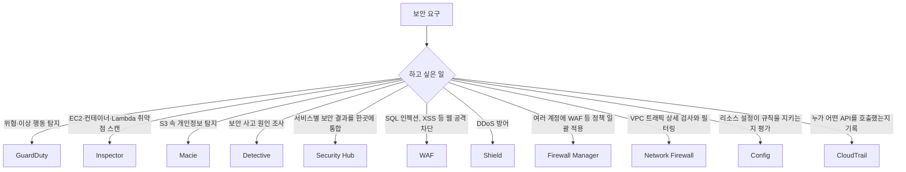

| 서비스 | 한 줄 정의 | 흔한 혼동 |
|---|---|---|
| GuardDuty | CloudTrail, VPC Flow Logs, DNS 로그 등을 분석해 **위협을 탐지** | 탐지만 하고 막지 않음 |
| Inspector | 취약점과 노출을 **자동 스캔** | 위협 탐지(GuardDuty)와 다름 |
| Macie | S3의 **민감 데이터(PII) 발견** | S3 접근 통제 서비스가 아님 |
| Detective | 사고의 **근본 원인 조사** | 탐지 서비스가 아님 |
| Security Hub | 여러 서비스의 **보안 결과를 통합·우선순위화** | 직접 탐지하는 서비스가 아님 |
| WAF | L7 **웹 공격 차단**(ALB, CloudFront, API Gateway 등에 연결) | DDoS 방어(Shield)와 다름 |
| Shield | **DDoS 방어**. Standard는 모든 고객에게 자동·무료, Advanced는 유료 | WAF와 역할이 다름 |
| Firewall Manager | Organizations 전반에 **방화벽 정책 중앙 배포** | 단일 계정용 WAF가 아님 |
| Network Firewall | VPC 수준의 **관리형 네트워크 방화벽** | 보안 그룹과 다른 계층 |
| Config | 리소스 **구성 준수 평가와 변경 이력**, 자동 교정 연동 | 예방 서비스가 아님 |
| CloudTrail | **API 호출 감사 기록** | 차단 도구가 아님 |

여기서 시험이 가장 사랑하는 질문 세 가지를 정리합니다. 첫째, **"관리자라도 못 하게 막기"는 SCP(예방)** 입니다. 둘째, **"위반을 감지하고 자동 수정"은 Config + SSM Automation(탐지·교정)** 입니다. 셋째, **"의심스러운 활동을 탐지"는 GuardDuty**입니다. 예방, 탐지, 감사라는 세 역할을 구분하면 대부분 풀립니다.

---

### 4.4 느슨한 결합과 이벤트 기반 설계 (Domain 2.1)

#### 왜 "사이에 뭔가를 끼우는가"

식당을 떠올려 보세요. 손님이 주방에 직접 가서 "이거 만들어 주세요" 하면, 주방이 바쁠 때 손님은 계속 서서 기다리고 주방은 몰려드는 손님에 무너집니다. 그래서 식당에는 **주문서를 꽂아 두는 레일**이 있습니다. 손님은 주문서만 꽂고 자리에 앉고, 주방은 자기 속도로 주문서를 뽑아 처리합니다. 이 레일이 **SQS(큐)** 입니다. 갑자기 주문이 몰려도 주문서가 쌓일 뿐 사라지지 않고, 주방 인원을 늘리면 처리 속도도 올라갑니다. 이것이 "느슨한 결합"과 "트래픽 급증 흡수"의 본질입니다.

#### SQS: 메시지를 쌓아 두고 천천히 처리

SQS에는 두 종류가 있습니다. **Standard 큐**는 사실상 무제한에 가까운 처리량을 내지만 전달이 "적어도 한 번(at-least-once)"이어서 **중복 전달이 가능**하고 순서도 보장하지 않습니다(그래서 소비자는 멱등하게 만들어야 합니다). **FIFO 큐**는 메시지 그룹 안에서 순서를 보장하고 중복 없이 한 번만 처리하는 대신 처리량에 제한이 있습니다. "주문 순서가 중요하다", "정확히 한 번 처리"가 보이면 FIFO입니다.

운영 개념 몇 가지도 시험에 자주 나옵니다.

- **가시성 제한 시간(visibility timeout)**: 소비자가 메시지를 가져가면 다른 소비자에게 일정 시간 보이지 않게 합니다(기본 30초). 이 시간 안에 처리 후 삭제하지 못하면 메시지가 다시 보여 재처리됩니다. 처리 시간이 긴 작업이면 이 값을 늘립니다.
- **보관 기간**: 기본 4일이며 최대 14일까지 설정합니다.
- **긴 폴링(long polling)**: 빈 응답을 줄여 비용과 지연을 낮춥니다.
- **DLQ(Dead-Letter Queue)**: 여러 번 처리에 실패한 메시지를 따로 격리합니다. 큐에 `maxReceiveCount`를 설정해 그 횟수를 넘으면 DLQ로 이동시킵니다. 이렇게 하면 "계속 실패하는 메시지(포이즌 메시지)가 정상 처리를 막는" 문제를 막고, 실패한 메시지를 나중에 분석할 수 있습니다.

**큐 길이 기반 Auto Scaling**도 단골입니다. 작업량이 CPU가 아니라 "큐에 쌓인 메시지 수"에 비례하는 워커라면, CPU 사용률보다 큐 길이가 더 직접적인 지표입니다. AWS가 권장하는 구체적 방식은 큐의 대기 메시지 수(ApproximateNumberOfMessagesVisible)를 인스턴스 수로 나눈 **"인스턴스당 백로그"** 를 사용자 지정 지표로 만들어 목표 추적 조정을 거는 것입니다. 시험에서는 "SQS 큐 길이 기반"이라는 방향만 알면 충분합니다.

#### SNS: 하나를 여러 곳에 뿌리는 방송

SNS는 게시/구독(pub/sub) 서비스입니다. 주제(topic)에 메시지를 한 번 발행하면 구독자 전부(SQS, Lambda, HTTP 엔드포인트, 이메일, SMS, 모바일 푸시 등)에게 전달됩니다. SQS와 SNS의 차이는 "누가 가져가는가"입니다. **SQS는 소비자가 당겨(pull) 가져가고 한 메시지는 한 소비자만 처리**합니다. **SNS는 발행하면 모든 구독자에게 밀어 넣습니다(push)**.

둘을 결합한 **팬아웃(fan-out)** 패턴이 정석입니다. 하나의 이벤트를 SNS 주제에 발행하고, 처리 주체마다 별도 SQS 큐를 구독시킵니다. 각 큐가 독립적이므로 한 처리가 느려지거나 실패해도 다른 처리에 영향이 없고, 새 소비자를 추가해도 생산자는 바꿀 필요가 없습니다.

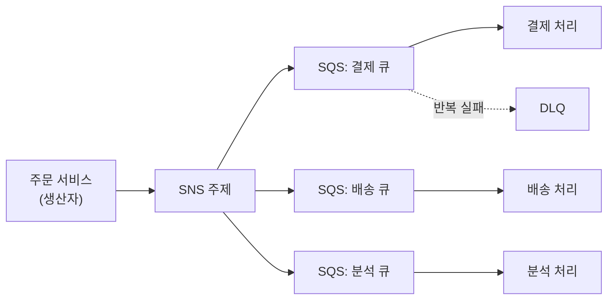

한 큐에 소비자 여러 개를 붙이는 방식은 팬아웃이 아닙니다. 그 경우 각 메시지는 소비자 중 **하나**에게만 갑니다(경쟁 소비자). 이 차이는 시험의 대표 함정입니다.

#### EventBridge와 Step Functions

**EventBridge**는 이벤트 버스입니다. AWS 서비스, 내 애플리케이션, SaaS 파트너가 보내는 이벤트를 **규칙(패턴)** 으로 걸러 원하는 대상(Lambda, SQS, Step Functions 등)에 전달하고, 일정 기반 실행(스케줄)도 지원합니다. "이벤트가 발생하면 반응하는 서버리스 설계"의 중심입니다.

**Step Functions**는 여러 단계로 된 작업 흐름을 **상태 머신**으로 정의하고 순서, 분기, 병렬 처리, 재시도, 오류 처리를 관리하는 오케스트레이션 서비스입니다. "여러 Lambda를 순서대로 호출하되 실패 시 재시도와 보상 처리가 필요하다"면 Lambda 안에서 Lambda를 부르는 코드를 짜지 말고 Step Functions를 선택하세요.

#### API Gateway와 Lambda

**API Gateway**는 REST, HTTP, WebSocket API를 만들고 관리하는 관리형 서비스입니다. 인증은 IAM, Cognito Authorizer, Lambda Authorizer(커스텀 로직), HTTP API의 JWT Authorizer(OIDC·OAuth2 토큰 검증)로 구성할 수 있습니다. 스로틀링과 사용량 계획, 캐싱(REST API) 같은 기능도 갖고 있습니다. 서버리스 API의 표준 조합은 **API Gateway + Lambda + DynamoDB**입니다.

**Lambda**는 이벤트에 반응해 코드를 실행하는 서버리스 컴퓨팅입니다. 서버 관리가 없고 요청에 따라 자동 확장되며, **한 번 실행은 최대 15분**으로 제한됩니다. 그래서 15분을 넘는 장시간 작업은 Fargate, EC2, Batch 같은 선택지로 가야 합니다. VPC 안의 리소스에 접근하려면 Lambda를 VPC에 연결할 수 있고, 그 상태에서 인터넷에 나가려면 NAT 게이트웨이가 필요하다는 점도 기억하세요.

#### 무상태(stateless) 설계

Auto Scaling 환경에서 인스턴스는 언제든 사라질 수 있습니다. 로그인 세션을 인스턴스 메모리에 저장하면 인스턴스가 교체될 때 사용자는 로그아웃됩니다. ALB의 스티키 세션은 같은 사용자를 같은 인스턴스로 보내 완화할 뿐, **인스턴스가 사라지면 세션도 사라지는 근본 문제**는 그대로입니다. 정석은 세션을 **ElastiCache나 DynamoDB 같은 외부 저장소로 옮겨** 어떤 인스턴스로 요청이 가도 같은 세션을 읽게 만드는 것입니다.

---

### 4.5 고가용성과 재해 복구 (Domain 2.2)

#### 장애의 크기에 맞는 이중화

| 장애 범위 | 대응 |
|---|---|
| 인스턴스 하나 | Auto Scaling이 대체 인스턴스를 띄움 |
| **AZ 하나** | **Multi-AZ** 구성(여러 AZ에 분산, DB는 Multi-AZ) |
| **리전 전체** | **Multi-Region**, 재해 복구(DR) 전략 |

그리고 **고가용성(HA)** 은 장애가 나도 짧은 중단으로 빠르게 복구하는 것, **내결함성(fault tolerance)** 은 구성 요소가 고장 나도 서비스가 중단되지 않는 것으로 구분합니다.

#### 로드 밸런서 선택

| 종류 | 계층 | 대표 특징 | 이럴 때 |
|---|---|---|---|
| ALB | L7(HTTP/HTTPS) | 경로·호스트 기반 라우팅, 웹소켓, WAF 연결, 대상으로 Lambda 가능 | 웹 애플리케이션, 마이크로서비스 |
| NLB | L4(TCP/UDP/TLS) | 초저지연, 대규모 처리, **AZ별 고정(탄력적) IP**, 클라이언트 IP 보존 | 게임, TCP/UDP, **고정 IP 허용 목록** |
| GWLB | L3 | 서드파티 가상 어플라이언스(방화벽 등)를 투명하게 삽입 | 보안 어플라이언스 |

"고정 IP 주소가 필요하다"에는 NLB를, HTTP 기반이면서 고정 IP가 필요하면 ALB 앞에 Global Accelerator를 두는 구성을 떠올립니다. 로드 밸런서의 **상태 확인(health check)** 이 비정상 대상을 빼 주고, Auto Scaling 그룹이 **ELB 상태 확인을 사용하도록** 설정하면 ALB 검사에 실패한 인스턴스를 그룹이 교체합니다(기본 EC2 상태 확인은 인스턴스 하드웨어 수준만 봅니다).

#### Auto Scaling의 정책들

| 정책 | 동작 | 적합한 상황 |
|---|---|---|
| 목표 추적(Target Tracking) | "CPU를 50%로 유지"처럼 목표값을 정하면 알아서 증감 | 가장 단순한 기본 선택 |
| 단계 조정(Step) | 경보 크기에 따라 단계별 증감 | 지표 편차에 따라 세밀한 반응 |
| 예약(Scheduled) | 정해진 시각에 증감 | **트래픽 시간대가 명확**할 때 |
| 예측(Predictive) | 과거 패턴으로 미리 확장 | 반복되는 주기적 패턴 |

Auto Scaling 그룹은 **여러 AZ에 걸쳐** 구성해야 의미가 있습니다. 한 AZ에 몰아 두면 그 AZ 장애에 무방비입니다. 또한 **불변 인프라(immutable infrastructure)** 는 서버를 패치하지 않고 새 AMI로 만든 새 인스턴스로 교체하는 방식으로, 일관성과 자동화에 유리합니다.

#### 데이터베이스의 고가용성

RDS는 용어가 비슷해 가장 많이 헷갈립니다. 정확히 구분하세요.

| 구분 | 목적 | 복제 방식 | 읽기 트래픽 처리 | 장애 조치 |
|---|---|---|---|---|
| **Multi-AZ DB 인스턴스 배포** | 고가용성 | 동기 복제로 다른 AZ에 스탠바이 유지 | **스탠바이는 읽기에 쓸 수 없음** | 자동 |
| **Multi-AZ DB 클러스터 배포**(MySQL·PostgreSQL) | 고가용성 + 읽기 | 쓰기 인스턴스 1개 + **읽기 가능한 스탠바이 2개** | 가능(스탠바이에서 읽기) | 자동 |
| **읽기 전용 복제본(Read Replica)** | **읽기 확장**, 리포팅, 교차 리전 | **비동기** 복제 | 가능 | 자동 장애 조치가 목적 아님(수동 승격) |

정리하면, 전통적인 Multi-AZ(인스턴스 배포)는 "장애 대비용 예비 인스턴스"이고, 읽기 전용 복제본은 "읽기를 나눠 처리하는 일꾼"입니다. 시험은 "리포팅 쿼리를 운영 DB에서 분리하라"에 읽기 전용 복제본을, "AZ 장애에 자동 복구"에 Multi-AZ를 정답으로 둡니다. 읽기 전용 복제본은 비동기라 약간의 지연(stale data)이 있을 수 있다는 점도 지문에 단서로 나옵니다.

**Aurora**는 구조가 다릅니다. 데이터가 세 AZ에 걸쳐 여섯 개 복사본으로 저장되는 공유 클러스터 스토리지를 쓰고, 읽기 전용 복제본(Aurora Replica)을 최대 15개까지 둘 수 있으며, 장애 시 복제본 중 하나가 쓰기 인스턴스로 승격됩니다. 리더 엔드포인트가 복제본들에 읽기를 분산합니다. 다른 리전으로 확장하려면 **Aurora Global Database**(일반적으로 1초 미만의 복제 지연)를 쓰고, 트래픽이 들쭉날쭉한 관계형 워크로드에는 **Aurora Serverless v2**가 용량을 자동 조절합니다.

**RDS Proxy**는 애플리케이션과 DB 사이에서 연결을 풀링해 줍니다. Lambda처럼 짧게 많은 연결을 만드는 클라이언트가 DB 연결 한도를 소진하는 문제를 줄이고, 장애 조치 시 연결 복구도 빠르게 해 줍니다. 코드 변경이 거의 없다는 점에서 drop-in의 좋은 예입니다.

**백업**은 자동 백업(보존 기간 설정, 특정 시점 복구 지원)과 수동 스냅샷(직접 삭제하기 전까지 유지)이 있고, 스냅샷을 다른 리전으로 복사해 리전 장애에 대비할 수 있습니다. **백업은 복구용이지 고가용성이 아닙니다.** 이 구분이 시험의 목적 이탈 오답 유형 4번입니다.

#### Route 53: DNS로 트래픽 방향을 정한다

| 라우팅 정책 | 하는 일 |
|---|---|
| 단순(Simple) | 레코드 값을 그대로 응답. 상태 확인 기반 제어 없음 |
| 가중치(Weighted) | 비율대로 분산(예: 90:10), 점진 배포에 유용 |
| 지연 시간(Latency) | **사용자에게 지연이 가장 낮은 리전**으로 |
| **장애 조치(Failover)** | 주(primary)가 비정상이면 보조(secondary)로. **액티브-패시브** |
| 지리적 위치(Geolocation) | 사용자의 **위치(국가·대륙)** 기준 라우팅 |
| 다중 값(Multivalue) | 정상인 여러 레코드를 반환 |

Route 53의 **상태 확인(health check)** 과 결합해야 비정상 대상을 제외할 수 있습니다. 별칭(Alias) 레코드는 AWS 리소스(ALB, CloudFront 등)를 가리키며 **존 정점(zone apex, 예: example.com)** 에도 쓸 수 있습니다. CNAME은 존 정점에 쓸 수 없다는 점이 단골 함정입니다. "지연 시간 기준"과 "위치 기준"은 비슷해 보여도 다르니, 지문에 "lowest latency"가 있으면 Latency를 고르세요.

#### 재해 복구(DR) 전략

DR의 두 지표를 먼저 정리합니다. **RPO(복구 시점 목표)** 는 "데이터를 얼마나 과거 시점까지 잃어도 되는가", **RTO(복구 시간 목표)** 는 "장애 후 얼마 안에 복구해야 하는가"입니다.

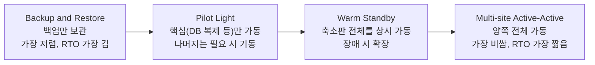

| 전략 | 평소 DR 리전 상태 | 장애 시 해야 할 일 | 비용 | RTO |
|---|---|---|---|---|
| Backup and Restore | 백업(스냅샷)만 보관 | 인프라를 만들고 데이터를 복원 | 가장 낮음 | 가장 김 |
| Pilot Light | 데이터 계층만 복제·가동, 애플리케이션 서버는 꺼짐 | 서버를 기동하고 확장 | 낮음~중간 | 중간 |
| Warm Standby | **축소된 규모의 전체 환경이 상시 가동** | 확장만 하면 됨 | 중간 | 짧음 |
| Active-Active | 양쪽이 모두 전체 용량으로 서비스 | 트래픽을 한쪽으로 전환 | 가장 높음 | 가장 짧음(거의 즉시) |

선택 요령은 이렇습니다. 요구에 "가장 저렴, 복구는 느려도 됨"이면 Backup and Restore(예: 교차 리전 스냅샷 복사), "핵심 DB는 항상 최신, 나머지는 필요할 때"면 Pilot Light, "분 단위 복구, 하지만 Active-Active는 과함"이면 Warm Standby, "중단이 거의 없어야 함"이면 Active-Active입니다. 한 가지 더 알아 둘 점은, DR 리전에서 갑자기 많은 리소스를 띄울 때 **서비스 한도(service quota)와 스로틀링**에 걸릴 수 있으므로 대기 환경의 한도를 미리 확보해 둬야 한다는 것입니다(공식 가이드가 언급하는 항목입니다). 분산 애플리케이션의 요청 흐름을 시각화하고 병목을 찾는 서비스는 **X-Ray**입니다.

---

### 4.6 스토리지: 객체, 블록, 파일 (Domain 3.1·4.1)

스토리지는 먼저 **세 가지 형태**로 나눕니다. **객체**(S3)는 URL로 접근하는 무한 확장형 저장소, **블록**(EBS)은 서버에 붙이는 디스크, **파일**(EFS, FSx)은 여러 서버가 함께 쓰는 공유 폴더입니다.

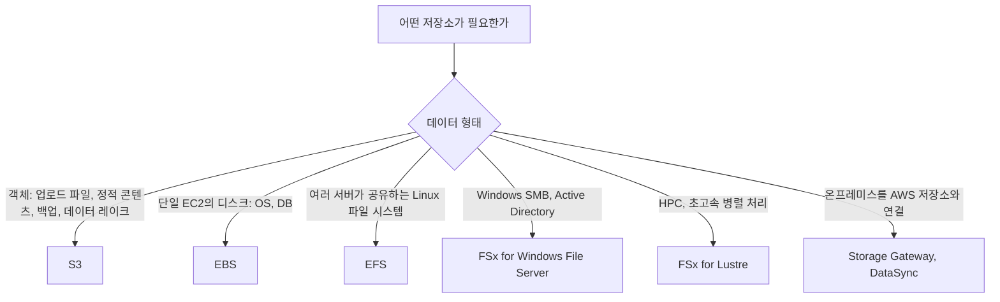

#### S3

S3는 객체 저장소입니다. 객체 하나는 최대 5TB이고, 한 번의 PUT은 최대 5GB이므로 큰 파일은 **멀티파트 업로드**(대략 100MB 이상에서 권장, 5GB 초과 시 필수)를 씁니다. 지금의 S3는 쓰기 후 읽기에 대해 **강한 일관성**을 제공합니다. 내구성은 모든 스토리지 클래스가 "99.999999999%(9가 11개)"로 설계되어 있고, 클래스마다 가용성과 비용, 접근 방식이 다릅니다.

| 클래스 | 접근 패턴 | 즉시 접근 | 최소 보관 기간 | 핵심 메모 |
|---|---|---|---|---|
| Standard | 자주 접근 | 예 | 없음 | 기본값 |
| Intelligent-Tiering | **접근 패턴을 예측하기 어려움** | 예(자동 계층) | 없음 | 객체별 모니터링 요금은 있으나 검색 요금 없음. 선택형 아카이브 계층은 복원 필요 |
| Standard-IA | 드물게(월 1회 정도), 필요 시 즉시 | 예 | 30일 | 검색 요금 있음 |
| One Zone-IA | 드물게 접근, **재생성 가능한 데이터** | 예 | 30일 | **단일 AZ** 저장, AZ 손실 시 데이터 손실 |
| Glacier Instant Retrieval | 분기 1회 정도, **밀리초 접근** | 예 | 90일 | 아카이브 중 즉시 접근 |
| Glacier Flexible Retrieval | 드물게, 복원 시간 허용 | 아니오 | 90일 | 복원: 신속 1~5분, 표준 3~5시간, 대량 5~12시간 |
| Glacier Deep Archive | 연 1~2회, **가장 저렴한 장기 보관** | 아니오 | 180일 | 복원: 표준 12시간 이내, 대량 48시간 이내 |

선택의 열쇠는 두 질문입니다. **얼마나 자주 읽는가**, **즉시 읽어야 하는가**. 접근 패턴이 **예측 불가**하면 Intelligent-Tiering, 예측 가능한 기간 경과(예: 30일 뒤엔 드물게 접근)면 **수명주기(Lifecycle) 규칙**으로 단계적으로 옮깁니다. 즉시 접근이 필요한데 Glacier Deep Archive를 고르면 요구 위반입니다.

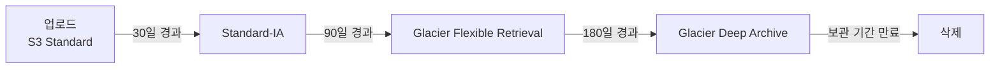

이처럼 수명주기 규칙은 "기간 기반"으로 클래스를 옮기거나 객체를 삭제합니다.

S3의 나머지 핵심 기능을 정리합니다.

- **버전 관리**: 덮어쓰기와 삭제로부터 객체를 보호합니다.
- **복제(CRR, SRR)**: 리전 간·리전 내 복제. **원본과 대상 모두 버전 관리가 필요**하고, 기본적으로 활성화한 이후의 새 객체에 적용됩니다.
- **Object Lock**: WORM(한 번 쓰면 못 바꿈). **거버넌스 모드**는 특별 권한이 있으면 우회 가능하고, **규정 준수(Compliance) 모드**는 루트 사용자도 보관 기간 동안 삭제·변경할 수 없습니다. 법적 보존(Legal Hold)은 보관 기간과 별개로 설정합니다. 버전 관리가 필요합니다.
- **Transfer Acceleration**: 먼 거리의 업로드를 CloudFront 엣지를 경유해 가속합니다.
- **Presigned URL**: 임시 업로드·다운로드 링크를 만듭니다.
- **이벤트 알림**: 객체 생성 등의 이벤트를 SQS, SNS, Lambda, EventBridge로 보냅니다.
- **접근 통제**: IAM 정책, 버킷 정책, 퍼블릭 액세스 차단(Block Public Access)을 씁니다. CloudFront 뒤의 버킷은 **OAC(Origin Access Control)** 로 CloudFront만 접근하도록 제한합니다.
- **요청자 부담(Requester Pays)**: 데이터를 내려받는 쪽(인증된 AWS 계정)이 요청·전송 비용을 부담합니다.

#### EBS

EBS는 EC2에 붙이는 블록 디스크이고 **특정 AZ에 묶여** 있습니다. 다른 AZ나 리전에서 쓰려면 스냅샷을 거칩니다.

| 유형 | 성격 | 용도 |
|---|---|---|
| gp3 | 범용 SSD. 기본 3,000 IOPS와 125 MiB/s, 용량과 별개로 성능 조정 | 대부분의 워크로드의 기본 선택 |
| gp2 | 범용 SSD. IOPS가 용량에 비례 | 구형 범용 |
| io2 / io2 Block Express | 프로비저닝 IOPS SSD. 지속적 고IOPS, 저지연 | 대규모 DB 등 높은 I/O |
| st1 | 처리량 최적화 HDD | 대용량 순차 처리(로그, 빅데이터) |
| sc1 | 콜드 HDD, 가장 저렴 | 드물게 접근하는 대용량 |

gp3는 최대 16,000 IOPS까지 설정할 수 있으므로 그 이상의 지속 IOPS와 낮은 지연이 요구되면 io2가 정답 후보입니다. st1과 sc1은 부팅 볼륨으로 쓸 수 없습니다. io1/io2는 같은 AZ 안에서 **Multi-Attach**로 여러 인스턴스에 붙일 수 있습니다. 인스턴스 스토어는 호스트에 붙은 임시 스토리지이므로 인스턴스를 중지·종료하면 데이터가 사라집니다.

#### EFS, FSx, Storage Gateway, Backup

**EFS**는 여러 Linux 인스턴스가 NFS로 동시에 마운트하는 관리형 공유 파일 시스템입니다. 용량이 자동으로 늘고 줄며, 여러 AZ에 걸친 표준 클래스와 단일 AZ 클래스, 자주 안 쓰는 파일을 싸게 보관하는 IA·Archive 계층이 있습니다. Windows에서는 쓸 수 없습니다.

**FSx**는 네 가지 맛이 있습니다. **FSx for Windows File Server**는 SMB와 Active Directory가 필요한 Windows 워크로드용, **FSx for Lustre**는 HPC·머신러닝처럼 초고속 병렬 처리와 S3 연동이 필요한 워크로드용, FSx for NetApp ONTAP은 NFS·SMB·iSCSI를 모두 쓰는 멀티 프로토콜 용도, FSx for OpenZFS는 NFS용입니다. 시험에서는 앞의 둘이 압도적으로 자주 나옵니다.

**Storage Gateway**는 온프레미스 애플리케이션이 익숙한 프로토콜(NFS, SMB, iSCSI, 가상 테이프)로 쓰면서 데이터는 AWS(S3 등)에 저장하게 하는 하이브리드 서비스입니다. File Gateway, Volume Gateway, Tape Gateway로 나뉘며 "기존 애플리케이션을 바꾸지 않고 클라우드 스토리지를 쓴다"는 drop-in 패턴의 대표입니다.

**AWS Backup**은 EBS, RDS, EFS, DynamoDB 등 여러 서비스의 백업을 정책으로 중앙 관리합니다. "여러 서비스의 백업 정책을 한곳에서"라는 문구가 보이면 떠올리세요.

---

### 4.7 컴퓨팅 선택과 구매 옵션 (Domain 3.2·4.2)

#### 무엇으로 실행할 것인가

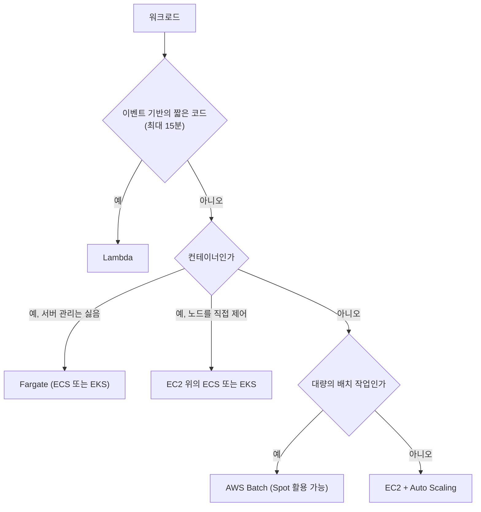

**EC2**는 가장 유연하지만 운영 책임도 가장 큽니다. 인스턴스 계열은 목적별로 나뉩니다. 범용(M, T), 컴퓨팅 최적화(C), 메모리 최적화(R, X), 스토리지 최적화(I, D), 가속 컴퓨팅(P, G 등)입니다. 지문에 "메모리를 많이 쓰는 인메모리 DB"가 나오면 메모리 최적화, "CPU 집약적 인코딩"이면 컴퓨팅 최적화를 떠올리면 됩니다.

**컨테이너**에서는 오케스트레이터와 실행 기반을 나눠서 봅니다. 오케스트레이터는 ECS(AWS 고유, 단순)와 EKS(관리형 쿠버네티스), 실행 기반은 **Fargate**(서버·노드 관리가 없는 서버리스)와 EC2(노드를 직접 관리)입니다. 이미지 저장소는 ECR입니다. "서버 관리 없이 컨테이너를 실행"이면 Fargate입니다. **Lambda**는 15분 한도 안의 이벤트 처리에, **AWS Batch**는 대량 배치 작업의 스케줄링과 자원 관리에, **Elastic Beanstalk**는 코드를 올리면 환경을 알아서 구성해 주는 PaaS에 어울립니다. 온프레미스에서 AWS 인프라를 그대로 쓰려면 **Outposts**, 5G 엣지 환경이면 **Wavelength**가 나옵니다.

**배치 그룹(Placement Group)** 도 가끔 나옵니다. **Cluster**는 한 AZ 안에 인스턴스를 가깝게 모아 노드 간 저지연·고처리량(HPC), **Spread**는 인스턴스를 서로 다른 하드웨어에 분산해 소수의 핵심 인스턴스의 동시 장애를 줄이고, **Partition**은 파티션별로 하드웨어를 분리해 Hadoop, Cassandra, Kafka 같은 대규모 분산 시스템에 쓰입니다.

#### 구매 옵션: 사용 패턴에 비용을 맞춘다

| 옵션 | 약정 | 중단 가능성 | 유연성 | 어울리는 상황 |
|---|---|---|---|---|
| 온디맨드 | 없음 | 없음 | 가장 높음 | 단기, 예측 불가, 테스트 |
| 예약 인스턴스(Standard) | 1년 또는 3년 | 없음 | 낮음(특정 구성 고정) | 안정적이고 구성이 고정된 지속 사용 |
| 예약 인스턴스(Convertible) | 1년 또는 3년 | 없음 | 중간(구성 변경 가능) | 일부 변경 가능성 |
| **Compute Savings Plans** | 1년 또는 3년의 시간당 사용 금액 약정 | 없음 | **높음**: 인스턴스 계열, 크기, 리전, OS, 테넌시와 무관하며 **EC2, Fargate, Lambda에 적용** | 지속 사용 + 구성·서비스 변경 가능성 |
| EC2 Instance Savings Plans | 1년 또는 3년 | 없음 | 중간: 특정 리전의 특정 인스턴스 계열에 고정 | 구성이 확정된 지속 사용 |
| **Spot** | 없음 | **있음**(회수 시 2분 전 알림) | 중간 | 중단되어도 되는 배치, 무상태 워커, 데이터 처리 |
| 전용 호스트(Dedicated Host) | 선택 | 없음 | 낮음 | 소켓·코어 기준 **BYOL 라이선스**, 규정 준수 |

판단 규칙을 한 줄로 요약합니다. **중단되어도 괜찮으면 Spot, 지속 사용이면서 유연성이 필요하면 Compute Savings Plans, 구성이 고정이면 Standard RI, 예측이 불가하거나 단기면 온디맨드**입니다. "장기 사용이면 무조건 RI"는 함정입니다. 인스턴스 계열이나 리전을 바꿀 가능성, 혹은 Fargate·Lambda로의 이동 가능성이 언급되면 Savings Plans가 정답입니다. 또한 Spot은 "가장 싸다"는 이유만으로 고르면 안 되고, **중단 불가한 서비스(예: 단일 운영 DB)** 에는 오답입니다.

**EC2 최대 절전(hibernation)** 은 메모리 내용을 EBS에 저장했다가 재개 시 복원해 시작 시간을 줄이는 기능으로, 비용 문맥에서 "중지 중에는 컴퓨팅 요금이 없다"는 점이 언급됩니다.

---

### 4.8 데이터베이스 선택 (Domain 3.3·4.3)

#### 데이터의 모양과 접근 방식으로 고른다

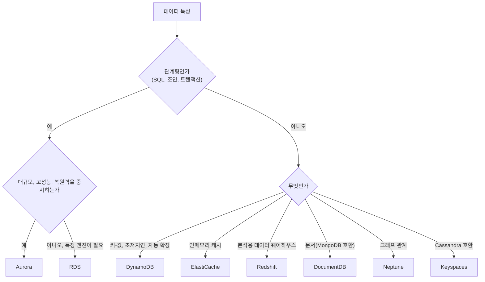

**RDS**는 MySQL, PostgreSQL, MariaDB, Oracle, SQL Server 등을 관리형으로 제공합니다. 패치, 백업, Multi-AZ를 AWS가 맡는 대신 운영체제 접근은 불가합니다. **Aurora**는 MySQL·PostgreSQL 호환의 AWS 자체 엔진으로, 클러스터 스토리지와 최대 15개의 복제본, 빠른 장애 조치가 강점입니다. 데이터베이스 엔진을 고르는 문제(MySQL 대 PostgreSQL)는 대개 "기존 애플리케이션이 쓰는 엔진과 호환"을 근거로 풀립니다.

**DynamoDB**는 키-값·문서 NoSQL이며 서버 관리가 없고, 한 자릿수 밀리초 지연에 거의 무제한에 가깝게 확장됩니다. 핵심 개념을 정리합니다.

- **용량 모드**: **온디맨드**는 요청한 만큼 과금되어 트래픽이 예측 불가하거나 급변할 때 좋고, **프로비저닝**은 읽기·쓰기 용량을 미리 정해 두며 **트래픽이 안정적이고 예측 가능할 때 비용이 낮습니다**(Auto Scaling과 결합 가능).
- **용량 단위**: 1 RCU는 4KB 항목의 강한 일관성 읽기를 초당 1회(최종 일관성 읽기는 2회), 1 WCU는 1KB 항목의 쓰기를 초당 1회입니다. 예를 들어 8KB 항목을 강한 일관성으로 읽으려면 2 RCU가 필요합니다.
- **DAX**: DynamoDB 앞에 두는 인메모리 캐시로 읽기 지연을 **마이크로초** 단위까지 줄입니다. DynamoDB API와 호환되므로 애플리케이션 변경이 적은 drop-in 선택입니다.
- **글로벌 테이블**: 여러 리전에 걸친 다중 활성(multi-active) 복제입니다.
- **TTL**(항목 자동 만료), **Streams**(변경 스트림), **PITR**(특정 시점 복구), **트랜잭션**도 알아 두세요.
- **파티션 키 설계**: 값의 종류가 많아 요청이 고르게 분산되는 키가 좋습니다. 특정 키에 요청이 몰리면 핫 파티션이 됩니다.

**ElastiCache**는 인메모리 캐시입니다. 두 엔진의 차이는 이렇습니다.

| 구분 | Redis 계열 | Memcached |
|---|---|---|
| 데이터 구조 | 리스트, 해시, 정렬 집합 등 풍부 | 단순 키-값 |
| 지속성·복제 | **복제, Multi-AZ 장애 조치, 백업** 지원 | 지속성 없음 |
| 용도 | 세션 저장, 리더보드, pub/sub, 고가용성 캐시 | 단순하고 가벼운 분산 캐시 |

"읽기가 많고 데이터가 자주 안 바뀐다"면 DB 앞에 ElastiCache를 두는 캐싱이 정답입니다. 세션 저장소로도 많이 쓰입니다. 다만 ElastiCache는 영구 데이터 원본(system of record)이 아닙니다.

**Redshift**는 **분석용 데이터 웨어하우스**입니다. 열 기반 저장과 대규모 병렬 처리로 대용량 집계 쿼리에 강하고, Redshift Spectrum으로 S3의 데이터도 질의합니다. 운영(OLTP) DB가 아닙니다. **DMS(Database Migration Service)** 는 DB를 이전하거나 지속 복제(CDC)하는 서비스이고, **다른 엔진으로 옮기는 이기종 이전**에는 스키마 변환 도구(SCT)가 함께 쓰입니다. 동종 이전(같은 엔진)은 DMS만으로도 되고, 이전 중에도 원본 DB를 계속 운영할 수 있습니다.

#### 읽기 중심인가, 쓰기 중심인가

- **읽기 병목**: 읽기 전용 복제본, ElastiCache, DAX, CloudFront 같은 캐시 계층이 해법입니다.
- **쓰기 병목**: 복제본과 캐시는 쓰기를 줄여 주지 않습니다. **SQS로 쓰기를 버퍼링**하거나, 쓰기 확장성이 높은 DynamoDB를 고려합니다.
- **연결 병목**: RDS Proxy입니다.
- **고가용성**: Multi-AZ(인스턴스 또는 클러스터), Aurora 복제본입니다.

---

### 4.9 엣지와 네트워크 성능 (Domain 3.4)

#### CloudFront와 Global Accelerator

두 서비스는 모두 "전 세계 사용자에게 빠르게"라는 목적이라 가장 많이 혼동됩니다. 구분 기준은 **캐싱 여부와 프로토콜**입니다.

| 비교 | CloudFront | Global Accelerator |
|---|---|---|
| 정체 | CDN. 엣지에 콘텐츠를 **캐싱** | AWS 글로벌 네트워크로 **트래픽 경로를 가속** |
| 프로토콜 | HTTP/HTTPS(웹소켓 포함) | TCP, UDP |
| 캐싱 | 가능 | 불가 |
| 고정 IP | 일반적으로 아님 | **2개의 고정 애니캐스트 IP** |
| 대상 | S3, ALB, 커스텀 HTTP 오리진 | ALB, NLB, EC2, 탄력적 IP |
| 대표 사례 | 이미지·CSS·JS·동영상, 정적·동적 웹 | 게임, VoIP, IoT, 고정 IP가 필요한 글로벌 API, 빠른 리전 장애 조치 |

정적 콘텐츠를 전 세계에 빠르게 전달하고 **오리진 부하를 줄이는 것**이 목적이라면 CloudFront입니다. UDP 트래픽이거나, 고정 IP가 필요하거나, 캐싱할 수 없는 TCP 서비스의 경로를 최적화하고 정상 엔드포인트로 빠르게 우회시키는 것이 목적이라면 Global Accelerator입니다.

CloudFront에서 알아 둘 기능은 다음과 같습니다. **OAC**로 S3 오리진을 CloudFront만 접근하도록 잠그고, **서명된 URL·쿠키**로 유료 콘텐츠 접근을 제어하고, **지리적 제한**으로 국가별 차단을 하고, **오리진 그룹**으로 오리진 장애 조치를 구성하며, **Lambda@Edge·CloudFront Functions**로 엣지에서 요청을 가공하고, **WAF**를 연결해 웹 공격을 막을 수 있습니다. AWS 오리진에서 CloudFront로 나가는 전송은 요금이 붙지 않는다는 점도 비용 문제에서 활용됩니다.

#### 캐시는 계층으로 생각한다

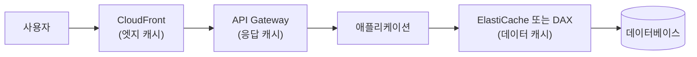

사용자에 가까운 곳에서 캐시가 응답할수록 뒤쪽 계층의 부하와 지연이 줄어듭니다. 문제에서 "어느 계층의 병목인가"를 읽어 알맞은 캐시를 고르세요.

#### 로드 밸런싱 감각

ALB는 HTTP 기반의 똑똑한 라우팅(경로·호스트 기준), NLB는 TCP/UDP의 극단적 성능과 고정 IP, GWLB는 보안 어플라이언스 삽입입니다. 교차 영역(cross-zone) 로드 밸런싱은 ALB에서는 기본으로 켜져 있고, NLB에서는 기본으로 꺼져 있다는 점이 비용·분산 문제에서 가끔 나옵니다. 서비스 자체를 다른 VPC·계정에 사설로 노출하려면 PrivateLink를 씁니다.

---

### 4.10 데이터 수집, 분석, 이전 (Domain 3.5)

#### 스트리밍: 큐와는 다른 이야기

| 서비스 | 성격 | 이럴 때 |
|---|---|---|
| SQS | 메시지 큐. 처리된 메시지는 **삭제**, 한 메시지는 한 소비자 | 작업 분산, 디커플링 |
| **Kinesis Data Streams** | 샤드 기반 스트림. 같은 데이터를 **여러 소비자가 독립적으로** 읽고, 보관 기간 안에서 **재처리(replay)** 가능. 샤드(파티션 키) 안에서 순서 유지 | 실시간 분석, 클릭스트림, 다중 소비자 |
| **Kinesis Data Firehose** | 스트림 데이터를 S3, Redshift, OpenSearch 등으로 **자동 전달**(준실시간, 버퍼링, 변환) | 별도 소비자 코드 없이 적재 |
| MSK | 관리형 Apache Kafka | 기존 Kafka 생태계와 호환이 필요 |

Kinesis Data Streams의 기본 데이터 보관 기간은 24시간이고 최대 365일까지 늘릴 수 있습니다. "최근 며칠 치 데이터를 다시 처리해야 한다"는 요구는 보관 기간 연장과 함께 Streams를 가리킵니다. Firehose는 재처리나 다중 소비자 모델이 아니라 "전달" 서비스입니다.

#### 분석 서비스 지도

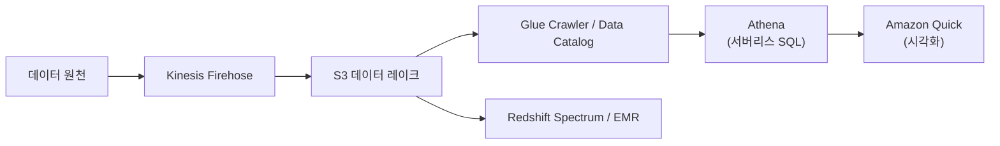

| 서비스 | 역할 | 키워드 |
|---|---|---|
| **Athena** | S3 데이터를 서버리스로 SQL 질의. **스캔한 데이터량 기준 과금** | ad hoc 쿼리, 서버 없음 |
| **Glue** | 서버리스 ETL, **Data Catalog**(메타데이터), **Crawler**(스키마 자동 탐색) | 변환, 카탈로그 |
| Lake Formation | 데이터 레이크 구축과 세밀한 권한 관리 | 데이터 레이크 보안 |
| EMR | Hadoop, Spark 등 대규모 빅데이터 처리 | 클러스터 기반 분석 |
| Redshift | 데이터 웨어하우스 | BI, 복잡한 집계 |
| OpenSearch Service | 검색, 로그 분석 | 전문 검색 |
| Amazon Quick | 비즈니스 인텔리전스·시각화(공식 가이드 표기) | 대시보드 |

비용과 성능을 함께 잡는 단골 정답은 **"CSV·JSON 같은 행 기반 포맷을 Parquet 같은 열 기반 포맷으로 변환하고 날짜 등으로 파티셔닝"** 입니다. Athena는 스캔량에 과금하므로, 필요한 열만 읽는 Parquet와 필요한 파티션만 읽는 파티셔닝이 비용과 시간을 동시에 줄입니다. 변환은 Glue ETL이 맡습니다(공식 가이드가 ".csv에서 .parquet로 변환"을 예로 든 바로 그 항목입니다).

#### 데이터를 AWS로 옮기는 도구들

| 상황 | 도구 | 핵심 |
|---|---|---|
| 온프레미스 NFS·SMB 파일을 S3·EFS·FSx로, **반복·증분·온라인** | **DataSync** | 에이전트 기반, 스케줄링, 증분, 무결성 검증 |
| 네트워크가 느리거나 대용량을 **오프라인**으로 | **Snow Family**(Snowball Edge 등) | 물리 장비 배송 |
| 온프레미스 앱이 기존 프로토콜로 AWS 스토리지 사용 | Storage Gateway | 하이브리드 캐시·연결 |
| SFTP, FTPS, FTP로 파트너가 파일 전송 | **Transfer Family** | 관리형 SFTP 등으로 S3·EFS 접근 |
| DB 이전·복제 | **DMS**(+ SCT) | 동종·이기종, 지속 복제(CDC) |
| 서버를 있는 그대로 이전(lift-and-shift) | **Application Migration Service** | 블록 수준 복제 |

대용량 이전은 **계산**으로 푸는 문제가 자주 나옵니다. 예를 들어 80TB를 1Gbps 회선으로 보낸다면, 80TB는 약 6.4×10¹⁴비트이고 1Gbps는 초당 10⁹비트이므로 회선을 100% 쓴다고 가정해도 약 6.4×10⁵초, 즉 **약 7.4일**이 걸립니다. 실제로는 회선을 전부 쓸 수 없으므로 더 걸립니다. 회선이 느리거나 일정이 촉박하면 오프라인 장비가, 회선이 충분하고 이후에도 반복 전송이 필요하면 DataSync가 알맞습니다. Snow Family의 제품 구성은 바뀔 수 있으니, 시험 대비로는 "오프라인 대용량 이전" 개념과 DataSync와의 비교만 정확히 잡으면 됩니다.

---

### 4.11 비용 최적화 (Domain 4)

비용 문제의 공통 원리는 **"필요한 만큼만, 사용 패턴에 맞는 방식으로"** 입니다. 영역별로 모아 보겠습니다.

**컴퓨팅**은 4.7의 구매 옵션 표가 중심입니다. 여기에 비프로덕션 환경 관리가 더해집니다. 개발·테스트 환경이 업무 시간에만 쓰인다면 퇴근 후 자동 중지하는 방식(스케줄 기반 시작·중지)이 가장 효과적입니다. 하루 12시간, 주 5일만 쓴다면 주 168시간 중 60시간만 가동하므로 컴퓨팅 비용이 약 64% 줄어듭니다(EBS 등 저장 요금은 남습니다). 예약 인스턴스는 사용하지 않는 시간에도 약정 비용이 나가므로 이런 환경에는 맞지 않습니다. 트래픽이 시간대별로 예측 가능한 운영 환경에는 **예약(Scheduled) 확장**이 알맞습니다. 적절한 크기(right-sizing)는 **Compute Optimizer**가 사용 지표를 분석해 추천합니다.

**스토리지**는 S3 클래스와 수명주기, EBS 유형 선택입니다. 접근 패턴이 불명확하면 Intelligent-Tiering, 명확하면 수명주기, 즉시 접근이 필요 없으면 Glacier 계열입니다. 요청자 부담(Requester Pays)은 대규모 공개 데이터셋의 전송 비용을 받는 쪽에 돌립니다. SSE-KMS의 호출 비용은 S3 Bucket Key로 줄입니다.

**데이터베이스**는 사용 패턴에 따라 갈립니다. 간헐적이고 예측 불가면 **Aurora Serverless, DynamoDB 온디맨드**, 안정적이고 예측 가능하면 **프로비저닝(Auto Scaling 포함)과 예약 용량·인스턴스**가 유리합니다. 읽기 부하가 크면 캐시로 DB 크기와 비용을 줄일 수 있고, 불필요하게 긴 백업 보존이나 잦은 스냅샷은 비용입니다.

**네트워크**는 데이터 전송 경로가 핵심입니다. 일반 규칙은 이렇습니다.

- 인터넷에서 AWS로 **들어오는** 데이터는 일반적으로 요금이 없습니다.
- 같은 AZ 안의 사설 IP 간 통신은 무료이고, **AZ 간**, **리전 간**, **인터넷으로 나가는** 전송에는 요금이 붙습니다.
- NAT 게이트웨이는 **시간당 요금 + 처리 데이터량당 요금**이 모두 붙습니다. 그래서 S3, DynamoDB 트래픽이 NAT를 통과하며 큰 비용이 생기면 **게이트웨이 엔드포인트(추가 요금 없음)** 로 우회합니다.
- 비프로덕션 환경에서는 AZ마다 NAT를 두는 대신 **하나를 공유**해 비용을 줄이는 선택이 가능합니다(AZ 장애 시 영향은 감수). 프로덕션은 AZ별 NAT이 고가용성 구성입니다.
- 정적 콘텐츠는 CloudFront로 캐싱해 오리진 전송과 부하를 줄입니다.

**비용 관리 도구**도 정리해 둡니다.

| 도구 | 역할 |
|---|---|
| Cost Explorer | 비용·사용량 **시각화와 예측**, 추세 분석 |
| Budgets | 예산을 정하고 **초과 시 알림**(조치 연동) |
| Cost and Usage Report | **가장 상세한 비용 데이터**를 S3로 전달 |
| 비용 할당 태그 | 리소스에 태그를 붙여 팀·프로젝트별 비용 분류(결제 콘솔에서 활성화 필요) |
| 통합 결제(Organizations) | 여러 계정의 비용을 합산하고 볼륨 할인·약정 혜택을 공유 |
| Compute Optimizer | 리소스 크기 최적화 추천 |

---

### 4.12 운영, 관찰, 자동화 도구 (보조 지식)

이 도구들은 독립된 영역으로 출제되기보다 다른 문제의 **정답 조각**으로 자주 등장합니다.

| 서비스 | 한 줄 정의 | 시험에서 자주 쓰이는 포인트 |
|---|---|---|
| CloudWatch | 지표, 경보, 로그 | EC2 기본 지표는 5분 간격(세부 모니터링은 1분), **메모리·디스크 사용률은 기본 지표가 아니어서 CloudWatch 에이전트가 필요** |
| CloudTrail | API 호출 기록 | 관리 이벤트는 기본 기록(이벤트 기록 90일), 더 길게 보관하려면 **트레일을 만들어 S3에 저장**, 조직 트레일, 데이터 이벤트는 별도 활성화 |
| Config | 구성 변경 기록과 규칙 평가 | 준수 평가 + SSM Automation으로 **자동 교정** |
| Systems Manager | 운영 자동화 모음 | **Session Manager**: SSH·배스천 호스트·22번 포트 개방 없이 인스턴스 접속, **Parameter Store**, Patch Manager, Run Command, Automation |
| CloudFormation | 코드로 인프라 정의(IaC) | 스택, 변경 세트, 드리프트 감지, **StackSets**로 다중 계정·리전 배포 |
| Service Catalog | 승인된 제품 카탈로그 | 조직이 허용한 구성만 사용자에게 제공 |
| Health Dashboard | AWS 서비스 상태·내 계정에 영향 주는 이벤트 | 계정별 서비스 이슈 확인 |
| Well-Architected Tool | 아키텍처 점검 | 여섯 기둥 기준 검토 |
| X-Ray | 분산 추적 | 마이크로서비스 병목 분석 |

기억해 둘 문장 하나가 있습니다. **"API를 누가 호출했는가는 CloudTrail, 리소스 설정이 규칙에 맞는가는 Config, 성능·상태 지표는 CloudWatch."** 세 서비스의 질문이 서로 다르다는 것을 구분하면 관찰·감사 문제는 거의 풀립니다.

---

## Part 5. 헷갈리는 쌍 마스터

SAA-C03의 오답 보기는 대부분 "비슷하게 생긴 서비스"입니다. 아래 표는 **무엇이 다른지 한 줄로 판별하는 기준**을 모았습니다. 시험 전날 이 표만 다시 훑어도 효과가 큽니다.

### 5.1 보안·계정

| 비교 | 한쪽 | 다른 쪽 | 판별 기준 |
|---|---|---|---|
| 보안 그룹 대 네트워크 ACL | SG: 인스턴스 단위, 상태 저장, **허용만** | NACL: 서브넷 단위, 상태 비저장, 허용과 거부 | **특정 IP를 차단**해야 하면 NACL |
| IAM 사용자 대 IAM 역할 | 사용자: 장기 자격 증명 | 역할: **임시** 자격 증명을 맡음 | 서비스·교차 계정·앱이 접근하면 역할 |
| SCP 대 권한 경계 대 IAM 정책 | SCP: 조직·계정의 상한 | 권한 경계: 한 주체의 상한 / IAM 정책: 실제 부여 | **상한은 부여하지 않는다**. SCP는 관리 계정에 적용 안 됨 |
| Cognito User Pool 대 Identity Pool | User Pool: **로그인(인증)**, 토큰 발급 | Identity Pool: **AWS 임시 자격 증명** 발급 | 앱 로그인이면 User Pool, AWS 리소스 접근이면 Identity Pool |
| Secrets Manager 대 Parameter Store | **자동 교체**, 비밀 관리 | 설정값 저장, 표준은 무료 | DB 비밀번호 자동 교체면 Secrets Manager |
| KMS 대 CloudHSM | 관리형 키 서비스, 대부분의 암호화 | **단독 사용 전용 HSM**, 키 완전 통제 | 규정상 전용 하드웨어·완전 통제면 CloudHSM |
| SSE-S3 대 SSE-KMS 대 SSE-C | S3 관리 키 / KMS 키 정책·감사 / 고객이 키 제공 | 클라이언트 측: 고객이 업로드 전 암호화 | **키 접근 통제와 감사**가 필요하면 SSE-KMS |
| GuardDuty 대 Inspector 대 Macie | 위협 탐지 / 취약점 스캔 / S3 개인정보 탐지 | Detective: 사고 원인 조사 | 동사로 구분: 탐지, 스캔, 발견, 조사 |
| WAF 대 Shield | L7 웹 공격(SQLi, XSS) 차단 | DDoS 방어 | 요청 내용을 검사하면 WAF, 대량 트래픽 공격이면 Shield |
| CloudTrail 대 Config 대 CloudWatch | API 호출 기록 / 구성 준수 평가 / 지표·경보·로그 | | 누가 호출했나는 CloudTrail, 규칙에 맞나는 Config, 상태·성능은 CloudWatch |

### 5.2 네트워크

| 비교 | 한쪽 | 다른 쪽 | 판별 기준 |
|---|---|---|---|
| 게이트웨이 엔드포인트 대 인터페이스 엔드포인트 | **S3, DynamoDB** 전용, 라우팅 항목, 추가 요금 없음 | 그 밖의 서비스·PrivateLink, ENI, 요금 있음 | S3나 DynamoDB면 게이트웨이 |
| VPC 피어링 대 Transit Gateway | 1:1 연결, **전이적 라우팅 불가** | 허브 앤 스포크 | VPC가 많거나 온프레미스까지 연결하면 TGW |
| Site-to-Site VPN 대 Direct Connect | 인터넷 위 **암호화**, 빠르게 구성 | 전용선, 일관된 성능, **기본 암호화 없음**, 구축 느림 | 며칠 안에 필요하면 VPN, 일관된 대역폭이면 DX |
| CloudFront 대 Global Accelerator | **캐싱**, HTTP/HTTPS | **고정 IP 2개**, TCP/UDP, 캐싱 없음 | 정적 콘텐츠면 CloudFront, 고정 IP·UDP면 GA |
| ALB 대 NLB 대 GWLB | L7 라우팅 / L4 고성능·고정 IP / 어플라이언스 삽입 | | 고정 IP·TCP/UDP면 NLB, 경로 라우팅이면 ALB |
| Latency 대 Geolocation 대 Failover | 지연이 가장 낮은 리전 / 사용자 위치 기준 / 주-보조(액티브-패시브) | | "lowest latency"는 Latency, 국가별 규제는 Geolocation |

### 5.3 복원력·메시징

| 비교 | 한쪽 | 다른 쪽 | 판별 기준 |
|---|---|---|---|
| Multi-AZ 대 읽기 전용 복제본 | 고가용성, 동기, 자동 장애 조치 | 읽기 확장, 비동기, 교차 리전 가능 | "장애 복구"는 Multi-AZ, "읽기 부하 분산"은 복제본 |
| 백업 대 고가용성 | 스냅샷은 **복구용** | Multi-AZ·Auto Scaling이 **가용성용** | 백업은 HA의 대체물이 아님 |
| SQS 대 SNS | 당겨 가는 큐, 한 메시지는 한 소비자 | 밀어 주는 pub/sub, 모든 구독자에게 | 여러 곳에 동시에 전달이면 SNS + SQS 팬아웃 |
| SQS Standard 대 FIFO | 높은 처리량, 중복 가능, 순서 보장 없음 | 순서 보장, 정확히 한 번 | "순서가 중요"면 FIFO |
| Kinesis Data Streams 대 Firehose | 다중 소비자, **재처리**, 순서(샤드 단위) | S3·Redshift 등으로 **자동 전달**, 준실시간 | 재처리·사용자 지정 소비자면 Streams, 적재만이면 Firehose |
| 파일럿 라이트 대 웜 스탠바이 | 핵심 데이터만 가동, 서버는 꺼짐 | **축소판 전체가 상시 가동** | 상시 가동 축소판이면 웜 스탠바이 |
| Object Lock 거버넌스 대 규정 준수 | 특별 권한으로 우회 가능 | **루트도 변경·삭제 불가** | "누구도 삭제 불가"면 규정 준수 모드 |

### 5.4 스토리지·데이터베이스·비용

| 비교 | 한쪽 | 다른 쪽 | 판별 기준 |
|---|---|---|---|
| EBS 대 인스턴스 스토어 대 EFS | 영구 블록 디스크, AZ 종속 / 임시, 고성능 | 공유 NFS 파일 시스템 | 여러 인스턴스가 공유하면 EFS, 임시 고속이면 인스턴스 스토어 |
| EFS 대 FSx Windows 대 FSx Lustre | Linux NFS / **SMB·AD** / **HPC·S3 연동** | | Windows면 FSx Windows, HPC면 Lustre |
| Standard-IA 대 One Zone-IA 대 Glacier IR | 월 단위 접근 / 재생성 가능 데이터 단일 AZ / **분기 단위·ms 접근** | | 접근 빈도와 AZ 요구로 구분 |
| Intelligent-Tiering 대 수명주기 | 접근 패턴을 **예측할 수 없음**, 자동 | 기간 경과로 **예측 가능**, 규칙 기반 | "unpredictable"이면 Intelligent-Tiering |
| Aurora 대 RDS | 고성능·빠른 장애 조치·최대 15개 복제본 | 다양한 표준 엔진 | 엔진 지정이 필요하면 RDS, 고성능·복원력이면 Aurora |
| DAX 대 ElastiCache | DynamoDB 전용, **API 호환(코드 변경 적음)** | 범용 캐시, 캐시 로직 직접 작성 | DynamoDB 읽기 가속에 최소 변경이면 DAX |
| DynamoDB 온디맨드 대 프로비저닝 | 예측 불가·급변에 적합 | **예측 가능·안정적**일 때 저렴 | 트래픽 패턴이 단서 |
| Compute SP 대 EC2 Instance SP 대 RI | EC2·Fargate·Lambda에 유연 적용 / 인스턴스 계열·리전 고정 / 구성 고정 | | 서비스·계열 변경 가능성이 있으면 Compute SP |
| DataSync 대 Snow 대 Storage Gateway | 온라인 반복 전송 / 오프라인 대용량 / 온프레미스 앱의 지속 연결 | | 회선이 느리거나 일회성 초대용량이면 Snow |

---

## Part 6. 추가 문제 24문항

사용법: **해설(Part 7)을 가리고** 먼저 푸세요. 각 문제를 **1.5분 안팎**으로 풀고, 풀이 루틴(질문 먼저 → 제약 표시 → 소거)을 지켰는지 점검하세요. 도메인은 Q1~Q6이 보안, Q7~Q12가 복원력, Q13~Q18이 고성능, Q19~Q24가 비용 최적화이며, Q4와 Q11은 복수 선택입니다. 기존에 풀었던 문제집과 겹치지 않도록 상황을 새로 구성했습니다.

### Domain 1. 보안 아키텍처

**Q1.** A company runs an AWS Lambda function in Account A that must read objects from an Amazon S3 bucket in Account B. The security policy prohibits long-term credentials and requires least privilege. Which solution meets these requirements?

A. Create an IAM user in Account B with read access to the bucket and store its access keys in the Lambda function's environment variables.
B. Create an IAM role in Account B that allows s3:GetObject on the bucket and trusts the Lambda function's execution role in Account A. Have the function assume the role by using AWS STS.
C. Make the bucket public and restrict access by using the source IP addresses of the Lambda function.
D. Peer the VPCs of Account A and Account B and access the bucket through the peering connection.

**Q2.** A company stores sensitive documents in Amazon S3. Only members of the security team may decrypt the data. Every decryption request must be auditable, and the company must be able to disable the encryption key immediately if it is compromised. Which solution meets these requirements?

A. Use server-side encryption with Amazon S3 managed keys (SSE-S3).
B. Use server-side encryption with AWS KMS (SSE-KMS) by using a customer managed key whose key policy allows only the security team. Review key usage in AWS CloudTrail logs.
C. Use server-side encryption with customer-provided keys (SSE-C) and store the keys in the application configuration.
D. Encrypt the data on the client and store the encryption key in the same S3 bucket.

**Q3.** An application behind an Application Load Balancer is receiving SQL injection attempts and HTTP floods from a small set of IP addresses. The company wants to block these attacks with the LEAST operational effort. Which solution meets these requirements?

A. Rely on AWS Shield Standard.
B. Associate an AWS WAF web ACL with the load balancer. Use an AWS managed rule group for SQL injection and add a rate-based rule.
C. Add deny entries to the network ACL for each offending IP address manually.
D. Enable Amazon GuardDuty and rely on it to block the malicious traffic.

**Q4. (Choose TWO.)** A company requires that an Amazon S3 bucket be accessible only from Amazon EC2 instances in a specific VPC, and that the traffic stay on the AWS network. Which combination of steps meets these requirements?

A. Create a gateway VPC endpoint for Amazon S3 and add it to the route tables of the private subnets.
B. Add a bucket policy statement that denies all requests unless the aws:SourceVpce condition key matches the endpoint ID.
C. Attach a security group to the S3 bucket that allows only the VPC CIDR range.
D. Deploy a NAT gateway and allow only the NAT gateway's Elastic IP address in the bucket policy.
E. Enable S3 Transfer Acceleration on the bucket.

**Q5.** A company's AWS environment is growing from 3 to 40 accounts. The company wants new accounts to be created automatically with a consistent baseline, preventive guardrails that stop anyone from disabling AWS CloudTrail, and centralized logging, with the LEAST effort. Which solution meets these requirements?

A. Set up an AWS Control Tower landing zone and use Account Factory with guardrails enabled.
B. Write an AWS CloudFormation template and deploy it manually to each new account.
C. Create IAM policies in each account that deny the CloudTrail API actions.
D. Enable AWS Config rules in each account and review noncompliant resources manually.

**Q6.** A company needs encrypted connectivity between its on-premises data center and its VPC within a few days. The required bandwidth is about 500 Mbps. The company is cost-sensitive, and the lead time for a dedicated circuit is too long. Which solution meets these requirements?

A. Create an AWS Site-to-Site VPN connection.
B. Order an AWS Direct Connect dedicated connection.
C. Deploy AWS Client VPN for the data center.
D. Create a VPC peering connection.

### Domain 2. 복원력 아키텍처

**Q7.** An e-commerce application must trigger three independent downstream processes (billing, shipping, and analytics) for every order. Each process must be able to retry failures without affecting the others, and new consumers may be added later without changing the order service. Which solution meets these requirements?

A. The order service writes each order to one Amazon SQS queue, and the three consumer applications poll the same queue.
B. The order service publishes each order to an Amazon SNS topic. Each process subscribes through its own Amazon SQS queue.
C. The order service invokes three AWS Lambda functions synchronously in sequence.
D. The order service writes each order to an Amazon S3 bucket, and the consumers list the bucket periodically.

**Q8.** A serverless application uses AWS Lambda functions to query an Amazon RDS for MySQL database. During traffic spikes, the functions open many connections and the database returns "too many connections" errors. Failovers also cause long error windows. Which solution resolves these problems with the LEAST code change?

A. Increase only the DB instance size.
B. Place Amazon RDS Proxy between the Lambda functions and the database.
C. Increase the memory allocated to the Lambda functions.
D. Create a read replica and send all traffic to it.

**Q9.** A business-critical application runs in us-east-1 on EC2 instances behind an Application Load Balancer, with an Amazon Aurora database. If the Region fails, the application must recover within minutes with minimal data loss. A full-capacity duplicate environment is too expensive. The company wants a scaled-down but fully functional copy of the stack to run continuously in the disaster recovery Region and be scaled up during failover. Which disaster recovery strategy meets these requirements?

A. Backup and restore
B. Pilot light
C. Warm standby
D. Multi-site active-active

**Q10.** An application is deployed in us-west-2 and ap-northeast-2, and both Regions serve traffic at the same time. The company wants each user routed to the Region that provides the lowest latency, and wants traffic to stop going to a Region that fails health checks. Which Amazon Route 53 configuration meets these requirements?

A. Geolocation routing with health checks
B. Latency-based routing with health checks
C. Weighted routing at 50/50 without health checks
D. Simple routing with two values

**Q11. (Choose TWO.)** A company runs a web tier on Amazon EC2 instances that are all in a single Availability Zone, fronted by an Application Load Balancer. The company wants to improve availability. Which actions will meet this requirement?

A. Configure an Auto Scaling group that spans at least two Availability Zones.
B. Move the instances into a cluster placement group.
C. Configure the Auto Scaling group to use Elastic Load Balancing health checks so that unhealthy instances are replaced.
D. Replace the instances with a larger instance type.
E. Assign an Elastic IP address to each instance.

**Q12.** A financial company must keep records in Amazon S3 immutable for 7 years. No user, including the root user, may delete or overwrite the records during that period. Which solution meets these requirements?

A. Enable versioning and MFA Delete on the bucket.
B. Use S3 Object Lock in compliance mode with a 7-year retention period.
C. Use S3 Object Lock in governance mode with a 7-year retention period.
D. Add a bucket policy that denies s3:DeleteObject for all principals.

### Domain 3. 고성능 아키텍처

**Q13.** A self-managed relational database runs on a Nitro-based Amazon EC2 instance and requires sustained 50,000 IOPS with consistently low latency. Which Amazon EBS volume type meets this requirement?

A. A gp3 volume with the maximum provisioned IOPS
B. An io2 Provisioned IOPS SSD volume
C. An st1 Throughput Optimized HDD volume
D. An sc1 Cold HDD volume

**Q14.** A company is migrating Windows-based file servers to AWS. The applications need SMB file shares, NTFS permissions, and integration with the company's Active Directory. The company wants a highly available managed service with minimal administration. Which solution meets these requirements?

A. Amazon EFS
B. Amazon FSx for Windows File Server
C. Amazon FSx for Lustre
D. Amazon EBS volumes with Multi-Attach

**Q15.** A product catalog is stored in an Amazon DynamoDB table. The workload is read-heavy, and the application needs microsecond response times for repeated reads with minimal code changes. Which solution meets these requirements?

A. Place an Amazon DynamoDB Accelerator (DAX) cluster in front of the table and use the DAX client.
B. Increase the provisioned read capacity units of the table.
C. Convert the table to a DynamoDB global table.
D. Add Amazon ElastiCache and write custom caching logic in the application.

**Q16.** A company ingests 100,000 clickstream events per second. Several independent applications must consume the same data, one application must be able to reprocess the last 3 days of events, and events from the same user must stay in order. Which solution meets these requirements?

A. Amazon Kinesis Data Firehose delivering to Amazon S3
B. Amazon Kinesis Data Streams with the user ID as the partition key and an extended data retention period
C. An Amazon SQS standard queue
D. An Amazon SNS topic

**Q17.** A TCP-based game backend must expose static IP addresses so that partners can add them to allow lists. The service handles millions of requests per second and needs ultra-low latency. Which load balancer meets these requirements?

A. Application Load Balancer
B. Network Load Balancer with an Elastic IP address in each Availability Zone
C. Gateway Load Balancer
D. Classic Load Balancer

**Q18.** Analysts query 20 TB of CSV files in Amazon S3 by using Amazon Athena. The queries are slow and expensive. Which change improves performance and reduces cost with the LEAST effort?

A. Load the data into Amazon RDS and query it there.
B. Use AWS Glue to convert the data to Apache Parquet partitioned by date, and query it with Athena.
C. Enable S3 Transfer Acceleration on the bucket.
D. Increase the compute capacity of the Athena workgroup.

### Domain 4. 비용 최적화 아키텍처

**Q19.** A company's non-production VPC spans three Availability Zones and has a NAT gateway in each one. The team accepts that an Availability Zone failure may interrupt outbound internet access for non-production workloads. The instances must not be directly reachable from the internet. Which change reduces cost?

A. Keep one NAT gateway per Availability Zone.
B. Keep a single NAT gateway in one public subnet and update the route tables of the private subnets in all Availability Zones to use it.
C. Move the instances to public subnets and assign public IP addresses.
D. Attach an internet gateway directly to the private subnets and remove the NAT gateways.

**Q20.** A company shares a 200 TB public dataset in Amazon S3 with research partners. The company wants the partners, not the company, to pay for requests and data transfer. Which solution meets this requirement?

A. Enable Requester Pays on the bucket.
B. Distribute the dataset through Amazon CloudFront.
C. Enable S3 Transfer Acceleration.
D. Make the bucket public.

**Q21.** Development and test EC2 instances run 24 hours a day but are used only from 08:00 to 20:00 on weekdays. Which solution reduces cost with the LEAST effort and risk?

A. Purchase 3-year Standard Reserved Instances.
B. Automatically stop the instances outside business hours and start them again before the workday, by using Amazon EventBridge Scheduler or AWS Instance Scheduler.
C. Move the instances to Dedicated Hosts.
D. Switch to larger instance types.

**Q22.** A company has a steady monthly spend on Amazon EC2. Over the next year it will move some workloads from EC2 to AWS Fargate and AWS Lambda and will change instance families. The company wants a discount for a 1-year commitment with the MOST flexibility. Which option should the company choose?

A. Standard Reserved Instances
B. Compute Savings Plans
C. EC2 Instance Savings Plans
D. Spot Instances

**Q23.** A media archive is accessed about once per quarter. When a file is requested, it must be available in milliseconds. The company wants to minimize total cost for this access pattern. Which Amazon S3 storage class should the company use?

A. S3 Standard-IA
B. S3 Glacier Instant Retrieval
C. S3 Glacier Flexible Retrieval
D. S3 Glacier Deep Archive

**Q24.** An Amazon DynamoDB table uses on-demand capacity mode. Traffic is steady and predictable, with a gradual daily pattern. The company wants to reduce cost. Which change meets this requirement?

A. Keep on-demand capacity mode.
B. Switch to provisioned capacity mode with auto scaling.
C. Add DAX to every table.
D. Migrate the table to Amazon RDS.

---

## Part 7. 정답과 해설

### 7.1 정답표

| 문항 | 정답 | 핵심 개념 |
|---|---|---|
| Q1 | B | 교차 계정 역할 위임(STS), 장기 키 금지 |
| Q2 | B | SSE-KMS, 키 정책, CloudTrail 감사 |
| Q3 | B | WAF 관리형 규칙 + 속도 기반 규칙 |
| Q4 | A, B | 게이트웨이 엔드포인트 + aws:SourceVpce 버킷 정책 |
| Q5 | A | Control Tower, 예방형 가드레일 |
| Q6 | A | Site-to-Site VPN |
| Q7 | B | SNS + SQS 팬아웃 |
| Q8 | B | RDS Proxy |
| Q9 | C | 웜 스탠바이 |
| Q10 | B | Route 53 지연 시간 기반 라우팅 + 상태 확인 |
| Q11 | A, C | 다중 AZ Auto Scaling + ELB 상태 확인 |
| Q12 | B | Object Lock 규정 준수 모드 |
| Q13 | B | io2 프로비저닝 IOPS |
| Q14 | B | FSx for Windows File Server |
| Q15 | A | DAX |
| Q16 | B | Kinesis Data Streams, 보관 기간 연장 |
| Q17 | B | NLB, 고정 IP |
| Q18 | B | Glue로 Parquet 변환 + 파티셔닝 |
| Q19 | B | NAT 게이트웨이 공유(비프로덕션) |
| Q20 | A | Requester Pays |
| Q21 | B | 스케줄 기반 중지·시작 |
| Q22 | B | Compute Savings Plans |
| Q23 | B | Glacier Instant Retrieval |
| Q24 | B | DynamoDB 프로비저닝 + Auto Scaling |

### 7.2 해설

해설은 "정답이 왜 맞는가"뿐 아니라 **오답이 Part 3.4의 네 가지 유형 중 어디에 해당하는지**를 함께 적었습니다. 틀린 문제는 이 유형 분류를 오답 노트에 그대로 옮기세요.

#### Q1. 정답 B

이 문제의 키워드는 "long-term credentials 금지"와 "least privilege"입니다. 정답의 구조는 **역할 위임**입니다. 계정 B에 S3 읽기 권한을 가진 역할을 만들고, 신뢰 정책에서 계정 A의 Lambda 실행 역할을 신뢰하게 한 뒤, Lambda가 STS로 그 역할을 맡아 임시 자격 증명으로 접근합니다. (대안으로 버킷 정책에서 계정 A의 실행 역할을 직접 허용하는 방법도 있지만, 이 문제의 보기 중에는 없습니다.)

A는 장기 액세스 키를 쓰므로 명시된 금지 조건을 어기는 **요구사항 위반(유형 2)** 입니다. C는 Lambda의 출발 IP가 고정이 아니고 버킷을 공개하는 것 자체가 위험하므로 **요구사항 위반**입니다. D는 S3가 VPC 안의 리소스가 아니라 피어링으로 접근하는 대상이 아니므로 **서비스 오용·목적 이탈(유형 1·4)** 입니다.

**풀이 노하우**: "다른 계정의 리소스 + 자격 증명 금지"가 보이면 곧바로 역할 위임(AssumeRole)을 떠올립니다.

#### Q2. 정답 B

세 요구를 하나씩 짚어 봅니다. "보안 팀만 복호화"는 **키 정책**, "모든 복호화 요청 감사"는 **CloudTrail에 기록되는 KMS 호출**, "키를 즉시 비활성화"는 **KMS 키의 비활성화 기능**입니다. 세 요구가 모두 고객 관리형 KMS 키로 해결됩니다.

A는 키를 S3가 알아서 관리하므로 팀 단위로 접근을 제어하거나 키를 끄는 방식의 통제가 불가능합니다(요구사항 위반). C는 AWS가 키를 저장하지 않아 KMS 기반 감사가 안 되고 키 관리 부담이 큽니다(과잉 부담·요구 위반). D는 암호화 키를 같은 버킷에 두면 암호화의 의미가 사라지는 **서비스 오용**입니다.

**풀이 노하우**: "누가 복호화했는지 감사"와 "키 단위 통제"가 함께 나오면 SSE-KMS입니다.

#### Q3. 정답 B

공격 두 가지는 모두 **L7(애플리케이션 계층)** 입니다. SQL 인젝션은 요청 내용을 검사해야 막을 수 있고, HTTP 플러드는 요청 빈도 기반으로 막습니다. WAF의 **관리형 규칙 그룹**(SQLi)과 **속도 기반 규칙**(rate-based rule)이 정확히 이 둘을 맡고, 운영 노력도 가장 적습니다.

A는 Shield Standard가 인프라 계층의 흔한 DDoS를 자동으로 막는 서비스이지 SQL 인젝션 요청을 검사하지 않으므로 **목적 이탈(유형 4)** 입니다. C는 수동 작업이어서 "least operational effort"를 어기고(유형 3), 공격 IP가 바뀌면 소용이 없습니다. D의 GuardDuty는 위협을 **탐지**할 뿐 트래픽을 **차단**하지 않습니다(유형 1).

**풀이 노하우**: "차단"이 요구되면 탐지 서비스(GuardDuty)는 후보에서 제외하세요.

#### Q4. 정답 A, B

두 단계가 짝을 이룹니다. A는 VPC에서 S3로 가는 **경로**를 AWS 네트워크 안으로 만들고, B는 그 경로가 아닌 접근을 **버킷 쪽에서 거부**합니다. 경로만 만들면 다른 경로로의 접근이 여전히 가능하고, 정책만 만들면 접근할 경로가 없습니다. 둘이 합쳐져야 "그 VPC에서만, AWS 네트워크 안으로만"이 완성됩니다.

C는 S3 버킷에는 보안 그룹을 붙일 수 없으므로 **서비스 오용**입니다. D는 NAT 게이트웨이를 거치는 트래픽은 인터넷 경로(공인 IP)를 통하므로 "AWS 네트워크 안에 머문다"는 요구를 어깁니다. E의 Transfer Acceleration은 업로드 속도 개선 기능으로 목적이 다릅니다.

**풀이 노하우**: 복수 선택 문제에서 **"경로 + 정책" 같은 짝**을 찾으세요.

#### Q5. 정답 A

세 요구(자동 계정 생성, 예방형 가드레일, 중앙 로깅)를 **최소 노력**으로 묶어 주는 서비스가 **Control Tower**입니다. 랜딩 존이 기본 구조와 중앙 로그 보관 계정을 만들고, Account Factory가 새 계정을 일관되게 만들며, 예방형 가드레일(SCP 기반)이 CloudTrail 비활성화 같은 행동을 막습니다.

B는 수동 배포라 확장성과 노력 면에서 불리합니다(과잉 부담). C는 계정 안의 관리자가 지울 수 있는 정책이라 **예방**이 되지 않습니다(요구 위반). D의 Config는 **탐지** 도구이므로 "예방형"이라는 요구와 목적이 다릅니다(유형 4).

**풀이 노하우**: "계정 수가 많고 일관된 기준 + 최소 노력"이면 Control Tower, "관리자도 못 하게"이면 SCP를 떠올립니다.

#### Q6. 정답 A

단서는 "며칠 안에", "암호화", "500Mbps", "비용 민감"입니다. Site-to-Site VPN은 빠르게 구성할 수 있고 IPsec으로 암호화되며, 연결당 터널 하나가 최대 약 1.25Gbps까지 지원하므로 500Mbps 요구를 충족합니다.

B의 Direct Connect는 구축에 시간이 걸리고 **기본적으로 암호화되지 않으며** 비용도 높아 모든 단서와 어긋납니다. C의 Client VPN은 사람이 쓰는 단말용 VPN으로, 데이터센터와 VPC를 잇는 용도가 아닙니다(서비스 오용). D의 피어링은 VPC 사이 연결이라 온프레미스에는 해당하지 않습니다.

#### Q7. 정답 B

핵심 구분은 **"한 메시지를 여러 곳에 모두 전달"** 입니다. SNS가 발행한 메시지를 처리 주체마다 별도의 SQS 큐가 받으면(팬아웃) 각 처리가 독립적으로 재시도할 수 있고, 새 소비자는 새 큐를 구독시키기만 하면 되므로 생산자는 바뀌지 않습니다.

A는 한 큐에 소비자를 여러 개 붙이는 구조라 **한 메시지가 소비자 중 하나에게만** 갑니다. 세 프로세스가 모두 받아야 하는 요구를 어기는 **목적 이탈**입니다. C는 순차 동기 호출이라 한 곳이 실패하면 나머지가 막히고 결합도가 높습니다. D는 주기적 조회 방식이라 지연과 불필요한 부담이 생기는 **과잉·비효율 설계**입니다.

#### Q8. 정답 B

RDS Proxy는 연결을 풀링해 많은 Lambda 동시 실행이 DB 연결 한도를 소진하는 문제를 줄이고, 장애 조치 시 연결 복구를 빠르게 해 줍니다. 애플리케이션은 엔드포인트만 프록시로 바꾸면 되므로 코드 변경이 거의 없습니다(drop-in).

A는 인스턴스를 키워도 연결 폭증의 구조적 원인은 남고 비용만 늘어납니다. C의 Lambda 메모리는 DB 연결 수와 무관합니다(목적 이탈). D의 읽기 전용 복제본은 읽기를 분산하지만 쓰기와 연결 한도 문제를 해결하지 못하고 장애 조치용도 아닙니다.

#### Q9. 정답 C

"축소된 규모의 완전한 복사본이 **상시 가동**"이라는 문장이 웜 스탠바이의 정의입니다. 장애 시에는 확장만 하면 되므로 분 단위 복구가 가능하고, 전체 용량 이중화(Active-Active)보다 훨씬 저렴합니다. Aurora라면 Global Database로 데이터 복제 지연을 낮게 유지할 수 있습니다.

A는 복구 시간이 가장 길어 "분 단위" 요구를 어깁니다. B의 파일럿 라이트는 데이터 계층만 가동하고 **애플리케이션 서버는 꺼져 있어** 장애 시 서버 기동부터 해야 하므로, "완전히 기능하는 사본이 계속 실행"이라는 요구와 맞지 않습니다. D는 전체 용량 이중화라 "너무 비싸다"는 조건을 어깁니다.

**풀이 노하우**: DR 문제는 "평소 DR 리전에서 무엇이 켜져 있는가"가 구분선입니다. 꺼짐은 백업·파일럿 라이트, 축소 가동은 웜 스탠바이, 전체 가동은 Active-Active입니다.

#### Q10. 정답 B

"가장 낮은 지연 시간"은 **지연 시간 기반 라우팅**의 정의이고, "실패한 리전으로 보내지 않음"은 **상태 확인과의 결합**입니다. 두 조건이 모두 충족됩니다.

A의 지리적 위치 라우팅은 사용자의 **위치**로 정하며 지연이 가장 낮은 곳을 보장하지 않습니다(목적 이탈). C는 상태 확인이 없어 실패한 리전에도 트래픽을 보냅니다. D의 단순 라우팅은 여러 값을 무작위로 반환하고 상태 기반 제어가 없습니다.

#### Q11. 정답 A, C

A는 단일 AZ라는 **단일 장애점을 제거**합니다. C는 Auto Scaling 그룹이 ELB 상태 확인을 사용하게 해서, 인스턴스가 살아 있어도 애플리케이션이 응답하지 않을 때(ALB 검사 실패) 그룹이 인스턴스를 교체하게 합니다. 기본 EC2 상태 확인만으로는 이런 애플리케이션 수준 장애를 놓칩니다.

B의 클러스터 배치 그룹은 한 AZ에 인스턴스를 모아 지연을 줄이는 용도라 오히려 가용성에는 불리합니다(목적 이탈). D의 더 큰 인스턴스는 성능 해법이며 AZ 장애에는 효과가 없습니다. E의 탄력적 IP는 고정 주소 용도로 가용성과 무관합니다.

#### Q12. 정답 B

"루트 사용자를 포함한 누구도 7년간 삭제·덮어쓰기 불가"는 **Object Lock 규정 준수 모드**의 정의입니다. 이 모드에서는 보관 기간이 끝날 때까지 루트 사용자도 보호를 해제하거나 보관 기간을 줄일 수 없습니다.

C의 거버넌스 모드는 특별한 권한(`s3:BypassGovernanceRetention`)을 가진 사용자가 우회할 수 있어 요구를 어깁니다. A의 MFA Delete는 버전 삭제 시 추가 인증을 요구할 뿐 루트 사용자가 수행 가능하며 불변을 보장하지 않습니다. D는 버킷 정책을 관리자가 수정할 수 있으므로 불변이 아닙니다.

#### Q13. 정답 B

단서는 "50,000 IOPS 지속, 저지연"입니다. gp3는 최대 16,000 IOPS까지 설정할 수 있어 이 요구에 못 미칩니다. **io2(프로비저닝 IOPS SSD)** 는 높은 IOPS를 일관된 저지연으로 지속 제공하도록 설계되었습니다. st1·sc1은 HDD라 처리량 위주이고 IOPS 요구에는 맞지 않으며, DB 같은 랜덤 I/O 워크로드에 부적합합니다.

**풀이 노하우**: 수치가 나오면 한도와 비교하세요. 16,000 IOPS를 넘으면 gp3는 탈락입니다.

#### Q14. 정답 B

SMB, NTFS 권한, Active Directory 통합은 **FSx for Windows File Server**의 대표 특징이고, 관리형 다중 AZ 구성으로 고가용성과 낮은 관리 부담도 충족합니다. EFS는 Linux용 NFS 파일 시스템이라 SMB와 Windows 요구에 맞지 않습니다. FSx for Lustre는 HPC용이며 Windows 파일 서버의 대체가 아닙니다. EBS Multi-Attach는 블록 볼륨을 여러 인스턴스에 붙이는 기능이고 파일 공유 서비스가 아닙니다.

#### Q15. 정답 A

DAX는 DynamoDB 전용 인메모리 캐시로, 반복 읽기를 **마이크로초** 단위까지 줄이며 DynamoDB와 API 호환이라 DAX 클라이언트로 바꾸는 정도의 **최소 변경**으로 적용됩니다.

B의 읽기 용량 증설은 처리량을 늘릴 뿐 지연을 마이크로초로 낮추지 못합니다. C의 글로벌 테이블은 다중 리전 복제 기능입니다(목적 이탈). D의 ElastiCache도 가능하지만 캐시 확인·채우기 로직을 직접 작성해야 하므로 "minimal code changes" 조건에서 DAX에 밀립니다.

#### Q16. 정답 B

세 요구를 매칭합니다. "여러 독립 소비자"와 "3일치 재처리"는 **Kinesis Data Streams**의 다중 소비 모델과 보관 기간(기본 24시간, 최대 365일)으로, "같은 사용자의 순서 유지"는 **사용자 ID를 파티션 키**로 써서 같은 샤드에 모이게 하는 것으로 충족됩니다. 3일치 재처리가 가능하려면 기본 24시간을 넘도록 **보관 기간을 연장**해야 합니다.

A의 Firehose는 S3 등으로 전달하는 서비스로 사용자 지정 소비자와 재처리 모델이 아닙니다. C의 SQS는 메시지를 처리하면 삭제하므로 재처리와 다중 소비자 요구에 맞지 않습니다. D의 SNS는 저장하지 않는 방송 서비스입니다.

#### Q17. 정답 B

"고정 IP 허용 목록", "TCP", "초저지연, 대규모"는 모두 **NLB**를 가리킵니다. NLB는 AZ마다 탄력적 IP를 할당할 수 있고 L4에서 극단적인 성능을 냅니다. ALB는 L7이고 고정 IP를 기본으로 제공하지 않으며(Global Accelerator를 앞에 두는 구성은 가능하지만 이 문제의 보기에는 없습니다), GWLB는 보안 어플라이언스 삽입용입니다. Classic Load Balancer는 구세대로 이 요구를 충족하지 않습니다.

#### Q18. 정답 B

Athena는 **스캔한 데이터량**으로 과금하고 속도도 스캔량에 좌우됩니다. CSV는 모든 열을 읽어야 하지만, 열 기반 포맷인 **Parquet**는 필요한 열만 읽고 압축률도 높습니다. 여기에 날짜 **파티셔닝**을 더하면 필요한 파티션만 읽어 스캔량이 크게 줄어듭니다. 변환은 Glue ETL로 서버리스·최소 노력으로 가능합니다.

A는 20TB를 RDS에 적재하는 것은 비용과 노력이 모두 큰 과잉 설계입니다. C의 Transfer Acceleration은 업로드 가속 기능이라 질의 성능과 무관합니다. D의 컴퓨팅 용량 증설은 비용을 줄이는 방향이 아니며, 스캔량이라는 근본 원인을 건드리지 못합니다.

#### Q19. 정답 B

"AZ 장애 시 비프로덕션의 아웃바운드 중단 수용"이라는 조건이 핵심입니다. 이 조건이 있으면 AZ마다 NAT를 두는 **고가용성 구성을 포기**하고 하나를 공유해 시간당 요금을 줄일 수 있습니다. 사설 서브넷은 그대로 두어 인스턴스가 인터넷에서 직접 접근되지 않게 합니다.

A는 비용을 줄이지 못합니다. C는 인스턴스를 공인 IP로 노출해 "직접 접근 불가" 조건을 어깁니다. D는 인터넷 게이트웨이를 사설 서브넷에 직접 연결하면 서브넷이 사실상 공용이 되어 요구에 반합니다. 참고로 단일 NAT는 다른 AZ의 트래픽에 AZ 간 전송 요금이 붙을 수 있는데, 비프로덕션 규모에서는 대체로 감수할 수 있는 수준입니다.

**풀이 노하우**: 비용 문제에서 "중단 수용" 같은 **허용 조건**은 이중화를 줄여도 된다는 허락입니다.

#### Q20. 정답 A

**요청자 부담(Requester Pays)** 버킷은 요청과 데이터 전송 비용을 요청하는 쪽(인증된 AWS 계정)이 부담하고, 버킷 소유자는 스토리지 비용만 냅니다. 공식 가이드가 비용 최적화 지식으로 언급하는 항목입니다. 요청자는 AWS 계정으로 인증해야 하며 익명 접근은 허용되지 않습니다.

B의 CloudFront는 전송을 가속하지만 비용은 여전히 소유자에게 갑니다. C의 Transfer Acceleration은 가속 기능이며 비용을 전가하지 않습니다. D는 버킷을 공개하는 것만으로는 비용 문제가 해결되지 않고 보안 위험만 키웁니다.

#### Q21. 정답 B

사용 시간이 주 168시간 중 60시간(12시간 × 5일)이므로 나머지 약 108시간 동안 인스턴스를 멈추면 컴퓨팅 비용이 약 64% 줄어듭니다. EventBridge Scheduler나 Instance Scheduler로 구성하면 노력도 적고 위험도 낮습니다. (EBS 같은 저장 요금은 계속 나옵니다.)

A의 예약 인스턴스는 24시간 약정이라 쓰지 않는 시간에도 비용이 나갑니다. C의 전용 호스트는 오히려 비용이 늘어납니다. D의 더 큰 인스턴스는 비용을 늘리는 방향입니다.

#### Q22. 정답 B

단서는 "EC2에서 Fargate·Lambda로 이동", "인스턴스 계열 변경", "1년 약정", "최대 유연성"입니다. **Compute Savings Plans**는 시간당 사용 금액을 약정하는 방식으로, 인스턴스 계열·크기·리전·OS에 무관하게 적용되고 **EC2뿐 아니라 Fargate와 Lambda 사용량에도 적용**됩니다.

A의 Standard RI는 특정 구성에 고정되어 변경에 취약합니다. C의 EC2 Instance Savings Plans는 특정 리전의 인스턴스 계열에 묶이고 Fargate·Lambda에 적용되지 않습니다. D의 Spot은 약정 할인이 아니며 중단될 수 있습니다.

#### Q23. 정답 B

세 조건을 겹쳐 봅니다. "분기 1회 접근"은 아카이브 성격이고, "밀리초 접근"은 즉시 접근이 필요하다는 뜻이며, "총비용 최소화"는 이 접근 빈도에서의 총비용을 말합니다. **Glacier Instant Retrieval**은 드물게 접근하면서 **밀리초 접근**이 필요한 아카이브를 위해 설계되었고, 이 접근 빈도에서는 Standard-IA보다 저장 비용이 낮습니다(대신 검색 요금과 90일 최소 보관 기간이 있습니다).

A의 Standard-IA는 월 단위 접근에 어울리고 분기 단위에서는 저장 비용이 더 비쌉니다. C와 D는 즉시 접근이 불가능해(복원에 분~시간 소요) "밀리초" 요구를 어깁니다.

**풀이 노하우**: 클래스 선택은 **접근 빈도(월 → 분기 → 연)** 와 **즉시 접근 여부** 두 축으로 정리하세요.

#### Q24. 정답 B

DynamoDB 온디맨드는 예측하기 어려운 트래픽에 알맞고, 안정적이고 예측 가능한 트래픽에서는 **프로비저닝 모드가 단가가 낮습니다.** Auto Scaling을 함께 쓰면 하루 동안의 완만한 변화도 흡수합니다.

A는 현상 유지라 비용이 줄지 않습니다. C의 DAX는 읽기 지연 개선용이고 모든 테이블에 붙이면 오히려 비용이 늘 수 있습니다(문제는 비용 절감 방법을 묻습니다). D는 이전 노력과 위험이 크고 요구에 근거가 없는 과잉 해법입니다.

---

## Part 8. 합격 로드맵과 시험 당일 전략

### 8.1 4주 학습 로드맵 (개인 권장안)

아래 일정은 AWS가 정한 표준이 아니라, 도메인 비중과 개념의 의존 관계를 고려해 제가 제안하는 순서입니다. 하루 투입 시간이나 사전 경험에 따라 주 단위로 늘리거나 줄이세요. 순서의 근거는 단순합니다. **IAM과 VPC는 다른 모든 영역의 바탕**이므로 가장 먼저, 비중이 큰 보안과 복원력을 앞쪽에 둡니다.

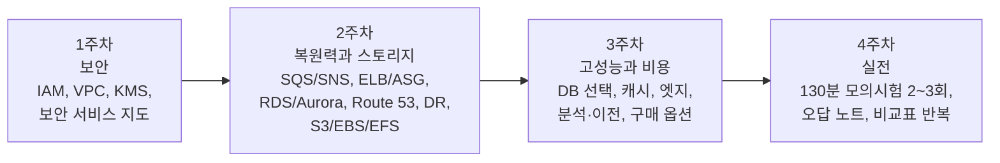

각 주의 마지막에는 이 문서의 해당 도메인 문제를 **시간을 재고** 풉니다. 1주차에는 Q1~Q6, 2주차에는 Q7~Q12, 3주차에는 Q13~Q24를 풀고, 틀린 문제는 8.2의 오답 노트에 기록합니다. 4주차에는 학습 내용을 새로 늘리기보다, 65문항을 시험과 같은 시간 조건으로 풀어 보는 연습을 반복하세요. 시간 압박 속에서 풀이 루틴이 무너지는지 확인하는 것이 목적입니다.

**실습도 병행하세요.** 공식 가이드는 대상 응시자를 AWS로 클라우드 솔루션을 설계해 본 경험이 1년 이상인 사람으로 가정합니다. 경험이 부족하다면 다음 정도의 작은 실습이 개념을 확실히 고정해 줍니다: 공용·사설 서브넷과 NAT, S3 게이트웨이 엔드포인트가 있는 VPC 만들기, S3 수명주기 규칙 설정, SNS 주제에 SQS 큐 두 개를 구독시키는 팬아웃 구성, RDS Multi-AZ 장애 조치 테스트, CloudFront + S3(OAC) 구성. **NAT 게이트웨이와 인터페이스 엔드포인트는 시간당 요금이 붙으므로 실습 후 반드시 삭제**하세요.

### 8.2 오답 노트 만들기

틀린 문제를 "정답은 B"로만 기록하면 같은 실수가 반복됩니다. 아래 네 칸으로 기록하세요.

| 문제(출처·번호) | 내가 놓친 단서 | 정답의 원리 | 내가 빠진 오답 유형(1~4) |
|---|---|---|---|
| 예: Q15 | "minimal code changes" | DAX는 API 호환 캐시라 변경이 적음 | 3(과잉 설계: ElastiCache 직접 구현) |

기록이 10개쯤 쌓이면 **자신이 자주 빠지는 유형**이 보입니다. 예를 들어 유형 4(목적 이탈)가 많다면 Part 5의 비교표를, 유형 2(요구사항 위반)가 많다면 지문의 제약 조건에 밑줄 치는 습관을 보강하면 됩니다. 약점은 서비스 지식이 아니라 **읽는 습관**에 있는 경우가 의외로 많습니다.

### 8.3 시험 직전 48시간

새로운 주제를 시작하지 마세요. 이 시기의 학습은 **이미 아는 것의 인출 속도를 높이는 것**이 전부입니다. Part 5의 비교표와 8.5의 한 장 요약, 그리고 오답 노트를 반복해서 읽고, 마지막으로 Part 3의 풀이 루틴을 한 번 더 읽습니다. 응시 방식(시험장 또는 온라인 감독 응시)에 따라 요구되는 신분증과 환경 조건이 다르므로 **예약 확인 메일과 공식 안내**를 미리 확인하고, 충분히 자는 것이 마지막 학습보다 점수에 더 도움이 됩니다.

### 8.4 시험 중 체크리스트

- 첫 문제부터 **질문 문장을 먼저** 읽고, 평가 기준(비용, 운영 부담, 보안, 가용성, 변경 최소화)에 표시합니다.
- 지문의 **제약 조건**(수치, 금지 사항, 프로토콜, 규모)을 짚습니다.
- 보기를 보기 전에 **후보 서비스를 먼저** 떠올립니다.
- 소거한 이유를 네 가지 유형(오용, 요구 위반, 과잉 설계, 목적 이탈)으로 분류합니다.
- 복수 선택은 **선택 개수**를 확인하고, 짝을 이루는 보기(경로 + 정책 등)를 찾습니다.
- 첫 순회는 문제당 **1.5분 안팎**, 막히면 가장 유력한 답을 선택하고 검토 표시를 한 뒤 넘어갑니다.
- **빈칸을 남기지 않습니다.** 오답 감점이 없습니다.
- 검토 때는 **명확한 이유가 있을 때만** 답을 바꿉니다.

### 8.5 한 장 요약: 자주 쓰이는 수치와 사실

수치는 바뀔 수 있으므로 시험 직전에 공식 문서로 다시 확인할 수 있다면 더 좋습니다. 아래는 오래 정착된 값 위주입니다.

| 항목 | 값·사실 |
|---|---|
| Lambda 최대 실행 시간 | 15분 |
| SQS 가시성 제한 시간 | 기본 30초 |
| SQS 메시지 보관 | 기본 4일, 최대 14일 |
| Kinesis Data Streams 보관 | 기본 24시간, 최대 365일 |
| S3 객체 크기 | 객체 최대 5TB, 단일 PUT 최대 5GB(그 이상은 멀티파트) |
| S3 최소 보관 기간 | IA 계열 30일, Glacier Instant·Flexible 90일, Deep Archive 180일 |
| Glacier Flexible Retrieval 복원 | 신속 1~5분, 표준 3~5시간, 대량 5~12시간 |
| Glacier Deep Archive 복원 | 표준 12시간 이내, 대량 48시간 이내 |
| gp3 IOPS | 기본 3,000, 최대 16,000 |
| Aurora | 세 AZ에 6개 사본, 복제본 최대 15개 |
| Site-to-Site VPN | 연결당 터널 2개(이중화) |
| CloudTrail 이벤트 기록 | 관리 이벤트 90일(장기 보관은 트레일 + S3) |
| EC2 CloudWatch 기본 모니터링 | 5분(세부 모니터링 1분), 메모리·디스크는 에이전트 필요 |
| DynamoDB 용량 단위 | 1 RCU = 4KB 강한 일관성 읽기/초, 1 WCU = 1KB 쓰기/초 |
| CloudFront용 ACM 인증서 | us-east-1 리전에서 요청 |
| RDS Multi-AZ 인스턴스 배포의 스탠바이 | 읽기 트래픽에 사용 불가 |
| 보안 그룹 / 네트워크 ACL | 허용만, 상태 저장 / 허용·거부, 상태 비저장 |
| Direct Connect | 기본적으로 암호화되지 않음 |
| SCP | 권한을 부여하지 않음, 관리 계정에는 적용 안 됨 |

### 8.6 합격자의 열 가지 철칙

1. **질문부터 읽는다.** 평가 기준이 정답의 방향을 정한다.
2. **제약 조건에 밑줄을 친다.** 조건 하나를 어기면 나머지가 아무리 좋아도 오답이다.
3. **관리형을 우선한다.** "운영 부담 최소"는 AWS가 대신 운영해 주는 서비스를 뜻한다.
4. **장기 자격 증명을 쓰지 않는다.** 역할, STS, Presigned URL이 답이다.
5. **장애의 크기에 맞춰 이중화한다.** 인스턴스는 Auto Scaling, AZ는 Multi-AZ, 리전은 DR이다.
6. **목적에 맞는 서비스를 고른다.** 비슷한 서비스는 "무엇을 위한 것인가"로 구분한다.
7. **읽기와 쓰기, 고가용성과 백업, 캐싱과 가속을 섞지 않는다.** 목적 이탈이 가장 흔한 함정이다.
8. **요구하지 않은 것까지 얹지 않는다.** 가장 단순하면서 모든 요구를 충족하는 해법이 정답이다.
9. **모르면 소거하고 반드시 답한다.** 오답 감점이 없고, 모르는 문제가 비채점일 수도 있다.
10. **답을 바꿀 때는 이유가 있어야 한다.** 막연한 불안은 이유가 아니다.

---

## 마무리

SAA-C03은 서비스 설명서를 통째로 외우는 시험이 아니라, **요구사항을 읽는 눈과 AWS의 설계 철학**을 묻는 시험입니다. 이 문서의 구조를 한 문장으로 줄이면 이렇습니다. 먼저 시험의 규칙을 알고(Part 1), AWS가 좋아하는 답의 성격을 익히고(Part 2), 지문을 읽는 루틴을 만들고(Part 3), 약한 분야를 이해 중심으로 채우고(Part 4), 헷갈리는 쌍을 정리한 뒤(Part 5), 새 문제로 루틴을 훈련하고(Part 6~7), 시간 조건에서 실전처럼 연습합니다(Part 8).

마지막으로 정보의 유효 기간에 대해 한 가지 부탁드립니다. 시험 범위, 서비스 구성, 한도와 가격은 바뀝니다. 응시 한 달쯤 전에 아래 공식 자료에서 **시험 가이드의 변경 이력**과 **응시 정보(시간, 비용, 언어, 시간 연장 제도 등)** 를 직접 확인하세요.

- 공식 시험 가이드: https://docs.aws.amazon.com/aws-certification/latest/examguides/solutions-architect-associate-03.html
- 공식 자격증 페이지: https://aws.amazon.com/certification/certified-solutions-architect-associate/

이 문서에서 어느 부분이든 더 깊이 파고들고 싶은 주제(예: IAM 정책 평가, DR 설계, 데이터 레이크 구성)가 있다면, 그 주제만 따로 확장해서 문제와 해설을 더 만들 수 있습니다.
