# AWS SAA-C03 Practice Exam — Detailed Set 1

| 도메인 | 실제 비중 | 이번 Set 반영 |
|---|---:|---:|
| Domain 1. Design Secure Architectures | 30% | 4문항 |
| Domain 2. Design Resilient Architectures | 26% | 3문항 |
| Domain 3. Design High-Performing Architectures | 24% | 3문항 |
| Domain 4. Design Cost-Optimized Architectures | 20% | 2문항 |

> 아래 문제는 학습용 예상 문제입니다. 실제 시험 문제나 덤프가 아니며, 최신 시험 정책과 출제 범위는 반드시 AWS 공식 Exam Guide로 재확인하셔야 합니다.

---

## Q1. Domain 1 — Design Secure Architectures

### Question

**A company runs an application on Amazon EC2 instances. The application needs to read and write objects in an Amazon S3 bucket. The security team requires that no long-term AWS access keys are stored on the EC2 instances or in the application code. The solution must follow AWS security best practices and require the least operational overhead.**

**Which solution should a solutions architect recommend?**

A. Create an IAM user with permissions to access the S3 bucket. Store the access key and secret access key in an encrypted file on each EC2 instance.

B. Create an IAM role with permissions to access the S3 bucket. Attach the IAM role to the EC2 instances.

C. Store AWS access keys in AWS Secrets Manager. Configure the application to retrieve the keys at startup.

D. Configure the S3 bucket policy to allow public read and write access.

---
<details>
<summary><strong>Click to view Answer & Detailed Explanation</strong></summary>

## 정답

**B. Create an IAM role with permissions to access the S3 bucket. Attach the IAM role to the EC2 instances.**

---

## 상세 해설

이 문제의 핵심 조건은 다음입니다.

| 조건 | 의미 |
|---|---|
| EC2에서 S3 접근 필요 | EC2가 AWS API를 호출해야 함 |
| 장기 Access Key 저장 금지 | IAM User Access Key를 파일/코드에 넣으면 안 됨 |
| AWS 보안 모범 사례 | 임시 자격 증명 사용 |
| 운영 부담 최소화 | 직접 키 관리하지 않아야 함 |

AWS에서 EC2가 S3, DynamoDB, CloudWatch 같은 AWS 서비스에 접근할 때 가장 권장되는 방식은 **IAM Role을 EC2에 연결하는 것**입니다.

IAM Role을 EC2에 연결하면 EC2 인스턴스는 별도의 Access Key 없이도 AWS가 자동으로 제공하는 **임시 보안 자격 증명**을 사용합니다.

즉, 애플리케이션 코드에 이런 식으로 Access Key를 넣을 필요가 없습니다.

```text
AWS_ACCESS_KEY_ID=...
AWS_SECRET_ACCESS_KEY=...
```

대신 AWS SDK는 EC2 메타데이터 서비스를 통해 자동으로 임시 자격 증명을 가져옵니다.

---

## 구조 이해

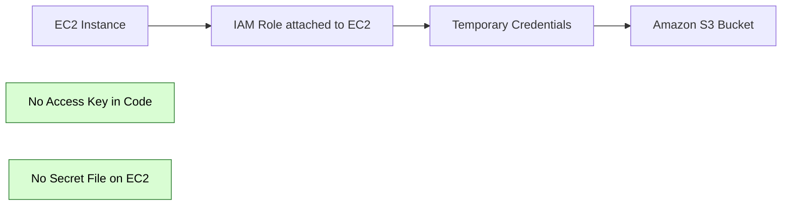

EC2에 IAM Role을 붙이면 다음 흐름으로 동작합니다.

1. EC2 인스턴스에 IAM Role 연결
2. AWS가 EC2에 임시 자격 증명 제공
3. 애플리케이션이 AWS SDK로 S3 API 호출
4. SDK가 자동으로 임시 자격 증명을 사용
5. S3 접근 가능

---

## 왜 B가 정답인가?

- Access Key를 저장하지 않음
- 자동으로 임시 자격 증명 사용
- 키 회전, 배포, 암호화 파일 관리가 필요 없음
- AWS 보안 모범 사례
- 운영 부담이 가장 낮음

---

## 오답 설명

### A. IAM User Access Key를 EC2에 저장

**오답입니다.**

IAM User의 Access Key는 장기 자격 증명입니다.

파일에 암호화해서 저장하더라도 다음 문제가 있습니다.

- 키 유출 가능성
- 키 회전 필요
- EC2 여러 대에 배포해야 함
- 개발자가 코드나 설정 파일에 실수로 포함할 수 있음
- AWS 보안 모범 사례에 어긋남

시험에서 다음 표현이 나오면 A 같은 보기는 거의 제거해야 합니다.

```text
store access keys
hard-code credentials
long-term credentials
```

---

### C. Secrets Manager에 Access Key 저장

겉보기에는 안전해 보이지만 **정답은 아닙니다.**

Secrets Manager는 DB 비밀번호, API Key, 외부 서비스 Credential 등을 저장하는 데 적합합니다.

하지만 EC2가 AWS 서비스에 접근하기 위해 AWS Access Key를 Secrets Manager에 저장하는 것은 좋은 방식이 아닙니다.

왜냐하면 애초에 Access Key를 만들 필요가 없기 때문입니다.

더 좋은 방식은 다음입니다.

```text
EC2 + IAM Role
```

---

### D. S3 Bucket Public Read/Write 허용

**가장 위험한 오답입니다.**

Public Write까지 허용하면 누구나 버킷에 객체를 업로드하거나 변조할 수 있습니다.

보안 요구사항과 완전히 반대입니다.

---

## 초보자용 기억법

> EC2에서 AWS 서비스 접근 = **IAM Role**

> Lambda에서 AWS 서비스 접근 = **Execution Role**

> 사람 사용자 접근 = **IAM Identity Center 또는 IAM User**

> 앱 사용자 로그인 = **Cognito**

</details>

---

## Q2. Domain 1 — Design Secure Architectures

### Question

**A company has multiple AWS accounts managed by AWS Organizations. The company has an Amazon S3 bucket in a shared services account. The security team wants to allow access to the S3 bucket only from principals that belong to the company’s AWS Organization. The solution must automatically include new accounts that are added to the organization.**

**Which solution should a solutions architect recommend?**

A. Add each AWS account ID to the S3 bucket policy manually.

B. Create an IAM user in each AWS account and grant access to the bucket.

C. Add an S3 bucket policy that uses the `aws:PrincipalOrgID` condition key.

D. Use AWS CloudTrail to detect new accounts and update the bucket policy with a Lambda function.

---
<details>
<summary><strong>Click to view Answer & Detailed Explanation</strong></summary>

## 정답

**C. Add an S3 bucket policy that uses the `aws:PrincipalOrgID` condition key.**

---

## 상세 해설

이 문제는 **AWS Organizations + S3 Bucket Policy** 문제입니다.

요구사항을 분해하면 다음과 같습니다.

| 요구사항 | 의미 |
|---|---|
| 여러 AWS 계정 | 계정별로 권한 관리하면 복잡함 |
| 같은 AWS Organization 소속만 허용 | 조직 ID 기준 접근 제어 필요 |
| 새 계정 자동 포함 | 계정 ID를 수동으로 나열하면 안 됨 |
| 운영 부담 최소화 | 자동 확장되는 정책 필요 |

이럴 때 사용하는 조건 키가 바로 다음입니다.

```text
aws:PrincipalOrgID
```

이 조건을 S3 Bucket Policy에 넣으면, 특정 AWS Organization에 속한 계정의 Principal만 접근할 수 있습니다.

---

## 예시 정책 개념

```json
{
  "Effect": "Allow",
  "Principal": "*",
  "Action": "s3:GetObject",
  "Resource": "arn:aws:s3:::example-bucket/*",
  "Condition": {
    "StringEquals": {
      "aws:PrincipalOrgID": "o-xxxxxxxxxx"
    }
  }
}
```

이 정책의 의미는 다음과 같습니다.

> 요청을 보낸 Principal이 `o-xxxxxxxxxx`라는 AWS Organization에 속해 있으면 허용한다.

---

## 구조 도식

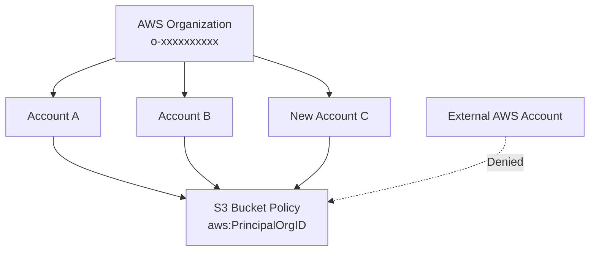

새 계정이 Organization에 추가되면 별도 정책 수정 없이 자동으로 조건을 만족합니다.

---

## 오답 설명

### A. 계정 ID를 수동으로 Bucket Policy에 추가

작은 환경에서는 가능하지만 운영 부담이 큽니다.

문제에서 다음 조건이 있습니다.

```text
automatically include new accounts
```

계정 ID를 수동으로 나열하면 새 계정이 생길 때마다 정책을 수정해야 합니다.

---

### B. 각 계정에 IAM User 생성

보안과 운영 모두 좋지 않습니다.

- IAM User는 장기 자격 증명 기반
- 계정별 생성/삭제/권한 관리 필요
- 조직 전체 접근 제어와 맞지 않음

---

### D. CloudTrail + Lambda로 정책 자동 업데이트

가능은 할 수 있지만 과합니다.

이런 보기는 시험에서 자주 나오는 함정입니다.

```text
직접 자동화 가능하지만, AWS 네이티브 조건 키 하나로 해결 가능
```

운영 부담 최소화 조건에서는 C가 더 적합합니다.

---

## 초보자용 기억법

> 같은 Organization 계정만 허용 → **aws:PrincipalOrgID**

> 특정 VPC Endpoint만 허용 → **aws:SourceVpce**

> 특정 IP만 허용 → **aws:SourceIp**

</details>

---

## Q3. Domain 1 — Design Secure Architectures

### Question

**A company stores credentials for an Amazon RDS for PostgreSQL database. The credentials must be rotated automatically every 30 days. Applications running in multiple AWS Regions need access to the credentials. The company wants to minimize custom code and operational overhead.**

**Which solution should the company use?**

A. Store the credentials in AWS Systems Manager Parameter Store as SecureString parameters and rotate them manually.

B. Store the credentials in AWS Secrets Manager, enable automatic rotation, and replicate the secret to the required Regions.

C. Store the credentials in an encrypted Amazon S3 bucket and use an EventBridge rule to invoke a Lambda function to rotate them.

D. Store the credentials in DynamoDB global tables and encrypt the table with AWS KMS.

---
<details>
<summary><strong>Click to view Answer & Detailed Explanation</strong></summary>

## 정답

**B. Store the credentials in AWS Secrets Manager, enable automatic rotation, and replicate the secret to the required Regions.**

---

## 상세 해설

이 문제는 **비밀값 관리 + 자동 교체 + Multi-Region** 문제입니다.

핵심 키워드는 다음입니다.

| 문제 표현 | 정답 방향 |
|---|---|
| credentials | Secrets Manager 또는 Parameter Store |
| rotated automatically | Secrets Manager |
| RDS database | Secrets Manager는 RDS Rotation과 잘 통합됨 |
| multiple AWS Regions | Multi-Region Secret Replication |
| minimize custom code | 관리형 기능 사용 |

AWS Secrets Manager는 이름 그대로 **비밀번호, DB Credential, API Key 같은 Secret을 관리하는 서비스**입니다.

특히 RDS와 통합되어 다음 작업을 자동화할 수 있습니다.

- DB 비밀번호 저장
- 주기적 Rotation
- 애플리케이션에서 안전하게 조회
- KMS 기반 암호화
- Multi-Region 복제

---

## 개념 도식

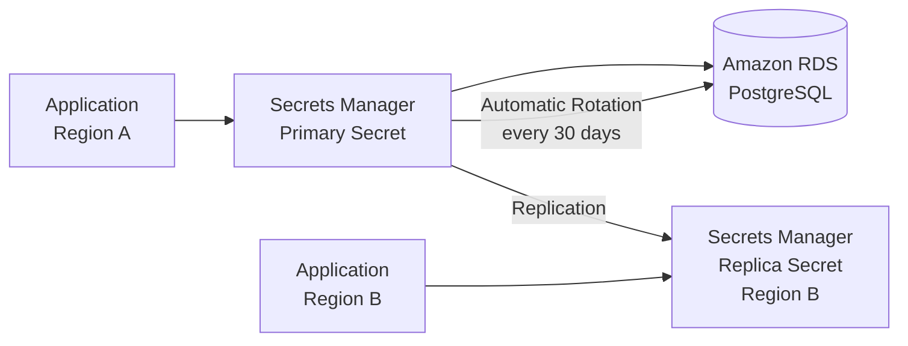

---

## 왜 Secrets Manager인가?

Secrets Manager는 단순 저장소가 아닙니다.

자동 Rotation 기능이 핵심입니다.

예를 들어 RDS Credential Rotation은 내부적으로 다음 흐름을 가집니다.

1. 새 비밀번호 생성
2. RDS DB 사용자 비밀번호 변경
3. Secret 값 업데이트
4. 애플리케이션은 최신 Secret 조회
5. 이전 비밀번호 폐기

이 과정을 직접 만들면 Lambda 코드, 실패 처리, 동기화, 권한 관리 등을 다 구현해야 합니다.

---

## 오답 설명

### A. Parameter Store SecureString

Parameter Store도 SecureString으로 암호화 저장은 가능합니다.

하지만 문제의 핵심은 다음입니다.

```text
rotated automatically every 30 days
```

RDS Credential 자동 Rotation은 Secrets Manager가 더 적합합니다.

Parameter Store는 보통 다음에 적합합니다.

- 일반 설정값
- 환경 변수
- 단순 Secure Parameter
- 상대적으로 저렴한 구성 관리

---

### C. S3 + Lambda 직접 Rotation

직접 구현은 가능합니다. 하지만 문제에서 이렇게 물었습니다.

```text
minimize custom code and operational overhead
```

S3에 Credential을 저장하고 Lambda로 직접 Rotation하면 다음을 직접 관리해야 합니다.

- 암호화
- 접근 제어
- Rotation 실패 처리
- DB 비밀번호 변경
- Secret 버전 관리
- Multi-Region 복제

운영 부담이 큽니다.

---

### D. DynamoDB Global Tables

DynamoDB Global Tables는 Multi-Region 데이터 복제에는 좋습니다.

하지만 Credential Rotation 기능은 없습니다.

Credential 저장소로 억지로 사용할 수는 있어도, Secrets Manager가 정답입니다.

---

## 초보자용 기억법

| 요구사항 | 서비스 |
|---|---|
| DB 비밀번호 자동 교체 | Secrets Manager |
| 설정값 저장 | Parameter Store |
| 암호화 키 관리 | KMS |
| 인증서 발급/관리 | ACM |

</details>

---

## Q4. Domain 1 — Design Secure Architectures

### Question

**A company runs a public web application behind an Application Load Balancer. The security team wants to protect the application from common web exploits such as SQL injection and cross-site scripting. The solution must be managed and must not require changes to the application code.**

**Which AWS service should be used?**

A. AWS WAF

B. AWS Shield Standard

C. Amazon GuardDuty

D. AWS CloudTrail

---
<details>
<summary><strong>Click to view Answer & Detailed Explanation</strong></summary>

## 정답


**A. AWS WAF**

---

## 상세 해설

이 문제는 **웹 애플리케이션 공격 방어** 문제입니다.

문제의 핵심 키워드는 다음입니다.

```text
SQL injection
cross-site scripting
public web application
Application Load Balancer
no application code changes
```

이런 키워드가 나오면 거의 바로 **AWS WAF**를 떠올려야 합니다.

AWS WAF는 Web Application Firewall입니다.

HTTP/HTTPS 요청을 검사하고, 특정 공격 패턴을 차단할 수 있습니다.

예를 들어 다음과 같은 요청을 막을 수 있습니다.

```sql
' OR '1'='1
```

또는 XSS 공격 예시:

```html
<script>alert('xss')</script>
```

---

## 구조 도식

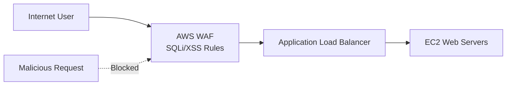

---

## AWS WAF가 적합한 이유

- ALB와 연동 가능
- CloudFront와도 연동 가능
- API Gateway와도 연동 가능
- 관리형 룰 사용 가능
- 애플리케이션 코드 수정 불필요
- SQL Injection, XSS 같은 L7 공격 방어

---

## 오답 설명

### B. AWS Shield Standard

AWS Shield Standard는 DDoS 방어 서비스입니다.

모든 AWS 고객에게 기본 제공됩니다.

하지만 Shield는 다음 공격에 초점이 있습니다.

- L3/L4 DDoS
- 네트워크 대량 트래픽 공격

SQL Injection, XSS 같은 웹 요청 내용 기반 공격은 WAF가 담당합니다.

---

### C. Amazon GuardDuty

GuardDuty는 위협 탐지 서비스입니다.

예를 들어 다음을 탐지합니다.

- 의심스러운 API 호출
- 비정상적인 DNS 요청
- 악성 IP와 통신
- 계정 침해 징후

하지만 웹 요청을 직접 차단하지는 않습니다.

---

### D. AWS CloudTrail

CloudTrail은 AWS API 호출 로그를 기록하는 서비스입니다.

예:

```text
누가 EC2를 만들었는가?
누가 IAM Policy를 변경했는가?
누가 S3 Bucket Policy를 수정했는가?
```

SQL Injection 차단과는 관련이 없습니다.

---

## 초보자용 기억법

| 보안 요구사항 | 서비스 |
|---|---|
| SQL Injection, XSS 차단 | AWS WAF |
| DDoS 방어 | AWS Shield |
| 위협 탐지 | GuardDuty |
| API 감사 로그 | CloudTrail |
| 취약점 스캔 | Inspector |
| 민감 데이터 탐지 | Macie |

</details>

---

## Q5. Domain 2 — Design Resilient Architectures

### Question

**A company runs a two-tier web application on Amazon EC2 instances in a single Availability Zone. The web tier is deployed on two EC2 instances. The database tier is a self-managed MySQL database running on a single EC2 instance. The company wants to improve availability and reduce operational overhead.**

**Which solution should a solutions architect recommend?**

A. Increase the size of all EC2 instances and keep the application in the same Availability Zone.

B. Deploy the web tier in an Auto Scaling group across multiple Availability Zones behind an Application Load Balancer, and migrate the database to Amazon RDS Multi-AZ.

C. Create an AMI of the database EC2 instance every night and restore it manually if the instance fails.

D. Store the MySQL database files in Amazon S3 and mount the S3 bucket to all EC2 instances.

---
<details>
<summary><strong>Click to view Answer & Detailed Explanation</strong></summary>

## 정답

**B. Deploy the web tier in an Auto Scaling group across multiple Availability Zones behind an Application Load Balancer, and migrate the database to Amazon RDS Multi-AZ.**

---

## 상세 해설

이 문제는 **고가용성 아키텍처 전환** 문제입니다.

현재 구조의 문제는 다음입니다.

```text
Single Availability Zone
Self-managed database on EC2
Manual operations
Single point of failure
```

즉, 장애가 나면 다음 문제가 생깁니다.

- AZ 장애 시 전체 서비스 중단 가능
- DB EC2 장애 시 DB 중단
- DB 백업/복구/패치/Failover를 직접 해야 함

---

## 기존 구조

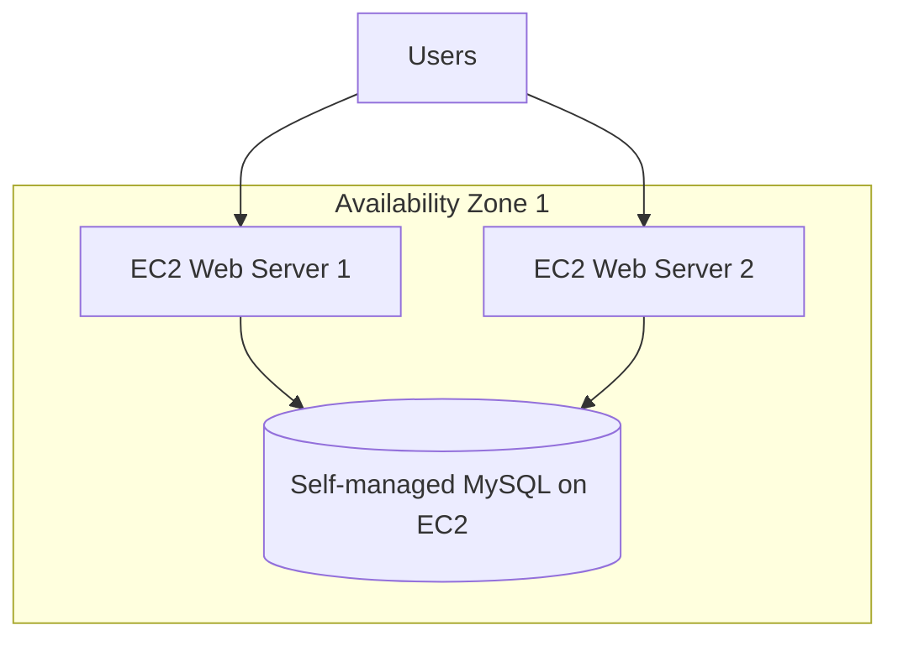

이 구조는 EC2가 2대여도 같은 AZ 안에 있으므로 AZ 장애에 취약합니다.

DB도 단일 EC2라 장애 지점입니다.

---

## 개선 구조

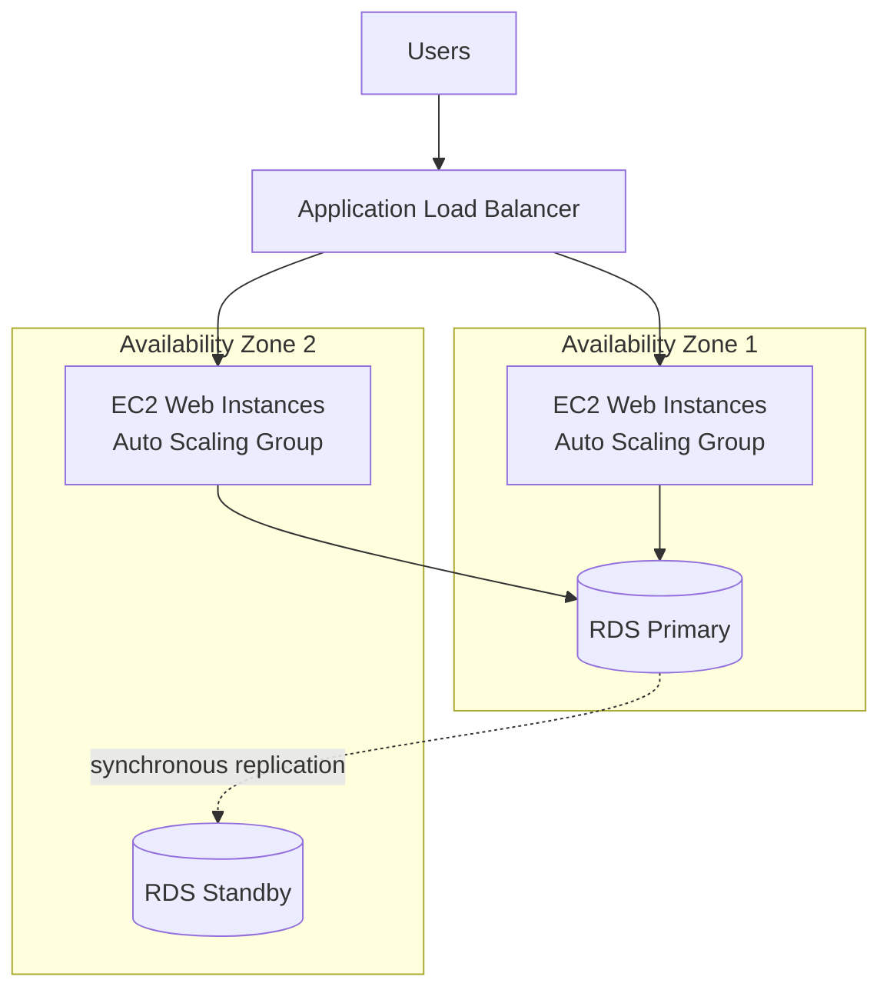

---

## 왜 B가 정답인가?

B는 두 계층 모두 개선합니다.

### 웹 계층

- ALB가 트래픽 분산
- Auto Scaling Group이 인스턴스 장애 시 자동 대체
- Multi-AZ 배치로 AZ 장애에 대응

### DB 계층

- RDS Multi-AZ로 자동 장애 조치
- DB 패치, 백업, 복구 운영 부담 감소
- Self-managed DB보다 운영 부담 낮음

---

## 오답 설명

### A. 인스턴스 크기만 증가

인스턴스 크기를 키우는 것은 성능 문제에는 도움이 될 수 있습니다.

하지만 고가용성 문제는 해결하지 못합니다.

단일 AZ는 그대로이므로 AZ 장애가 나면 서비스가 중단될 수 있습니다.

---

### C. AMI를 매일 생성하고 수동 복구

백업은 도움이 되지만 고가용성은 아닙니다.

AMI 복구 방식은 다음 문제가 있습니다.

- 복구 시간이 김
- 데이터 손실 가능성 있음
- 수동 작업 필요
- 장애 감지와 Failover 자동화가 안 됨

---

### D. MySQL DB 파일을 S3에 저장

S3는 객체 스토리지입니다.

MySQL 데이터 파일을 여러 EC2에서 동시에 마운트해 사용하는 DB 스토리지로 적합하지 않습니다.

---

## 초보자용 기억법

> 고가용성 웹 = **ALB + ASG + Multi-AZ**

> 고가용성 DB = **RDS Multi-AZ**

> 읽기 확장 DB = **Read Replica**

</details>

---

## Q6. Domain 2 — Design Resilient Architectures

### Question

**A company runs an online order processing application. The web tier receives sudden spikes of traffic. The application writes each order directly to an Amazon RDS database. During peak traffic, the database cannot process all write requests fast enough. The company must ensure that no orders are lost and that the application remains responsive.**

**Which solution should a solutions architect recommend?**

A. Enable Multi-AZ on the RDS database and configure the application to write to both the primary and standby databases.

B. Add an Amazon SQS queue between the web tier and the processing tier. Configure worker instances to read messages from the queue and write orders to the database.

C. Add Amazon CloudFront in front of the web tier to cache order submission requests.

D. Replace the RDS database with Amazon EFS and store orders as files.

---
<details>
<summary><strong>Click to view Answer & Detailed Explanation</strong></summary>

## 정답

**B. Add an Amazon SQS queue between the web tier and the processing tier. Configure worker instances to read messages from the queue and write orders to the database.**

---

## 상세 해설

이 문제는 **Decoupling, 즉 결합도 분리** 문제입니다.

현재 구조는 다음과 같습니다.

```text
User → Web Server → RDS
```

문제는 Web Server가 주문 요청을 받을 때마다 RDS에 바로 쓰고 있다는 점입니다.

트래픽이 갑자기 몰리면 RDS가 처리할 수 있는 쓰기 처리량을 초과합니다.

그러면 다음 문제가 생깁니다.

- 주문 저장 실패
- 사용자 응답 지연
- DB Connection 증가
- 애플리케이션 Timeout
- 주문 유실 가능성

---

## 잘못된 구조

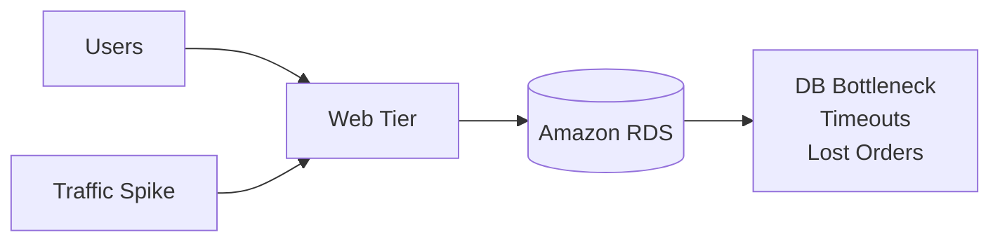

---

## 개선 구조

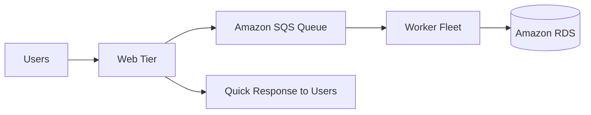

SQS를 중간에 넣으면 Web Tier는 주문을 Queue에 넣고 빠르게 응답할 수 있습니다.

Worker는 DB가 감당할 수 있는 속도로 Queue에서 메시지를 읽어 RDS에 기록합니다.

---

## SQS를 쓰는 이유

SQS는 메시지 대기열입니다.

쉽게 말하면 "주문 접수 대기줄"입니다.

식당으로 비유하면 다음과 같습니다.

- 손님이 한꺼번에 몰림
- 주방이 바로 모든 주문을 처리할 수 없음
- 주문표를 대기열에 쌓아둠
- 주방은 순서대로 처리
- 주문표가 사라지지 않으므로 주문 유실 방지

---

## 오답 설명

### A. RDS Multi-AZ에 양쪽 Write

RDS Multi-AZ는 고가용성을 위한 기능입니다.

Standby DB는 장애 조치용이며 애플리케이션이 동시에 Write하는 대상이 아닙니다.

즉, Multi-AZ는 다음에 적합합니다.

```text
DB 장애 시 자동 Failover
```

하지만 이 문제의 핵심은 다음입니다.

```text
쓰기 요청 폭주를 흡수
```

따라서 SQS가 적합합니다.

---

### C. CloudFront로 주문 요청 캐싱

CloudFront는 정적 콘텐츠, 이미지, CSS, JS, 일부 GET 요청 캐싱에 적합합니다.

하지만 주문 제출은 보통 POST 요청이며, 사용자별로 달라지는 쓰기 요청입니다.

주문 요청을 캐싱하면 오히려 잘못된 결과가 생길 수 있습니다.

---

### D. EFS에 주문을 파일로 저장

EFS는 공유 파일 시스템입니다.

주문 트랜잭션 저장소로 RDS를 대체하는 것은 일반적으로 적절하지 않습니다.

---

## 초보자용 기억법

> 갑작스러운 요청 폭주 + 유실 방지 → **SQS**

> 여러 구독자에게 동시에 전달 → **SNS**

> 순서 보장 필요 → **SQS FIFO**

</details>

---

## Q7. Domain 2 — Design Resilient Architectures

### Question

**A company needs a disaster recovery strategy for a business-critical application. The application must be restored within a few minutes after a Regional outage. The company wants a lower-cost solution than running the full production workload in two Regions at all times.**

**Which disaster recovery strategy should the company use?**

A. Backup and restore

B. Pilot light

C. Warm standby

D. Active-active multi-Region

---
<details>
<summary><strong>Click to view Answer & Detailed Explanation</strong></summary>

## 정답
**C. Warm standby**

---

## 상세 해설

이 문제는 **DR, Disaster Recovery 전략** 문제입니다.

핵심 조건은 다음입니다.

| 조건 | 의미 |
|---|---|
| Regional outage | 리전 장애 대비 |
| restored within a few minutes | RTO가 짧아야 함 |
| lower-cost than full production in two Regions | Active-Active보다는 저렴해야 함 |

DR 전략은 비용과 복구 시간의 균형입니다.

---

## DR 전략 비교

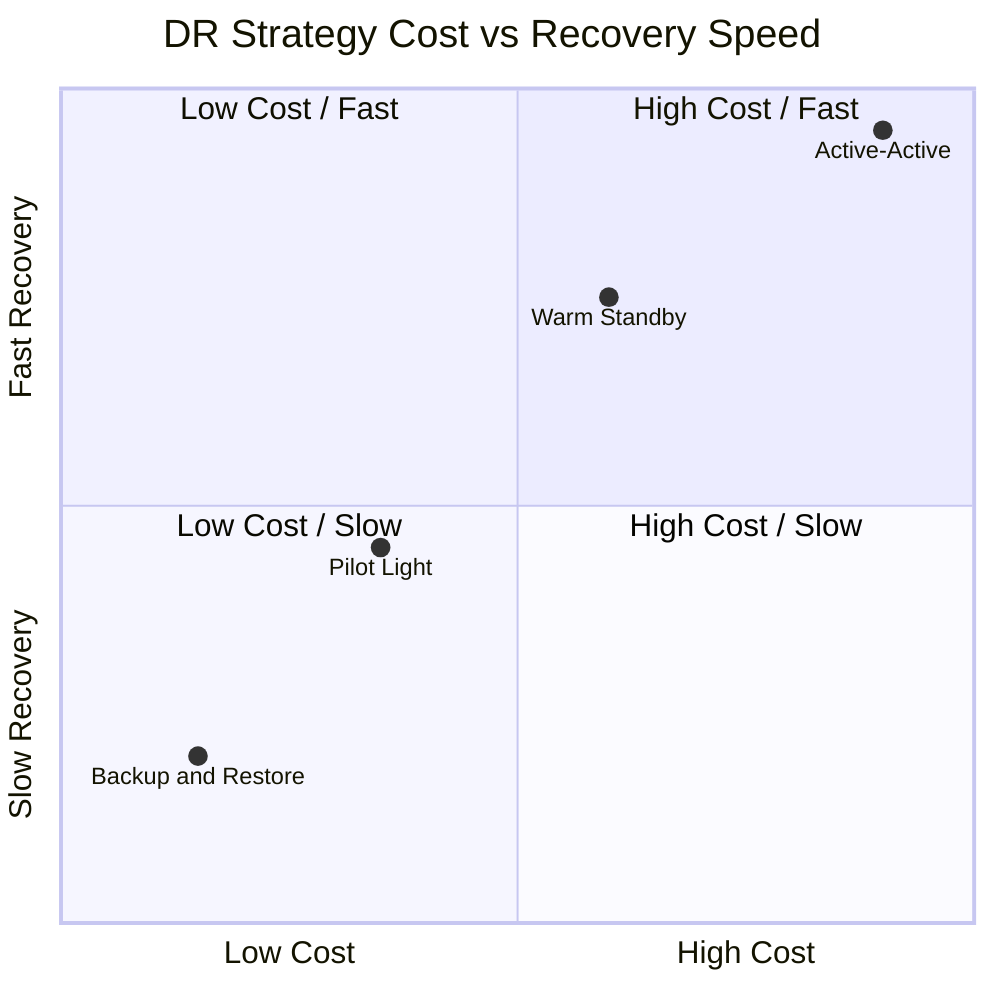

---

## Warm Standby란?

Warm Standby는 다른 리전에 축소된 버전의 운영 환경을 항상 켜두는 방식입니다.

예를 들면 다음과 같습니다.

| 운영 리전 | DR 리전 |
|---|---|
| EC2 10대 | EC2 2대 |
| RDS Primary | RDS Replica 또는 대기 DB |
| 전체 트래픽 처리 | 장애 시 확장 |
| 정상 운영 | 준비된 상태 |

장애가 발생하면 DR 리전의 용량을 빠르게 늘려 서비스를 복구합니다.

---

## 왜 Warm Standby가 정답인가?

요구사항이 "몇 분 내 복구"입니다.

- Backup and Restore는 너무 느립니다.
- Pilot Light는 핵심 구성요소만 켜져 있어서 Warm Standby보다 복구 시간이 더 걸릴 수 있습니다.
- Active-Active는 가장 빠르지만 비용이 높습니다.
- Warm Standby는 비용과 복구 속도의 균형이 좋습니다.

---

## 오답 설명

### A. Backup and restore

가장 저렴하지만 복구 시간이 깁니다.

보통 다음 작업이 필요합니다.

1. 백업에서 데이터 복원
2. 인프라 생성
3. 애플리케이션 배포
4. DNS 전환

몇 분 내 복구 요구에는 부족할 수 있습니다.

---

### B. Pilot light

Pilot Light는 "불씨만 살려두는 방식"입니다.

DB나 핵심 인프라는 준비하지만, 전체 애플리케이션은 대부분 꺼져 있습니다.

Warm Standby보다 비용은 낮지만 복구 시간은 더 깁니다.

---

### D. Active-active multi-Region

가장 빠른 복구가 가능하지만 문제에서 이렇게 말했습니다.

```text
lower-cost solution than running the full production workload in two Regions
```

Active-Active는 두 리전에서 풀 프로덕션을 운영하므로 비용이 높습니다.

---

## 초보자용 기억법

| 전략 | 비유 |
|---|---|
| Backup and Restore | 창고에 부품만 보관 |
| Pilot Light | 보일러 불씨만 켜둠 |
| Warm Standby | 작은 규모로 이미 운영 중 |
| Active-Active | 두 공장이 동시에 풀가동 |

</details>

---

## Q8. Domain 3 — Design High-Performing Architectures

### Question

**A company uses an Amazon Aurora MySQL database for an application. The application performs many read queries for reporting. These read queries are causing high latency for the primary database instance. The company wants to improve read performance with minimal application changes.**

**What should a solutions architect recommend?**

A. Enable Multi-AZ and direct read traffic to the standby instance.

B. Create Aurora Replicas and configure the application to use the Aurora reader endpoint for read queries.

C. Move the database to Amazon S3 and query it with Amazon Athena.

D. Increase the backup retention period of the Aurora cluster.

---
<details>
<summary><strong>Click to view Answer & Detailed Explanation</strong></summary>

## 정답

**B. Create Aurora Replicas and configure the application to use the Aurora reader endpoint for read queries.**

---

## 상세 해설

이 문제는 **데이터베이스 읽기 성능 개선** 문제입니다.

현재 병목은 다음입니다.

```text
Reporting read queries → Primary DB에 부하 발생
```

읽기 쿼리가 많아서 Primary DB가 느려지고 있습니다.

이 경우 정답 방향은 **Read Scaling**입니다.

Aurora에서는 Aurora Replica를 추가하고, 읽기 쿼리는 **Reader Endpoint**로 보내면 됩니다.

---

## Aurora Endpoint 개념

Aurora에는 보통 다음 Endpoint가 있습니다.

| Endpoint | 용도 |
|---|---|
| Writer Endpoint | 쓰기 작업용 |
| Reader Endpoint | 읽기 작업 분산 |
| Instance Endpoint | 특정 DB 인스턴스 직접 연결 |

---

## 구조 도식

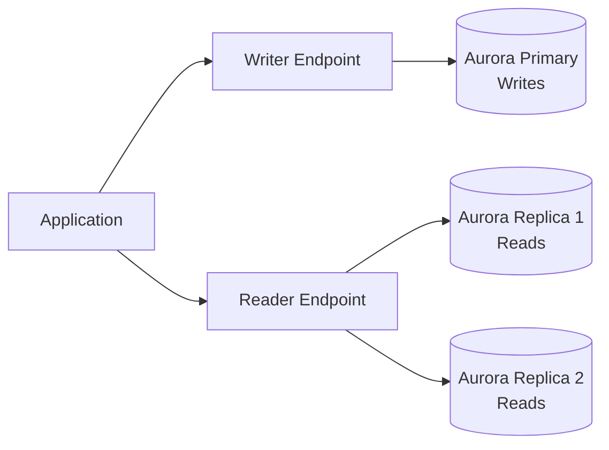

애플리케이션에서 다음처럼 분리하는 방식입니다.

```text
INSERT/UPDATE/DELETE → Writer Endpoint
SELECT/reporting queries → Reader Endpoint
```

---

## 오답 설명

### A. Multi-AZ Standby에 읽기 전달

일반 RDS에서 Multi-AZ Standby는 장애 조치용입니다.

읽기 트래픽을 보내는 대상이 아닙니다.

Aurora도 고가용성을 제공하지만, 읽기 확장은 Replica와 Reader Endpoint를 사용해야 합니다.

---

### C. S3 + Athena로 이동

Athena는 S3 데이터를 SQL로 분석할 때 좋습니다.

하지만 운영 중인 Aurora DB의 읽기 부하를 최소 변경으로 개선하려는 문제입니다.

DB를 S3로 옮기는 것은 큰 아키텍처 변경입니다.

---

### D. 백업 보존 기간 증가

백업 보존 기간은 복구 가능 기간과 관련이 있습니다.

읽기 성능 개선과는 관계가 없습니다.

---

## 초보자용 기억법

> RDS/Aurora 읽기 부하 증가 → **Read Replica / Aurora Replica**

> 장애 조치 목적 → **Multi-AZ**

> 분석용 S3 SQL → **Athena**

</details>

---

## Q9. Domain 3 — Design High-Performing Architectures

### Question

**A company hosts a web application in one AWS Region behind an Application Load Balancer. Users are located around the world and experience high latency when downloading static images, CSS files, and JavaScript files. The company wants to improve performance for global users.**

**Which solution should a solutions architect recommend?**

A. Use Amazon CloudFront with the Application Load Balancer as the origin.

B. Move the Application Load Balancer into a private subnet.

C. Use AWS Direct Connect between each user location and AWS.

D. Increase the instance size of all EC2 instances behind the load balancer.

---
<details>
<summary><strong>Click to view Answer & Detailed Explanation</strong></summary>

## 정답

**A. Use Amazon CloudFront with the Application Load Balancer as the origin.**

---

## 상세 해설

이 문제는 **글로벌 사용자 대상 콘텐츠 전송 성능 개선** 문제입니다.

문제의 핵심은 다음입니다.

```text
Users are located around the world
high latency
static images, CSS, JavaScript
```

정적 콘텐츠를 전 세계 사용자에게 빠르게 제공하려면 **CDN, Content Delivery Network**가 필요합니다.

AWS의 CDN 서비스는 **Amazon CloudFront**입니다.

CloudFront는 전 세계 Edge Location에 콘텐츠를 캐싱합니다.

사용자는 원본 서버가 있는 리전까지 가지 않고, 가까운 Edge Location에서 콘텐츠를 받습니다.

---

## 기존 구조

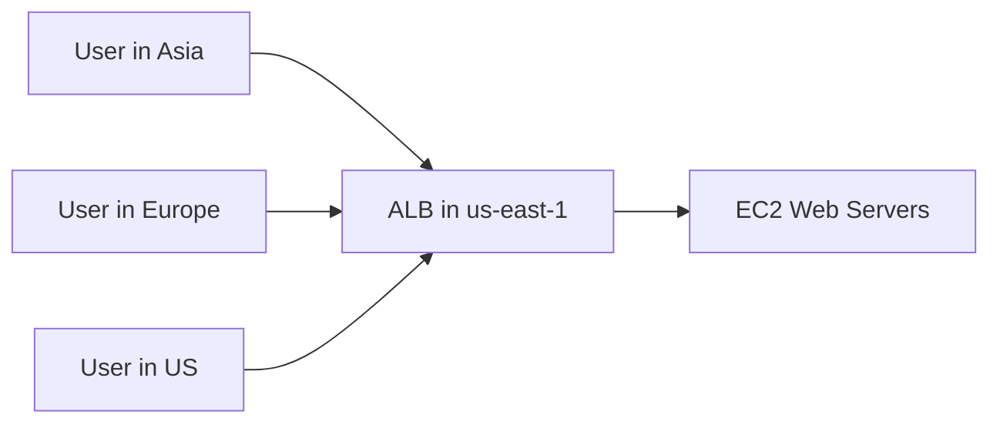

멀리 있는 사용자는 리전까지 네트워크 왕복 시간이 길어집니다.

---

## 개선 구조

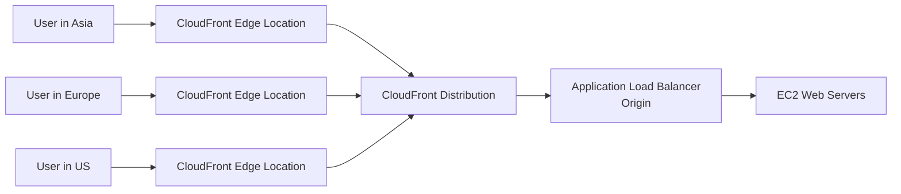

정적 파일은 Edge Location에 캐싱되므로 사용자는 더 빠르게 다운로드합니다.

---

## 오답 설명

### B. ALB를 Private Subnet으로 이동

Public Web Application은 인터넷 사용자가 접근해야 합니다.

ALB를 Private Subnet에 두면 외부 접근성이 깨질 수 있습니다.

성능 개선과도 관련이 없습니다.

---

### C. 모든 사용자 위치와 Direct Connect

Direct Connect는 기업 데이터센터와 AWS 간 전용 네트워크 연결입니다.

전 세계 일반 웹 사용자에게 적용하는 방식이 아닙니다.

---

### D. EC2 인스턴스 크기 증가

EC2 크기를 키우면 서버 처리 능력은 좋아질 수 있습니다.

하지만 사용자가 전 세계에 있을 때 발생하는 네트워크 지연은 해결하지 못합니다.

---

## 초보자용 기억법

| 문제 상황 | 서비스 |
|---|---|
| 전 세계 정적 콘텐츠 빠르게 제공 | CloudFront |
| 글로벌 TCP/UDP 성능 개선 | Global Accelerator |
| DNS 기반 지역/지연 라우팅 | Route 53 |
| 온프레미스와 전용 연결 | Direct Connect |

</details>

---

## Q10. Domain 3 — Design High-Performing Architectures

### Question

**A company stores JSON-formatted application logs in Amazon S3. Data analysts need to run ad hoc SQL queries against the logs. The company wants the solution with the least operational overhead and does not want to load the data into a database.**

**Which solution should a solutions architect recommend?**

A. Use Amazon Athena to query the data directly in Amazon S3.

B. Load the data into Amazon Redshift before querying.

C. Launch an Amazon EMR cluster for every query.

D. Copy the logs into Amazon RDS for PostgreSQL.

---
<details>
<summary><strong>Click to view Answer & Detailed Explanation</strong></summary>

## 정답

**A. Use Amazon Athena to query the data directly in Amazon S3.**

---

## 상세 해설

이 문제는 **S3에 저장된 데이터에 SQL Query**를 하는 문제입니다.

핵심 키워드는 다음입니다.

```text
JSON logs in S3
ad hoc SQL queries
least operational overhead
does not want to load the data into a database
```

이 조건을 모두 만족하는 서비스는 **Amazon Athena**입니다.

Athena는 서버리스 SQL Query 서비스입니다.

S3에 있는 데이터를 그대로 두고 SQL로 조회할 수 있습니다.

---

## 구조 도식

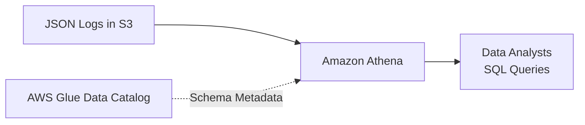

Athena를 사용하면 다음이 가능합니다.

```sql
SELECT status_code, count(*)
FROM application_logs
WHERE date = '2026-01-01'
GROUP BY status_code;
```

---

## Athena가 적합한 이유

- 서버 관리 불필요
- 데이터베이스 적재 불필요
- S3 데이터를 직접 Query
- JSON, CSV, Parquet 등 지원
- 사용한 Query 데이터량 기반 과금
- ad hoc 분석에 적합

---

## 오답 설명

### B. Redshift에 적재

Redshift는 데이터웨어하우스입니다.

대규모 BI 분석, 정형화된 분석에는 좋습니다.

하지만 이 문제는 다음 조건이 있습니다.

```text
does not want to load the data into a database
least operational overhead
```

따라서 Redshift는 과합니다.

---

### C. EMR 클러스터 실행

EMR은 Hadoop/Spark 기반 대규모 분산 처리에 적합합니다.

하지만 단순 ad hoc SQL 조회에는 운영 부담이 큽니다.

- 클러스터 생성
- 노드 관리
- 작업 실행
- 종료 관리

이런 부담이 있습니다.

---

### D. RDS PostgreSQL로 복사

RDS는 관계형 DB입니다.

로그 분석을 위해 데이터를 복사하고 스키마 설계, 적재 파이프라인을 구성해야 합니다.

운영 부담이 큽니다.

---

## 초보자용 기억법

> S3에 있는 파일을 SQL로 바로 조회 → **Athena**

> 데이터웨어하우스 → **Redshift**

> Spark/Hadoop 대규모 처리 → **EMR**

> ETL/메타데이터 카탈로그 → **Glue**

</details>

---

## Q11. Domain 4 — Design Cost-Optimized Architectures

### Question

**A company runs a steady-state application on Amazon EC2 instances. The application runs continuously, but the company wants flexibility to change instance families, instance sizes, operating systems, and AWS Regions in the future. The company also wants to reduce compute costs compared with On-Demand pricing.**

**Which purchasing option should the company choose?**

A. On-Demand Instances

B. Spot Instances

C. Compute Savings Plans

D. Dedicated Hosts

---
<details>
<summary><strong>Click to view Answer & Detailed Explanation</strong></summary>

## 정답

**C. Compute Savings Plans**

---

## 상세 해설

이 문제는 **EC2 비용 최적화 구매 옵션** 문제입니다.

핵심 조건은 다음입니다.

| 조건 | 의미 |
|---|---|
| steady-state | 지속적으로 사용 |
| runs continuously | 장기 사용 |
| flexibility | 유연성이 필요 |
| reduce costs | 할인 필요 |
| change instance families, sizes, OS, Regions | RI보다 더 유연한 옵션 필요 |

이 조건에 가장 잘 맞는 것은 **Compute Savings Plans**입니다.

---

## EC2 구매 옵션 비교

| 구매 옵션 | 특징 | 적합한 상황 |
|---|---|---|
| On-Demand | 약정 없음, 비쌈 | 단기/예측 불가 |
| Reserved Instances | 특정 조건 약정, 할인 | 안정적인 특정 인스턴스 사용 |
| Savings Plans | 사용량 약정, 유연한 할인 | 지속 사용 + 유연성 필요 |
| Spot Instances | 매우 저렴, 중단 가능 | 중단 가능한 배치/비핵심 작업 |
| Dedicated Hosts | 물리 서버 전용 | 라이선스/규제 요구 |

---

## 왜 Compute Savings Plans인가?

Compute Savings Plans는 일정 금액의 컴퓨팅 사용량을 1년 또는 3년 약정하면 할인받는 방식입니다.

Reserved Instance보다 유연합니다.

예를 들어 다음 변경에도 적용될 수 있습니다.

- 인스턴스 패밀리 변경
- 인스턴스 사이즈 변경
- 리전 변경
- OS 변경
- EC2, Fargate, Lambda 등 일부 컴퓨팅 서비스

---

## 오답 설명

### A. On-Demand Instances

가장 유연하지만 할인 효과가 없습니다.

문제에서 비용 절감이 필요하다고 했으므로 부족합니다.

---

### B. Spot Instances

Spot은 저렴하지만 AWS가 용량을 회수할 수 있습니다.

지속 실행되는 안정적인 애플리케이션에는 위험할 수 있습니다.

문제에 이런 표현이 있으면 Spot을 조심해야 합니다.

```text
cannot be interrupted
production workload
must run continuously
```

---

### D. Dedicated Hosts

Dedicated Hosts는 물리 서버를 전용으로 사용하는 옵션입니다.

보통 다음 요구사항에 적합합니다.

- BYOL, Bring Your Own License
- 물리 서버 단위 라이선스
- 강한 규제 요구

일반 비용 절감 목적의 정답은 아닙니다.

---

## 초보자용 기억법

> 지속 사용 + 유연한 할인 → **Savings Plans**

> 지속 사용 + 특정 인스턴스 고정 → **Reserved Instances**

> 중단 가능 + 최저 비용 → **Spot Instances**

</details>

---

## Q12. Domain 4 — Design Cost-Optimized Architectures

### Question

**A company has EC2 instances in private subnets that frequently access Amazon S3. The traffic currently goes through a NAT gateway. The company wants to reduce NAT gateway data processing charges while keeping the traffic private.**

**Which solution should a solutions architect recommend?**

A. Create an S3 gateway VPC endpoint and update the private subnet route tables.

B. Add a second NAT gateway in another Availability Zone.

C. Enable S3 Transfer Acceleration on the S3 bucket.

D. Assign public IP addresses to the EC2 instances and route traffic through an internet gateway.

---
<details>
<summary><strong>Click to view Answer & Detailed Explanation</strong></summary>

## 정답

**A. Create an S3 gateway VPC endpoint and update the private subnet route tables.**

---

## 상세 해설

이 문제는 **Private Subnet에서 S3 접근 비용 최적화** 문제입니다.

현재 구조는 다음과 같습니다.

```text
Private EC2 → NAT Gateway → Internet Gateway → S3
```

이 방식은 동작은 합니다.

하지만 NAT Gateway를 거치면 NAT Gateway 데이터 처리 비용이 발생합니다.

S3는 AWS 서비스입니다.

Private Subnet에서 S3로 자주 접근한다면 **S3 Gateway VPC Endpoint**를 사용하면 됩니다.

---

## 기존 구조

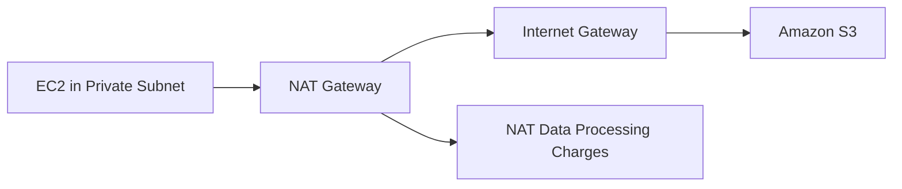

---

## 개선 구조

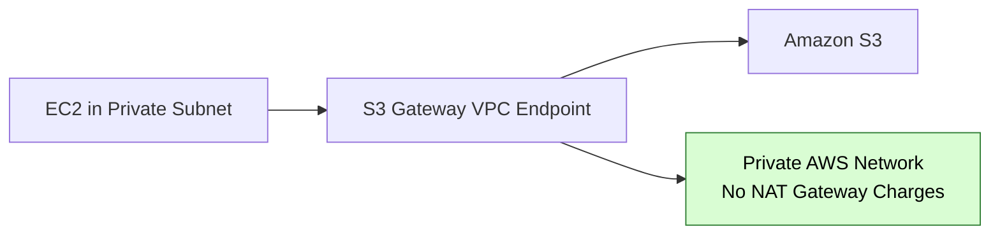

---

## 왜 Gateway VPC Endpoint인가?

VPC Endpoint에는 크게 두 가지가 있습니다.

| 유형 | 주 사용처 |
|---|---|
| Gateway Endpoint | S3, DynamoDB |
| Interface Endpoint | 대부분의 AWS 서비스, PrivateLink |

S3와 DynamoDB는 Gateway Endpoint를 사용할 수 있습니다.

S3 Gateway Endpoint는 Route Table에 추가하여 사용합니다.

---

## 오답 설명

### B. NAT Gateway 추가

NAT Gateway를 추가하면 AZ 장애 대응 측면에서는 좋아질 수 있습니다.

하지만 문제는 비용 절감입니다.

NAT Gateway를 추가하면 오히려 비용이 증가할 수 있습니다.

---

### C. S3 Transfer Acceleration

S3 Transfer Acceleration은 전 세계에서 S3로 업로드할 때 성능을 높이는 기능입니다.

CloudFront Edge Network를 활용해 업로드를 가속합니다.

하지만 이 문제의 핵심은 다음입니다.

```text
EC2 in private subnets frequently access S3
reduce NAT gateway charges
```

따라서 Transfer Acceleration이 아니라 VPC Endpoint입니다.

---

### D. Public IP + Internet Gateway

Private Subnet의 보안 구조를 깨는 방식입니다.

또한 "keeping the traffic private" 요구사항을 위반합니다.

---

## 초보자용 기억법

> Private Subnet에서 S3 접근 비용 줄이기 → **S3 Gateway VPC Endpoint**

> Private Subnet에서 다른 AWS 서비스 접근 → **Interface Endpoint**

> Private Subnet에서 인터넷 접근 → **NAT Gateway**

</details>

---

# Set 1 정답표

| 번호 | 도메인 | 정답 |
|---:|---|---|
| Q1 | Secure | B |
| Q2 | Secure | C |
| Q3 | Secure | B |
| Q4 | Secure | A |
| Q5 | Resilient | B |
| Q6 | Resilient | B |
| Q7 | Resilient | C |
| Q8 | High-Performing | B |
| Q9 | High-Performing | A |
| Q10 | High-Performing | A |
| Q11 | Cost-Optimized | C |
| Q12 | Cost-Optimized | A |

---

# 이번 Set에서 반드시 가져가야 할 핵심 요약

| 주제 | 시험 정답 패턴 |
|---|---|
| EC2에서 S3 접근 | IAM Role |
| Organization 소속 계정만 허용 | `aws:PrincipalOrgID` |
| RDS Credential 자동 교체 | Secrets Manager |
| SQL Injection/XSS 방어 | AWS WAF |
| 웹 고가용성 | ALB + ASG + Multi-AZ |
| DB 고가용성 | RDS Multi-AZ |
| 쓰기 폭주 흡수 | SQS |
| DR 수분 내 복구, Active-Active보다 저렴 | Warm Standby |
| Aurora 읽기 성능 | Aurora Replica + Reader Endpoint |
| 글로벌 정적 콘텐츠 성능 | CloudFront |
| S3 로그 SQL 분석 | Athena |
| 지속 사용 + 유연한 할인 | Compute Savings Plans |
| Private Subnet에서 S3 비용 절감 | S3 Gateway Endpoint |
