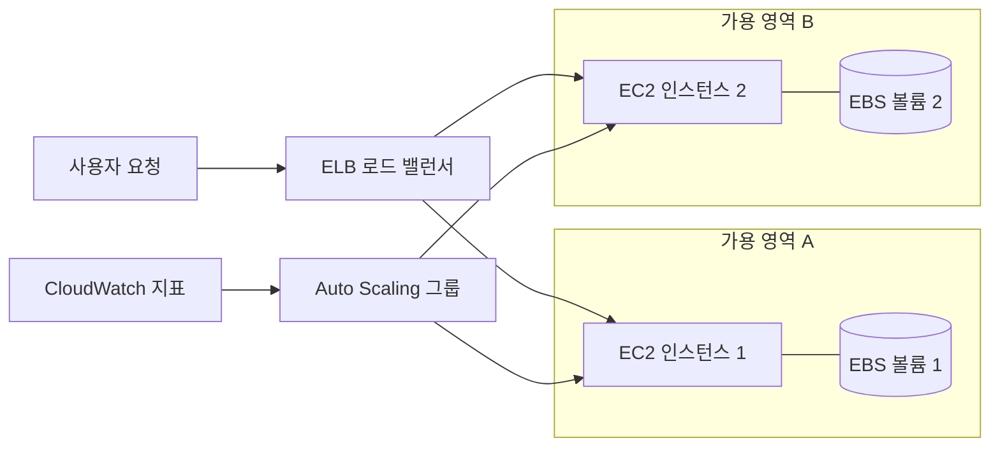
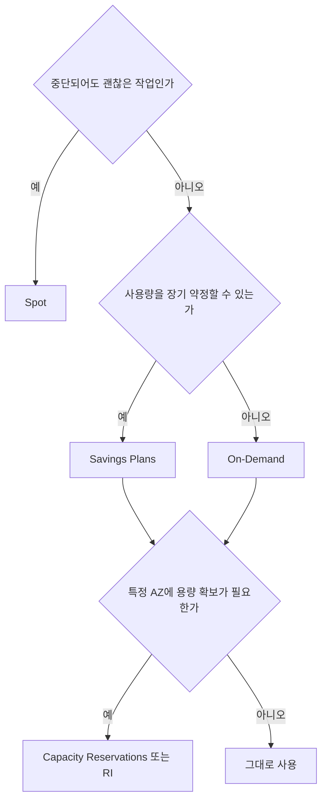
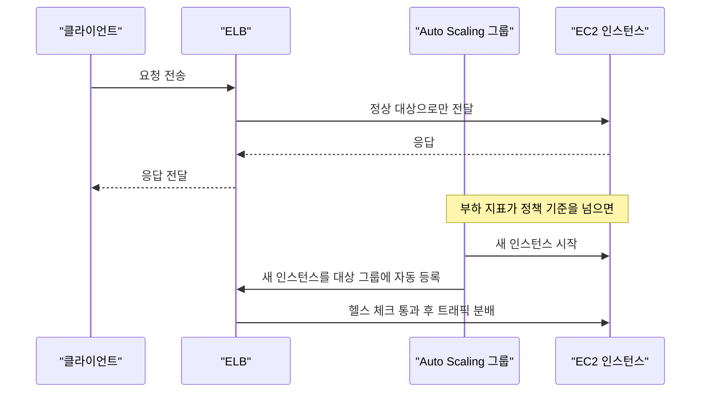

# Amazon EC2 핵심 정리: 가상 머신, EBS, ELB, Auto Scaling

기준 시점은 2026-11-18입니다. 제품 사양과 수치는 이 시점에 AWS 공식 문서와 공식 발표에서 확인한 내용입니다. 글 안에서 내용의 성격은 "확인된 사실", "벤더 주장", "제3자 보고", "필자 해석"으로 구분해 적었고, 확인하지 못한 부분은 그렇게 밝혔습니다.

---

## 1. 이 글은 무엇을 다루는가

AWS 입문 강의에서 Amazon EC2를 처음 소개할 때 보여 주는 개요 슬라이드가 있습니다. 슬라이드의 내용은 크게 네 문장으로 요약됩니다.

- EC2는 AWS가 제공하는 서비스 중 가장 많이 쓰이는 축에 속한다.
- EC2는 Elastic Compute Cloud의 약자이며, 인프라를 서비스로 빌려 쓰는 IaaS(Infrastructure as a Service)다.
- EC2는 가상 머신 임대(EC2), 가상 디스크에 데이터 저장(EBS), 여러 머신에 부하 분산(ELB), 오토 스케일링 그룹을 통한 서비스 확장(ASG)이라는 네 가지 능력으로 이루어진다.
- EC2를 아는 것은 클라우드가 어떻게 동작하는지 이해하는 데 기본이 된다.

이 글은 이 문장들을 하나씩 풀어서 설명합니다. 슬라이드에는 약어만 나오고 그 안쪽의 동작 방식은 나오지 않기 때문에, 각 약어 뒤에 실제로 무엇이 있는지를 AWS 공식 문서를 기준으로 채웠습니다. 2026년 현재 시점에서 달라진 부분, 예를 들어 새로 나온 인스턴스 계열이나 EBS 볼륨 유형의 위상 변화도 함께 다룹니다.

"가장 인기 있는 서비스 중 하나"라는 강의 속 표현은 강사의 설명이며, 이를 뒷받침하는 사용량 통계는 이번 조사에서 확인하지 못했습니다. 그래서 이 문장은 사실 확인 대상에서 제외하고, 나머지 네 가지 기능 설명을 중심으로 정리합니다.

---

## 2. 배경: 가상 머신을 빌린다는 것

### 2.1 EC2는 무엇인가

AWS는 EC2를 크기를 조절할 수 있는 안전한 컴퓨팅 용량을 가상 서버 형태로 제공하는 클라우드 서비스라고 소개합니다. AWS 제품 페이지는 인텔, AMD, Arm 프로세서를 모두 지원하며 1,000종이 넘는 인스턴스 타입을 제공한다고 적고 있습니다. 이 수치는 벤더가 직접 밝힌 것이며, 이번 조사에서 독립 기관의 확인을 거치지는 못했습니다.

여기서 "인스턴스"는 EC2에서 실행 중인 가상 서버 한 대를 뜻합니다. 사용자가 인스턴스를 시작하면 AWS가 데이터센터의 물리 서버 위에 가상 서버를 만들어 줍니다. 문서에 따르면 사용자가 지정하는 인스턴스 타입이 그 가상 서버를 올릴 호스트 컴퓨터의 하드웨어 사양을 결정합니다.

AWS 제품 페이지는 EC2가 99.99% 가용성 SLA(서비스 수준 협약) 아래에서 용량을 몇 분 안에 늘리거나 줄일 수 있다고 설명합니다. SLA는 벤더가 약속하는 서비스 수준이며, 실제 장애 시 보상 조건은 SLA 원문에서 따로 확인해야 합니다.

### 2.2 IaaS라는 말의 의미

IaaS는 서버, 저장 장치, 네트워크 같은 인프라 자원을 서비스 형태로 빌려 쓰는 방식입니다. 필자 해석으로 풀어 쓰면, 건물과 전기와 서버 장비는 AWS가 관리하고, 그 위에 운영체제를 올리고 애플리케이션을 설치하고 운영하는 일은 사용자가 맡는 구조입니다. 사무실 임대에 비유하면, 건물 관리는 임대인이 하되 안에 가구를 들이고 업무를 꾸리는 것은 세입자의 몫인 것과 비슷합니다.

이 구분은 뒤에서 다룰 한계와 트레이드오프에서 중요해집니다. 같은 클라우드 서비스라도 AWS Lambda처럼 서버를 의식하지 않는 서비스와 달리, EC2에서는 운영체제 패치, 용량 계획, 장애 대응 설계가 사용자 책임으로 남기 때문입니다.

---

## 3. 동작 원리와 구조

슬라이드가 말한 네 가지 능력이 서로 어떻게 맞물리는지 먼저 한눈에 보겠습니다.

사용자의 요청은 ELB가 받아서 건강한 EC2 인스턴스에게 나눠 줍니다. 각 인스턴스는 EBS 볼륨을 디스크처럼 붙여서 씁니다. Auto Scaling 그룹은 인스턴스의 개수를 정해 둔 범위 안에서 유지하고, 부하 지표에 따라 늘리거나 줄입니다. 가용 영역(Availability Zone, AZ)은 한 리전 안에서 물리적으로 분리된 데이터센터 묶음을 가리키며, 두 개 이상의 AZ에 인스턴스를 나눠 두면 한 곳에 문제가 생겨도 서비스가 이어질 수 있습니다.

### 3.1 인스턴스 타입: 하드웨어 사양을 고르는 일

인스턴스 타입의 이름은 인스턴스 패밀리, 세대, 프로세서 계열, 부가 기능, 크기를 조합해서 짓는다고 AWS 문서가 설명합니다. 예를 들어 최근 공지에 나오는 `C8id`, `M8id`, `R8id` 같은 이름에서 첫 글자는 패밀리를, 숫자는 세대를 가리킵니다. 뒤에 붙는 글자들의 정확한 의미는 AWS의 명명 규칙 페이지에 정리되어 있으나, 이번 조사에서 그 페이지를 직접 열어 확인하지는 못했습니다.

공식 문서와 발표에 이름이 나오는 대표적인 용도별 분류는 다음과 같습니다.

| 분류 | 문서에서 확인된 계열 예시 | 성격 |
|---|---|---|
| 범용 | M8i, M8azn | CPU, 메모리, 네트워크 균형형 |
| 컴퓨팅 최적화 | C8i, C8gn, C9g | CPU 비중이 큰 작업 |
| 메모리 최적화 | R8i | 메모리 비중이 큰 작업 |
| 스토리지 최적화 | I8ge | 로컬 디스크 입출력이 큰 작업 |
| 고성능 컴퓨팅 | Hpc6a, Hpc7a, Hpc8a | 과학·공학 계산 |
| 가속 컴퓨팅 | GPU 인스턴스, AWS Inferentia, AWS Trainium | AI 학습·추론 등 |

프로세서는 인텔, AMD, 그리고 AWS가 직접 설계한 Arm 기반 Graviton이 있습니다. Graviton은 AWS 문서가 EC2 인스턴스에서 가격 대비 성능을 가장 좋게 내도록 설계한 프로세서 계열이라고 소개합니다. 이 역시 벤더의 설명입니다.

### 3.2 Nitro 시스템: 가상화를 전용 하드웨어로 옮기다

EC2 문서에 따르면 EC2가 지원하는 하이퍼바이저(가상 머신을 만들고 관리하는 소프트웨어)는 Xen과 Nitro 두 가지입니다. 현재 세대의 인스턴스는 대부분 Nitro 위에서 동작합니다.

AWS 보안 백서는 Nitro 시스템의 핵심을 이렇게 설명합니다. 예전에는 하이퍼바이저가 호스트 CPU 위에서 네트워크, 스토리지, 관리 기능까지 모두 처리했습니다. Nitro는 이런 기능을 Nitro 카드라는 전용 하드웨어로 옮겨, 호스트 CPU와 메모리의 거의 전부를 고객의 인스턴스에 돌려줍니다. 백서에 따르면 2017년에 나온 C5 인스턴스 이후로 Nitro는 기존 Xen 구조의 Dom0(관리용 가상 머신)를 없앴습니다. AWS 보안 블로그에 따르면 Nitro 카드는 AWS의 자체 반도체 개발 자회사인 Annapurna Labs가 설계·제작·시험합니다.

Nitro 기반 인스턴스는 네트워크에 ENA라는 고성능 네트워크 어댑터를, 스토리지에는 NVMe 블록 디바이스 방식을 씁니다. 이런 구조 덕분에 베어메탈 인스턴스(가상화 계층 없이 물리 서버를 그대로 쓰는 인스턴스)도 같은 기반에서 제공됩니다. 또 AWS 보안 블로그는 Nitro 구조상 AWS 운영자를 포함해 어떤 시스템이나 사람도 EC2 호스트에 로그인해 인스턴스 메모리를 읽을 방법이 없다고 설명합니다. 이는 벤더의 보안 주장이며, 독립 감사 결과는 이번에 확인하지 못했습니다.

### 3.3 구매 옵션: 같은 인스턴스를 어떻게 사느냐

EC2를 쓰는 비용은 어떤 구매 방식을 고르느냐에 따라 크게 달라집니다. AWS 문서가 나열하는 옵션은 다음과 같습니다.

| 옵션 | 정의 | 약정 |
|---|---|---|
| On-Demand | 실행한 인스턴스만큼 초 단위로 지불 | 없음 |
| Savings Plans | 시간당 USD 기준의 일정한 사용량을 약정하고 할인 | 1년 또는 3년 |
| Reserved Instances | 인스턴스 유형과 리전 같은 특정 구성을 약정하고 할인 | 1년 또는 3년 |
| Spot Instances | AWS의 남는 EC2 용량을 요청해 사용 | 없음 |
| Dedicated Hosts | 인스턴스 전용 물리 호스트를 통째로 사용 | 문서에 명시 없음 |
| Dedicated Instances | 단일 테넌트 하드웨어에서 실행, 시간 단위 과금 | 없음 |
| Capacity Reservations | 특정 AZ에 EC2 용량을 예약 | 없음 |
| Capacity Blocks | GPU 인스턴스 클러스터를 예약 | 예약 기간 |

AWS는 요금 안내에서 Reserved Instances보다 Savings Plans를 권장한다고 밝히고, Savings Plans의 할인 폭이 온디맨드 대비 최대 72%라고 적고 있습니다. 이 수치는 벤더가 직접 밝힌 최대치이며, 실제 할인율은 인스턴스, 리전, 약정 기간에 따라 다릅니다.

Spot은 AWS가 남는 용량을 온디맨드보다 싸게 내놓는 방식으로, AWS Labs 자료는 온디맨드 대비 최대 90% 할인이라고 설명합니다. 대신 AWS가 용량을 되찾아야 할 때 인스턴스가 중단될 수 있습니다. 제3자 자료는 중단 2분 전에 알림을 보낸다고 AWS의 안내를 인용하는데, 이번에 AWS 원문에서 직접 확인하지는 못했습니다.

공식 문서의 선택 가이드를 필자가 다이어그램으로 옮기면 다음과 같습니다.

문서에 따르면 용량 예약이 필요할 때는 특정 AZ에 대한 Reserved Instances나 Capacity Reservations를 사야 하고, 약정 할인만으로는 용량이 보장되지 않습니다. 약정 할인과 용량 보장은 서로 다른 문제라는 점이 중요합니다.

### 3.4 EBS: 인스턴스에 붙이는 가상 디스크

EBS(Elastic Block Store)는 EC2 인스턴스에 붙여서 쓰는 블록 스토리지 볼륨입니다. 문서는 볼륨을 인스턴스에 연결하면 컴퓨터에 달린 로컬 하드디스크처럼 파일을 저장하거나 프로그램을 설치하는 데 쓸 수 있다고 설명합니다. 슬라이드가 "가상 드라이브에 데이터를 저장한다"고 표현한 것이 바로 이 기능입니다.

EBS에는 알아 둬야 할 성질이 몇 가지 있습니다.

- **AZ에 묶여 있습니다.** 볼륨은 특정 가용 영역에 만들어지고, 같은 AZ의 인스턴스에만 붙일 수 있습니다. 볼륨 데이터는 그 AZ 안에서 여러 서버에 자동 복제되어 부품 하나가 고장 나도 데이터를 잃지 않도록 합니다.
- **스냅샷으로 옮깁니다.** 볼륨의 특정 시점 복사본인 스냅샷을 만들 수 있고, 스냅샷은 S3에 저장되어 여러 AZ에 중복 보관됩니다. 같은 스냅샷으로 다른 AZ에 새 볼륨을 만들 수 있어서, 이것이 AZ 사이로 데이터를 옮기는 방법입니다. 이후 스냅샷은 증분(바뀐 부분만) 방식입니다.
- **인스턴스와 수명이 다를 수 있습니다.** 인스턴스를 종료할 때 루트 볼륨은 기본적으로 삭제되고, 이 동작은 `DeleteOnTermination` 값을 false로 바꿔 조절합니다. 인스턴스를 종료하면 데이터까지 사라질 수 있다는 점을 기억해야 합니다.
- **한 번에 한 대에 붙이는 것이 기본입니다.** 예외로 io2 Block Express는 Multi-Attach로 같은 AZ의 Nitro 기반 인스턴스 최대 16대에 동시에 연결할 수 있습니다.

볼륨 유형별 사양은 AWS 공식 페이지 기준으로 아래와 같습니다. 크기는 AWS 페이지 표기를 그대로 따랐습니다. IOPS(초당 입출력 횟수)와 처리량은 볼륨 하나의 최대치이며, gp3와 io2 Block Express는 16 KiB 입출력, st1과 sc1은 1 MB 입출력 기준입니다.

| 항목 | gp3 | io2 Block Express | st1 | sc1 |
|---|---|---|---|---|
| 성격 | 범용 SSD | 프로비저닝 IOPS SSD | 처리량 최적화 HDD | 콜드 HDD |
| 크기 범위 | 1 GB ~ 64 TB | 4 GB ~ 64 TB | 125 GB ~ 16 TB | 125 GB ~ 16 TB |
| 최대 IOPS | 80,000 | 256,000 | 500 | 250 |
| 최대 처리량 | 2,000 MB/s | 4,000 MB/s | 500 MB/s | 250 MB/s |
| 내구성 | 99.8% ~ 99.9% | 99.999% | 99.8% ~ 99.9% | 99.8% ~ 99.9% |
| 주 사용처 | 부트 볼륨, 개발·테스트, 중형 DB | 대형 DB, 미션 크리티컬 | 빅데이터, 로그 처리 | 드물게 접근하는 콜드 데이터 |

범용 SSD의 세대 교체는 짚어 둘 만합니다. gp3는 기본으로 3,000 IOPS와 125 MiB/s를 스토리지 가격에 포함하고, 필요하면 IOPS를 최대 80,000까지, 처리량을 최대 2,000 MiB/s까지 따로 늘릴 수 있습니다. 볼륨 크기와 성능을 독립적으로 정할 수 있다는 뜻입니다. gp3는 gp2보다 GiB당 가격이 20% 낮다고 문서가 밝힙니다. 반면 이전 세대인 gp2는 성능이 크기에 비례해서 GiB당 3 IOPS씩 늘고 최대 16,000 IOPS에서 멈추며, 1 TiB보다 작은 볼륨은 I/O 크레딧을 소모해 3,000 IOPS까지 일시적으로 버스트합니다. 크레딧이 바닥나면 기준 성능으로 떨어집니다. gp3에는 이런 버스트 개념이 없고 프로비저닝한 성능을 계속 유지합니다.

콘솔에서 새 볼륨을 만들 때 기본 선택값이 gp3이고, 기존 gp2 볼륨은 서비스 중단 없이 Elastic Volumes 기능으로 gp3로 바꿀 수 있다고 문서가 안내합니다.

io2 Block Express는 16 KiB 입출력에서 평균 지연 시간이 500마이크로초 미만으로 설계되었다고 AWS가 밝히며, 모든 Nitro 기반 EC2 인스턴스에서 쓸 수 있습니다. 지연 시간 수치는 AWS가 설계 목표로 제시한 값입니다.

### 3.5 ELB: 요청을 나눠 주는 문지기

Elastic Load Balancing(ELB)은 들어오는 트래픽을 여러 대상(EC2 인스턴스, 컨테이너, IP 주소 등)에 나누어 줍니다. 대상의 상태를 계속 점검해서 정상인 대상으로만 요청을 보내므로, 인스턴스 한 대가 죽어도 사용자는 영향을 덜 받습니다.

ELB가 지원하는 로드 밸런서는 네 종류입니다. 각각의 동작 계층은 OSI 7계층 모델(통신을 일곱 단계로 나눈 표준 설명 틀)에서 어느 단계를 다루는지로 구분합니다.

| 유형 | 동작 계층 | 지원 프로토콜 | 주된 쓰임 |
|---|---|---|---|
| Application Load Balancer (ALB) | 애플리케이션 계층(7계층) | HTTP, HTTPS | 웹 애플리케이션, 요청 내용에 따른 라우팅, 마이크로서비스·컨테이너 |
| Network Load Balancer (NLB) | 전송 계층(4계층) | TCP, TLS, UDP | 고성능, 고정 IP가 필요한 경우 |
| Gateway Load Balancer (GWLB) | 네트워크 계층(3계층) | 문서에 명시 없음 | 방화벽 같은 가상 어플라이언스 앞단 |
| Classic Load Balancer (CLB) | 이전 세대 | 이번 조사에서 확인 못 함 | 기존 환경 호환 |

NLB의 프로토콜 목록은 문서 판본에 따라 TCP, TLS, UDP만 적은 곳도 있고 QUIC까지 적은 곳도 있습니다. QUIC 지원의 시점과 범위는 확인하지 못했습니다.

ALB는 HTTP 헤더를 읽고 그 내용에 따라 대상을 고르기 때문에 "지능적인" 분배가 가능하고, AWS WAF(웹 애플리케이션 방화벽)와 연동하며, 한 인스턴스의 여러 포트로 분배하는 컨테이너 지원을 제공한다고 AWS 문서가 소개합니다. NLB는 AZ마다 하나씩 Elastic IP를 붙여 고정 IP를 쓸 수 있습니다. GWLB는 제3자 자료 기준으로 GENEVE 프로토콜을 사용해 가상 어플라이언스로 트래픽을 보냅니다.

Classic Load Balancer는 여전히 ELB의 지원 유형에 포함되어 있으나, AWS는 CLB를 ALB나 NLB로 옮기는 마이그레이션 마법사를 제공합니다. CLB가 HTTP/HTTPS 리스너를 쓰면 ALB로, TCP 리스너를 쓰면 NLB로 옮기는 것이 AWS 안내입니다.

ELB의 동작에서 알아 둘 세부 사항은 다음과 같습니다.

- **노드와 DNS:** AZ를 활성화하면 그 AZ에 로드 밸런서 노드가 만들어지고, 트래픽이 바뀌면 ELB가 로드 밸런서를 스스로 확장하고 DNS 항목을 갱신합니다.
- **교차 영역 분산:** 켜져 있으면 각 노드가 모든 AZ의 대상에 분배하고, 꺼져 있으면 자기 AZ의 대상에만 분배합니다. 공식 문서에 따르면 ALB는 로드 밸런서 수준에서 항상 켜져 있고 대상 그룹 수준에서 끌 수 있으며, NLB와 GWLB는 기본값이 꺼짐입니다. NLB에서 켜면 AZ 간 데이터 전송 요금이 붙는다는 점은 제3자 자료 기준이며 AWS 요금 페이지로는 확인하지 못했습니다.
- **헬스 체크:** ALB는 등록된 대상에 주기적으로 요청을 보내 상태를 확인합니다. 모든 AZ의 모든 대상이 동시에 실패하면 ELB는 "fail open"으로 동작해 상태와 관계없이 모든 대상에 트래픽을 보냅니다.
- **등록 해제 지연:** 대상을 제거할 때 ALB는 기본 300초를 기다려 처리 중인 요청이 끝나도록 합니다.

### 3.6 Auto Scaling 그룹: 개수를 지키고 늘리고 줄이는 일

Amazon EC2 Auto Scaling은 인스턴스를 하나의 논리적 묶음(Auto Scaling 그룹, ASG)으로 관리합니다. 핵심은 세 개의 숫자입니다.

- **최소 용량(minimum):** 그룹이 절대 이 아래로 내려가지 않습니다.
- **희망 용량(desired):** 그룹이 평소에 유지하려는 인스턴스 수입니다.
- **최대 용량(maximum):** 그룹이 절대 이 위로 올라가지 않습니다.

AWS 문서의 예시는 최소 4대, 희망 6대, 최대 12대인 그룹입니다. 그룹은 처음에 희망 용량만큼 인스턴스를 띄우고, 이후 주기적인 헬스 체크로 그 수를 유지합니다. 인스턴스가 비정상으로 판정되면 종료하고 새로 시작해서 개수를 맞춥니다. 여러 AZ를 지정하면 희망 용량이 AZ들에 나뉘어 배치됩니다. Spot 인스턴스가 중단되면 대체 인스턴스를 띄우려 시도하고, Capacity Rebalancing 기능으로 중단 위험이 높은 Spot 인스턴스를 미리 교체할 수도 있습니다.

규모를 바꾸는 방식은 여러 가지입니다.

- **수동 조정:** 희망 용량을 사람이 직접 바꿉니다.
- **동적 조정:** CloudWatch 지표를 보고 target tracking(목표값 추적), step(단계별), simple 정책으로 자동 증감합니다. 문서는 동적 조정이 처음이라면 target tracking을 권장한다고 안내합니다.
- **예약 조정:** 정해 둔 시간에 맞춰 조정합니다. 이 항목은 제3자 해설 자료에 나온 분류이며 이번에 공식 페이지에서 따로 확인하지는 못했습니다.
- **예측 조정(predictive scaling):** 과거 부하 패턴을 학습해 수요가 오르기 전에 미리 인스턴스를 띄웁니다. 처음 켜면 실제 조정은 하지 않고 예측만 만드는 "forecast only" 모드로 시작하며, 새 그룹은 첫 예측을 만들기까지 최소 24시간의 데이터가 필요합니다. 기본적으로 매 시간 시작 시점에 그 시간대의 예측에 맞춰 조정합니다. 2025-10-24 공지로 하이데라바드, 멜버른, 텔아비브, 캘거리, 스페인, 취리히 리전에서도 쓸 수 있게 되었습니다. 2021년 AWS 블로그는 예측 조정이 예측 오차로 용량이 모자라는 위험을 없애기 위해 스케일 아웃만 하도록 설계되었다고 설명했는데, 이 설계가 현재 문서에서도 그대로인지는 확인하지 못했습니다.

ASG를 ELB와 연결하는 방식도 정리해 둘 만합니다. ALB, NLB, GWLB를 쓸 때는 로드 밸런서 자체가 아니라 대상 그룹(target group)을 ASG에 붙입니다. 붙이고 나면 ASG가 시작한 인스턴스는 자동으로 대상 그룹에 등록되고, 종료된 인스턴스는 자동으로 등록 해제됩니다. 사람이 인스턴스를 일일이 등록할 필요가 없습니다. 다만 ASG와 함께 쓰는 대상 그룹은 대상 유형이 `instance`여야 하고 `ip`는 쓸 수 없으며, 로드 밸런서와 ASG는 같은 계정, VPC, 리전에 있어야 합니다.

헬스 체크에는 주의할 기본값이 있습니다. ASG는 기본적으로 EC2 상태 점검에서 비정상이거나 도달할 수 없는 인스턴스만 교체합니다. ELB 헬스 체크를 따로 켜야 로드 밸런서가 비정상으로 보고한 인스턴스도 교체합니다. 애플리케이션이 멈췄는데 서버 자체는 살아 있는 경우를 잡으려면 이 설정이 필요합니다. 또 인스턴스가 시작된 뒤 헬스 체크 결과를 반영하기까지의 유예 시간인 health check grace period는, 문서에 따르면 너무 높게 잡지 않되 ELB 헬스 체크가 대상의 준비 여부를 판단할 수 있을 만큼은 충분해야 합니다.

### 3.7 전체가 맞물리는 순서

확장이 일어날 때의 흐름을 순서대로 보면 다음과 같습니다.

---

## 4. 사례와 수치: 2026년의 EC2

### 4.1 2026년에 발표된 인스턴스

EC2는 계속 새 세대가 나옵니다. AWS의 What's New 공지 기준으로 2026년에 올라온 항목 중 일부를 날짜순으로 정리하면 다음과 같습니다. 성능 수치는 모두 AWS가 발표한 값이며 측정 조건은 각 공지의 원문을 따릅니다.

| 공지일 | 인스턴스 | 공지 내용 |
|---|---|---|
| 2026-01-22 | C8gb, M8gb, R8gb 48xlarge 크기 | EBS 최적화 인스턴스, 최대 144만 IOPS로 EC2에서 EBS IOPS가 가장 높다고 AWS가 설명 |
| 2026-02-04 | C8id, M8id, R8id | 맞춤형 인텔 Xeon 6 프로세서, 일반 공급 시작 |
| 2026-02-12 | M8azn | 5세대 AMD EPYC 기반 범용 고주파수·고네트워크 인스턴스 |
| 2026-02-16 | Hpc8a | 5세대 AMD EPYC 기반 고성능 컴퓨팅 인스턴스 |
| 2026-04-27 | M8in, M8ib | M8in은 600 Gbps 네트워크, M8ib는 최대 300 Gbps EBS 대역폭이며 6세대 Nitro 카드 탑재 |
| 2026-07-01경 | C9g, C9gd | Graviton5 기반, C8g 대비 vCPU당 성능 최대 25% 향상(제3자 매체가 AWS 발표를 보도) |
| 2026-07-14 | M8in 등 4종의 리전 확대 | 미국 동부(오하이오), 유럽(아일랜드), 아시아 태평양(도쿄)에 추가 |

C9g 항목은 AWS 원문 공지를 직접 열어 확인하지 못했고 IT Brief UK와 ChannelLife의 보도를 근거로 했습니다. 발표 시점은 보도일(2026-07-01, 07-02) 기준이며 AWS의 공식 공지일과 하루 이틀 다를 수 있습니다.

이 목록에서 한국 독자에게 의미 있는 점은 새 세대가 모든 리전에 동시에 나오지 않는다는 사실입니다. 2026년 5월 공지 기준으로 M8idn과 M8idb는 미국 동부(버지니아 북부), 미국 서부(오리건), 유럽(스페인)에서 제공되었고, 2026-07-14에야 M8in 등 네 종류가 오하이오, 아일랜드, 도쿄로 확대되었습니다. 서울 리전에서 어느 세대까지 쓸 수 있는지는 이번 조사에서 확인하지 못했습니다. 실제로 쓰려면 인스턴스 타입별 리전 지원 목록을 직접 확인해야 합니다.

### 4.2 gp2에서 gp3로의 이동

앞서 본 것처럼 gp3는 같은 용량에서 GiB당 가격이 20% 낮고 기본 3,000 IOPS와 125 MiB/s를 포함합니다. gp2에서 3,000 IOPS를 얻으려면 1,000 GiB(약 1 TiB) 크기가 필요하다는 것이 문서의 gp2 성능표에서 읽힙니다. 작은 볼륨이 많은 환경에서는 gp3로 바꾸는 것만으로 성능과 비용이 모두 바뀔 수 있으며, AWS는 이를 위한 비용 절감 계산기를 제공합니다. 실제 절감액은 환경마다 달라서 계산기에 자기 볼륨 구성을 넣어 확인해야 합니다.

---

## 5. 한계와 트레이드오프

**운영 책임이 사용자에게 남습니다.** IaaS이므로 운영체제 업데이트, 보안 설정, 애플리케이션 배포, 모니터링은 사용자가 설계해야 합니다. 관리형 서비스에 비해 자유도는 높지만 손이 더 갑니다.

**EBS는 AZ를 넘지 못합니다.** 볼륨은 한 AZ 안에서만 복제되므로 AZ 단위 장애에 대비하려면 스냅샷을 쓰거나 애플리케이션 차원에서 여러 AZ에 데이터를 두어야 합니다. AWS 문서는 모든 EBS 볼륨 유형이 99.999% 가용성을 목표로 설계되었다고 밝히지만, 볼륨 복제가 한 AZ 안에서 이루어진다는 점에서 AZ 전체가 멈추는 상황까지 막아 준다고 읽어서는 안 됩니다. 이 부분은 필자의 해석입니다.

**약정 할인은 용량을 보장하지 않습니다.** Savings Plans는 비용을 줄여 줄 뿐이고, 특정 AZ에서 인스턴스를 확실히 띄우려면 Capacity Reservations 같은 별도 수단이 필요합니다.

**Spot은 중단을 전제로 해야 합니다.** 싸지만 AWS가 용량을 필요로 하면 회수됩니다. 상태를 잃어도 되는 작업, 즉 재시작해도 결과가 같은 배치 처리나 상태 없는 웹 계층에 맞습니다.

**ASG의 기본 헬스 체크는 애플리케이션 상태를 보지 않습니다.** ELB 헬스 체크를 켜지 않으면 서버는 살아 있지만 앱이 응답하지 않는 인스턴스가 교체되지 않습니다. 반대로 헬스 체크 경로가 잘못 설정되어 등록된 인스턴스가 하나도 통과하지 못하면, 로드 밸런서는 InService 상태가 되지 못하고 ASG는 그 인스턴스들을 교체하지 않습니다. 공식 문서가 직접 경고하는 사례입니다.

**예측 조정은 데이터가 있어야 합니다.** 새 그룹은 24시간 데이터가 쌓이기 전에는 예측을 만들지 못하고, 애플리케이션을 새 ASG로 갈아탈 때마다 이 대기 시간이 다시 생깁니다.

**교차 영역 분산에는 비용 문제가 있을 수 있습니다.** NLB에서 이를 켜면 AZ 간 전송 비용이 붙는다는 제3자 설명이 있습니다. 반대로 끄면 AZ마다 대상 수가 다를 때 트래픽이 한쪽에 쏠립니다. 이 균형은 설계 단계에서 정해야 합니다.

---

## 6. 실무 시사점

필자의 해석이지만, 슬라이드가 말하는 네 가지 능력을 조합할 때 가장 흔한 출발점은 다음 구성입니다.

1. 인스턴스 타입은 워크로드의 병목, 즉 CPU, 메모리, 디스크, 네트워크 중 무엇이 부족한지로 고릅니다. AWS는 최종 선택 전에 자기 벤치마크 애플리케이션으로 직접 시험해 보라고 권합니다.
2. 디스크는 특별한 이유가 없다면 gp3로 시작합니다. 지연 시간에 민감한 대형 데이터베이스라면 io2 Block Express를 검토합니다.
3. 서비스 앞에 ALB를 두고 최소 두 개의 AZ에 인스턴스를 나눕니다. TCP·UDP 성능이나 고정 IP가 중요하면 NLB를 봅니다.
4. 인스턴스는 직접 만들지 말고 ASG로 관리합니다. ELB 헬스 체크를 켜고, 처음에는 target tracking 정책 하나로 시작합니다.
5. 항상 떠 있어야 하는 기본 용량에는 Savings Plans를, 중단되어도 되는 초과분에는 Spot을 섞는 식으로 구매 옵션을 나눕니다.
6. 새 세대 인스턴스를 도입하려면 쓰려는 리전에서 해당 타입이 제공되는지 먼저 확인합니다.

슬라이드가 "EC2를 아는 것이 클라우드를 이해하는 기본"이라고 말한 것은 강사의 평가입니다. 다만 위의 구성을 보면 이 한 서비스 안에 컴퓨팅, 스토리지, 로드 밸런싱, 자동 확장, 가용 영역 설계, 비용 모델이 모두 들어 있음을 알 수 있어서 입문 주제로 삼기에 적절한 이유가 읽힙니다.

---

## 7. 검증 요약표

| 항목 | 구분 | 근거 |
|---|---|---|
| EC2의 정의 (크기 조절이 가능한 가상 서버 용량 제공) | 확인된 사실 | AWS EC2 제품 페이지 |
| 1,000종 이상 인스턴스, 3종 프로세서 지원 | 벤더 주장 | AWS EC2 제품 페이지 |
| 99.99% 가용성 SLA (SLA 원문 미확인) | 벤더 주장 | AWS EC2 제품 페이지 |
| 하이퍼바이저는 Xen과 Nitro | 확인된 사실 | EC2 사용자 가이드 |
| C5 이후 Nitro가 Dom0 제거 | 확인된 사실 | Nitro 보안 백서 |
| AWS 운영자도 호스트에 접근 불가 | 벤더 주장 | AWS 보안 블로그 |
| 구매 옵션 8종과 정의 | 확인된 사실 | EC2 청구·구매 옵션 문서 |
| Savings Plans 최대 72% 할인 (벤더가 밝힌 최대치) | 벤더 주장 | AWS 요금 페이지 |
| Spot 최대 90% 할인 (벤더가 밝힌 최대치) | 벤더 주장 | AWS Labs 자료 |
| Spot 2분 전 중단 알림 (AWS 원문 미확인) | 제3자 보고 | 제3자 가이드 |
| EBS는 같은 AZ의 인스턴스에만 연결 | 확인된 사실 | EBS 기능 문서 |
| gp3 기본 3,000 IOPS, 125 MiB/s, 최대 80,000 IOPS, 2,000 MiB/s | 확인된 사실 | EBS 사용자 가이드 |
| gp3 가격이 gp2보다 GiB당 20% 낮음 (벤더가 밝힌 사실) | 확인된 사실 | EBS 사용자 가이드 |
| io2 Block Express 256,000 IOPS, 4,000 MB/s, 99.999% 내구성 (벤더 사양) | 벤더 주장 | AWS EBS 볼륨 유형 페이지 |
| io2 Block Express 평균 지연 500마이크로초 미만 (설계 목표) | 벤더 주장 | EBS 사용자 가이드 |
| ELB 4종 유형, ALB 7계층, NLB 4계층, GWLB 3계층 | 확인된 사실 | ELB API 레퍼런스 |
| NLB의 QUIC 지원 (문서 판본에 따라 다름) | 확인하지 못함 | ELB API 레퍼런스 판본 비교 |
| ALB 교차 영역 분산 기본 켜짐, NLB·GWLB 기본 꺼짐 | 확인된 사실 | ELB 동작 문서 |
| NLB 교차 영역 시 AZ 간 요금 (AWS 요금 페이지 미확인) | 제3자 보고 | 제3자 해설 |
| ASG 최소·희망·최대 용량과 헬스 체크 교체 | 확인된 사실 | Auto Scaling 사용자 가이드 |
| ELB 헬스 체크는 별도로 켜야 반영 | 확인된 사실 | Auto Scaling 사용자 가이드 |
| 예측 조정 forecast only 시작, 24시간 데이터 필요 | 확인된 사실 | Auto Scaling 사용자 가이드 |
| 예측 조정이 스케일 아웃만 함 (2021년 블로그 기준, 현재 문서 미확인) | 확인하지 못함 | AWS 컴퓨트 블로그 |
| 예약 조정이라는 분류 (공식 페이지 미확인) | 제3자 보고 | 제3자 해설 |
| 2026년 신규 인스턴스 발표 | 확인된 사실(C9g는 매체 보도) | AWS What's New, IT Brief UK |
| 서울 리전의 신규 세대 지원 여부 (조사하지 못함) | 확인하지 못함 | 해당 없음 |
| 강의의 "가장 인기 있는 서비스" 표현 (통계 미확인) | 확인하지 못함 | 해당 없음 |

---

## 8. 참고 자료

접근일은 모두 2026-11-18입니다.

### 공식 문서

- Amazon EC2 인스턴스 타입 가이드: https://docs.aws.amazon.com/ec2/latest/instancetypes/instance-types.html
- Nitro 기반 인스턴스 목록: https://docs.aws.amazon.com/ec2/latest/instancetypes/ec2-nitro-instances.html
- AWS Nitro 시스템 보안 설계 백서: https://docs.aws.amazon.com/whitepapers/latest/security-design-of-aws-nitro-system/the-nitro-system-journey.html
- Amazon EC2 청구 및 구매 옵션: https://docs.aws.amazon.com/AWSEC2/latest/UserGuide/instance-purchasing-options.html
- Amazon EBS 범용 SSD 볼륨(gp3, gp2): https://docs.aws.amazon.com/ebs/latest/userguide/general-purpose.md
- Amazon EBS 볼륨 유형(AWS 제품 페이지): https://aws.amazon.com/ebs/volume-types
- Amazon EBS 기능과 이점: https://docs.aws.eu/ebs/latest/userguide/EBSFeatures.html
- Amazon EBS 개요(AWS 문서 소개): https://aws.amazon.com/documentation-overview/ebs/
- Elastic Load Balancing API 레퍼런스: https://docs.aws.eu/elasticloadbalancing/latest/APIReference/Welcome.html
- Elastic Load Balancing 동작 방식: https://docs.aws.eu/elasticloadbalancing/latest/userguide/how-elastic-load-balancing-works.html
- ALB 대상 그룹 헬스 체크: https://docs.aws.eu/elasticloadbalancing/latest/application/target-group-health-checks.html
- Classic Load Balancer 마이그레이션: https://docs.aws.amazon.com/elasticloadbalancing/latest/userguide/migrate-classic-load-balancer.html
- Auto Scaling 그룹: https://docs.aws.amazon.com/autoscaling/ec2/userguide/auto-scaling-groups.html
- ASG에 로드 밸런서 연결: https://docs.aws.amazon.com/autoscaling/ec2/userguide/autoscaling-load-balancer.html
- 로드 밸런서 연결 준비(대상 유형 조건): https://docs.aws.eu/autoscaling/ec2/userguide/getting-started-elastic-load-balancing.html
- 로드 밸런서 연결 상태 확인: https://docs.aws.eu/autoscaling/ec2/userguide/load-balancer-status.html
- 예측 조정 동작 방식: https://docs.aws.amazon.com/autoscaling/ec2/userguide/predictive-scaling-policy-overview.html

### 벤더 공식 발표와 블로그

- Amazon EC2 제품 페이지: https://aws.amazon.com/ec2/
- Savings Plans와 Reserved Instances 가격 안내: https://aws.amazon.com/ec2/pricing/reserved-instances/pricing/
- Nitro 시스템 소개: https://aws.amazon.com/ec2/nitro/
- AWS 보안 블로그, 컨피덴셜 컴퓨팅에 대한 AWS의 관점: https://aws.amazon.com/blogs/security/confidential-computing-an-aws-perspective
- AWS 컴퓨트 블로그, 예측 조정 소개(2021): https://aws.amazon.com/blogs/compute/introducing-native-support-for-predictive-scaling-with-amazon-ec2-auto-scaling
- EC2 Auto Scaling 예측 조정 6개 리전 확대(2025-10-24): https://aws.amazon.com/about-aws/whats-new/2025/10/amazon-ec2-auto-scaling-predictive-scaling-in-six
- C8gb, M8gb, R8gb 48xlarge(2026-01-22): https://aws.amazon.com/about-aws/whats-new/2026/01/graviton4-ebs-optimized-larger-sizes
- C8id, M8id, R8id(2026-02-04): https://aws.amazon.com/about-aws/whats-new/2026/02/amazon-ec2-c8id-m8id-r8id-instances
- M8azn(2026-02-12): https://aws.amazon.com/about-aws/whats-new/2026/02/aws-m8azn-instances-generally-available
- Hpc8a(2026-02-16): https://aws.amazon.com/about-aws/whats-new/2026/02/announcing-amazon-ec2-hpc8a-instances
- M8in, M8ib(2026-04-27): https://aws.amazon.com/about-aws/whats-new/2026/04/amazon-ec2-m8in-m8ib/
- M8in 등 리전 확대(2026-07-14): https://aws.amazon.com/about-aws/whats-new/2026/07/m8in-m8idn-m8ib-m8idb-new-regions
- AWS Labs, GPU 용량 확보 구매 옵션 비교: https://awslabs.github.io/accelerated-compute-tutorials/ai-infra/purchase-options/

### 주요 기술 매체

- IT Brief UK, Graviton5 기반 C9g, C9gd 출시 보도(2026-07-02): https://itbrief.co.uk/story/aws-launches-graviton5-based-ec2-c9g-c9gd-instances

### 제3자 해설(검증 수준이 낮은 자료)

- DigitalCloud, ELB 유형 비교: https://digitalcloud.training/aws-elastic-load-balancing-aws-elb/
- KernelTalks, ELB 유형 정리: https://kerneltalks.com/tag/list-of-elb/amp/
- Usage.ai, EC2 요금 가이드(Spot 중단 알림 인용): https://www.usage.ai/blogs/aws/ec2/pricing-and-cost-optimization-guide/
- KodeKloud, EC2 Auto Scaling 그룹 노트: https://notes.kodekloud.com/docs/Amazon-Elastic-Compute-Cloud-EC2/EC2-Advanced/EC2-Instance-Autoscaling-Group/page.md

---

작성 일자: 2026-11-18
