# AWS SAA-C03 Practice Exam — Detailed Set 3

## 실전 난이도: 중상급

## 도메인 구성

| 도메인 | 실제 비중 | Set 3 반영 |
|---|---:|---:|
| Domain 1. Design Secure Architectures | 30% | 4문항 |
| Domain 2. Design Resilient Architectures | 26% | 3문항 |
| Domain 3. Design High-Performing Architectures | 24% | 3문항 |
| Domain 4. Design Cost-Optimized Architectures | 20% | 2문항 |

> 아래 문제는 학습용 예상 문제입니다. 실제 시험 문제나 덤프가 아닙니다. 최신 시험 범위는 AWS 공식 Exam Guide로 재확인하셔야 합니다.

---

# Q25. Domain 1 — Design Secure Architectures

## Question

**A company hosts a web application on Amazon EC2 instances behind an Application Load Balancer. The application stores user-uploaded files in an Amazon S3 bucket. The security team requires that users can upload files directly to Amazon S3 without exposing AWS credentials to the client application. The upload permission must be temporary and limited to a specific object key.**

**Which solution should a solutions architect recommend?**

A. Create an IAM user with permissions to upload objects to the S3 bucket. Embed the access key in the client application.

B. Generate Amazon S3 presigned URLs on the backend application and return the URLs to the client application.

C. Configure the S3 bucket policy to allow public write access for all users.

D. Use AWS Secrets Manager to store AWS access keys and allow the client application to retrieve the keys before uploading.

---
<details>
<summary><strong>Click to view Answer & Detailed Explanation</strong></summary>


## 정답

**B. Generate Amazon S3 presigned URLs on the backend application and return the URLs to the client application.**

---

## 상세 해설

이 문제는 **S3 직접 업로드 + 임시 권한 + Credential 노출 방지** 문제입니다.

핵심 조건을 보면 다음과 같습니다.

| 조건 | 의미 |
|---|---|
| Users upload files directly to S3 | 클라이언트가 S3로 직접 업로드 |
| without exposing AWS credentials | Access Key를 클라이언트에 주면 안 됨 |
| temporary | 일정 시간 후 만료되어야 함 |
| limited to a specific object key | 특정 파일 경로에만 업로드 가능해야 함 |

이 조건에 가장 적합한 것이 **S3 Presigned URL**입니다.

Presigned URL은 백엔드 서버가 AWS 자격 증명을 사용해서 일정 시간 동안만 유효한 S3 URL을 생성하는 방식입니다. 클라이언트는 AWS Access Key를 알 필요 없이 해당 URL로만 업로드할 수 있습니다.

---

## 구조 도식

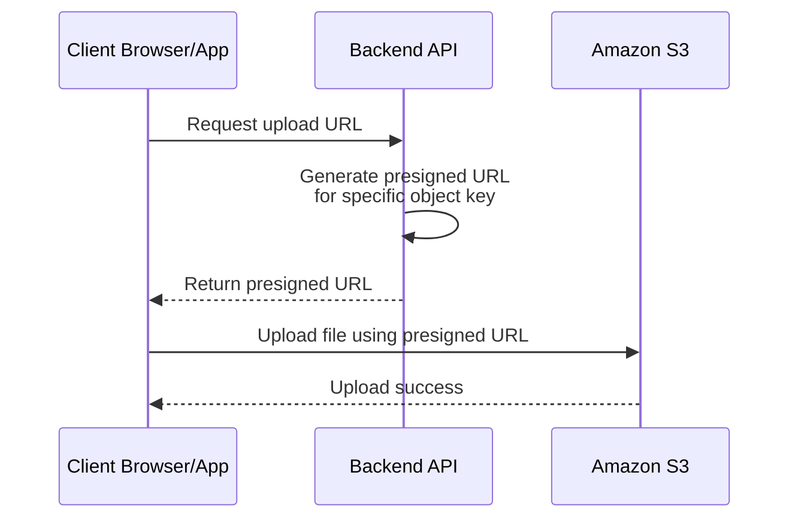

---

## 왜 Presigned URL이 정답인가?

Presigned URL은 다음 조건을 만족합니다.

- AWS Credential을 클라이언트에 노출하지 않음
- URL 만료 시간 설정 가능
- 특정 S3 Object Key에 대해서만 허용 가능
- 업로드 또는 다운로드 권한을 제한적으로 위임 가능
- 서버가 파일 데이터를 직접 받지 않아도 되므로 서버 부하 감소

---

## 오답 설명

### A. IAM User Access Key를 클라이언트에 포함

가장 위험한 오답입니다.

클라이언트 앱에 Access Key가 포함되면 누구나 앱을 분석해서 키를 탈취할 수 있습니다.

탈취된 키로 S3뿐 아니라 연결된 다른 AWS 리소스까지 접근할 수 있습니다.

시험에서 다음 표현이 보이면 거의 오답입니다.

```text
embed access key
hard-code credentials
store long-term credentials in client
```

---

### C. S3 Bucket Public Write 허용

Public Write는 매우 위험합니다.

누구나 버킷에 파일을 업로드할 수 있고, 악성 파일 저장소로 악용될 수 있습니다.

보안 요구사항을 정면으로 위반합니다.

---

### D. Secrets Manager에서 Access Key를 클라이언트가 조회

Secrets Manager는 서버 측 애플리케이션이 Secret을 안전하게 가져오는 용도입니다.

클라이언트 앱이 AWS Access Key를 가져가게 하는 구조는 Credential 노출과 다르지 않습니다.

---

## 초보자용 기억법

> 사용자가 S3에 직접 업로드/다운로드하지만 AWS 키를 주면 안 됨 → **Presigned URL**

</details>

---

# Q26. Domain 1 — Design Secure Architectures

## Question

**A company runs multiple applications in a VPC. The applications need to call AWS Secrets Manager and AWS Systems Manager Parameter Store from private subnets. The company security policy requires that this traffic must not traverse the public internet.**

**Which solution should a solutions architect implement?**

A. Create a NAT gateway in a public subnet and route all outbound traffic through it.

B. Create interface VPC endpoints for Secrets Manager and Systems Manager.

C. Create a gateway VPC endpoint for Secrets Manager and Systems Manager.

D. Assign public IP addresses to the EC2 instances and restrict access with security groups.

---
<details>
<summary><strong>Click to view Answer & Detailed Explanation</strong></summary>


## 정답

**B. Create interface VPC endpoints for Secrets Manager and Systems Manager.**

---

## 상세 해설

이 문제는 **AWS 서비스에 Private Subnet에서 private 접근**하는 문제입니다.

핵심 조건은 다음입니다.

| 조건 | 의미 |
|---|---|
| private subnets | 인터넷 직접 접근 불가 |
| Secrets Manager, Systems Manager Parameter Store | AWS API 서비스 |
| must not traverse public internet | NAT Gateway가 아니라 VPC Endpoint 필요 |
| applications call AWS services | PrivateLink 기반 Interface Endpoint 필요 |

VPC Endpoint는 크게 두 가지입니다.

| VPC Endpoint 유형 | 주 사용 서비스 |
|---|---|
| Gateway Endpoint | Amazon S3, DynamoDB |
| Interface Endpoint | Secrets Manager, Systems Manager, CloudWatch, ECR, STS 등 대부분의 AWS 서비스 |

Secrets Manager와 Systems Manager는 **Interface VPC Endpoint**를 사용합니다.

---

## 구조 도식

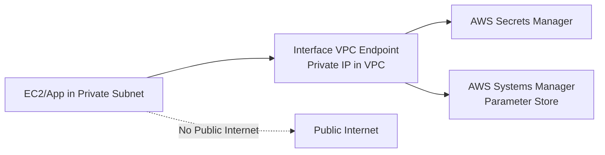

Interface Endpoint는 VPC 안에 ENI, Elastic Network Interface 형태로 생성됩니다.

애플리케이션은 Private IP를 통해 AWS 서비스에 접근합니다.

---

## 오답 설명

### A. NAT Gateway

NAT Gateway를 사용하면 Private Subnet에서 인터넷으로 outbound는 가능합니다.

하지만 문제에서 명확히 말합니다.

```text
must not traverse the public internet
```

NAT Gateway는 인터넷 경로를 사용하므로 보안 요구사항에 맞지 않습니다.

---

### C. Gateway VPC Endpoint

Gateway Endpoint는 S3와 DynamoDB에 사용합니다.

Secrets Manager와 Systems Manager에는 Gateway Endpoint를 사용할 수 없습니다.

---

### D. Public IP 부여

Private Subnet 리소스에 Public IP를 주고 Internet Gateway로 접근하게 하는 것은 보안 요구사항에 맞지 않습니다.

또한 private subnet 설계 의도와도 반대입니다.

---

## 초보자용 기억법

| AWS 서비스 | Endpoint 유형 |
|---|---|
| S3 | Gateway Endpoint |
| DynamoDB | Gateway Endpoint |
| Secrets Manager | Interface Endpoint |
| Systems Manager | Interface Endpoint |
| CloudWatch Logs | Interface Endpoint |
| ECR | Interface Endpoint |

</details>

---

# Q27. Domain 1 — Design Secure Architectures

## Question

**A company uses AWS Organizations. The security team wants to prevent member accounts from disabling AWS CloudTrail or leaving the organization. The restriction must apply even to administrators in member accounts.**

**Which solution should a solutions architect recommend?**

A. Create IAM policies in each member account that deny CloudTrail deletion and organization leave actions.

B. Apply a service control policy, SCP, at the organizational unit level to deny the required actions.

C. Use AWS Config rules to detect when CloudTrail is disabled and automatically re-enable it.

D. Use Amazon GuardDuty to prevent administrators from disabling CloudTrail.

---
<details>
<summary><strong>Click to view Answer & Detailed Explanation</strong></summary>

## 정답

**B. Apply a service control policy, SCP, at the organizational unit level to deny the required actions.**

---

## 상세 해설

이 문제는 **AWS Organizations의 SCP, Service Control Policy** 문제입니다.

핵심 문장은 다음입니다.

```text
must apply even to administrators in member accounts
```

일반 IAM Policy는 계정 내부 권한 제어입니다.

하지만 계정의 AdministratorAccess 권한을 가진 사용자는 IAM Policy를 변경하거나 우회할 수 있습니다.

AWS Organizations에서 계정 전체에 대한 최대 권한 경계를 설정하는 기능이 **SCP**입니다.

SCP는 특정 계정 또는 OU에 적용해서 해당 계정 내 사용자/역할이 수행할 수 있는 작업의 최대 범위를 제한합니다.

---

## 권한 구조 이해

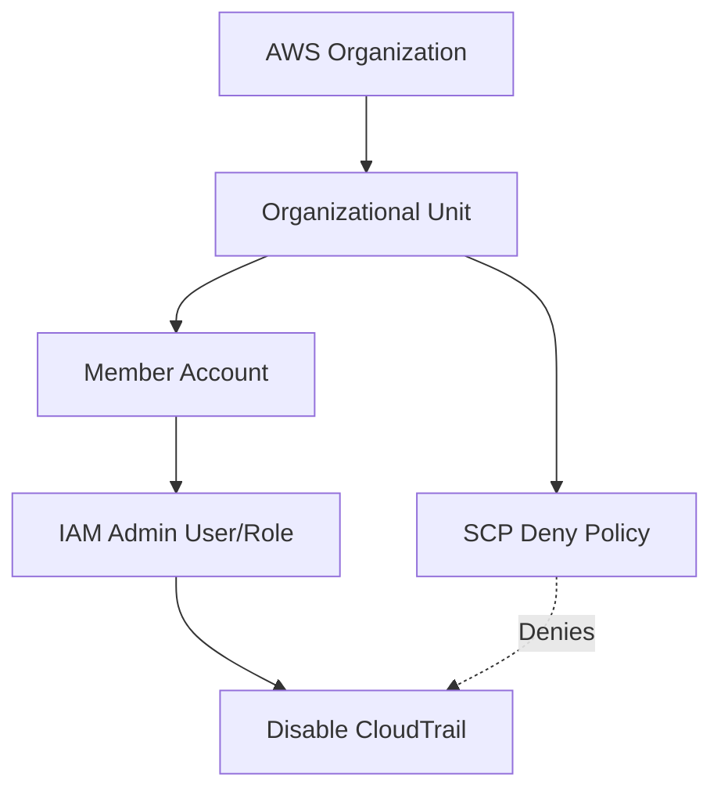

IAM Admin이라도 SCP에서 명시적으로 Deny된 작업은 수행할 수 없습니다.

---

## 왜 SCP가 정답인가?

- Organizations 레벨에서 제어
- Member Account 관리자에게도 적용
- 보안 통제 강제 가능
- CloudTrail 삭제/비활성화 같은 위험 작업 방지 가능
- 계정이 Organization을 떠나는 작업도 제한 가능

---

## 오답 설명

### A. 각 계정에 IAM Policy 생성

IAM Policy는 계정 내부에서 관리됩니다.

관리자가 해당 정책을 수정하거나 우회할 수 있습니다.

문제는 "관리자에게도 강제"해야 하므로 SCP가 필요합니다.

---

### C. AWS Config로 감지 후 복구

Config는 탐지와 평가에 유용합니다.

하지만 예방이 아닙니다.

즉, CloudTrail이 꺼진 뒤에 감지하고 복구하는 방식입니다.

문제는 "prevent"에 가깝습니다.

---

### D. GuardDuty

GuardDuty는 위협 탐지 서비스입니다.

관리자가 CloudTrail을 비활성화하는 API 호출을 원천적으로 막지는 못합니다.

---

## 초보자용 기억법

> AWS Organizations에서 계정 전체 권한 상한 설정 → **SCP**

> 계정 내부 사용자 권한 → **IAM Policy**

> 리소스 접근 제어 → **Resource Policy**

</details>

---

# Q28. Domain 1 — Design Secure Architectures

## Question

**A company has an application that allows users to sign in with social identity providers such as Google and Facebook. After signing in, users need temporary AWS credentials to upload files to their own folder in an S3 bucket.**

**Which AWS service should the company use to provide this functionality?**

A. AWS IAM Identity Center

B. Amazon Cognito identity pools

C. AWS Directory Service

D. AWS Organizations

---
<details>
<summary><strong>Click to view Answer & Detailed Explanation</strong></summary>

## 정답

**B. Amazon Cognito identity pools**

---

## 상세 해설

이 문제는 **애플리케이션 사용자 인증 + 임시 AWS 자격 증명 발급** 문제입니다.

핵심 조건을 보면 다음과 같습니다.

| 조건 | 의미 |
|---|---|
| users sign in with Google/Facebook | 소셜 로그인 |
| temporary AWS credentials | 임시 AWS 자격 증명 필요 |
| upload files to S3 | AWS 리소스 접근 필요 |
| own folder | 사용자별 권한 분리 필요 |

Amazon Cognito에는 크게 두 가지 개념이 있습니다.

| Cognito 구성요소 | 역할 |
|---|---|
| User Pool | 사용자 로그인, 인증, JWT 발급 |
| Identity Pool | 인증된 사용자에게 임시 AWS Credential 발급 |

이 문제는 사용자가 소셜 로그인 후 S3에 직접 업로드해야 하므로 **Cognito Identity Pool**이 필요합니다.

---

## 구조 도식

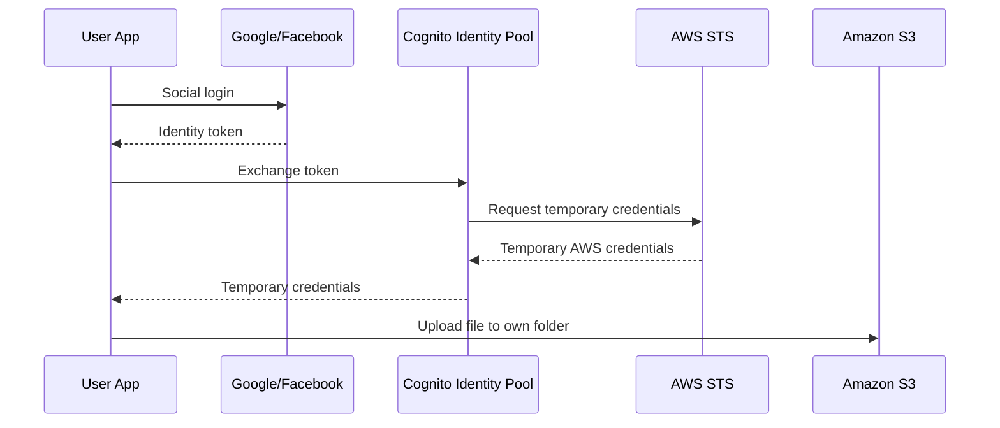

---

## 왜 Cognito Identity Pool인가?

Identity Pool은 외부 IdP 또는 Cognito User Pool로 인증된 사용자에게 IAM Role 기반의 임시 자격 증명을 제공합니다.

예를 들어 다음과 같은 정책을 적용할 수 있습니다.

```text
userA는 s3://bucket/userA/* 만 접근
userB는 s3://bucket/userB/* 만 접근
```

---

## 오답 설명

### A. IAM Identity Center

IAM Identity Center는 직원이나 조직 사용자가 AWS 계정, AWS Console, CLI 등에 접근할 때 사용합니다.

일반 앱 사용자 소셜 로그인에는 Cognito가 적합합니다.

---

### C. AWS Directory Service

Directory Service는 Microsoft AD 연동, Managed AD, AD Connector 같은 기업 디렉터리 연동 서비스입니다.

소셜 로그인 앱 사용자용이 아닙니다.

---

### D. AWS Organizations

Organizations는 여러 AWS 계정 관리 서비스입니다.

사용자 소셜 로그인이나 임시 자격 증명 발급과는 관련이 없습니다.

---

## 초보자용 기억법

| 대상 | 서비스 |
|---|---|
| 앱 사용자 로그인 | Cognito User Pool |
| 앱 사용자에게 AWS 임시 권한 부여 | Cognito Identity Pool |
| 직원 AWS 계정 접근 | IAM Identity Center |
| 여러 AWS 계정 관리 | Organizations |

</details>

---

# Q29. Domain 2 — Design Resilient Architectures

## Question

**A company runs a web application on Amazon EC2 instances behind an Application Load Balancer. The instances are in an Auto Scaling group across two Availability Zones. The application stores session data locally on each EC2 instance. Users report that they are frequently logged out when instances are replaced or when traffic is routed to another instance.**

**Which solution will improve resiliency and user experience?**

A. Enable sticky sessions on the Application Load Balancer and continue storing sessions locally.

B. Store session data in Amazon ElastiCache or DynamoDB and make the application stateless.

C. Increase the minimum size of the Auto Scaling group.

D. Use larger EC2 instances so sessions remain in memory longer.

---
<details>
<summary><strong>Click to view Answer & Detailed Explanation</strong></summary>

## 정답

**B. Store session data in Amazon ElastiCache or DynamoDB and make the application stateless.**

---

## 상세 해설

이 문제는 **Stateful Web Application을 Stateless하게 변경**하는 문제입니다.

현재 문제는 세션 정보가 EC2 로컬에 저장된다는 점입니다.

```text
User Session → EC2 local memory or local disk
```

Auto Scaling 환경에서는 인스턴스가 언제든지 교체될 수 있습니다.

또한 ALB가 사용자를 다른 인스턴스로 보낼 수도 있습니다.

그러면 해당 인스턴스에는 사용자의 세션 정보가 없어서 로그아웃됩니다.

---

## 문제가 있는 구조

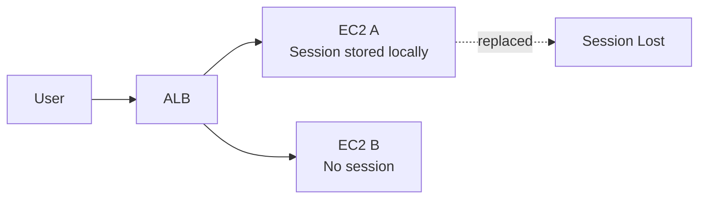

---

## 개선 구조

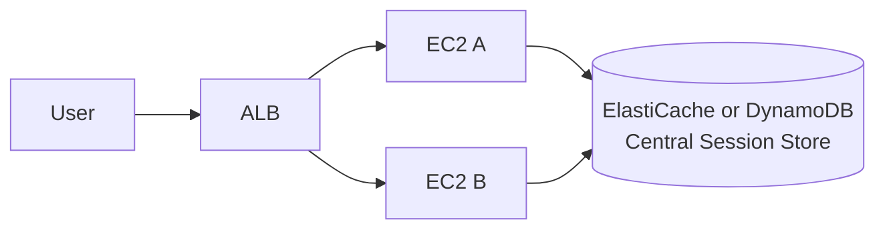

세션을 중앙 저장소에 저장하면 어떤 EC2 인스턴스로 요청이 가도 동일한 세션을 조회할 수 있습니다.

---

## ElastiCache vs DynamoDB

| 서비스 | 세션 저장 적합성 |
|---|---|
| ElastiCache Redis | 매우 빠른 세션 캐시, TTL 처리 좋음 |
| DynamoDB | 내구성 있는 Key-Value 세션 저장, 확장성 좋음 |

---

## 오답 설명

### A. ALB Sticky Sessions

Sticky Session을 쓰면 같은 사용자를 같은 인스턴스로 보내는 데 도움이 됩니다.

하지만 근본 해결은 아닙니다.

왜냐하면 인스턴스가 종료되면 세션도 사라집니다.

Auto Scaling, 배포, 장애 조치 환경에서는 로컬 세션 저장을 피하고 Stateless하게 만드는 것이 더 좋은 아키텍처입니다.

---

### C. Auto Scaling 최소 크기 증가

인스턴스 수를 늘려도 세션이 특정 인스턴스에 묶여 있는 문제는 해결되지 않습니다.

---

### D. 큰 EC2 사용

인스턴스 메모리가 커져도 인스턴스 교체 시 세션은 사라집니다.

---

## 초보자용 기억법

> Auto Scaling 환경에서 세션 로컬 저장은 위험

> 세션은 **ElastiCache Redis 또는 DynamoDB**에 저장해서 Stateless 구조로 전환

</details>

---

# Q30. Domain 2 — Design Resilient Architectures

## Question

**A company runs an application that processes messages from an Amazon SQS standard queue. The application sometimes fails to process messages because of temporary downstream errors. The company wants to prevent messages that repeatedly fail from blocking the processing of other messages and wants to analyze failed messages later.**

**Which solution should a solutions architect recommend?**

A. Increase the visibility timeout to 12 hours and delete all failed messages.

B. Configure a dead-letter queue, DLQ, and set an appropriate maximum receive count.

C. Replace the SQS queue with an Amazon SNS topic.

D. Enable S3 Versioning on the SQS queue.

---
<details>
<summary><strong>Click to view Answer & Detailed Explanation</strong></summary>

## 정답

**B. Configure a dead-letter queue, DLQ, and set an appropriate maximum receive count.**

---

## 상세 해설

이 문제는 **SQS 실패 메시지 처리** 문제입니다.

SQS에서 메시지를 처리하다 실패하면 메시지는 일정 시간 후 다시 Queue에 나타납니다.

이를 재시도라고 볼 수 있습니다.

하지만 어떤 메시지는 계속 실패할 수 있습니다.

예:

- 데이터 형식이 잘못됨
- 필수 필드 누락
- 다운스트림 시스템에서 영구적으로 거부
- 코드 버그로 특정 메시지만 처리 실패

이런 메시지가 계속 재처리되면 정상 메시지 처리에 방해가 될 수 있습니다.

이때 사용하는 것이 **DLQ, Dead-Letter Queue**입니다.

---

## DLQ 구조

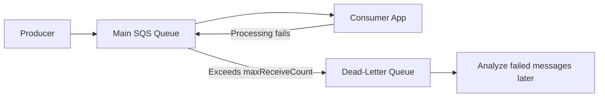

---

## Maximum Receive Count란?

`maxReceiveCount`는 메시지를 몇 번까지 재처리할지 정하는 값입니다.

예:

```text
maxReceiveCount = 5
```

그러면 같은 메시지가 5번 처리 실패하면 DLQ로 이동합니다.

---

## 오답 설명

### A. Visibility Timeout 12시간 + 실패 메시지 삭제

Visibility Timeout을 길게 하면 메시지가 다시 보이는 시간을 늦출 수는 있습니다.

하지만 실패 메시지를 분석할 수 없고, 삭제하면 데이터 유실이 발생합니다.

문제는 실패 메시지를 나중에 분석하고 싶다고 했습니다.

---

### C. SNS로 대체

SNS는 Pub/Sub 알림 서비스입니다.

메시지 실패 재처리, DLQ 기반 큐 처리의 기본 대체제가 아닙니다.

---

### D. S3 Versioning on SQS

SQS Queue에는 S3 Versioning을 적용할 수 없습니다.

서비스 개념이 섞인 명백한 오답입니다.

---

## 초보자용 기억법

> SQS 처리 실패 반복 → **DLQ**

> 메시지가 처리 중 다시 보이지 않게 하는 시간 → **Visibility Timeout**

> 메시지 장기 보관/분석 → **DLQ 후 S3 적재 등**

</details>

---

# Q31. Domain 2 — Design Resilient Architectures

## Question

**A company runs a multi-tier application in a single AWS Region. The company wants to improve disaster recovery by storing database backups in another AWS Region. The company uses Amazon RDS for PostgreSQL. The company does not need the database to be running in the secondary Region unless a disaster occurs.**

**Which solution is the MOST cost-effective?**

A. Enable RDS Multi-AZ deployment.

B. Create a cross-Region read replica and keep it running at all times.

C. Copy automated RDS snapshots to another Region. Restore the snapshot in the secondary Region during a disaster.

D. Deploy an active-active database architecture across two Regions.

---
<details>
<summary><strong>Click to view Answer & Detailed Explanation</strong></summary>

## 정답

**C. Copy automated RDS snapshots to another Region. Restore the snapshot in the secondary Region during a disaster.**

---

## 상세 해설

이 문제는 **DR 비용 최적화** 문제입니다.

핵심 조건:

| 조건 | 의미 |
|---|---|
| store database backups in another Region | 다른 리전에 백업 필요 |
| does not need the database running | 평상시 DB 인스턴스 실행 불필요 |
| unless disaster occurs | 재해 시 복구하면 됨 |
| MOST cost-effective | 실행 비용 최소화 |

평상시에 보조 리전에 DB를 실행하지 않아도 된다면 가장 비용 효율적인 방식은 **Cross-Region Snapshot Copy 후 재해 시 Restore**입니다.

---

## 구조 도식

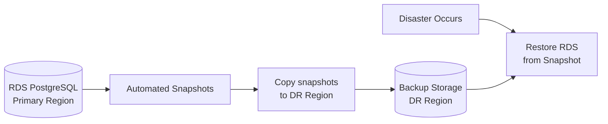

---

## 왜 C가 정답인가?

보조 리전에 RDS 인스턴스를 항상 실행하지 않으므로 컴퓨팅 비용을 줄일 수 있습니다.

비용 구조는 대략 다음과 같습니다.

- Snapshot Storage 비용 발생
- Cross-Region 데이터 전송 비용 일부 발생
- 평상시 DB 인스턴스 실행 비용 없음
- 장애 시 Restore 시간 필요

즉, RTO가 다소 길어도 되는 비용 최적화 DR에 적합합니다.

---

## 오답 설명

### A. RDS Multi-AZ

Multi-AZ는 같은 Region 내 AZ 장애 대응입니다.

다른 Region에 백업을 저장하는 요구사항에는 부족합니다.

---

### B. Cross-Region Read Replica

Cross-Region Read Replica는 DR 리전에 DB가 계속 실행됩니다.

복구 시간은 짧아질 수 있지만 비용이 더 듭니다.

문제는 평상시 보조 리전 DB 실행이 필요 없고 비용 최적화가 핵심입니다.

---

### D. Active-active multi-Region

가장 높은 가용성을 제공하지만 가장 비쌉니다.

문제 조건과 반대입니다.

---

## 초보자용 기억법

| 요구사항 | DR 선택 |
|---|---|
| 가장 저렴, 복구 느려도 됨 | Snapshot Copy / Backup and Restore |
| 핵심만 켜둠 | Pilot Light |
| 축소 환경 실행 | Warm Standby |
| 즉시 장애 대응 | Active-Active |

</details>

---

# Q32. Domain 3 — Design High-Performing Architectures

## Question

**A company has an application that frequently reads product catalog data from an Amazon RDS for MySQL database. The data changes only a few times per day. During peak traffic, the database experiences high CPU utilization due to repeated read queries.**

**Which solution should a solutions architect recommend to improve performance with minimal changes?**

A. Add Amazon ElastiCache in front of the database to cache frequently accessed product catalog data.

B. Enable Multi-AZ for the RDS database.

C. Store the product catalog data in Amazon S3 Glacier Deep Archive.

D. Increase the backup retention period for the RDS database.

---
<details>
<summary><strong>Click to view Answer & Detailed Explanation</strong></summary>

## 정답

**A. Add Amazon ElastiCache in front of the database to cache frequently accessed product catalog data.**

---

## 상세 해설

이 문제는 **읽기 부하 캐싱** 문제입니다.

핵심 조건:

| 조건 | 의미 |
|---|---|
| frequently reads | 반복 조회 많음 |
| product catalog data | 자주 읽는 참조 데이터 |
| changes only a few times per day | 캐싱하기 좋은 데이터 |
| high CPU due to repeated read queries | DB 읽기 부하 문제 |

이 경우 DB 앞에 캐시 계층을 두면 성능을 크게 개선할 수 있습니다.

대표 서비스는 **Amazon ElastiCache**입니다.

---

## 캐싱 구조

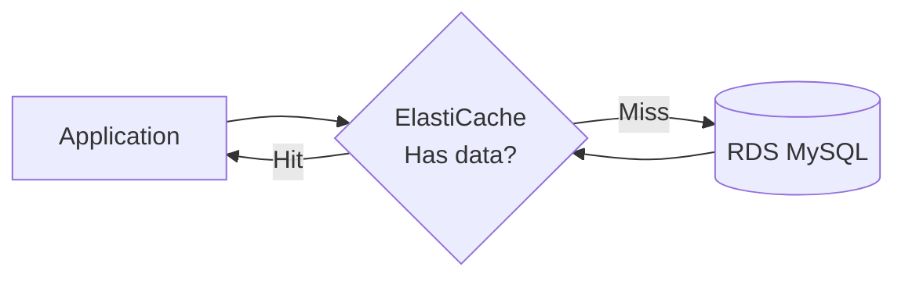

---

## 캐시가 효과적인 이유

상품 카탈로그처럼 자주 읽지만 자주 바뀌지 않는 데이터는 캐시하기 좋습니다.

예를 들어 상품명, 가격, 카테고리, 이미지 URL 같은 데이터를 매번 RDS에서 읽으면 DB 부하가 증가합니다.

ElastiCache에 저장해두면 메모리에서 빠르게 응답할 수 있습니다.

---

## 오답 설명

### B. Multi-AZ

Multi-AZ는 고가용성 목적입니다.

읽기 성능 개선 목적이 아닙니다.

---

### C. S3 Glacier Deep Archive

Glacier Deep Archive는 장기 아카이브 스토리지입니다.

즉시 조회해야 하는 상품 카탈로그에는 전혀 맞지 않습니다.

---

### D. Backup Retention 증가

백업 보존 기간은 복구 정책과 관련 있습니다.

DB CPU 읽기 부하 개선과는 관계 없습니다.

---

## 초보자용 기억법

> 자주 읽고, 자주 안 바뀌는 데이터 → **Cache**

> AWS 캐시 서비스 → **ElastiCache Redis/Memcached**

</details>

---

# Q33. Domain 3 — Design High-Performing Architectures

## Question

**A company runs a REST API using Amazon API Gateway and AWS Lambda. The API receives unpredictable traffic spikes. The backend data store must provide low-latency access and automatically scale to handle the traffic without database administration.**

**Which data store should the company use?**

A. Amazon DynamoDB

B. Amazon RDS for MySQL on a large instance

C. Amazon Redshift

D. Amazon EFS

---
<details>
<summary><strong>Click to view Answer & Detailed Explanation</strong></summary>

## 정답

**A. Amazon DynamoDB**

---

## 상세 해설

이 문제는 **Serverless API + 자동 확장 + Low latency 데이터 저장소** 문제입니다.

핵심 키워드:

```text
API Gateway
Lambda
unpredictable traffic spikes
low-latency access
automatically scale
without database administration
```

이런 조합에서는 **DynamoDB**가 매우 적합합니다.

---

## 서버리스 아키텍처 구조

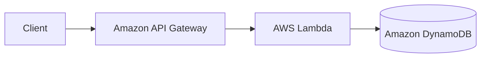

이 구조는 전형적인 AWS Serverless API 패턴입니다.

- API Gateway: API Endpoint 제공
- Lambda: 비즈니스 로직 실행
- DynamoDB: 자동 확장 NoSQL 데이터 저장소

---

## DynamoDB가 적합한 이유

- 서버 관리 없음
- 자동 확장
- 낮은 지연 시간
- Lambda와 잘 통합
- 갑작스러운 트래픽 스파이크 대응 가능
- On-Demand 모드 사용 가능

---

## 오답 설명

### B. RDS MySQL large instance

RDS는 관계형 DB가 필요한 경우 좋습니다.

하지만 예측 불가능한 스파이크에 대해 인스턴스 크기 기반 확장은 한계가 있습니다.

또한 DB 커넥션 관리, 스케일링, 패치 등 운영 고려가 필요합니다.

---

### C. Redshift

Redshift는 데이터웨어하우스입니다.

REST API의 실시간 백엔드 데이터 저장소가 아닙니다.

---

### D. EFS

EFS는 파일 시스템입니다.

API의 low-latency key-value 또는 document 데이터 저장소로 적합하지 않습니다.

---

## 초보자용 기억법

> API Gateway + Lambda + 자동 확장 DB → **DynamoDB**

> SQL 트랜잭션 필요 → **RDS/Aurora**

> 분석 데이터웨어하우스 → **Redshift**

</details>

---

# Q34. Domain 3 — Design High-Performing Architectures

## Question

**A company needs to transfer 80 TB of data from an on-premises NFS file system to Amazon S3. The company has a high-speed internet connection and wants to complete the transfer as quickly as possible with minimal operational overhead. The transfer must be online and repeatable for future incremental transfers.**

**Which service should the company use?**

A. AWS DataSync

B. AWS Snowball Edge

C. Amazon S3 Glacier

D. AWS Database Migration Service

---
<details>
<summary><strong>Click to view Answer & Detailed Explanation</strong></summary>

## 정답

**A. AWS DataSync**

---

## 상세 해설

이 문제는 **온프레미스 파일 시스템에서 S3로 온라인 데이터 이전** 문제입니다.

핵심 조건:

| 조건 | 의미 |
|---|---|
| on-premises NFS file system | 파일 시스템 소스 |
| to Amazon S3 | S3 대상 |
| high-speed internet connection | 온라인 전송 가능 |
| repeatable future incremental transfers | 반복/증분 전송 필요 |
| minimal operational overhead | 관리형 전송 서비스 필요 |

이 조건에 가장 적합한 서비스는 **AWS DataSync**입니다.

---

## DataSync 구조

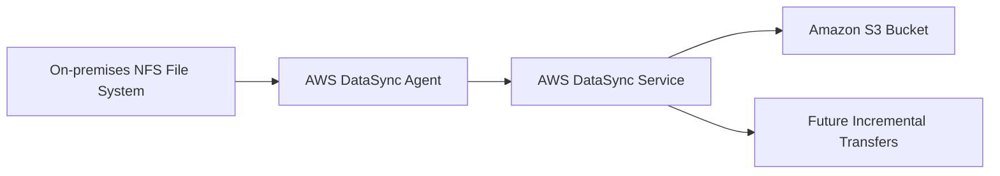

DataSync는 온프레미스 NFS, SMB, object storage 등에서 AWS 스토리지 서비스로 데이터를 전송하는 관리형 서비스입니다.

---

## DataSync의 장점

- NFS/SMB 지원
- S3, EFS, FSx 등으로 전송 가능
- 증분 전송 가능
- 스케줄링 가능
- 데이터 검증 기능 제공
- 네트워크 최적화
- 운영 부담 낮음

---

## 오답 설명

### B. Snowball Edge

Snowball Edge는 대량 데이터를 물리 디바이스로 이전할 때 사용합니다.

네트워크가 느리거나 오프라인 이전이 필요할 때 적합합니다.

하지만 문제에서 다음을 말합니다.

```text
high-speed internet connection
online and repeatable
future incremental transfers
```

이 조건에서는 DataSync가 더 적합합니다.

---

### C. S3 Glacier

S3 Glacier는 아카이브 스토리지입니다.

데이터 전송 서비스가 아닙니다.

---

### D. DMS

AWS Database Migration Service는 데이터베이스 마이그레이션 서비스입니다.

NFS 파일 시스템에서 S3로 파일을 옮기는 용도가 아닙니다.

---

## 초보자용 기억법

| 이전 대상 | 서비스 |
|---|---|
| 파일시스템 NFS/SMB → S3/EFS/FSx | DataSync |
| 대량 오프라인 데이터 이전 | Snowball |
| DB 이전 | DMS |
| 서버 Lift-and-shift | Application Migration Service |

</details>

---

# Q35. Domain 4 — Design Cost-Optimized Architectures

## Question

**A company runs a web application on Amazon EC2 instances behind an Application Load Balancer. Traffic is predictable and increases every weekday from 9 AM to 6 PM. The company wants to scale out before traffic increases and scale in after business hours to reduce costs.**

**Which scaling strategy should a solutions architect recommend?**

A. Configure scheduled scaling actions for the Auto Scaling group.

B. Use manual scaling every morning and evening.

C. Use EC2 Spot Instances only and remove the Auto Scaling group.

D. Use a larger fixed number of On-Demand Instances all day.

---
<details>
<summary><strong>Click to view Answer & Detailed Explanation</strong></summary>

## 정답

**A. Configure scheduled scaling actions for the Auto Scaling group.**

---

## 상세 해설

이 문제는 **예측 가능한 트래픽 패턴 기반 비용 최적화** 문제입니다.

핵심 조건:

```text
predictable
weekday from 9 AM to 6 PM
scale out before traffic increases
scale in after business hours
reduce costs
```

트래픽 증가 시간이 명확하면 Auto Scaling의 **Scheduled Scaling**을 사용할 수 있습니다.

---

## 스케줄 기반 확장 구조

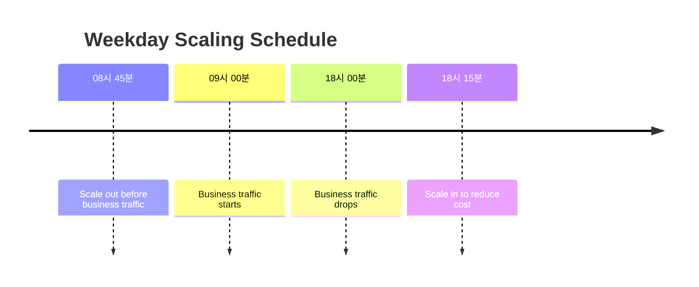

---

## Auto Scaling 방식 비교

| 방식 | 적합한 상황 |
|---|---|
| Target Tracking | CPU 등 지표 기반 자동 조정 |
| Step Scaling | 알람 단계별 확장 |
| Scheduled Scaling | 트래픽 시간이 예측 가능 |
| Predictive Scaling | 과거 패턴 기반 예측 |

이번 문제는 시간이 명확하므로 Scheduled Scaling이 가장 단순하고 효과적입니다.

---

## 오답 설명

### B. 수동 Scaling

운영자가 매일 직접 조정해야 하므로 운영 부담이 큽니다.

실수 가능성도 큽니다.

---

### C. Spot Instances만 사용하고 ASG 제거

Spot은 비용 절감에 도움이 될 수 있지만, 중단 가능성이 있습니다.

또한 ASG를 제거하면 자동 확장/복구 능력을 잃습니다.

---

### D. 하루 종일 큰 고정 용량 유지

피크에 맞춰 하루 종일 용량을 유지하면 비업무 시간에 비용 낭비가 발생합니다.

---

## 초보자용 기억법

> 트래픽 시간이 명확함 → **Scheduled Scaling**

> 트래픽이 예측 불가 → **Target Tracking / Queue 기반 Scaling**

> 과거 패턴이 반복됨 → **Predictive Scaling**

</details>

---

# Q36. Domain 4 — Design Cost-Optimized Architectures

## Question

**A company uses AWS KMS with server-side encryption for a high-volume S3 workload. The application uploads and downloads millions of objects each day. The company wants to reduce AWS KMS request costs while continuing to use SSE-KMS for new objects.**

**Which solution should a solutions architect recommend?**

A. Enable S3 Bucket Keys for SSE-KMS on the S3 bucket.

B. Switch to SSE-C for all new objects.

C. Disable encryption for frequently accessed objects.

D. Move all objects to S3 Glacier Deep Archive immediately after upload.

---
<details>
<summary><strong>Click to view Answer & Detailed Explanation</strong></summary>

## 정답

**A. Enable S3 Bucket Keys for SSE-KMS on the S3 bucket.**

---

## 상세 해설

이 문제는 **SSE-KMS 비용 최적화** 문제입니다.

핵심 조건:

| 조건 | 의미 |
|---|---|
| AWS KMS with server-side encryption | SSE-KMS 사용 중 |
| millions of objects each day | KMS 요청 수가 많음 |
| reduce AWS KMS request costs | KMS API 비용 줄여야 함 |
| continue to use SSE-KMS | SSE-S3나 SSE-C로 바꾸면 안 됨 |

정답은 **S3 Bucket Keys**입니다.

---

## SSE-KMS 비용 문제

SSE-KMS를 사용하면 S3 객체 암호화/복호화 과정에서 KMS API 호출이 발생할 수 있습니다.

객체 수가 매우 많으면 KMS 요청 비용이 커질 수 있습니다.

S3 Bucket Key를 활성화하면 S3가 버킷 수준의 키를 활용하여 KMS 호출 수를 줄입니다.

---

## 구조 도식

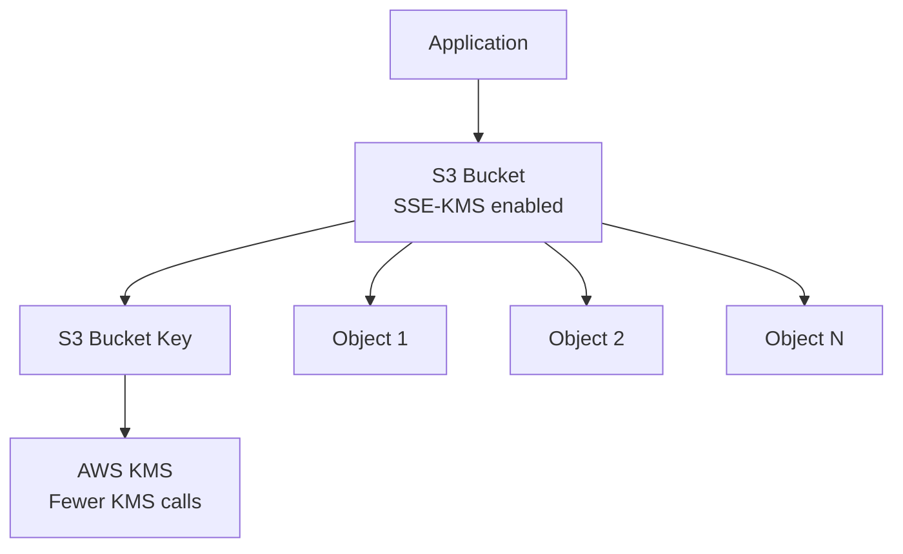

---

## 왜 A가 정답인가?

S3 Bucket Key는 다음 조건을 모두 만족합니다.

- SSE-KMS 계속 사용
- KMS 요청 비용 감소
- 애플리케이션 변경 거의 없음
- 운영 부담 낮음

---

## 오답 설명

### B. SSE-C로 전환

SSE-C는 고객 제공 키 방식입니다.

문제는 SSE-KMS를 계속 사용해야 한다고 했습니다.

```text
continuing to use SSE-KMS
```

따라서 오답입니다.

---

### C. 암호화 비활성화

보안 요구사항 위반입니다.

민감 데이터 또는 암호화 요구가 있는 워크로드에서 암호화를 끄는 것은 정답이 될 수 없습니다.

---

### D. Glacier Deep Archive로 즉시 이동

Glacier Deep Archive는 장기 아카이브용입니다.

고빈도 업로드/다운로드 워크로드와 맞지 않습니다.

또한 KMS 요청 비용 절감의 직접 해결책도 아닙니다.

---

## 초보자용 기억법

> S3에서 SSE-KMS 비용 줄이기 → **S3 Bucket Keys**

</details>

---

# Set 3 정답표

| 번호 | 도메인 | 정답 |
|---:|---|---|
| Q25 | Secure | B |
| Q26 | Secure | B |
| Q27 | Secure | B |
| Q28 | Secure | B |
| Q29 | Resilient | B |
| Q30 | Resilient | B |
| Q31 | Resilient | C |
| Q32 | High-Performing | A |
| Q33 | High-Performing | A |
| Q34 | High-Performing | A |
| Q35 | Cost-Optimized | A |
| Q36 | Cost-Optimized | A |

---

# Set 3 핵심 요약

| 주제 | 정답 패턴 |
|---|---|
| S3 직접 업로드, 임시 권한 | Presigned URL |
| Private Subnet에서 Secrets Manager 접근 | Interface VPC Endpoint |
| 계정 관리자도 못 하게 막기 | SCP |
| 소셜 로그인 후 AWS 임시 자격 증명 | Cognito Identity Pool |
| 세션 로컬 저장 문제 | ElastiCache/DynamoDB로 Stateless |
| SQS 실패 메시지 분석 | DLQ |
| 저비용 Cross-Region DB DR | Snapshot Copy |
| 반복 읽기 많은 DB 부하 | ElastiCache |
| Serverless API 백엔드 DB | DynamoDB |
| NFS → S3 온라인 증분 전송 | DataSync |
| 예측 가능한 업무시간 트래픽 | Scheduled Scaling |
| SSE-KMS KMS 비용 절감 | S3 Bucket Keys |

---

# Set 3에서 특히 중요한 실전 함정

## 1. Presigned URL vs Cognito Identity Pool

| 요구사항 | 정답 |
|---|---|
| 특정 파일 1개 업로드/다운로드 URL 임시 발급 | Presigned URL |
| 로그인한 앱 사용자에게 AWS 리소스 접근 권한 부여 | Cognito Identity Pool |

---

## 2. NAT Gateway vs Interface Endpoint

| 요구사항 | 정답 |
|---|---|
| Private Subnet에서 인터넷 패치 다운로드 | NAT Gateway |
| Private Subnet에서 Secrets Manager private 접근 | Interface Endpoint |
| Private Subnet에서 S3 접근 | Gateway Endpoint |

---

## 3. Config vs SCP

| 요구사항 | 정답 |
|---|---|
| 위반을 감지하고 알림/자동복구 | AWS Config |
| 아예 못 하게 막기 | SCP |
| API 호출 이력 확인 | CloudTrail |

---

## 4. DataSync vs Snowball

| 상황 | 정답 |
|---|---|
| 고속 네트워크 있음, 반복/증분 전송 필요 | DataSync |
| 네트워크 부족, 수십~수백 TB 오프라인 이전 | Snowball |
| DB 마이그레이션 | DMS |
| 서버 Lift-and-shift | Application Migration Service |
