# AWS SAA-C03 Practice Exam — Detailed Set 4

## 고난도 함정 문제 12문항

## 도메인 구성

| 도메인 | 실제 비중 | Set 4 반영 |
|---|---:|---:|
| Domain 1. Design Secure Architectures | 30% | 4문항 |
| Domain 2. Design Resilient Architectures | 26% | 3문항 |
| Domain 3. Design High-Performing Architectures | 24% | 3문항 |
| Domain 4. Design Cost-Optimized Architectures | 20% | 2문항 |

> 아래 문제는 학습용 예상 문제입니다. 실제 시험 문제 또는 덤프가 아닙니다.

</details>

---

# Q37. Domain 1 — Design Secure Architectures

## Question

**A company stores application configuration values and database passwords for multiple applications. The configuration values are not sensitive and are updated occasionally. The database passwords must be encrypted and rotated automatically. The company wants to use the most appropriate AWS services while minimizing operational overhead.**

**Which combination of services should a solutions architect recommend?**

A. Store both configuration values and database passwords in AWS Secrets Manager. Enable automatic rotation for all values.

B. Store configuration values in AWS Systems Manager Parameter Store and database passwords in AWS Secrets Manager with automatic rotation enabled.

C. Store configuration values in Amazon S3 and database passwords in AWS KMS.

D. Store both configuration values and database passwords in AWS Systems Manager Parameter Store as SecureString parameters and rotate them manually.

---
<details>
<summary><strong>Click to view Answer & Detailed Explanation</strong></summary>

## 정답

**B. Store configuration values in AWS Systems Manager Parameter Store and database passwords in AWS Secrets Manager with automatic rotation enabled.**

---

## 상세 해설

이 문제는 **Parameter Store vs Secrets Manager vs KMS**를 구분하는 고빈도 함정 문제입니다.

문제를 나누어 보면 두 종류의 데이터가 있습니다.

| 데이터 | 특징 | 적합한 서비스 |
|---|---|---|
| 일반 설정값 | 민감하지 않음, 가끔 변경 | Systems Manager Parameter Store |
| DB 비밀번호 | 민감함, 암호화 필요, 자동 Rotation 필요 | Secrets Manager |

즉, 모든 값을 한 서비스에 몰아넣는 것이 아니라 **성격에 맞게 분리**하는 것이 정답입니다.

---

## 서비스 역할 비교

| 서비스 | 주 용도 |
|---|---|
| Systems Manager Parameter Store | 설정값, 환경 변수, 단순 파라미터 저장 |
| Secrets Manager | DB 비밀번호, API Key 등 Secret 저장 및 자동 Rotation |
| KMS | 암호화 키 관리 |
| S3 | 객체 저장소 |

KMS는 "비밀번호를 저장하는 서비스"가 아닙니다.

KMS는 데이터를 암호화하는 데 쓰는 **키를 관리**합니다.

---

## 구조 도식

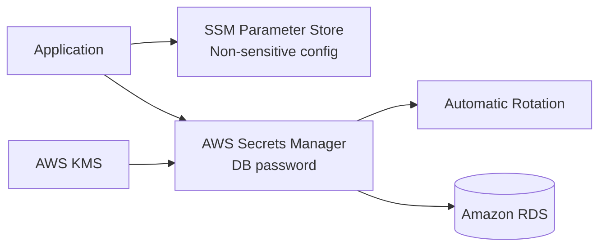

---

## 왜 B가 정답인가?

- 설정값은 Parameter Store가 적합
- DB 비밀번호는 Secrets Manager가 적합
- Secrets Manager는 RDS Credential 자동 Rotation 기능 제공
- 운영 부담 최소
- 서비스 목적에 맞는 설계

---

## 오답 설명

### A. 둘 다 Secrets Manager에 저장

동작은 가능할 수 있지만 가장 적절하지 않습니다.

민감하지 않은 일반 설정값까지 Secrets Manager에 저장하면 비용과 관리 측면에서 비효율적일 수 있습니다.

시험에서는 "most appropriate"라는 표현이 중요합니다.

서비스 목적에 맞게 분리하는 B가 더 좋습니다.

---

### C. 설정값은 S3, DB 비밀번호는 KMS

S3에 설정 파일을 저장할 수는 있지만 애플리케이션 설정 관리용으로는 Parameter Store가 더 적합합니다.

또한 KMS는 비밀번호 저장소가 아닙니다.

---

### D. 둘 다 Parameter Store SecureString + 수동 Rotation

SecureString은 암호화 저장은 가능하지만, DB 비밀번호 자동 Rotation 요구사항이 있습니다.

수동 Rotation은 운영 부담이 큽니다.

---

## 초보자용 기억법

> 설정값 → **Parameter Store**

> 비밀번호 자동 교체 → **Secrets Manager**

> 암호화 키 → **KMS**

</details>

---

# Q38. Domain 1 — Design Secure Architectures

## Question

**A company has several AWS accounts in AWS Organizations. The security team needs to ensure that all Amazon S3 buckets across member accounts block public access. The team wants to continuously detect noncompliant buckets and automatically remediate them.**

**Which solution should a solutions architect recommend?**

A. Use AWS Config rules to detect noncompliant S3 buckets and AWS Systems Manager Automation documents to remediate them.

B. Use AWS Shield Advanced to block public access to S3 buckets.

C. Use an SCP to enable S3 Block Public Access on every bucket automatically.

D. Use Amazon GuardDuty to prevent S3 bucket policies from being changed.

---
<details>
<summary><strong>Click to view Answer & Detailed Explanation</strong></summary>

## 정답

**A. Use AWS Config rules to detect noncompliant S3 buckets and AWS Systems Manager Automation documents to remediate them.**

---

## 상세 해설

이 문제는 **예방 vs 탐지/교정** 구분 문제입니다.

문제에서 중요한 표현은 다음입니다.

```text
continuously detect noncompliant buckets
automatically remediate them
```

즉, "아예 못 하게 막기"보다는 **위반 상태를 지속적으로 감지하고 자동 교정**하는 요구입니다.

이 요구에는 **AWS Config + Remediation** 조합이 적합합니다.

---

## AWS Config 역할

AWS Config는 AWS 리소스의 설정 상태를 기록하고, 규칙에 따라 준수 여부를 평가합니다.

예를 들어 다음을 검사할 수 있습니다.

- S3 Bucket이 public read를 허용하는가?
- Security Group이 0.0.0.0/0 SSH를 허용하는가?
- EBS Volume이 암호화되어 있는가?
- CloudTrail이 활성화되어 있는가?

그리고 Non-compliant로 판단되면 SSM Automation을 통해 자동 조치할 수 있습니다.

---

## 구조 도식

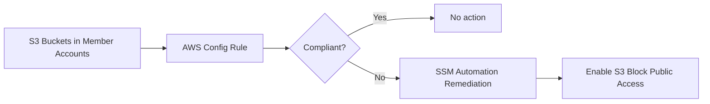

---

## 오답 설명

### B. AWS Shield Advanced

Shield Advanced는 DDoS 보호 서비스입니다.

S3 Bucket Public Access 설정 감지/교정과 관련이 없습니다.

---

### C. SCP로 S3 Block Public Access 자동 활성화

SCP는 특정 API 작업을 허용/거부하는 권한 경계입니다.

하지만 이미 존재하는 모든 버킷의 설정을 자동으로 수정하지는 않습니다.

SCP는 예방에는 유용하지만, 문제에서 말한 **detect and remediate**에는 AWS Config가 더 적합합니다.

---

### D. GuardDuty

GuardDuty는 위협 탐지 서비스입니다.

S3 Public Access 설정을 지속적으로 평가하고 자동 교정하는 서비스가 아닙니다.

---

## 초보자용 기억법

| 요구사항 | 서비스 |
|---|---|
| 설정 위반 탐지 | AWS Config |
| 자동 교정 | SSM Automation |
| 계정 권한 상한 | SCP |
| 위협 탐지 | GuardDuty |
| DDoS 방어 | Shield |

</details>

---

# Q39. Domain 1 — Design Secure Architectures

## Question

**A company runs an application on EC2 instances in private subnets. The application needs to download software updates from the internet. The EC2 instances must not be directly reachable from the internet.**

**Which solution meets these requirements?**

A. Attach an internet gateway to the private subnets and assign Elastic IP addresses to the EC2 instances.

B. Create a NAT gateway in a public subnet and update the private subnet route tables to route internet-bound traffic to the NAT gateway.

C. Create a gateway VPC endpoint for Amazon EC2 and update the route tables.

D. Create an Application Load Balancer in front of the EC2 instances and allow outbound traffic through the load balancer.

---
<details>
<summary><strong>Click to view Answer & Detailed Explanation</strong></summary>

## 정답

**B. Create a NAT gateway in a public subnet and update the private subnet route tables to route internet-bound traffic to the NAT gateway.**

---

## 상세 해설

이 문제는 **Private Subnet의 인터넷 Outbound** 문제입니다.

핵심 조건은 다음입니다.

| 조건 | 의미 |
|---|---|
| EC2 in private subnets | 외부에서 직접 접근되면 안 됨 |
| download software updates from internet | 인터넷 outbound 필요 |
| must not be directly reachable | Public IP 주면 안 됨 |

이 경우에는 **NAT Gateway**를 사용합니다.

---

## NAT Gateway 구조

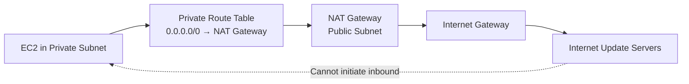

EC2는 인터넷으로 나갈 수 있지만, 인터넷에서 EC2로 직접 들어올 수는 없습니다.

---

## 중요한 차이

| 목적 | 서비스 |
|---|---|
| Private Subnet에서 인터넷 다운로드 | NAT Gateway |
| Private Subnet에서 S3 접근 | Gateway VPC Endpoint |
| Private Subnet에서 Secrets Manager 접근 | Interface VPC Endpoint |

---

## 오답 설명

### A. Private EC2에 Elastic IP 부여

Elastic IP를 부여하면 인터넷에서 직접 접근 가능성이 생깁니다.

문제의 보안 조건을 위반합니다.

---

### C. Gateway VPC Endpoint for Amazon EC2

Gateway Endpoint는 S3와 DynamoDB에 사용합니다.

"Amazon EC2 Gateway Endpoint"라는 방식은 이 문제에 맞지 않습니다.

소프트웨어 업데이트 서버는 인터넷에 있으므로 NAT Gateway가 필요합니다.

---

### D. ALB로 outbound 처리

ALB는 inbound 트래픽 분산용입니다.

EC2의 인터넷 outbound 라우팅 용도가 아닙니다.

---

## 초보자용 기억법

> Private EC2가 인터넷으로 나가야 함 → **NAT Gateway**

> 인터넷이 Private EC2로 들어오면 안 됨 → **Public IP 부여 금지**

</details>

---

# Q40. Domain 1 — Design Secure Architectures

## Question

**A company has a public API hosted on Amazon API Gateway. The company wants to authenticate users with JSON Web Tokens, JWTs, issued by an external OpenID Connect identity provider. The company wants API Gateway to validate the tokens before requests reach the backend.**

**Which solution should a solutions architect recommend?**

A. Use an API Gateway JWT authorizer.

B. Use AWS Shield Standard.

C. Use AWS KMS to decrypt the JWTs in API Gateway.

D. Store the JWTs in AWS Secrets Manager and rotate them every hour.

---
<details>
<summary><strong>Click to view Answer & Detailed Explanation</strong></summary>

## 정답

**A. Use an API Gateway JWT authorizer.**

---

## 상세 해설

이 문제는 **API Gateway 인증/인가** 문제입니다.

핵심 키워드는 다음입니다.

```text
API Gateway
JWT
external OpenID Connect identity provider
validate tokens before backend
```

HTTP API Gateway에서는 JWT Authorizer를 사용해 OIDC 또는 OAuth2 Provider가 발급한 JWT를 검증할 수 있습니다.

---

## 구조 도식

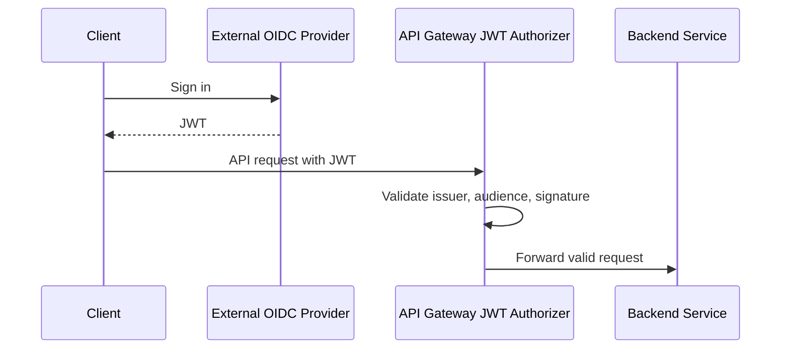

---

## JWT Authorizer가 검증하는 것

일반적으로 다음을 확인합니다.

- 토큰 발급자, issuer
- 대상, audience
- 서명 유효성
- 만료 시간
- Scope 또는 claim

백엔드에 요청이 도달하기 전에 API Gateway에서 검증할 수 있으므로 보안과 운영 측면에서 유리합니다.

---

## 오답 설명

### B. Shield Standard

DDoS 보호 서비스입니다.

JWT 인증과 관련 없습니다.

---

### C. KMS로 JWT 복호화

JWT는 일반적으로 암호화된 비밀 데이터라기보다 서명된 토큰입니다.

검증은 KMS가 아니라 Authorizer가 수행합니다.

---

### D. JWT를 Secrets Manager에 저장

JWT는 사용자 요청마다 전달되는 인증 토큰입니다.

Secrets Manager에 저장하고 Rotation하는 대상이 아닙니다.

---

## 초보자용 기억법

| API 인증 방식 | 사용 |
|---|---|
| JWT 검증 | API Gateway JWT Authorizer |
| Lambda로 커스텀 인증 | Lambda Authorizer |
| AWS IAM SigV4 인증 | IAM Authorization |
| 앱 사용자 관리 | Cognito |

</details>

---

# Q41. Domain 2 — Design Resilient Architectures

## Question

**A company runs an application on Amazon EC2 instances in an Auto Scaling group. The instances process messages from an Amazon SQS queue. The company wants the number of instances to scale based on the amount of work waiting in the queue.**

**Which metric should a solutions architect use for scaling?**

A. Average CPU utilization of the EC2 instances

B. ApproximateNumberOfMessagesVisible in the SQS queue

C. NetworkIn of the Application Load Balancer

D. Number of IAM role sessions used by EC2 instances

---
<details>
<summary><strong>Click to view Answer & Detailed Explanation</strong></summary>

## 정답

**B. ApproximateNumberOfMessagesVisible in the SQS queue**

---

## 상세 해설

이 문제는 **Queue 기반 Auto Scaling** 문제입니다.

애플리케이션이 SQS Queue에서 메시지를 가져와 처리합니다.

이 경우 "일이 얼마나 쌓였는가"를 나타내는 가장 직접적인 지표는 SQS의 다음 메트릭입니다.

```text
ApproximateNumberOfMessagesVisible
```

이 값은 현재 Queue에서 처리 대기 중인 메시지 수를 의미합니다.

---

## 구조 도식

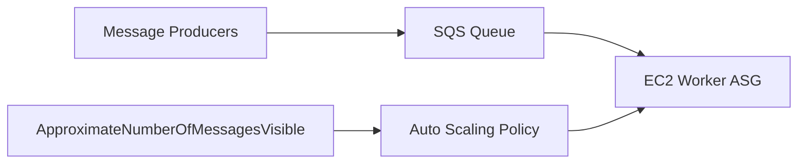

Queue에 메시지가 많이 쌓이면 Worker 인스턴스를 늘리고, 메시지가 줄어들면 Worker를 줄입니다.

---

## 왜 CPU보다 Queue Depth인가?

CPU도 참고할 수는 있지만, 이 문제의 핵심은 "처리해야 할 작업량"입니다.

예를 들어 CPU가 낮아도 메시지가 많이 쌓일 수 있습니다.

- 외부 API 대기
- I/O 대기
- DB 대기
- 처리 로직이 CPU 중심이 아님

따라서 Queue 기반 워크로드는 Queue Depth가 더 직접적인 Scaling 기준입니다.

---

## 오답 설명

### A. CPU Utilization

일반 웹 서버나 CPU 중심 작업에는 좋을 수 있습니다.

하지만 SQS Worker의 확장 기준으로는 Queue에 쌓인 메시지 수가 더 적합합니다.

---

### C. ALB NetworkIn

문제는 SQS Queue 처리입니다.

ALB 트래픽이 핵심이 아닙니다.

---

### D. IAM Role Session 수

IAM Role Session은 처리 대기 작업량을 나타내지 않습니다.

---

## 초보자용 기억법

> SQS Worker Auto Scaling → **Queue Depth 기반**

> 대표 메트릭 → **ApproximateNumberOfMessagesVisible**

</details>

---

# Q42. Domain 2 — Design Resilient Architectures

## Question

**A company runs a critical web application in one AWS Region. The company wants to route users to a secondary Region only if the primary Region becomes unhealthy. The company uses public DNS names for the application endpoints.**

**Which Route 53 routing policy should a solutions architect use?**

A. Simple routing

B. Weighted routing

C. Failover routing

D. Geolocation routing

---
<details>
<summary><strong>Click to view Answer & Detailed Explanation</strong></summary>

## 정답

**C. Failover routing**

---

## 상세 해설

이 문제는 **Route 53 라우팅 정책** 문제입니다.

핵심 조건:

```text
secondary Region only if primary Region becomes unhealthy
```

이 요구사항은 명확하게 **Failover Routing**입니다.

---

## Failover Routing 구조

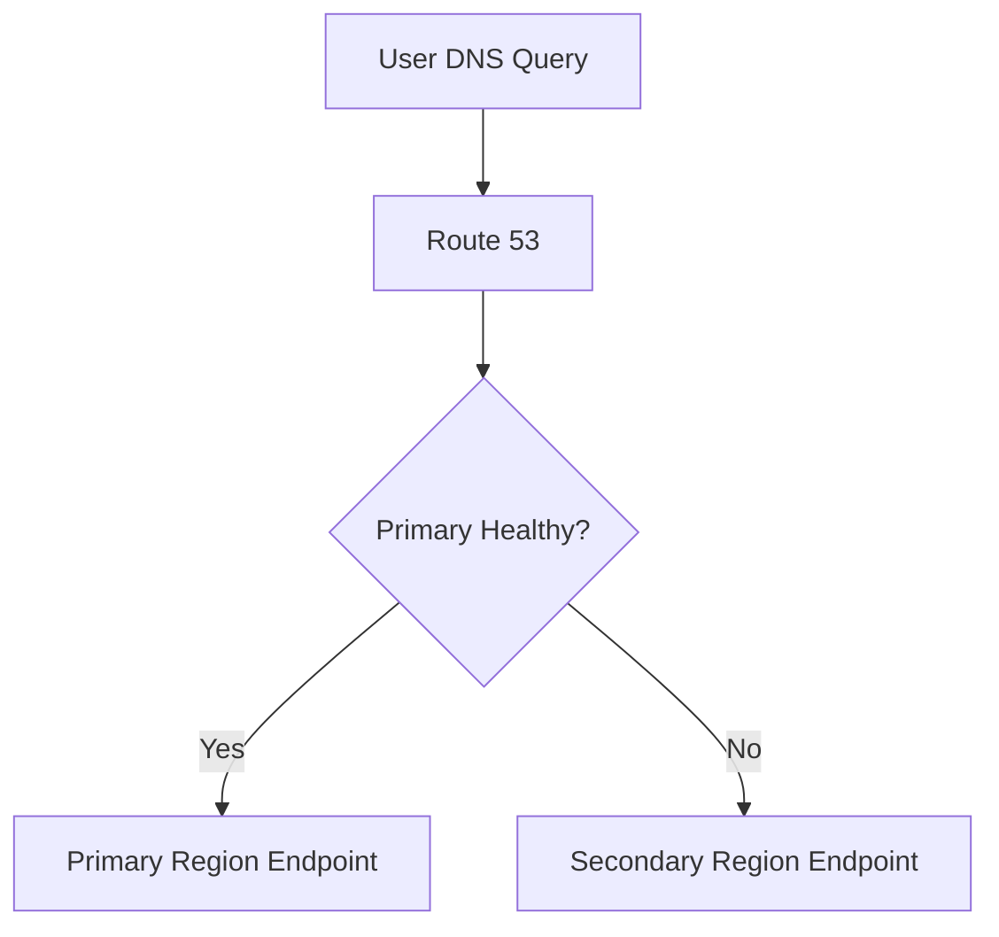

Route 53 Health Check가 Primary Endpoint를 검사합니다.

Primary가 비정상이 되면 Secondary로 응답합니다.

---

## Route 53 정책 비교

| 정책 | 용도 |
|---|---|
| Simple | 단순 레코드 응답 |
| Weighted | 비율 기반 트래픽 분산 |
| Latency | 가장 낮은 지연 리전으로 라우팅 |
| Failover | Primary 장애 시 Secondary |
| Geolocation | 사용자 위치 기반 |
| Geoproximity | 위치와 Bias 기반 |
| Multivalue Answer | 여러 정상 레코드 반환 |

---

## 오답 설명

### A. Simple Routing

장애 조치 로직이 없습니다.

단순히 레코드 값을 반환합니다.

---

### B. Weighted Routing

예를 들어 90:10, 50:50처럼 트래픽을 나누는 데 사용합니다.

Primary가 정상일 때 Secondary로 보내지 않겠다는 요구와 다릅니다.

---

### D. Geolocation Routing

사용자 국가/지역에 따라 라우팅합니다.

장애 시 Secondary로 전환하는 요구와는 다릅니다.

---

## 초보자용 기억법

> 장애 시 보조 리전으로 전환 → **Route 53 Failover Routing**

</details>

---

# Q43. Domain 2 — Design Resilient Architectures

## Question

**A company has an Amazon RDS for MySQL database. The company wants to improve read scalability and allow reporting queries to run without affecting the primary database. The reporting workload can tolerate slightly stale data.**

**Which solution should a solutions architect recommend?**

A. Enable Multi-AZ deployment and run reporting queries on the standby instance.

B. Create a read replica and direct reporting queries to the read replica.

C. Increase the backup retention period and query the backups.

D. Use AWS DMS to replicate the database to Amazon EBS.

---
<details>
<summary><strong>Click to view Answer & Detailed Explanation</strong></summary>

## 정답

**B. Create a read replica and direct reporting queries to the read replica.**

---

## 상세 해설

이 문제는 **RDS Multi-AZ vs Read Replica** 함정입니다.

핵심 조건:

| 조건 | 의미 |
|---|---|
| improve read scalability | 읽기 확장 필요 |
| reporting queries | 무거운 SELECT 쿼리 |
| without affecting primary | Primary에서 분리 필요 |
| tolerate slightly stale data | 비동기 복제 허용 |

Read Replica가 적합합니다.

---

## 구조 도식

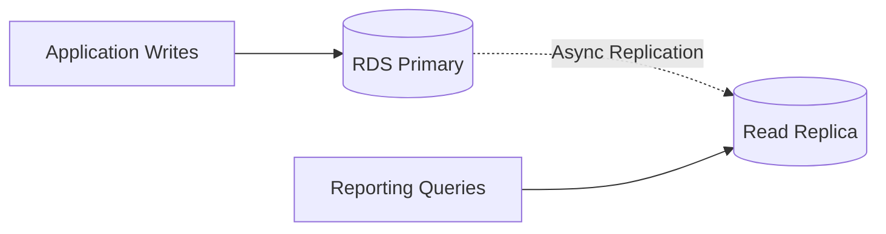

Read Replica는 비동기 복제이므로 약간의 지연이 있을 수 있습니다.

문제에서 stale data를 허용한다고 했으므로 적합합니다.

---

## 오답 설명

### A. Multi-AZ Standby에서 Reporting

RDS Multi-AZ Standby는 장애 조치용입니다.

일반적으로 읽기 쿼리를 보내는 대상이 아닙니다.

실전 시험에서 매우 자주 나오는 함정입니다.

---

### C. 백업을 Query

RDS 백업은 복구용입니다.

운영 Reporting Query 대상이 아닙니다.

---

### D. DMS to EBS

DMS는 DB 마이그레이션/복제 서비스입니다.

EBS는 블록 스토리지이며 Reporting DB가 아닙니다.

---

## 초보자용 기억법

> 읽기 확장 → **Read Replica**

> 장애 조치 → **Multi-AZ**

</details>

---

# Q44. Domain 3 — Design High-Performing Architectures

## Question

**A company runs a global application that serves mostly static content such as images, CSS, JavaScript, and videos. Users are located worldwide. The company wants to reduce latency and reduce load on the origin servers.**

**Which service should the company use?**

A. AWS Global Accelerator

B. Amazon CloudFront

C. AWS Direct Connect

D. Amazon Route 53 simple routing

---
<details>
<summary><strong>Click to view Answer & Detailed Explanation</strong></summary>

## 정답

**B. Amazon CloudFront**

---

## 상세 해설

이 문제는 **CloudFront vs Global Accelerator** 함정입니다.

문제의 핵심은 다음입니다.

```text
mostly static content
images, CSS, JavaScript, videos
reduce latency
reduce load on origin servers
```

정적 콘텐츠를 전 세계 사용자에게 빠르게 제공하고 Origin 부하를 줄이려면 **CloudFront**가 정답입니다.

CloudFront는 CDN입니다.

Edge Location에 콘텐츠를 캐싱해서 사용자에게 가까운 위치에서 응답합니다.

---

## 구조 도식

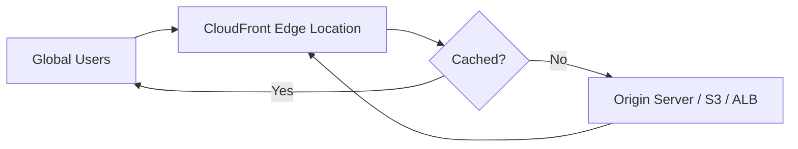

---

## 오답 설명

### A. Global Accelerator

Global Accelerator는 TCP/UDP 트래픽을 AWS 글로벌 네트워크로 최적화하는 서비스입니다.

캐싱 기능은 없습니다.

정적 콘텐츠 캐싱과 Origin 부하 감소가 핵심이면 CloudFront가 맞습니다.

---

### C. Direct Connect

회사 온프레미스와 AWS 간 전용 연결입니다.

전 세계 일반 사용자에게 정적 콘텐츠를 빠르게 제공하는 서비스가 아닙니다.

---

### D. Route 53 Simple Routing

DNS 레코드만 응답합니다.

캐싱이나 CDN 기능은 없습니다.

---

## 초보자용 기억법

> 정적 콘텐츠 + 캐싱 + Origin 부하 감소 → **CloudFront**

> TCP/UDP 글로벌 가속 + 고정 Anycast IP → **Global Accelerator**

</details>

---

# Q45. Domain 3 — Design High-Performing Architectures

## Question

**A company needs to run a relational database workload that has unpredictable periods of activity. The database might be idle for several hours and then experience sudden bursts of traffic. The company wants a solution that automatically scales capacity and reduces costs during idle periods.**

**Which database option should a solutions architect recommend?**

A. Amazon RDS for MySQL with a fixed large instance

B. Amazon Aurora Serverless v2

C. Amazon Redshift provisioned cluster

D. Amazon DynamoDB provisioned capacity

---
<details>
<summary><strong>Click to view Answer & Detailed Explanation</strong></summary>

## 정답

**B. Amazon Aurora Serverless v2**

---

## 상세 해설

이 문제는 **관계형 DB + 가변 워크로드 + 자동 확장 + 유휴 비용 절감** 문제입니다.

핵심 조건:

| 조건 | 의미 |
|---|---|
| relational database workload | 관계형 DB 필요 |
| unpredictable periods of activity | 트래픽 예측 어려움 |
| idle for several hours | 유휴 시간 비용 절감 필요 |
| sudden bursts | 자동 확장 필요 |

이 조건에는 **Aurora Serverless v2**가 적합합니다.

Aurora Serverless v2는 관계형 DB 용량을 워크로드에 따라 자동으로 조정할 수 있습니다.

---

## 구조 도식

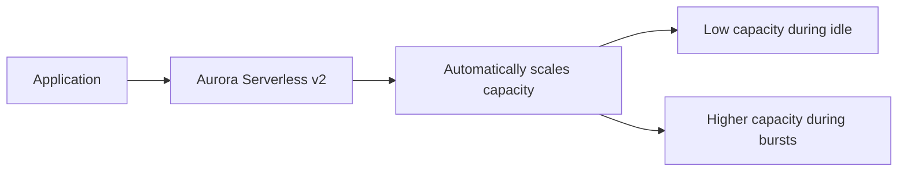

---

## 오답 설명

### A. 고정 대형 RDS 인스턴스

피크에는 대응할 수 있지만 유휴 시간에도 계속 비용이 발생합니다.

비용 최적화 요구에 맞지 않습니다.

---

### C. Redshift Provisioned Cluster

Redshift는 분석 데이터웨어하우스입니다.

일반 관계형 OLTP 워크로드와 다릅니다.

---

### D. DynamoDB Provisioned Capacity

DynamoDB는 NoSQL입니다.

문제에서 relational database workload라고 했으므로 Aurora/RDS 계열이 맞습니다.

또한 Provisioned Capacity는 예측 가능한 트래픽에 더 적합합니다.

---

## 초보자용 기억법

> 관계형 DB + 가변/간헐적 트래픽 + 자동 확장 → **Aurora Serverless v2**

> NoSQL + Key-Value + 자동 확장 → **DynamoDB On-Demand**

</details>

---

# Q46. Domain 3 — Design High-Performing Architectures

## Question

**A company stores large amounts of structured data in Amazon S3 in Parquet format. Data analysts need to run complex SQL queries across this data and join it with other datasets in S3. The company wants a serverless solution and wants to pay only for queries that are run.**

**Which service should the company use?**

A. Amazon Athena

B. Amazon Redshift provisioned cluster

C. Amazon RDS for PostgreSQL

D. Amazon OpenSearch Service

---
<details>
<summary><strong>Click to view Answer & Detailed Explanation</strong></summary>

## 정답

**A. Amazon Athena**

---

## 상세 해설

이 문제는 **S3 데이터 SQL 분석** 문제입니다.

핵심 조건:

```text
structured data in S3
Parquet format
SQL queries
serverless
pay only for queries
```

이 조건은 거의 Athena를 가리킵니다.

Athena는 S3에 저장된 데이터를 직접 SQL로 조회하는 서버리스 분석 서비스입니다.

Parquet 같은 컬럼 기반 포맷과 잘 맞습니다.

---

## 구조 도식

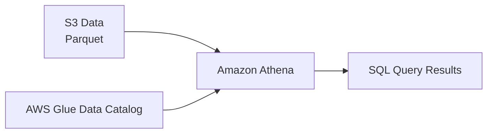

---

## 왜 Parquet이 중요한가?

Parquet은 컬럼 기반 포맷입니다.

Athena는 쿼리에서 필요한 컬럼만 읽을 수 있어서 비용과 성능에 유리합니다.

예를 들어 CSV보다 Parquet이 좋은 경우가 많습니다.

---

## 오답 설명

### B. Redshift provisioned cluster

Redshift도 SQL 분석에 좋습니다.

하지만 provisioned cluster는 서버를 계속 운영해야 합니다.

문제에서 다음 조건이 있습니다.

```text
serverless
pay only for queries that are run
```

따라서 Athena가 더 적합합니다.

---

### C. RDS PostgreSQL

RDS는 운영 관계형 DB입니다.

S3의 대량 분석 데이터에 직접 SQL을 실행하는 서버리스 서비스가 아닙니다.

---

### D. OpenSearch Service

OpenSearch는 검색/로그 분석/텍스트 검색에 적합합니다.

S3 Parquet 데이터에 SQL Join 분석을 하는 대표 서비스는 Athena입니다.

---

## 초보자용 기억법

> S3 + SQL + Serverless + Query 단위 과금 → **Athena**

</details>

---

# Q47. Domain 4 — Design Cost-Optimized Architectures

## Question

**A company stores objects in Amazon S3. The objects are accessed frequently for the first 7 days. After that, access patterns become unpredictable. Some objects are accessed frequently again, while others are rarely accessed. The company requires immediate retrieval when objects are accessed and wants to optimize storage costs automatically.**

**Which S3 storage class should the company use after the first 7 days?**

A. S3 Glacier Deep Archive

B. S3 One Zone-IA

C. S3 Intelligent-Tiering

D. S3 Standard only

---
<details>
<summary><strong>Click to view Answer & Detailed Explanation</strong></summary>

## 정답

**C. S3 Intelligent-Tiering**

---

## 상세 해설

이 문제는 **S3 Intelligent-Tiering vs Lifecycle to Glacier** 함정입니다.

핵심 조건:

| 조건 | 의미 |
|---|---|
| first 7 days frequently accessed | 처음은 Standard 적합 |
| after that unpredictable | 이후 접근 패턴 예측 어려움 |
| some frequently again, others rarely | 객체별 패턴 다름 |
| immediate retrieval | Glacier Deep Archive 부적합 |
| optimize automatically | Intelligent-Tiering 적합 |

S3 Intelligent-Tiering은 접근 패턴을 자동으로 모니터링해서 비용 효율적인 티어로 이동합니다.

그리고 Frequent/IA 티어는 즉시 접근이 가능합니다.

---

## 도식

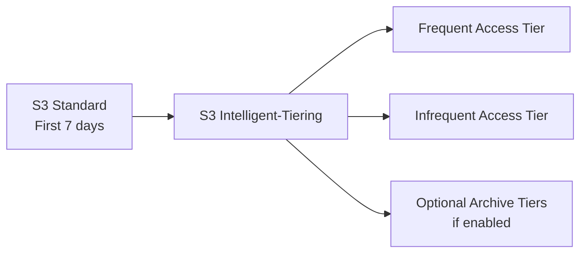

---

## 오답 설명

### A. Glacier Deep Archive

가장 저렴한 아카이브 계열이지만 즉시 접근이 불가능합니다.

복원 시간이 오래 걸립니다.

문제에서 immediate retrieval을 요구하므로 오답입니다.

---

### B. One Zone-IA

One Zone-IA는 단일 AZ에 저장됩니다.

비용은 낮지만 가용성과 내구성 측면에서 Standard-IA보다 낮습니다.

또한 접근 패턴 자동 최적화 기능은 없습니다.

---

### D. Standard only

즉시 접근은 가능하지만 비용 최적화가 부족합니다.

---

## 초보자용 기억법

> 접근 패턴이 예측 불가 + 즉시 접근 필요 → **S3 Intelligent-Tiering**

> 접근 패턴 명확 + 오래 안 봄 → **Lifecycle → Glacier**

</details>

---

# Q48. Domain 4 — Design Cost-Optimized Architectures

## Question

**A company runs a data processing application on EC2 instances. The workload runs continuously and has predictable compute usage. The company can commit to a consistent amount of compute usage for one year, but it wants flexibility to change instance families and Regions.**

**Which purchasing option provides the best balance of cost savings and flexibility?**

A. Standard Reserved Instances

B. Compute Savings Plans

C. Spot Instances

D. On-Demand Instances

---
<details>
<summary><strong>Click to view Answer & Detailed Explanation</strong></summary>

## 정답

**B. Compute Savings Plans**

---

## 상세 해설

이 문제는 **Reserved Instances vs Savings Plans** 함정입니다.

핵심 조건:

| 조건 | 의미 |
|---|---|
| runs continuously | 장기 할인 가능 |
| predictable compute usage | 약정 가능 |
| commit for one year | Savings Plans/RI 후보 |
| flexibility to change instance families and Regions | Compute Savings Plans가 유리 |

Compute Savings Plans는 일정 컴퓨팅 사용량에 대해 약정하고 할인을 받는 방식입니다.

Standard Reserved Instances보다 유연성이 높습니다.

---

## 구매 옵션 비교

| 옵션 | 할인 | 유연성 | 적합 |
|---|---:|---:|---|
| Standard RI | 높음 | 낮음 | 특정 인스턴스 고정 |
| Convertible RI | 중간 | 중간 | 일부 변경 필요 |
| Compute Savings Plans | 좋음 | 높음 | 인스턴스/리전 유연성 필요 |
| Spot | 매우 높음 | 중단 가능 | 중단 가능한 작업 |
| On-Demand | 없음 | 높음 | 단기/예측 불가 |

---

## 오답 설명

### A. Standard Reserved Instances

Standard RI는 비용 절감 효과가 좋지만 유연성이 낮습니다.

문제에서 인스턴스 패밀리와 리전 변경 유연성이 필요하다고 했으므로 Compute Savings Plans가 더 적합합니다.

---

### C. Spot Instances

Spot은 중단될 수 있습니다.

지속 실행, 예측 가능한 워크로드에는 Savings Plans가 더 안정적입니다.

---

### D. On-Demand

유연하지만 비용 절감이 없습니다.

---

## 초보자용 기억법

> 지속 사용 + 유연성 → **Compute Savings Plans**

> 지속 사용 + 특정 인스턴스 고정 → **Standard Reserved Instances**

> 중단 가능 → **Spot**

</details>

---

# Set 4 정답표

| 번호 | 도메인 | 정답 |
|---:|---|---|
| Q37 | Secure | B |
| Q38 | Secure | A |
| Q39 | Secure | B |
| Q40 | Secure | A |
| Q41 | Resilient | B |
| Q42 | Resilient | C |
| Q43 | Resilient | B |
| Q44 | High-Performing | B |
| Q45 | High-Performing | B |
| Q46 | High-Performing | A |
| Q47 | Cost-Optimized | C |
| Q48 | Cost-Optimized | B |

---

# Set 4 핵심 요약

| 주제 | 정답 패턴 |
|---|---|
| 일반 설정값 + DB 비밀번호 자동 회전 | Parameter Store + Secrets Manager |
| S3 Public Access 지속 탐지/자동 교정 | AWS Config + SSM Automation |
| Private EC2 인터넷 업데이트 | NAT Gateway |
| API Gateway JWT 검증 | JWT Authorizer |
| SQS Worker 확장 | Queue Depth |
| Primary 장애 시 Secondary DNS 전환 | Route 53 Failover |
| RDS 읽기 확장 | Read Replica |
| 글로벌 정적 콘텐츠 | CloudFront |
| 가변 관계형 DB 용량 | Aurora Serverless v2 |
| S3 Parquet SQL 분석 | Athena |
| 접근 패턴 불명확 + 즉시 접근 | S3 Intelligent-Tiering |
| 지속 사용 + 유연한 할인 | Compute Savings Plans |

---

# Set 4에서 꼭 기억해야 할 고난도 함정 비교

## 1. Secrets Manager vs Parameter Store vs KMS

| 요구사항 | 정답 |
|---|---|
| 일반 설정값 저장 | Parameter Store |
| DB 비밀번호 자동 Rotation | Secrets Manager |
| 암호화 키 관리 | KMS |
| Secret 자체 저장 | Secrets Manager/Parameter Store |
| Key Policy, 암호화 API | KMS |

---

## 2. Config vs SCP vs GuardDuty

| 요구사항 | 정답 |
|---|---|
| 위반 상태 탐지 | AWS Config |
| 위반 상태 자동 교정 | AWS Config + SSM Automation |
| 계정 관리자도 못 하게 방지 | SCP |
| 위협 탐지 | GuardDuty |
| API 감사 로그 | CloudTrail |

---

## 3. RDS Multi-AZ vs Read Replica

| 요구사항 | 정답 |
|---|---|
| 자동 Failover | Multi-AZ |
| 읽기 부하 분산 | Read Replica |
| Reporting Query 분리 | Read Replica |
| Standby에 쿼리 실행 | 일반적으로 불가 |

---

## 4. CloudFront vs Global Accelerator vs Route 53

| 요구사항 | 정답 |
|---|---|
| 정적 콘텐츠 캐싱 | CloudFront |
| TCP/UDP 글로벌 가속 | Global Accelerator |
| DNS 장애 조치 | Route 53 Failover |
| DNS 지연 기반 라우팅 | Route 53 Latency Routing |

---

## 5. S3 Intelligent-Tiering vs Glacier

| 요구사항 | 정답 |
|---|---|
| 접근 패턴 불명확 | Intelligent-Tiering |
| 즉시 접근 필요 | Intelligent-Tiering 또는 Standard-IA |
| 장기 보관, 복원 시간 허용 | Glacier |
| 가장 저렴한 장기 보관 | Glacier Deep Archive |
