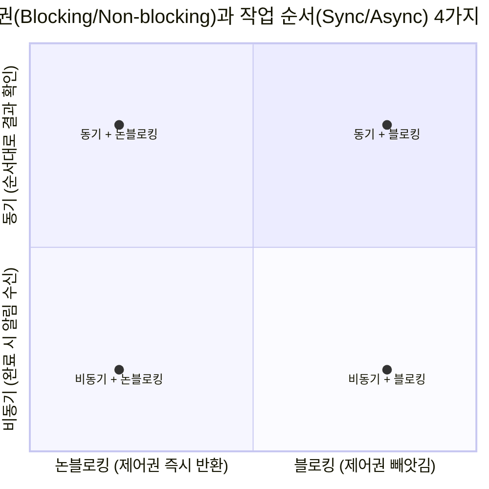
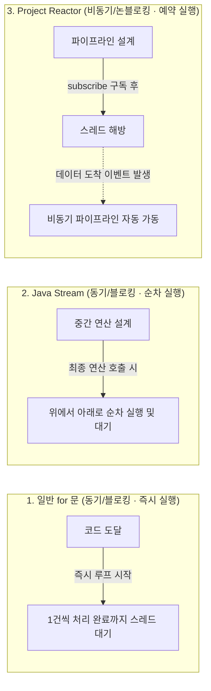
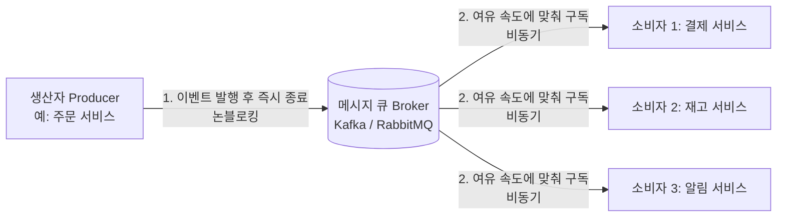
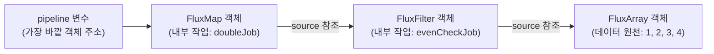

# 비동기·논블로킹 아키텍처와 Project Reactor (`Mono` / `Flux`) 완벽 가이드

이 문서는 **블로킹/논블로킹과 동기/비동기의 명확한 개념 구분**에서 출발하여, **메시지 큐(MQ)와 MSA 아키텍처의 비동기 통신**, 그리고 **Java 애플리케이션 내부에서 비동기 데이터 파이프라인을 구축하는 Project Reactor(`Mono`와 `Flux`)의 메모리 내 동작 실체와 실전 코드**까지 체계적으로 정리한 가이드입니다.

---

## 1. 블로킹/논블로킹 vs. 동기/비동기 완벽 이해

실무에서 가장 많이 혼동하는 두 개념은 **관점(축) 자체가 완전히 다릅니다.**

* **블로킹(Blocking) vs. 논블로킹(Non-blocking)** ➔ **제어권(행동)의 관점**: 내가 다른 작업에 일을 시켰을 때 **내 스레드(몸)가 멈춰서 기다리는가, 아니면 바로 내 할 일을 계속하는가?**
* **동기(Synchronous) vs. 비동기(Asynchronous)** ➔ **작업 완료와 순서(결과)의 관점**: 일을 시킨 쪽이 상대방의 **작업 완료 여부를 직접 챙겨서 순서대로 처리하는가, 아니면 완료 시점에 알림(이벤트/콜백)으로 전달받는가?**

### 1.1 4가지 조합 한눈에 보기 (카페 주문 비유)



| 조합 | 동작 방식 | 일상 비유 (카페 주문) | 실무 활용도 |
| :--- | :--- | :--- | :--- |
| **동기 + 블로킹** | 제어권을 넘긴 채 작업이 끝날 때까지 대기하고, 결과를 직접 받아 다음 단계 실행 | 카운터 앞에서 커피가 나올 때까지 **아무것도 안 하고 서서 기다린 뒤** 받아옴 | 전통적인 JDBC, 일반 `for` 문, Spring MVC 기본 구조 |
| **비동기 + 논블로킹** | 일을 시키자마자 내 할 일을 계속하고, 작업 완료 이벤트가 오면 그때 결과 처리 | **진동벨**을 받고 자리에 앉아 책을 읽다가, 벨이 울리면 커피를 가져옴 | **Project Reactor (WebFlux)**, Node.js, 대규모 트래픽 서버 |
| **동기 + 논블로킹** | 내 할 일을 계속하지만, 작업이 끝났는지 틈틈이 계속 물어보며 결과를 직접 챙김 | 자리에 앉아 책을 읽으면서 **1분마다 카운터에 가서 "커피 나왔나요?" 물어봄** | 게임 루프, 폴링(Polling) 방식 상태 체크 |
| **비동기 + 블로킹** | 완료 알림을 받기로 해놓고 정작 아무것도 안 하고 그 자리에서 멈춰 기다림 | 진동벨을 받아놓고 자리에 가지 않은 채 **카운터 앞에서 벨 울릴 때까지 서 있음** | 비효율적 안티 패턴 (예: `Flux` 작성 후 `.block()` 호출) |

---

## 2. Java 코드 실행 방식 3단계 비교

같은 데이터 처리 로직이라도 어떤 도구를 쓰느냐에 따라 **실행 시점**과 **스레드 점유 방식**이 달라집니다.



1. **동기 / 블로킹 (즉시 실행) — 일반 `for` 반복문**
   * 코드 라인에 도달하는 순간 **즉시** 루프를 실행합니다.
   * 모든 반복이 끝날 때까지 호출한 스레드가 다음 줄로 넘어가지 못하고 묶여 있습니다.
2. **동기 / 블로킹 (위에서 아래로 순차 실행) — 표준 Java Stream API**
   * `.filter()`, `.map()` 작성 시점에는 실행하지 않고 **설계도(파이프라인)** 만 만듭니다(게으른 연산).
   * `.toList()` 같은 **최종 연산**을 만나는 순간 위에서 아래로 파이프라인을 가동하며, 완료될 때까지 스레드가 대기합니다.
3. **비동기 / 논블로킹 (이벤트 기반 예약 실행) — Project Reactor (`Flux` / `Mono`)**
   * `.subscribe()` 호출 시 **"데이터가 도착하면 이 로직을 실행해 줘"라고 예약**만 걸어두고 스레드는 즉시 다른 일을 하러 떠납니다.
   * 나중에 네트워크나 DB에서 데이터가 도착하는 **이벤트**가 발생하면 그때 예약된 파이프라인이 비동기적으로 작동합니다.

---

## 3. 서버 간 비동기 통신: 메시지 큐(MQ)와 MSA

애플리케이션 내부의 비동기 처리를 담당하는 것이 Project Reactor라면, **서로 다른 마이크로서비스(서버) 간의 비동기·논블로킹 통신**을 실현하는 핵심 인프라는 **메시지 큐(Message Queue, MQ)** 입니다.

### 3.1 메시지 큐(MQ) 동작 구조



### 3.2 실무 메시지 큐(MQ) 대표 사용 사례 4가지
1. **시간 지연 부가 작업 분리**: 회원가입 완료 시 DB 저장 후 `회원가입 완료` 메시지만 MQ에 넣고 사용자에게 즉시 응답합니다. 이메일 발송, 쿠폰 발급, 포인트 적립은 소비자들이 백그라운드에서 처리합니다.
2. **트래픽 폭주 방어 (버퍼링)**: 티켓팅이나 선착순 이벤트 시 수십만 건의 요청을 앞단 MQ가 댐(Buffer)처럼 받아두고, 뒷단 서버는 감당 가능한 속도(예: 초당 1,000건)만큼만 꺼내 안정적으로 처리합니다.
3. **대용량 데이터 스트리밍**: 쇼핑몰 클릭 로그나 결제 이벤트를 Apache Kafka로 실시간 수집하여 AI 추천 엔진 및 분석 시스템으로 전달합니다.
4. **장애 격리 및 데이터 유실 방지**: 알림톡 서버가 점검 중이더라도 메시지는 MQ 안에 안전하게 보관되어 있다가, 서버 복구 즉시 다시 꺼내어 발송합니다.

### 3.3 MSA(마이크로서비스 아키텍처)에서의 핵심 활용법
* **서비스 간 결합도 낮추기 (Decoupling)**: 주문 서비스가 결제·재고·알림 서비스를 직접 HTTP 호출하지 않고 `OrderCreated` 이벤트만 발행합니다. 추후 통계 서비스가 추가되어도 주문 서비스 코드는 수정할 필요가 없습니다.
* **분산 트랜잭션 처리 (Saga 패턴)**: 물리적으로 분리된 DB 환경에서 `결제 완료` 후 `재고 부족`이 발생하면, 재고 서비스가 `재고 부족 실패` 이벤트를 MQ로 발행해 결제 서비스가 자동으로 결제를 취소(보상 트랜잭션)하도록 만듭니다.
* **데이터 동기화 (CQRS)**: 각 서비스의 데이터 변경 이벤트를 구독하여 마이페이지 전용 조회 DB에 미리 조합된 데이터를 실시간 복제해 두어 조회 속도를 극대화합니다.

---

## 4. 애플리케이션 내부 비동기 엔진: Project Reactor

Project Reactor는 **외부 API 호출, R2DBC(비동기 DB), MQ 연동 등 I/O 대기 시간이 긴 작업을 적은 스레드로 수만 건씩 동시에 처리**하기 위해 탄생한 리액티브 라이브러리입니다.

### 4.1 Project Reactor를 만든 4가지 결정적 이유
1. **단건(`Mono`)과 다건(`Flux`)의 명확한 스트림 처리**: 기존 `CompletableFuture<List<T>>`는 데이터가 다 모일 때까지 기다려야 했지만, `Flux`는 **도착하는 1건씩 즉시 스트림에 태워 실시간으로 전송**할 수 있습니다.
2. **콜백 지옥 해결**: 복잡한 비동기 작업 연쇄를 Java Stream과 똑같은 **선언형 메서드 체이닝(`.filter()`, `.map()`, `.flatMap()`)** 으로 깔끔하게 작성할 수 있습니다.
3. **배압(Backpressure) 조절 기능**: 데이터 생산자가 1초에 10,000건을 쏘더라도 소비자가 감당할 수 있는 만큼만("일단 100개만 보내줘") 요청하여 **서버 메모리 폭발(OOM)을 방지**합니다.
4. **일관된 비동기 에러 복구**: 다른 스레드에서 발생한 예외도 `.onErrorReturn()`, `.onErrorResume()`, `.retry()` 연산자로 파이프라인 내부에서 우아하게 복구합니다.

### 4.2 왜 `Flux` 하나로 통일하지 않고 `Mono`를 따로 만들었을까?
기술적으로 `Flux`(0~N개)가 `Mono`(0~1개)를 포함하지만, 다음 4가지 실무적 이점 때문에 철저히 분리했습니다. (일반 자바에서 `List<User>` 외에 `Optional<User>`를 쓰는 것과 같은 이유입니다.)

| 구분 | `Mono<T>` (0 ~ 1개 데이터) | `Flux<T>` (0 ~ N개 데이터) |
| :--- | :--- | :--- |
| **API 명세(계약)** | 호출하는 개발자가 **"결과가 최대 1개뿐"** 임을 즉시 확신 | 호출하는 개발자가 **"여러 건이 스트리밍될 수 있음"** 을 인지 |
| **전용 핵심 연산자** | `Mono.zip()`(단건 병합), `.defaultIfEmpty()` 등 단건 최적화 | `buffer()`, `window()`, `groupBy()`, `collectList()` 등 다건 제어 |
| **HTTP 응답 매핑** | 단일 JSON 객체 `{ "id": 1 }` 로 자동 변환 | JSON 배열 `[ {...}, {...} ]` 또는 SSE 실시간 스트림 변환 |
| **내부 성능 최적화** | 다중 버퍼링과 배압 루프를 생략한 **초경량 실행 경로** 사용 | 다중 신호 추적 및 배압 상태 관리를 포함한 스트리밍 엔진 사용 |

---

## 5. [심화 이해] "예약된 파이프라인"의 실제 메모리 정체 (람다 걷어내기)

"파이프라인을 예약한다"는 표현이 추상적으로 느껴지는 이유는 **람다식(`->`)** 으로 코드가 압축되어 있기 때문입니다. 람다식을 벗겨내고 평범한 자바 객체로 풀어보면 **JVM 메모리(Heap)에 조립된 객체 사슬**이라는 물리적 실체가 명확히 보입니다.

### 5.1 람다식 제거: 사실은 평범한 '작업 지시서(객체)' 조립입니다
람다식 `n -> n * 2`는 마법이 아니라, **"나중에 데이터가 오면 실행할 메서드 1개짜리 객체"** 를 짧게 줄여 쓴 문법입니다.

```java
// 람다식 버전 (축약되어 내부가 안 보임)
Flux<Integer> pipeline = Flux.just(1, 2, 3, 4)
    .filter(n -> n % 2 == 0)
    .map(n -> n * 2);

// 람다 제거 버전 (컴파일러가 실제로 만드는 100% 동일한 평범한 자바 객체 코드)
Predicate<Integer> evenCheckJob = new Predicate<Integer>() {
    @Override
    public boolean test(Integer n) {
        return n % 2 == 0; // 1번 작업 지시서
    }
};

Function<Integer, Integer> doubleJob = new Function<Integer, Integer>() {
    @Override
    public Integer apply(Integer n) {
        return n * 2;      // 2번 작업 지시서
    }
};

// 작업 지시서 객체를 부품으로 끼워 넣어 기계(객체 사슬)를 조립함 (아직 전원 꺼짐!)
Flux<Integer> pipeline = Flux.just(1, 2, 3, 4)
    .filter(evenCheckJob)
    .map(doubleJob);
```

### 5.2 메모리 내부 구조: 양파 껍질(데코레이터) 객체 사슬
위 코드가 실행되면 메모리 힙(Heap)에는 앞 단계 기계를 품고 있는 **포장지 객체들**이 줄줄이 연결되어 대기합니다.



* **조립 시점 (`.subscribe()` 호출 전)**: 메모리에는 작업 지시서를 품은 기계(`FluxMap` -> `FluxFilter` -> `FluxArray`)만 조립되어 서 있을 뿐, **전원 버튼이 꺼져 있어 아무 연산도 실행되지 않습니다.**
* **실행 시점 (`.subscribe()` 호출 후)**: 스위치가 켜지면서 바깥쪽에서 안쪽으로 구독자(`Subscriber`)가 전달됩니다. 이후 DB나 네트워크에서 데이터가 도착하면 `evenCheckJob.test()` ➔ `doubleJob.apply()`가 연쇄적으로 호출됩니다.

---

## 6. `Mono` vs. `Flux` 실전 샘플 코드

### 6.1 `Mono` 샘플: 단건 조회, 빈 값 대체 및 동시 API 결합
회원 정보(0.5초)와 포인트 잔액(0.5초)을 **동시에(병렬) 비동기 요청**하여 총 0.5초 만에 마이페이지 요약을 조립하는 코드입니다.

```java
import reactor.core.publisher.Mono;
import java.time.Duration;

public class MonoSample {

    public static void main(String[] args) throws InterruptedException {
        Long userId = 100L;

        // 1. 회원 정보 단건 비동기 조회 (없으면 기본값으로 즉시 대체)
        Mono<String> userMono = findUserNameById(userId)
            .defaultIfEmpty("비회원(Guest)");

        // 2. 포인트 잔액 단건 비동기 조회 (API 장애 시 0원으로 안전 복구)
        Mono<Integer> pointMono = fetchUserPoint(userId)
            .onErrorReturn(0);

        // 3. 두 개의 단건 작업(Mono)을 동시에 실행 후 하나의 결과로 조립
        Mono<String> profileSummaryMono = Mono.zip(userMono, pointMono)
            .map(tuple -> String.format(
                "[마이페이지] %s님의 보유 포인트는 %,d원입니다.",
                tuple.getT1(), tuple.getT2()
            ));

        // 4. 구독(전원 켜기) 및 결과 출력
        profileSummaryMono.subscribe(System.out::println);

        // 비동기 스레드 작업 완료 대기 (실제 WebFlux 서버에서는 불필요)
        Thread.sleep(1000);
    }

    private static Mono<String> findUserNameById(Long id) {
        return Mono.just("홍길동").delayElement(Duration.ofMillis(500));
    }

    private static Mono<Integer> fetchUserPoint(Long id) {
        return Mono.just(15000).delayElement(Duration.ofMillis(500));
    }
}
```

### 6.2 `Flux` 샘플: 다건 실시간 스트리밍 및 가공 파이프라인
여러 건의 주문 데이터가 시간차를 두고 유입될 때, **전체가 모일 때까지 기다리지 않고 조건에 맞는 건부터 즉시 처리해 흘려보내는** 코드입니다.

```java
import reactor.core.publisher.Flux;
import java.time.Duration;

public class FluxSample {

    record Order(String itemName, int price, boolean isCanceled) {}

    public static void main(String[] args) throws InterruptedException {
        // 1. 0.3초 간격으로 주문 데이터가 1건씩 들어오는 실시간 다건 스트림
        Flux<Order> orderStream = Flux.just(
                new Order("키보드", 120000, false),
                new Order("마우스", 45000, true),   // 취소된 주문
                new Order("모니터", 350000, false),
                new Order("웹캠", 80000, false)
            )
            .delayElements(Duration.ofMillis(300));

        // 2. 도착하는 순서대로 1건씩 필터링·변환 후 즉시 소비
        orderStream
            .filter(order -> !order.isCanceled())       // 취소 건 제외
            .filter(order -> order.price() >= 100000)   // 10만 원 이상 고액 결제만 통과
            .map(order -> String.format(
                "[VIP 알림] '%s' 상품 결제 완료 (%,d원)",
                order.itemName(), order.price()
            ))
            .subscribe(System.out::println);            // 통과 즉시 1건씩 출력

        Thread.sleep(2000);
    }
}
```

---

## 7. 실무 필수 연산자 & 주의사항 치트시트

### 7.1 자주 쓰는 핵심 연산자 요약

| 연산자 | 역할 | 비유 및 실무 활용처 |
| :--- | :--- | :--- |
| **`.map()`** | 동기적 1:1 데이터 변환 | 도착한 엔티티(`Order`)를 응답 객체(`OrderDto`)로 단순 변환할 때 |
| **`.flatMap()`** | 비동기 작업(`Mono`/`Flux`) 연결 | 조회된 회원 ID를 가지고 **다시 비동기 DB/API를 호출**해야 할 때 (가장 중요) |
| **`Mono.zip()`** | 여러 비동기 작업을 동시에 실행 후 결합 | 회원 정보 + 주문 내역 + 포인트를 **병렬 호출**해 한 화면으로 묶을 때 |
| **`.switchIfEmpty()`** | 데이터가 비어있을 때 다른 비동기 로직 실행 | 캐시(Redis)에 데이터가 없을 때 **DB 조회(`Mono`)로 대체**할 때 |
| **`.onErrorResume()`** | 에러 발생 시 대체 비동기 스트림으로 복구 | 외부 추천 서버 장애 시 **기본 인기 상품 목록(`Flux`)을 반환**할 때 |

### 7.2 실무 도입 시 절대 주의사항 (3가지)
1. **운영 코드에서 `.block()` 금지**: WebFlux 이벤트 루프 스레드에서 `.block()`을 호출하면 논블로킹의 장점이 모두 사라지며 스레드 고갈(Deadlock)로 서버가 멈출 수 있습니다. `.block()`은 오직 단위 테스트 코드에서만 사용하세요.
2. **블로킹 I/O 섞어 쓰기 금지**: WebFlux 파이프라인 내부에 일반 JDBC(JPA), `RestTemplate`, `Thread.sleep()` 같은 블로킹 코드를 넣으면 전체 성능이 급락합니다. 반드시 **R2DBC, WebClient** 같은 논블로킹 드라이버를 함께 사용해야 합니다.
3. **구독(`.subscribe()`) 없이는 아무 일도 일어나지 않음**: `Mono`와 `Flux`는 조립만 해둔 파이프라인 기계일 뿐입니다. 마지막에 `.subscribe()`를 호출하거나 Spring WebFlux 컨트롤러에서 반환해야 전원이 켜지고 데이터가 흐르기 시작합니다.
