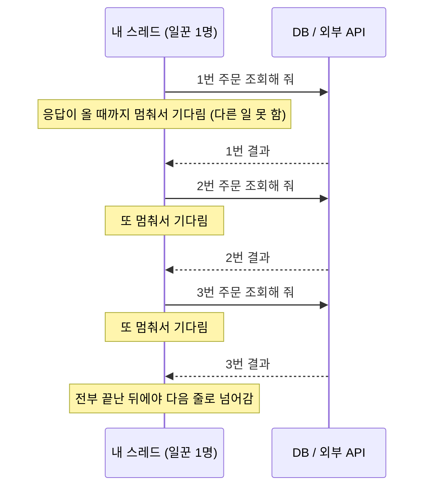
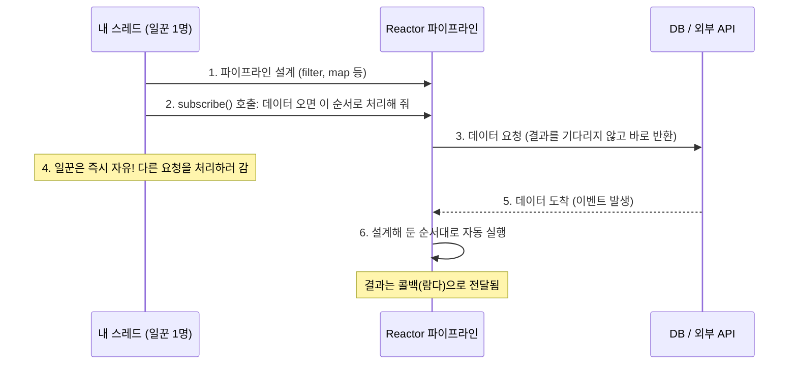
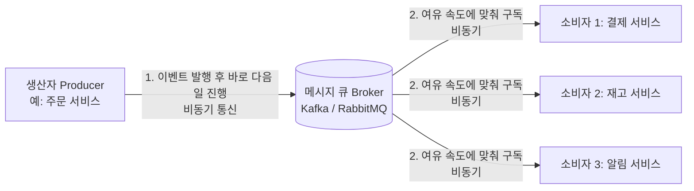
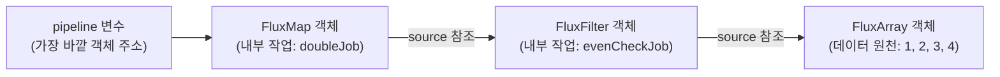
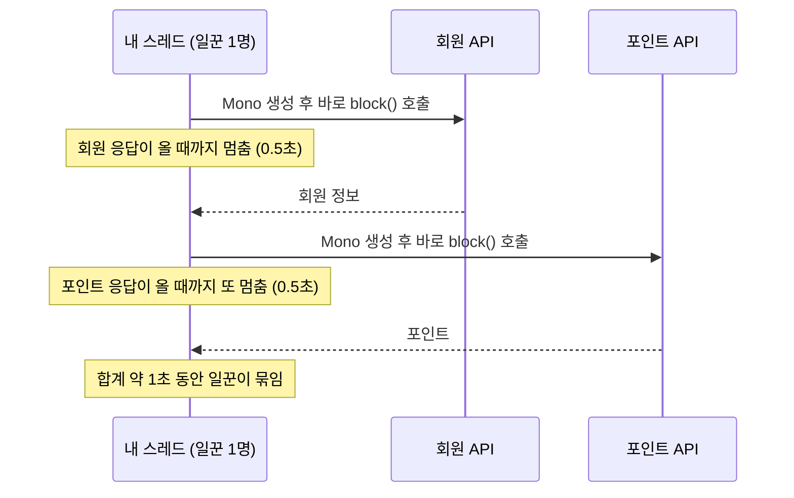
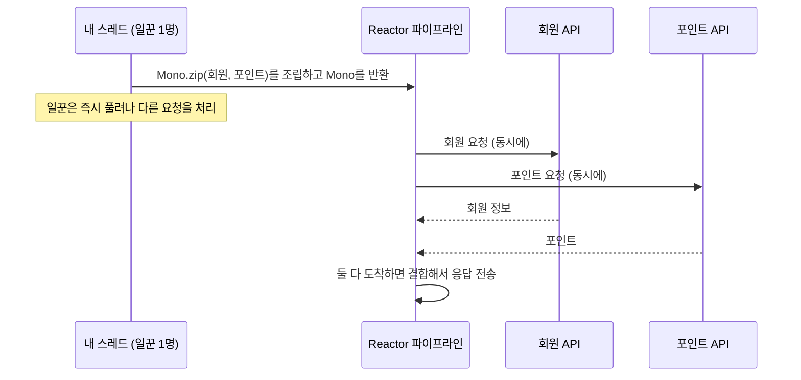
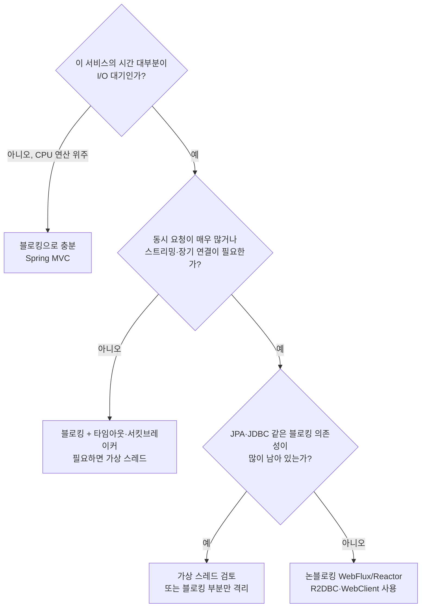

# 비동기·논블로킹 아키텍처와 Project Reactor (`Mono` / `Flux`) 완벽 가이드

이 문서는 **블로킹/논블로킹과 동기/비동기를 쉬운 말로 구분하는 데서 출발**하여, **메시지 큐(MQ)와 MSA의 서버 간 비동기 통신**, 그리고 **Java 애플리케이션 안에서 비동기 데이터 파이프라인을 만드는 Project Reactor(`Mono`와 `Flux`)의 메모리 내 동작과 실전 코드**까지 정리한 가이드입니다.

처음 읽는다면 1장과 2장만 먼저 읽어도 나머지 장의 전제가 잡힙니다.

---

## 1. 블로킹/논블로킹 vs. 동기/비동기 완벽 이해

두 용어가 헷갈리는 이유는 **서로 다른 질문에 대한 답**이기 때문입니다. 한 세트로 외우지 말고, 질문 두 개를 따로 던져 보세요.

**질문 ① (블로킹/논블로킹): "일을 맡기고 나서, 나는 그 자리에 멈춰 서서 기다리는가?"**

* **블로킹(Blocking)**: 멈춰 서서 기다립니다. 기다리는 동안 나(스레드)는 다른 일을 못 합니다.
* **논블로킹(Non-blocking)**: 맡기자마자 바로 내 할 일을 계속합니다.

**질문 ② (동기/비동기): "일이 끝났는지를 누가 챙기는가?"**

* **동기(Synchronous)**: 내가 직접 챙깁니다. 끝났는지 확인하고, 결과를 내 손으로 받아 다음 단계를 진행합니다.
* **비동기(Asynchronous)**: 상대가 끝나면 알려 줍니다(콜백·이벤트). 나는 알림이 올 때 결과를 받습니다.

한 줄로 줄이면 **블로킹은 "내 몸(스레드)이 묶이는가", 동기는 "결과를 내가 쫓아다니는가"** 입니다. 두 질문의 답은 서로 독립이라서 네 가지 조합이 모두 존재합니다.

> 용어 하나만 짚고 갑니다. **스레드**는 우리 코드를 위에서 아래로 실행하는 "일꾼 한 명"이라고 생각하면 됩니다. 이 일꾼이 멈춰 있는 동안에는 다른 요청을 처리하지 못합니다.

### 1.1 4가지 조합 한눈에 보기 (카페 주문 비유)

| 조합 | 내 스레드(몸) | 결과는 누가 챙기나 | 카페 주문 비유 | 실무 예 |
| :--- | :--- | :--- | :--- | :--- |
| **동기 + 블로킹** | 멈춰서 기다림 | 내가 직접 받음 | 카운터 앞에 서서 커피가 나올 때까지 **아무것도 안 하고 기다렸다가** 받아 감 | JDBC 조회, Spring MVC + `RestTemplate` 호출 |
| **동기 + 논블로킹** | 안 멈추고 내 일 계속 | 내가 틈틈이 직접 확인 | 자리에서 책을 읽다가 **1분마다 카운터에 가서 "커피 나왔나요?"** 하고 물어봄 | 폴링(Polling): 논블로킹 소켓을 `while` 루프로 계속 읽어 보기, 작업 상태 API를 주기적으로 호출 |
| **비동기 + 블로킹** | 멈춰서 기다림 | 완료 알림으로 받음 | 진동벨을 받아 놓고도 **카운터 앞에 서서 벨이 울릴 때까지** 그냥 서 있음 | 비동기로 만든 뒤 `.block()`으로 결과를 기다리는 코드 (비동기의 장점이 사라지는 안티 패턴, **별첨 A 참고**) |
| **비동기 + 논블로킹** | 안 멈추고 내 일 계속 | 완료 알림으로 받음 | **진동벨**을 받고 자리에서 책을 읽다가, 벨이 울리면 커피를 가져옴 | **Project Reactor(WebFlux)**, Node.js |

실무에서 가장 자주 만나는 것은 **동기 + 블로킹**(전통적 방식)과 **비동기 + 논블로킹**(Reactor/WebFlux 방식) 두 가지입니다. 나머지 두 가지는 두 질문이 독립이라는 점을 확인하는 용도로 보면 충분합니다.

---

## 2. Java 코드 실행 방식 3가지 비교

같은 일, 예를 들어 **"주문 3건을 하나씩 DB에서 조회해서 가공하기"** 를 세 가지 도구로 작성해 보면 달라지는 것은 딱 두 가지입니다.

1. **언제 시작하는가?** (코드에 도달하는 즉시 / 마지막 한 줄에서 / 데이터가 도착했을 때)
2. **일을 맡긴 뒤 내 스레드가 어떻게 되는가?** (끝날 때까지 묶인다 / 바로 풀려난다)

### 2.1 먼저 비유로 이해하기: 일꾼 1명과 주방

스레드를 **주방에 있는 일꾼 한 명**이라고 해 보겠습니다. 일꾼이 주방에 묶여 있으면 그동안 다른 손님(다른 요청)을 받을 수 없습니다.

| 방식 | 주방 비유 | 언제 시작하나 | 일꾼(스레드)은? |
| :--- | :--- | :--- | :--- |
| **① 일반 `for` 문** | 일꾼이 주문서를 받자마자 **직접 요리를 시작**합니다. 주문 3건을 하나씩 만들고, 다 끝날 때까지 주방을 못 떠납니다. | 코드 줄에 도달하는 **즉시** | 끝날 때까지 **묶임** |
| **② Java Stream** | 일꾼이 먼저 **조리 순서표**만 씁니다(`.filter()`, `.map()`). 이때는 요리를 하나도 안 합니다. 마지막에 "자, 결과 내놔"(`.toList()`)라고 하는 순간 요리를 시작하고, 그다음부터는 ①과 똑같이 끝날 때까지 주방에 묶입니다. | **최종 연산**을 만나는 순간 | 시작한 뒤 끝날 때까지 **묶임** |
| **③ Project Reactor** | 일꾼이 조리 순서표를 써서 접수대에 제출하며 **"재료가 도착하면 이 순서대로 처리해 주세요"**(`.subscribe()`)라고 맡기고, **바로 다른 손님을 응대**하러 갑니다. 재료가 도착하면 그때 알림을 받아 처리됩니다. | `.subscribe()` 이후, **데이터가 도착할 때마다** | 맡기자마자 **풀려남** |

### 2.2 도식으로 보기: 일꾼(스레드)이 무엇을 하고 있는가

**그림 A. ① `for` 문과 ② Stream: 건마다 응답을 기다리며 멈춘다 (동기 + 블로킹)**



**그림 B. ③ Project Reactor: 맡겨 놓고 바로 풀려난다 (비동기 + 논블로킹)**



**그림을 읽는 법**

* 세로 방향이 시간이 흐르는 순서입니다. 위에서 아래로 읽습니다.
* 그림 A에서는 일꾼이 건마다 "응답이 올 때까지 멈춰서 기다림" 구간에 갇혀 있습니다. 이 구간이 **블로킹**입니다.
* 그림 B에서는 일꾼이 3번 단계에서 요청만 걸어 두고 바로 풀려납니다. 데이터는 한참 뒤 5번 단계에서 **이벤트**로 도착하고, 그때 설계해 둔 파이프라인이 실행됩니다. 이 구조가 **비동기 + 논블로킹**입니다.

### 2.3 한눈에 비교

| 방식 | 언제 실행되나 | 결과는 어떻게 받나 | 일꾼(스레드)은 | 분류 |
| :--- | :--- | :--- | :--- | :--- |
| ① 일반 `for` 문 | 코드 줄에 도달하는 즉시 | 반환값을 내가 바로 받음 | 끝날 때까지 묶임 | 동기 + 블로킹 |
| ② Java Stream | 최종 연산(`.toList()` 등)을 만나는 순간 | 최종 연산의 반환값을 내가 받음 | 끝날 때까지 묶임 | 동기 + 블로킹 |
| ③ Project Reactor | `.subscribe()` 이후 데이터가 도착할 때 | 콜백(람다)으로 도착 시 전달받음 | 맡기자마자 풀려남 | 비동기 + 논블로킹 |

### 2.4 자주 헷갈리는 3가지

**① `for` 문과 Stream의 차이는 "동기/비동기"가 아니라 "언제 시작하느냐"입니다.**
둘 다 호출한 스레드가 끝날 때까지 일을 하므로 모두 동기입니다. Stream은 `.filter()`, `.map()`을 쓰는 시점에는 설계도만 만들고(**게으른 연산**), 최종 연산에서 비로소 시작한다는 점만 다릅니다. 시작하면 요소 1건이 `filter`와 `map`을 모두 통과한 뒤 다음 요소로 넘어갑니다.

**② "블로킹"은 원래 "응답을 기다리며 멈춰 있음"이라는 뜻입니다.**
메모리 안의 숫자 목록을 도는 `for` 문은 멈춘 것이 아니라 **바쁘게 계산하는 중**입니다. 반복마다 DB나 외부 API를 호출해 응답을 기다릴 때 비로소 진짜 블로킹이 됩니다. 그래서 그림 A는 "반복마다 DB 호출"이라는 상황으로 그렸습니다.

**③ Reactor는 `.subscribe()`만 한다고 저절로 다른 스레드에서 도는 것이 아닙니다.**
데이터가 이미 메모리에 있으면 호출한 스레드에서 그 자리에서 끝납니다. 일꾼이 풀려나는 것은 **데이터가 나중에 도착하는 진짜 비동기 소스**(네트워크, R2DBC, 타이머)를 만났을 때입니다.

```java
// 데이터가 이미 메모리에 있는 경우: 호출한 스레드(main)에서 그 자리에서 끝난다
Flux.just(1, 2, 3)
    .map(n -> n * 2)
    .subscribe(n -> System.out.println(Thread.currentThread().getName() + " : " + n));
System.out.println("subscribe 다음 줄");
// 출력: main : 2 → main : 4 → main : 6 → subscribe 다음 줄

// 데이터가 '나중에' 도착하는 경우: 다음 줄이 먼저 실행되고, 처리는 다른 스레드에서 일어난다
Flux.just(1, 2, 3)
    .delayElements(Duration.ofMillis(100))
    .subscribe(n -> System.out.println(Thread.currentThread().getName() + " : " + n));
System.out.println("subscribe 다음 줄");
Thread.sleep(500); // main이 먼저 끝나 JVM이 종료되는 것을 막기 위한 대기
// 출력: subscribe 다음 줄 → parallel-1 : 1 → parallel-1 : 2 → parallel-1 : 3
//       (스레드 이름은 환경에 따라 다를 수 있음)
```

정리하면 **"Reactor는 비동기/논블로킹"** 이라는 말은 정확히는 **"Reactor가 진짜 비동기 소스와 만났을 때 스레드를 붙잡지 않는다"** 는 뜻입니다. 이 문서의 나머지 장도 이 전제 위에서 읽어 주세요.

---

## 3. 서버 간 비동기 통신: 메시지 큐(MQ)와 MSA

애플리케이션 내부의 비동기 처리를 담당하는 것이 Project Reactor라면, **서로 다른 마이크로서비스(서버) 간의 비동기 통신**을 실현하는 핵심 인프라는 **메시지 큐(Message Queue, MQ)** 입니다. MQ가 주는 것은 서비스 사이의 **시간적 분리**(보내는 쪽과 받는 쪽이 동시에 살아 있지 않아도 됨)이고, 각 서비스 내부에서 스레드를 논블로킹으로 쓰는 문제는 Reactor 같은 도구가 별개로 담당합니다.

### 3.1 메시지 큐(MQ) 동작 구조



### 3.2 실무 메시지 큐(MQ) 대표 사용 사례 4가지

1. **시간 지연 부가 작업 분리**: 회원가입 완료 시 DB 저장 후 `회원가입 완료` 메시지만 MQ에 넣고 사용자에게 즉시 응답합니다. 이메일 발송, 쿠폰 발급, 포인트 적립은 소비자들이 백그라운드에서 처리합니다.
2. **트래픽 폭주 방어 (버퍼링)**: 티켓팅이나 선착순 이벤트 시 수십만 건의 요청을 앞단 MQ가 댐(Buffer)처럼 받아 두고, 뒷단 서버는 감당 가능한 속도(예: 초당 1,000건)만큼만 꺼내 안정적으로 처리합니다. 이 경우 사용자에게는 결과 대신 "접수됨/대기 중" 응답을 먼저 주는 설계가 일반적입니다.
3. **대용량 데이터 스트리밍**: 쇼핑몰 클릭 로그나 결제 이벤트를 Apache Kafka로 실시간 수집하여 AI 추천 엔진 및 분석 시스템으로 전달합니다.
4. **장애 격리 및 데이터 유실 방지**: 알림톡 서버가 점검 중이더라도 메시지는 MQ 안에 보관되어 있다가, 서버 복구 즉시 다시 꺼내어 발송합니다. (메시지 영속화와 복제가 설정되어 있다는 전제입니다.)

### 3.3 MSA(마이크로서비스 아키텍처)에서의 핵심 활용법

* **서비스 간 결합도 낮추기 (Decoupling)**: 주문 서비스가 결제·재고·알림 서비스를 직접 HTTP 호출하지 않고 `OrderCreated` 이벤트만 발행합니다. 추후 통계 서비스가 추가되어도 주문 서비스 코드는 수정할 필요가 없습니다.
* **분산 트랜잭션 처리 (Saga 패턴)**: 물리적으로 분리된 DB 환경에서 `결제 완료` 후 `재고 부족`이 발생하면, 재고 서비스가 `재고 부족 실패` 이벤트를 MQ로 발행해 결제 서비스가 자동으로 결제를 취소(보상 트랜잭션)하도록 만듭니다.
* **데이터 동기화 (CQRS)**: 각 서비스의 데이터 변경 이벤트를 구독하여 마이페이지 전용 조회 DB에 미리 조합된 데이터를 실시간 복제해 두어 조회 속도를 극대화합니다.

---

## 4. 애플리케이션 내부 비동기 엔진: Project Reactor

Project Reactor는 **외부 API 호출, R2DBC(비동기 DB), MQ 연동처럼 I/O 대기 시간이 긴 작업을 적은 스레드로 많이 동시에 처리**하기 위해 만들어진 리액티브 라이브러리입니다. 스레드가 응답을 기다리며 놀지 않고, 데이터가 도착했을 때만 일하게 만드는 것이 핵심입니다.

### 4.1 Project Reactor를 만든 4가지 결정적 이유

1. **단건(`Mono`)과 다건(`Flux`)을 구분한 스트림 처리**: 기존 `CompletableFuture<List<T>>`는 목록이 다 모일 때까지 기다려야 했지만, `Flux`는 **도착하는 대로 1건씩 바로 흘려보내** 실시간 전송할 수 있습니다.
2. **콜백 지옥 해결**: 복잡한 비동기 작업 연쇄를 Java Stream과 비슷한 **선언형 메서드 체이닝(`.filter()`, `.map()`, `.flatMap()`)** 으로 깔끔하게 작성합니다.
3. **배압(Backpressure) 조절**: 생산자가 데이터를 아무리 빠르게 만들어도, 소비자가 "일단 100개만 보내줘"처럼 **감당할 수 있는 만큼만 요청**해 서버 메모리 폭발(OOM)을 막을 수 있습니다.
4. **일관된 비동기 에러 복구**: 다른 스레드에서 발생한 예외도 `.onErrorReturn()`, `.onErrorResume()`, `.retry()` 연산자로 파이프라인 안에서 처리합니다. (비동기 코드에서는 호출한 쪽의 `try-catch`로 예외를 잡을 수 없기 때문에 필요한 기능입니다.)

### 4.2 왜 `Flux` 하나로 통일하지 않고 `Mono`를 따로 만들었을까?

기술적으로는 `Flux`(0~N개)가 `Mono`(0~1개)를 포함할 수 있지만, 다음 4가지 실무적 이점 때문에 분리했습니다. 일반 자바에서 `List<User>` 외에 `Optional<User>`를 쓰는 것과 같은 이유입니다.

| 구분 | `Mono<T>` (0~1개 데이터) | `Flux<T>` (0~N개 데이터) |
| :--- | :--- | :--- |
| **API 명세(계약)** | 호출하는 개발자가 **"결과가 최대 1개"** 임을 바로 확신 | 호출하는 개발자가 **"여러 건이 스트리밍될 수 있음"** 을 인지 |
| **주로 쓰는 연산자** | 단건 결합·변환: `Mono.zip()`, `.flatMap()`, 다건으로 확장하는 `.flatMapMany()` | 다건 제어: `buffer()`, `window()`, `groupBy()`, `collectList()` |
| **HTTP 응답 매핑** | 단일 JSON 객체 `{ "id": 1 }` | JSON 배열 `[ {...}, {...} ]` 또는 SSE·NDJSON 같은 실시간 스트림 (응답 타입에 따라 다름) |
| **내부 성능 최적화** | 요소가 최대 1개라서 다건용 버퍼링·요청량 관리를 단순화한 가벼운 구현 사용 | 여러 신호 추적과 배압 상태 관리를 포함한 스트리밍 구현 사용 |

`.defaultIfEmpty()`, `.switchIfEmpty()`, `.map()`, `.filter()` 같은 연산자는 `Mono`와 `Flux` 양쪽에 있습니다. 두 타입의 차이는 "연산자 목록"보다 **"데이터가 몇 개일 수 있는가라는 계약"** 에 있습니다.

---

## 5. [심화 이해] "예약된 파이프라인"의 실제 메모리 정체 (람다 걷어내기)

"파이프라인을 예약한다"는 표현이 추상적으로 느껴지는 이유는 **람다식(`->`)** 으로 코드가 압축되어 있기 때문입니다. 람다식을 벗겨내고 평범한 자바 객체로 풀어보면 **JVM 메모리(Heap)에 조립된 객체 사슬**이라는 물리적 실체가 보입니다.

### 5.1 람다식 제거: 사실은 평범한 '작업 지시서(객체)' 조립입니다

람다식 `n -> n * 2`는 마법이 아니라, **"나중에 데이터가 오면 실행할 메서드 1개짜리 객체"** 를 짧게 줄여 쓴 문법입니다. (실제 컴파일 결과는 익명 클래스가 아니라 `invokedynamic` 기반이지만, 개념과 동작은 아래 코드와 같습니다.)

```java
import java.util.function.Function;
import java.util.function.Predicate;
import reactor.core.publisher.Flux;

// (A) 람다식 버전 (축약되어 내부가 안 보임)
Flux<Integer> pipelineA = Flux.just(1, 2, 3, 4)
    .filter(n -> n % 2 == 0)
    .map(n -> n * 2);

// (B) 람다를 풀어 쓴 버전 (동작은 (A)와 같음)
Predicate<Integer> evenCheckJob = new Predicate<Integer>() {
    @Override
    public boolean test(Integer n) {
        return n % 2 == 0; // 1번 작업 지시서
    }
};

Function<Integer, Integer> doubleJob = new Function<Integer, Integer>() {
    @Override
    public Integer apply(Integer n) {
        return n * 2;      // 2번 작업 지시서
    }
};

// 작업 지시서 객체를 부품으로 끼워 넣어 기계(객체 사슬)를 조립함 (아직 전원 꺼짐!)
Flux<Integer> pipelineB = Flux.just(1, 2, 3, 4)
    .filter(evenCheckJob)
    .map(doubleJob);

// 둘 다 구독하면 같은 결과: 4, 8
```

### 5.2 메모리 내부 구조: 양파 껍질(데코레이터) 객체 사슬

위 코드가 실행되면 메모리 힙(Heap)에는 앞 단계 기계를 품고 있는 **포장지 객체들**이 줄줄이 연결되어 대기합니다.



실제 클래스 이름은 최적화 때문에 `FluxMapFuseable`, `FluxFilterFuseable`처럼 조금 다를 수 있지만 구조는 같습니다.

* **조립 시점 (`.subscribe()` 호출 전)**: 메모리에는 작업 지시서를 품은 기계(`FluxMap` → `FluxFilter` → `FluxArray`)만 조립되어 서 있을 뿐, **전원 버튼이 꺼져 있어 아무 연산도 실행되지 않습니다.**
* **실행 시점 (`.subscribe()` 호출 후)**: 스위치가 켜지면서 바깥쪽에서 안쪽으로 구독자(`Subscriber`)가 전달됩니다. 이후 데이터가 흘러나오면 `evenCheckJob.test()` → `doubleJob.apply()`가 연쇄적으로 호출됩니다.
* **데이터가 언제 오는가**: 위 예제처럼 데이터가 메모리에 이미 있는 `Flux.just(...)`는 구독하는 순간 **호출한 스레드에서 곧바로** 흘러나옵니다. DB나 네트워크처럼 데이터가 나중에 도착하는 소스일 때는 도착하는 시점에 같은 사슬이 실행됩니다(2.4장 참고).

---

## 6. `Mono` vs. `Flux` 실전 샘플 코드

실행 준비: `reactor-core` 의존성이 필요하고, 6.2의 `record` 문법 때문에 Java 16 이상이어야 합니다.

### 6.1 `Mono` 샘플: 단건 조회, 빈 값 대체 및 동시 API 결합

회원 정보(0.5초)와 포인트 잔액(0.5초)을 **동시에 비동기로 요청**해 약 0.5초 만에 마이페이지 요약을 조립합니다. `Mono.zip()`은 두 `Mono`를 한꺼번에 구독하므로, 합계 1초가 아니라 느린 쪽 시간(0.5초)만큼만 걸립니다.

```java
import reactor.core.publisher.Mono;
import java.time.Duration;

public class MonoSample {

    public static void main(String[] args) throws InterruptedException {
        Long userId = 100L;

        // 1. 회원 정보 단건 비동기 조회 (없으면 기본값으로 즉시 대체)
        Mono<String> userMono = findUserNameById(userId)
            .defaultIfEmpty("비회원(Guest)");

        // 2. 포인트 잔액 단건 비동기 조회 (API 장애 시 0원으로 안전 복구)
        Mono<Integer> pointMono = fetchUserPoint(userId)
            .onErrorReturn(0);

        // 3. 두 개의 단건 작업(Mono)을 동시에 실행 후 하나의 결과로 조립
        Mono<String> profileSummaryMono = Mono.zip(userMono, pointMono)
            .map(tuple -> String.format(
                "[마이페이지] %s님의 보유 포인트는 %,d원입니다.",
                tuple.getT1(), tuple.getT2()
            ));

        // 4. 구독(전원 켜기) 및 결과 출력
        profileSummaryMono.subscribe(System.out::println);

        // main 스레드가 먼저 끝나 JVM이 종료되는 것을 막기 위한 대기 (실제 WebFlux 서버에서는 불필요)
        Thread.sleep(1000);
    }

    private static Mono<String> findUserNameById(Long id) {
        return Mono.just("홍길동").delayElement(Duration.ofMillis(500));
    }

    private static Mono<Integer> fetchUserPoint(Long id) {
        return Mono.just(15000).delayElement(Duration.ofMillis(500));
    }
}
```

실행하면 약 0.5초 뒤에 다음 한 줄이 출력됩니다.

```text
[마이페이지] 홍길동님의 보유 포인트는 15,000원입니다.
```

### 6.2 `Flux` 샘플: 다건 실시간 스트리밍 및 가공 파이프라인

여러 건의 주문 데이터가 시간차를 두고 유입될 때, **전체가 모일 때까지 기다리지 않고 조건에 맞는 건부터 즉시 처리해 흘려보내는** 코드입니다.

```java
import reactor.core.publisher.Flux;
import java.time.Duration;

public class FluxSample {

    record Order(String itemName, int price, boolean isCanceled) {}

    public static void main(String[] args) throws InterruptedException {
        // 1. 0.3초 간격으로 주문 데이터가 1건씩 들어오는 실시간 다건 스트림
        Flux<Order> orderStream = Flux.just(
                new Order("키보드", 120000, false),
                new Order("마우스", 45000, true),   // 취소된 주문
                new Order("모니터", 350000, false),
                new Order("웹캠", 80000, false)
            )
            .delayElements(Duration.ofMillis(300));

        // 2. 도착하는 순서대로 1건씩 필터링·변환 후 즉시 소비
        orderStream
            .filter(order -> !order.isCanceled())       // 취소 건 제외
            .filter(order -> order.price() >= 100000)   // 10만 원 이상 고액 결제만 통과
            .map(order -> String.format(
                "[VIP 알림] '%s' 상품 결제 완료 (%,d원)",
                order.itemName(), order.price()
            ))
            .subscribe(System.out::println);            // 통과 즉시 1건씩 출력

        Thread.sleep(2000);
    }
}
```

주문이 0.3초 간격으로 도착하므로, 출력도 도착 시점마다 하나씩 나옵니다. 키보드는 전체 4건이 다 도착하기 전(0.3초)에 먼저 출력되고, 취소된 마우스와 8만 원짜리 웹캠은 필터에서 빠집니다.

```text
[VIP 알림] '키보드' 상품 결제 완료 (120,000원)   // 약 0.3초 후
[VIP 알림] '모니터' 상품 결제 완료 (350,000원)   // 약 0.9초 후
```

---

## 7. 실무 필수 연산자 & 주의사항 치트시트

### 7.1 자주 쓰는 핵심 연산자 요약

| 연산자 | 역할 | 실무 활용처 / 주의점 |
| :--- | :--- | :--- |
| **`.map()`** | 동기적 1:1 데이터 변환 | 도착한 엔티티(`Order`)를 응답 객체(`OrderDto`)로 단순 변환할 때 |
| **`.flatMap()`** | 요소마다 비동기 작업(`Mono`/`Flux`)을 실행하고 결과를 이어 붙임 | 조회된 회원 ID로 **다시 비동기 DB/API를 호출**해야 할 때 (가장 중요). 작업이 끝나는 순서대로 내보내므로 원래 순서가 바뀔 수 있어, 순서가 중요하면 `.concatMap()`을 씁니다 |
| **`Mono.zip()`** | 여러 비동기 작업을 동시에 구독하고, 모두 도착하면 하나로 결합 | 회원 정보 + 주문 내역 + 포인트를 **병렬 호출**해 한 화면으로 묶을 때 |
| **`.switchIfEmpty()`** | 데이터가 비어 있을 때 다른 비동기 로직으로 전환 | 캐시(Redis)에 데이터가 없을 때 **DB 조회(`Mono`)로 대체**할 때. 인자로 넘기는 코드는 파이프라인을 조립할 때 항상 실행되므로, 호출 자체에 비용이나 부작용이 있으면 `Mono.defer(() -> ...)`로 감쌉니다 |
| **`.onErrorResume()`** | 에러 발생 시 대체 비동기 스트림으로 복구 | 외부 추천 서버 장애 시 **기본 인기 상품 목록(`Flux`)을 반환**할 때 |

### 7.2 실무 도입 시 절대 주의사항 (3가지)

1. **운영 코드에서 `.block()` 금지** (자세한 설명은 별첨 A 참고): `.block()`은 비동기 결과를 기다렸다가 값으로 꺼내는 메서드라, 호출한 스레드가 멈추게 됩니다. WebFlux의 이벤트 루프 스레드에서 호출하면 Reactor가 `IllegalStateException`으로 막아 주고, 이를 우회해 부르더라도 소수의 이벤트 루프 스레드가 묶여 전체 응답이 느려지거나 멈춥니다. `.block()`은 `main()` 같은 프로그램 진입점이나 테스트 코드에서만 쓰고, 테스트에서는 `StepVerifier`를 우선 고려하세요.
2. **블로킹 I/O 섞어 쓰기 금지**: WebFlux 파이프라인 내부에 일반 JDBC(JPA), `RestTemplate`, `Thread.sleep()` 같은 블로킹 코드를 넣으면 전체 성능이 급락합니다. 반드시 **R2DBC, WebClient** 같은 논블로킹 드라이버를 함께 사용하세요. 부득이하게 블로킹 코드를 써야 한다면 `Mono.fromCallable(...).subscribeOn(Schedulers.boundedElastic())`처럼 별도 스레드 풀로 격리합니다.
3. **구독(`.subscribe()`) 없이는 아무 일도 일어나지 않음**: `Mono`와 `Flux`는 조립만 해 둔 파이프라인일 뿐입니다. 마지막에 `.subscribe()`를 호출하거나, Spring WebFlux 컨트롤러에서 반환해 프레임워크가 대신 구독하게 해야 데이터가 흐르기 시작합니다.

---

## 별첨 A. 안티 패턴 해부: "비동기로 만든 뒤 `.block()`으로 기다리기"

1장 표의 **비동기 + 블로킹** 행에 나온 바로 그 코드입니다. 실무에서 가장 흔하게 만들어지는 실수라서 따로 떼어 자세히 정리합니다.

### A-1. 한 줄 요약

**비동기 도구(`Mono`/`Flux`)로 일을 시켜 놓고, 곧바로 `.block()`으로 "끝날 때까지 한 발짝도 안 움직일래" 하는 코드**입니다. 카페에서 진동벨을 받아 놓고도 카운터 앞에 서 있는 것과 같습니다. 비동기의 장점(적은 스레드로 많은 요청 처리)은 하나도 못 얻고, 비동기 객체를 만드는 비용만 더 듭니다.

### A-2. 코드로 보기

아래 예시는 회원 API와 포인트 API를 호출해 마이페이지를 만드는 컨트롤러입니다. `userClient`, `pointClient`는 `WebClient`로 만든 가상의 클라이언트이고, 각각 응답에 0.5초가 걸린다고 가정합니다.

**나쁜 예: 비동기로 만들고 `.block()`으로 기다림**

```java
@GetMapping("/mypage")
public MyPage getMyPage(Long userId) {
    User user = userClient.findUser(userId).block();        // 응답이 올 때까지 이 스레드가 멈춤 (0.5초)
    Integer point = pointClient.findPoint(userId).block();  // 끝난 뒤에야 시작해서 또 멈춤 (0.5초)
    return new MyPage(user, point);                         // 합계 약 1초
}
```

**좋은 예: `Mono`를 끝까지 이어서 반환**

```java
@GetMapping("/mypage")
public Mono<MyPage> getMyPage(Long userId) {
    return Mono.zip(userClient.findUser(userId), pointClient.findPoint(userId))  // 두 호출을 동시에
               .map(tuple -> new MyPage(tuple.getT1(), tuple.getT2()));          // 도착하면 결합
    // 스레드는 즉시 풀려나고, 구독은 프레임워크(WebFlux)가 대신 합니다. 합계 약 0.5초
}
```

### A-3. 도식으로 보기

**그림 C. 나쁜 예: 건마다 `.block()`으로 멈춘다 (비동기 + 블로킹)**



**그림 D. 좋은 예: `Mono.zip`으로 조립하고 반환 (비동기 + 논블로킹)**



그림 C에서는 `Mono`를 만들었는데도 일꾼이 두 번 멈춥니다. 그림 D에서는 일꾼이 조립만 하고 떠나며, 두 API 호출이 동시에 나갑니다.

### A-4. 왜 문제인가: 3가지

1. **스레드가 묶여서 비동기의 이득이 사라집니다.**
   WebFlux 서버는 이벤트 루프 스레드를 CPU 코어 수 정도만 두고 모든 요청을 처리하는 구조입니다. 그중 하나가 `.block()`으로 0.5초 멈추면, 그 스레드가 담당하던 다른 요청들이 그동안 기다립니다. 동시 요청이 몰리면 전체 응답이 느려지거나 멈춥니다.
2. **병렬로 할 수 있던 일이 직렬이 되어 더 느려집니다.**
   `.block()`을 연달아 부르면 앞의 호출이 끝나야 다음 호출이 시작됩니다. 위 예시처럼 `Mono.zip`이면 약 0.5초인 일이 약 1초가 됩니다.
3. **환경에 따라 에러가 나거나 영원히 멈출 수 있습니다.**
   * Spring WebFlux의 이벤트 루프 스레드에서 호출하면 Reactor가 `IllegalStateException`으로 막습니다. 이 에러는 로컬 테스트에서는 안 보이다가 WebFlux 환경에서 처음 드러나기도 합니다.
   * Spring MVC처럼 일반 스레드에서는 에러 없이 "동작은" 합니다. 하지만 비동기로 만든 의미가 없고, 일반 동기 호출보다 이득이 없습니다.
   * 시간 제한이 없는 `.block()`은 응답이 안 오면 **무한정 기다립니다.** 어쩔 수 없이 써야 할 때는 `.block(Duration.ofSeconds(3))`처럼 제한을 겁니다.

### A-5. 이렇게 고치세요: 상황별 대응표

`.block()`이 생기는 이유는 대부분 "여기서 값이 필요한데?"라는 생각 때문입니다. 값을 꺼내지 말고 **값이 도착했을 때 실행할 일을 파이프라인에 이어 붙이면** 됩니다.

| 상황 | 나쁜 코드 | 고치는 방법 |
| :--- | :--- | :--- |
| 결과가 서로 독립인 호출 2개 이상이 필요 | `a.block()`, `b.block()` 연달아 호출 | `Mono.zip(a, b)`로 동시에 호출하고 결합 |
| 앞 호출의 결과로 다음 호출을 해야 함 | `x = a.block()` 후 `callB(x).block()` | `a.flatMap(x -> callB(x))` |
| 받은 값을 변환만 하면 됨 | `a.block()`으로 꺼낸 뒤 변환 | `a.map(x -> 변환(x))` |
| 컨트롤러가 값을 반환해야 해서 꺼냄 | 반환 타입이 일반 객체라 `.block()` 필요 | 반환 타입을 `Mono<T>`/`Flux<T>`로 바꾸고 그대로 반환 |
| 값이 없을 때 대체 로직이 필요 | `a.block()`이 null인지 확인 | `a.switchIfEmpty(대체Mono)` 또는 `.defaultIfEmpty(...)` |

**`flatMap`으로 고치는 예시**

```java
// 나쁜 예: 값을 꺼내서 다음 호출에 넘김
User user = userClient.findUser(id).block();
Orders orders = orderClient.findOrders(user.getId()).block();

// 좋은 예: 값이 도착했을 때 실행할 일을 이어 붙임
Mono<Orders> orders = userClient.findUser(id)
        .flatMap(user -> orderClient.findOrders(user.getId()));
```

### A-6. `.block()`을 써도 되는 경우

"절대 금지"가 아니라 **파이프라인의 맨 바깥 경계에서 딱 한 번만** 허용됩니다.

| 위치 | 허용 여부 | 비고 |
| :--- | :--- | :--- |
| `main()` 같은 프로그램 진입점 | 가능 | 비동기 결과를 받아 프로그램을 끝내야 할 때 |
| 단위 테스트 | 가능 | 가능하면 `StepVerifier`를 우선 사용 |
| Spring MVC(동기) 앱에서 `WebClient`를 한 번 호출 | 제한적으로 가능 | `.block(Duration)`으로 시간 제한을 걸 것. 이 경우는 사실상 동기 호출과 같아서 이득은 없고 편의를 위한 선택입니다 |
| WebFlux 컨트롤러·서비스·필터 안 | **금지** | 이벤트 루프 스레드를 막습니다 |
| `flatMap`, `map` 같은 연산자 람다 안 | **금지** | 파이프라인이 도는 스레드를 막습니다 |

반대 방향의 문제도 있습니다. 어쩔 수 없이 **블로킹 라이브러리(JDBC 등)를 Reactor 안에서** 써야 한다면, 블로킹 코드를 별도 스레드 풀로 보냅니다.

```java
Mono<User> user = Mono.fromCallable(() -> jdbcRepository.findById(id))   // 블로킹 호출
                      .subscribeOn(Schedulers.boundedElastic());          // 이벤트 루프 대신 별도 풀에서 실행
```

### A-7. 코드 리뷰 체크리스트

코드에서 `.block()`을 발견하면 이 3가지를 물어보세요.

1. **이 코드가 도는 스레드는 무엇인가?** WebFlux의 이벤트 루프 스레드(`reactor-http-nio-*` 등)라면 바로 수정 대상입니다.
2. **`.block()`이 연달아 있는가?** 그렇다면 `Mono.zip`이나 `flatMap`으로 바꿔 직렬 실행을 없앨 수 있는지 봅니다.
3. **정말 맨 바깥 경계(`main`, 테스트, 동기 앱의 진입점)인가? 시간 제한이 있는가?** 아니라면 반환 타입을 `Mono`/`Flux`로 바꿔 끝까지 이어 가는 쪽이 정답입니다.

---

## 별첨 B. 블로킹/논블로킹, MSA에 반드시 필요한가?

### B-1. 결론: 필수가 아닙니다

**MSA와 논블로킹은 서로 다른 층위의 결정**입니다.

| 구분 | 답하는 질문 | 선택지 |
| :--- | :--- | :--- |
| **서비스 사이** (아키텍처 수준) | 서비스끼리 어떻게 주고받는가? | 동기 호출(HTTP, gRPC) 또는 비동기 메시징(MQ) |
| **서비스 안** (구현 수준) | 요청을 처리하는 스레드가 I/O 때 멈추는가? | 블로킹(Spring MVC), 논블로킹(WebFlux/Reactor), 또는 가상 스레드 |

MSA는 "서비스를 어떻게 쪼개고 서로 어떻게 통신하는가"의 문제이고, 블로킹/논블로킹은 "서비스 한 대 안에서 스레드가 I/O를 어떻게 다루는가"의 문제입니다. 그래서 두 선택은 독립적이며, 블로킹 방식의 Spring MVC 서비스만으로도 얼마든지 MSA를 만들 수 있습니다.

| 서비스 사이 | 서비스 안 | 예 |
| :--- | :--- | :--- |
| 동기(HTTP) | 블로킹 | Spring MVC + `RestClient` (가장 흔함) |
| 동기(HTTP) | 논블로킹 | WebFlux + `WebClient` (API Gateway, BFF 등) |
| 비동기(MQ) | 블로킹 | Spring MVC + Kafka 컨슈머 (매우 흔함) |
| 비동기(MQ) | 논블로킹 | WebFlux/Reactor 기반 이벤트 스트리밍 |

3장에서 말한 "MQ로 서비스 간 비동기 통신을 한다"는 것과, 이 문서가 다루는 "Reactor로 서비스 안에서 논블로킹을 한다"는 것은 **별개의 선택**입니다. MQ를 쓴다고 서비스 안이 자동으로 논블로킹이 되지는 않습니다.

### B-2. 그런데 왜 MSA에서 이 논의가 자주 나올까

MSA에서는 **요청 하나가 여러 서비스를 거치기 때문**입니다. 호출 하나하나가 네트워크 I/O이고, 블로킹 방식이면 각 단계에서 스레드가 응답을 기다리며 묶입니다. 하위 서비스 하나가 느려지면 위쪽 서비스들의 스레드가 줄줄이 묶여, 스레드 풀이 바닥나는 **연쇄 장애**로 번질 수 있습니다.


한 요청이 여러 서비스를 한꺼번에 호출해 결과를 조합하는 경우(마이페이지, 게이트웨이)에도 같은 문제가 커집니다. 이때 논블로킹이 도움이 되는 것은 사실입니다. 다만 해법이 논블로킹 하나뿐인 것은 아닙니다.

### B-3. 논블로킹이 효과를 내는 곳과 내기 어려운 곳

| 구분 | 서비스 유형 | 이유 |
| :--- | :--- | :--- |
| **효과가 큼** | API Gateway, BFF 등 여러 서비스를 호출해 조합하는 서비스 | 시간 대부분이 I/O 대기라서 적은 스레드로 많은 요청을 처리할 수 있음 |
| **효과가 큼** | 동시 연결이 많은 서비스 (알림 SSE, WebSocket, 채팅) | 연결마다 스레드를 붙잡지 않아도 됨 |
| **효과가 큼** | 외부 API 호출 비중이 큰 서비스, 이벤트 스트림 소비 | 대기 시간이 길수록 스레드 절약 효과가 커짐 |
| **효과가 작음** | CPU 연산 중심 서비스 (이미지 처리, 암호화, 대량 계산) | 스레드가 대기하는 것이 아니라 일하고 있으므로 아낄 대기 시간이 없음 |
| **효과가 작음** | JPA/JDBC 기반 CRUD 중심 서비스 | DB 드라이버가 블로킹이라 중간에 섞으면 이득이 사라짐 (7.2장). R2DBC는 JPA만큼 기능이 풍부하지 않음 |
| **효과가 작음** | 동시 요청이 많지 않은 서비스 | 스레드 풀이 포화될 일이 없어 복잡도만 늘어남 |
| **비용이 큼** | 팀에 Reactor 경험자가 적은 경우 | 학습 곡선이 높고, 비동기 스택 트레이스 때문에 디버깅이 어려움 |

### B-4. 선택지는 3가지입니다

1. **블로킹 + 보호 장치**: Spring MVC를 그대로 쓰되 **타임아웃, 서킷브레이커, 벌크헤드(호출별 스레드 풀 분리)** 로 장애 전파를 막습니다(예: Resilience4j). 연쇄 장애를 막는 핵심은 논블로킹이 아니라 이런 보호 장치이며, 대부분의 MSA는 여기서 시작해도 충분합니다.
2. **가상 스레드(Java 21+)**: 코드는 블로킹 스타일 그대로 두고, 블로킹 호출을 만나면 JVM이 가상 스레드를 내려놓아 운영체제 스레드는 묶이지 않게 합니다. Spring Boot 3.2 이상에서는 Java 21 위에서 `spring.threads.virtual.enabled=true` 설정으로 켭니다. 논블로킹의 이득 상당 부분을 익숙한 코드 스타일로 얻는 방법입니다. 한계도 있습니다. `Flux`처럼 배압을 조절하거나 데이터를 스트림으로 가공하는 연산자는 없고, 일부 상황에서는 가상 스레드가 운영체제 스레드를 붙잡는 pinning이 생깁니다. `synchronized` 블록 안에서 발생하는 pinning은 JDK 24(JEP 491)에서 해소되었지만, 네이티브 코드(JNI 등)를 거치는 경우의 pinning은 남아 있으니 JDK 버전과 사용하는 라이브러리를 확인하세요.
3. **논블로킹(WebFlux/Reactor)**: 게이트웨이, 스트리밍, 동시 연결이 많은 I/O 서비스에 선택적으로 적용합니다. MSA의 장점은 서비스마다 기술을 달리 고를 수 있다는 점이므로, **모든 서비스를 WebFlux로 통일할 필요는 없습니다.** Spring Cloud Gateway(기본형)가 WebFlux 기반인 것처럼 "게이트웨이만 논블로킹"인 구성도 흔합니다.

**판단 흐름**



### B-5. 흔한 오해 4가지

| 오해 | 사실 |
| :--- | :--- |
| "MSA니까 WebFlux를 써야 한다" | MSA는 서비스 경계와 통신 방식의 문제입니다. 서비스 내부 스레드 모델은 서비스마다 따로 고를 수 있습니다 |
| "논블로킹이면 무조건 빠르다" | 요청 한 건의 응답 시간이 짧아지는 것이 아닙니다. 같은 스레드 수로 **동시에 처리할 수 있는 양**이 늘어나는 것입니다 |
| "MQ를 쓰면 논블로킹이다" | MQ는 서비스 사이를 비동기로 분리할 뿐입니다. 컨슈머 스레드가 DB를 블로킹으로 호출할 수도 있습니다 |
| "WebFlux 안에서 JPA를 써도 된다" | 블로킹 호출을 섞으면 이벤트 루프 스레드가 묶여 성능이 급락합니다 (7.2장, 별첨 A) |

### B-6. 정리: 측정해서 필요한 곳에만 도입하세요

1. 먼저 **블로킹 + 보호 장치**로 시작합니다.
2. 병목은 감으로 정하지 말고 **스레드 풀 사용률, 요청 대기열 길이, 상위 지연 시간(p99)** 을 측정해서 확인합니다.
3. 스레드 풀 포화가 실제로 확인된 서비스에만 **가상 스레드 또는 논블로킹**을 도입합니다.
4. 논블로킹을 도입할 때는 의존성(DB 드라이버, HTTP 클라이언트)까지 논블로킹으로 함께 맞춥니다. 일부만 바꾸면 별첨 A의 안티 패턴이 됩니다.

**출처**: [Spring Boot 3.2 Release Notes](https://github.com/spring-projects/spring-boot/wiki/Spring-Boot-3.2-Release-Notes), [JEP 491: Synchronize Virtual Threads without Pinning](https://openjdk.org/jeps/491), [Virtual Threads After JDK 24 (InfoQ)](https://infoq.com/articles/virtual-threads-after-jdk24)

---

## 부록. 원문 대비 수정 사항

| 위치 | 원문의 문제 | 수정 내용 |
| :--- | :--- | :--- |
| 2장 전체 | 한 도식에서 **"언제 시작하나(즉시/게으른 실행)"** 와 **"스레드가 묶이나(블로킹)"** 두 가지 기준을 섞어 비교해 헷갈림 | 두 기준을 분리하고, 주방 비유 표와 스레드 시퀀스 도식(그림 A/B), 헷갈리는 3가지 설명으로 재구성 |
| 2장 | 메모리 안 `for` 문도 "스레드 대기"로 표현 (실제로는 바쁘게 계산 중) | 블로킹은 **I/O 응답을 기다리며 멈추는 것**임을 명시하고, 예시를 "반복마다 DB 호출"로 변경 |
| 2장, 5장 | "`.subscribe()` 하면 스레드가 즉시 떠난다"는 서술이 항상 참인 것처럼 표현 | 데이터가 메모리에 있으면 호출 스레드에서 그대로 실행되며, **비동기 소스일 때** 스레드가 풀려난다는 조건과 코드 예시 추가 |
| 1장 | '동기 + 논블로킹' 예시가 "게임 루프" (부정확) | 폴링 예시(논블로킹 소켓 루프, 상태 API 주기 호출)로 교체. '비동기 + 블로킹'은 `.block()` 안티 패턴임을 명확히 표기. 사분면 차트는 표로 통합 |
| 3장 | MQ 설명에서 "논블로킹"이라는 표현이 서비스 간 통신과 스레드 수준 개념을 혼용 | "비동기 통신(시간적 분리)"으로 정정하고 스레드 수준의 논블로킹과 구분. 메시지 보관은 영속화 설정 전제임을 명시 |
| 4장 | "수만 건 동시 처리"라는 과장된 수치, 에러 복구의 필요 이유 누락 | 수치 제거, `try-catch`로 못 잡는 이유 보충 |
| 4.2 | `defaultIfEmpty()` 등을 `Mono` 전용 연산자처럼 표기 (실제로는 `Flux`에도 있음) | 양쪽 공통 연산자임을 밝히고, 차이는 "데이터 개수 계약"임을 명시. HTTP 매핑 설명 보정 |
| 5.1 | 람다 제거 코드가 "컴파일러가 만드는 100% 동일한 코드"라는 표현, `pipeline` 변수 중복 선언으로 그대로 복사하면 컴파일 오류 | "개념과 동작이 같다"로 정정(`invokedynamic` 언급), 변수명 분리, `import` 추가, 결과(4, 8) 명시 |
| 5.2 | 실제 클래스 이름과 구독 시점의 데이터 흐름 설명 부족 | `Fuseable` 변형 클래스 언급, `Flux.just`가 호출 스레드에서 즉시 흐른다는 설명 추가 |
| 6장 | 실행 조건과 결과가 없음 | Java 16+ 요구사항, 예상 출력, `Thread.sleep`을 쓰는 이유 추가 |
| 7.1 | `flatMap` 순서 보장 문제, `switchIfEmpty` 인자 즉시 평가 문제 누락 | `concatMap`, `Mono.defer` 주의점 추가 |
| 7.2 | `.block()`이 "Deadlock으로 서버가 멈춘다"는 부정확한 설명, 테스트에서만 허용한다는 단정 | Reactor가 `IllegalStateException`으로 막는다는 점으로 정정, 진입점 허용·`StepVerifier` 권장·`boundedElastic` 격리 방법 추가 |
| 별첨 A | (신규 추가) | 1장 '비동기 + 블로킹' 행의 `.block()` 안티 패턴을 코드, 시퀀스 도식, 상황별 수정법, 허용 범위, 리뷰 체크리스트로 상세 정리 |
| 별첨 B | (신규 추가) | "블로킹/논블로킹이 MSA에 반드시 필요한가?"를 서비스 간/서비스 내 층위 구분, 적용 적합성, 3가지 선택지(블로킹+보호 장치, 가상 스레드, 논블로킹), 흔한 오해로 정리 |
