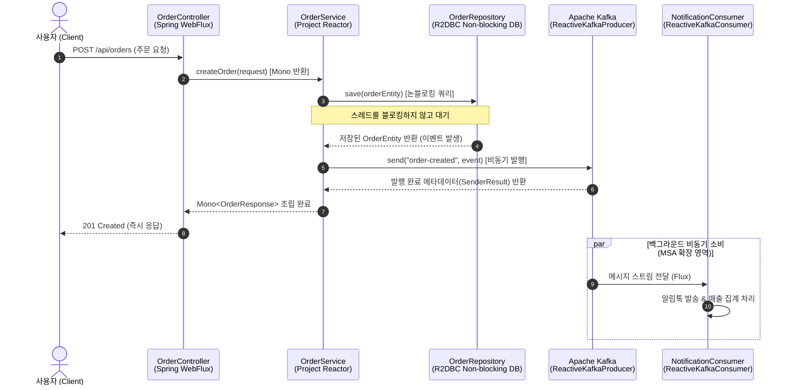

# Spring WebFlux + R2DBC + Kafka 실전 연동 미니 프로젝트 가이드

이 문서는 **논블로킹 웹 프레임워크(Spring WebFlux)**, **논블로킹 DB 드라이버(R2DBC)**, 그리고 **비동기 메시지 브로커(Apache Kafka)** 를 결합하여 **엔드-투-엔드(End-to-End) 논블로킹 마이크로서비스**를 구축하는 아키텍처와 실전 코드 예시를 다룹니다.

---

## 1. 미니 프로젝트 시나리오 및 전체 아키텍처

### 1.1 시나리오: 고트래픽 주문 접수 및 비동기 알림 시스템
1. 사용자가 **주문 생성 API (`POST /api/orders`)** 를 호출합니다.
2. 주문 서비스는 **R2DBC**를 통해 MySQL/PostgreSQL에 주문 내역을 **논블로킹으로 저장**합니다.
3. DB 저장이 완료되는 즉시(`flatMap`), **Reactor Kafka**를 통해 `order-created` 토픽으로 **주문 생성 이벤트를 비동기 발행**하고 사용자에게 즉시 응답을 반환합니다.
4. 별도의 알림/통계 컨슈머(Consumer)가 Kafka 토픽을 구독하고 있다가 이벤트를 받아 백그라운드에서 알림톡 발송 및 통계를 집계합니다.

### 1.2 엔드-투-엔드(End-to-End) 논블로킹 데이터 흐름도



---

## 2. 프로젝트 설정 (`build.gradle` & `application.yml`)

논블로킹 파이프라인이 중간에 끊기지 않도록 **웹, DB, 메시징 모두 리액티브 전용 라이브러리**를 사용합니다.

### 2.1 `build.gradle` 핵심 의존성
```groovy
dependencies {
    // 1. Spring WebFlux (Netty 기반 논블로킹 웹 서버)
    implementation 'org.springframework.boot:spring-boot-starter-webflux'

    // 2. Spring Data R2DBC (논블로킹 DB 접근)
    implementation 'org.springframework.boot:spring-boot-starter-data-r2dbc'
    runtimeOnly 'org.postgresql:r2dbc-postgresql' // 또는 io.asyncer:r2dbc-mysql

    // 3. Reactor Kafka (Project Reactor 기반 논블로킹 Kafka 클라이언트)
    implementation 'org.springframework.kafka:spring-kafka'
    implementation 'io.projectreactor.kafka:reactor-kafka'

    // 4. 유틸리티
    compileOnly 'org.projectlombok:lombok'
    annotationProcessor 'org.projectlombok:lombok'
}
```

### 2.2 `application.yml` 환경 설정
```yaml
spring:
  r2dbc:
    url: r2dbc:postgresql://localhost:5432/shop_db
    username: shop_user
    password: secret
  kafka:
    bootstrap-servers: localhost:9092
    consumer:
      group-id: order-notification-group
      auto-offset-reset: earliest
```

---

## 3. 계층별 핵심 구현 코드

### 3.1 도메인 엔티티 및 DTO (`Order.java`, `OrderEvent.java`)
R2DBC는 JPA(`@Entity`)와 달리 연관관계 매핑이나 지연 로딩(Lazy Loading)이 없는 가벼운 테이블 매핑(`@Table`)을 사용합니다.

```java
// 1. R2DBC 테이블 매핑 엔티티
@Table("orders")
@Getter
@NoArgsConstructor
@AllArgsConstructor
@Builder
public class Order {
    @Id
    private Long id;
    private Long userId;
    private String productName;
    private Integer price;
    private String status;
    private LocalDateTime createdAt;
}

// 2. Kafka로 전송할 이벤트 메시지 객체 (Java Record)
public record OrderCreatedEvent(
    Long orderId,
    Long userId,
    String productName,
    Integer price,
    LocalDateTime orderedAt
) {}

// 3. API 요청/응답 DTO
public record OrderCreateRequest(Long userId, String productName, Integer price) {}
public record OrderResponse(Long orderId, String status, String message) {}
```

### 3.2 리액티브 리포지토리 (`OrderRepository.java`)
리턴 타입이 `Order`나 `List<Order>`가 아닌 **`Mono<Order>`와 `Flux<Order>`** 인 것이 핵심입니다.

```java
public interface OrderRepository extends ReactiveCrudRepository<Order, Long> {
    // 특정 회원의 주문 목록을 다건 스트림(Flux)으로 논블로킹 조회
    Flux<Order> findByUserId(Long userId);
}
```

### 3.3 리액티브 Kafka 프로듀서 설정 (`ReactiveKafkaConfig.java`)
Spring Boot 자동 설정을 활용해 논블로킹 Kafka 송신기(`ReactiveKafkaProducerTemplate`)와 수신기(`ReactiveKafkaReceiver`) 빈을 등록합니다.

```java
@Configuration
public class ReactiveKafkaConfig {

    @Bean
    public ReactiveKafkaProducerTemplate<String, OrderCreatedEvent> reactiveKafkaProducerTemplate(
            KafkaProperties properties) {
        Map<String, Object> props = properties.buildProducerProperties(null);
        props.put(ProducerConfig.KEY_SERIALIZER_CLASS_CONFIG, StringSerializer.class);
        props.put(ProducerConfig.VALUE_SERIALIZER_CLASS_CONFIG, JsonSerializer.class);

        return new ReactiveKafkaProducerTemplate<>(SenderOptions.create(props));
    }

    @Bean
    public ReactiveKafkaConsumerTemplate<String, OrderCreatedEvent> reactiveKafkaConsumerTemplate(
            KafkaProperties properties) {
        Map<String, Object> props = properties.buildConsumerProperties(null);
        props.put(ConsumerConfig.KEY_DESERIALIZER_CLASS_CONFIG, StringDeserializer.class);
        props.put(ConsumerConfig.VALUE_DESERIALIZER_CLASS_CONFIG, JsonDeserializer.class);
        props.put(JsonDeserializer.TRUSTED_PACKAGES, "*");

        ReceiverOptions<String, OrderCreatedEvent> receiverOptions =
            ReceiverOptions.<String, OrderCreatedEvent>create(props)
                .subscription(Collections.singletonList("order-created"));

        return new ReactiveKafkaConsumerTemplate<>(receiverOptions);
    }
}
```

### 3.4 비즈니스 서비스: DB 저장 후 Kafka 발행 파이프라인 (`OrderService.java`)
**가장 중요한 핵심 코드입니다.** `.flatMap()`을 사용해 **① R2DBC 저장 완료 -> ② Kafka 이벤트 발행 -> ③ 응답 DTO 변환** 과정을 하나의 논블로킹 파이프라인으로 연결합니다.

```java
@Slf4j
@Service
@RequiredArgsConstructor
public class OrderService {

    private final OrderRepository orderRepository;
    private final ReactiveKafkaProducerTemplate<String, OrderCreatedEvent> kafkaProducer;
    private static final String TOPIC_NAME = "order-created";

    public Mono<OrderResponse> createOrder(OrderCreateRequest request) {
        Order newOrder = Order.builder()
            .userId(request.userId())
            .productName(request.productName())
            .price(request.price())
            .status("COMPLETED")
            .createdAt(LocalDateTime.now())
            .build();

        // 1. R2DBC를 통한 논블로킹 DB INSERT
        return orderRepository.save(newOrder)
            // 2. DB 저장이 완료되면(savedOrder 도착), 이어서 Kafka에 비동기 이벤트 발행
            .flatMap(savedOrder -> {
                OrderCreatedEvent event = new OrderCreatedEvent(
                    savedOrder.getId(),
                    savedOrder.getUserId(),
                    savedOrder.getProductName(),
                    savedOrder.getPrice(),
                    savedOrder.getCreatedAt()
                );

                // Key를 userId로 지정하여 동일 회원의 주문 이벤트 순서 보장
                return kafkaProducer.send(TOPIC_NAME, String.valueOf(savedOrder.getUserId()), event)
                    .doOnSuccess(result -> log.info("Kafka 이벤트 발행 성공: orderId={}", savedOrder.getId()))
                    .thenReturn(savedOrder); // 발행 성공 후 다음 단계로 savedOrder 전달
            })
            // 3. 최종 사용자 응답 DTO로 동기 변환 (.map 사용)
            .map(savedOrder -> new OrderResponse(
                savedOrder.getId(),
                savedOrder.getStatus(),
                "주문이 성공적으로 접수되었습니다."
            ))
            // 4. 파이프라인 도중 에러 발생 시 안전하게 로그를 남기고 예외 전파
            .doOnError(error -> log.error("주문 처리 중 오류 발생: {}", error.getMessage()));
    }

    // 회원의 주문 내역 다건 조회 (Flux 스트리밍 반환)
    public Flux<Order> getUserOrders(Long userId) {
        return orderRepository.findByUserId(userId);
    }
}
```

### 3.5 WebFlux 컨트롤러 (`OrderController.java`)
컨트롤러에서는 절대 `.subscribe()`나 `.block()`을 호출하지 않고 **`Mono`나 `Flux` 자체를 그대로 반환**합니다. 실제 구독(실행)은 Netty 웹 엔진이 알아서 수행합니다.

```java
@RestController
@RequestMapping("/api/orders")
@RequiredArgsConstructor
public class OrderController {

    private final OrderService orderService;

    @PostMapping
    @ResponseStatus(HttpStatus.CREATED)
    public Mono<OrderResponse> placeOrder(@RequestBody OrderCreateRequest request) {
        return orderService.createOrder(request);
    }

    // 다건 데이터를 JSON 배열 또는 실시간 스트림(NDJSON)으로 반환
    @GetMapping("/user/{userId}")
    public Flux<Order> getOrdersByUser(@PathVariable Long userId) {
        return orderService.getUserOrders(userId);
    }
}
```

### 3.6 Kafka 리액티브 컨슈머 (`OrderNotificationConsumer.java`)
애플리케이션 시작 시(`@EventListener(ApplicationReadyEvent.class)`) Kafka 토픽을 구독하여, 메시지가 들어올 때마다 **배압(Backpressure)이 적용된 `Flux` 스트림**으로 알림을 처리합니다.

```java
@Slf4j
@Component
@RequiredArgsConstructor
public class OrderNotificationConsumer {

    private final ReactiveKafkaConsumerTemplate<String, OrderCreatedEvent> kafkaConsumer;

    @EventListener(ApplicationReadyEvent.class)
    public void consumeOrderEvents() {
        kafkaConsumer.receiveAutoAck() // 수신 시 자동 오프셋 커밋 스트림(Flux)
            .doOnNext(record -> {
                OrderCreatedEvent event = record.value();
                log.info("[알림 서비스 수신] 주문번호: {}, 상품명: {}, 금액: {}원 -> 카카오톡 알림 발송 완료!",
                    event.orderId(), event.productName(), event.price());
            })
            .doOnError(error -> log.error("Kafka 메시지 소비 중 에러 발생", error))
            .retry() // 일시적 장애 시 스트림이 끊기지 않도록 자동 재구독
            .subscribe(); // 백그라운드 컨슈머 파이프라인 가동 시작!
    }
}
```

---

## 4. 아키텍처 설계 핵심 포인트 4가지

1. **왜 `.map()` 대신 `.flatMap()`을 썼을까?**
Use code with caution.
• orderRepository.save()의 결과(savedOrder)를 받아서 또 다른 비동기 작업(kafkaProducer.send(), 반환 타입 Mono<SenderResult>)을 호출해야 하기 때문입니다. 만약 .map()을 쓰면 Mono<Mono<Order>>처럼 상자가 이중으로 겹치게 되므로, 상자를 평평하게 합쳐주는 .flatMap()이 필수입니다.
2. 동일 회원의 주문 순서 보장 (Key 지정)
	• kafkaProducer.send(TOPIC_NAME, String.valueOf(userId), event)처럼 메시지 Key에 userId를 넣으면, 같은 회원의 이벤트는 항상 동일한 Kafka 파티션으로 들어가므로 '주문 생성' 이벤트가 '주문 취소' 이벤트보다 먼저 처리되는 순서가 보장됩니다.
3. DB 저장과 Kafka 발행의 원자성 (Transactional Outbox 패턴 고려)
	• 위 예제는 학습용 기본 구조입니다. 실무에서 DB 저장은 성공했는데 Kafka 브로커 장애로 메시지 발행만 실패하는 상황까지 완벽히 막으려면, DB 트랜잭션 안에 Outbox 테이블에 이벤트를 함께 저장(@Transactional)한 뒤 별도 워커가 Kafka로 쏘는 Transactional Outbox 패턴을 적용합니다.
4. 블로킹 코드 침투 방지 (BlockHound)
	• 실무에서는 개발자가 실수로 WebFlux 스레드 안에 블로킹 메서드를 섞어 쓰는 것을 막기 위해 테스트 환경에 BlockHound 라이브러리를 추가하여 블로킹 호출 감지 시 즉시 예외를 발생시키도록 검증합니다.

