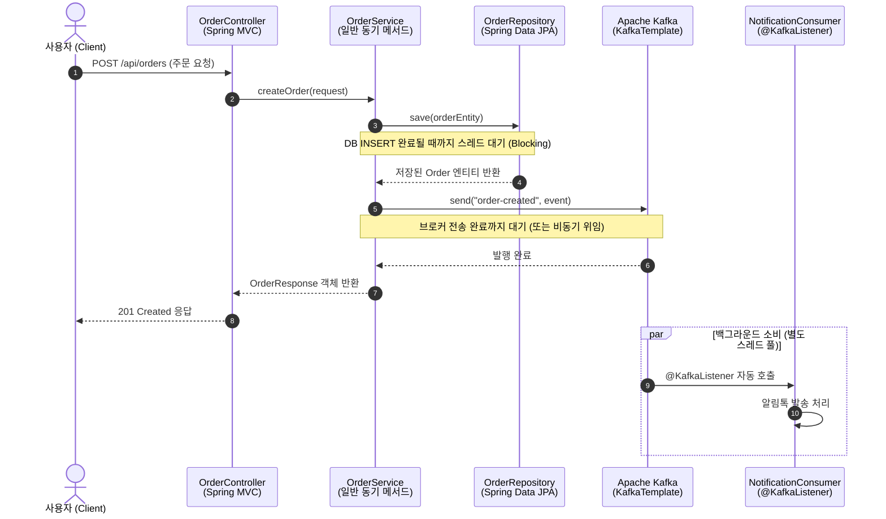
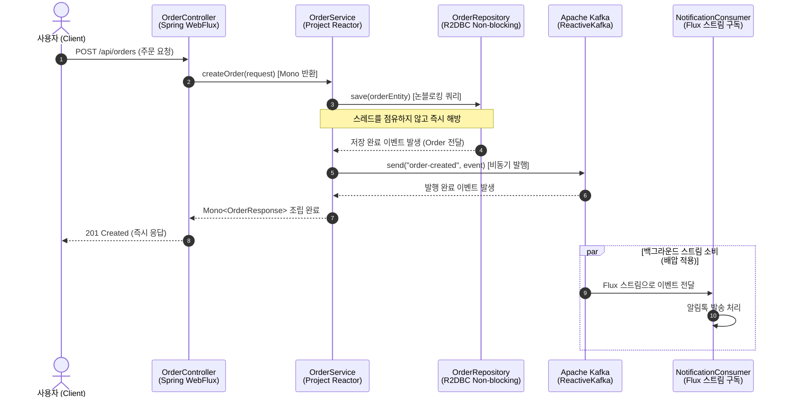

# Spring MVC(JPA) vs. Spring WebFlux(R2DBC) + Kafka 실전 아키텍처 및 코드 완벽 비교

이 문서는 동일한 **'실시간 주문 접수 및 알림 처리 시스템'**을 **전통적인 동기·블로킹 방식(Spring Boot + JPA + Kafka)**과 **비동기·논블로킹 리액티브 방식(Spring WebFlux + R2DBC + Reactor Kafka)**으로 각각 구현하여, 아키텍처 흐름과 실제 코드의 차이를 명확하게 비교하는 실무 가이드입니다.

---

## 1. 한눈에 보는 두 아키텍처 핵심 비교

| 비교 항목 | 평범한 Spring Boot (MVC + JPA) | 리액티브 스택 (WebFlux + R2DBC) |
| :--- | :--- | :--- |
| **웹 엔진 & 스레드 모델** | Tomcat (요청당 1개 스레드 점유, **블로킹**) | Netty (소수의 이벤트 루프 스레드 공유, **논블로킹**) |
| **DB 접근 기술** | Spring Data JPA / JDBC (**블로킹 I/O**) | Spring Data R2DBC (**논블로킹 I/O**) |
| **Kafka 연동 방식** | `KafkaTemplate` + `@KafkaListener` | `ReactiveKafkaProducer` + `Flux` 스트림 구독 |
| **코드 스타일 & 난이도** | 위에서 아래로 읽히는 직관적 코드 (**쉬움**) | `Mono`/`Flux` 메서드 체이닝 파이프라인 (**높음**) |
| **DB 기능 지원 범위** | 연관관계, 영속성 컨텍스트, QueryDSL 등 **풍부함** | 단순 CRUD 및 쿼리 위주 (**연관관계·지연로딩 미지원**) |
| **디버깅 및 유지보수** | 스택 트레이스(Stack Trace) 추적이 매우 용이함 | 비동기 스레드를 넘나들어 에러 원인 추적이 까다로움 |
| **적합한 실무 환경** | **일반적인 비즈니스 백엔드 서비스 (90% 이상)** | 대규모 실시간 스트리밍, API 게이트웨이, 초고트래픽 서버 |

---

## 2. 아키텍처 실행 흐름 비교 (Sequence Diagram)

### 2.1 평범한 Spring Boot (MVC + JPA + Kafka): 동기·블로킹 방식
톰캣 스레드 1명이 요청을 받아 **DB 저장이 끝날 때까지 기다리고(Block), Kafka 전송이 끝날 때까지 기다린 뒤(Block)** 응답을 내려줍니다.



### 2.2 리액티브 스택 (WebFlux + R2DBC + Reactor Kafka): 비동기·논블로킹 방식
스레드가 기다리지 않고 **파이프라인 설계도(`Mono`)만 조립해서 반환**하며, DB 저장과 Kafka 발행이 완료되는 이벤트가 발생할 때마다 다음 단계가 자동으로 이어집니다.



---

## 3. 프로젝트 의존성 (`build.gradle`) 비교

### ① 평범한 Spring Boot (`build.gradle`)
```groovy
dependencies {
    implementation 'org.springframework.boot:spring-boot-starter-web'      // Tomcat 기반 블로킹 웹
    implementation 'org.springframework.boot:spring-boot-starter-data-jpa' // JDBC 기반 블로킹 DB
    implementation 'org.springframework.kafka:spring-kafka'                // 표준 Spring Kafka
    runtimeOnly 'org.postgresql:postgresql'
}
```

### ② 리액티브 스택 (`build.gradle`)
```groovy
dependencies {
    implementation 'org.springframework.boot:spring-boot-starter-webflux'    // Netty 기반 논블로킹 웹
    implementation 'org.springframework.boot:spring-boot-starter-data-r2dbc' // R2DBC 논블로킹 DB
    implementation 'org.springframework.kafka:spring-kafka'
    implementation 'io.projectreactor.kafka:reactor-kafka'                   // 리액티브 Kafka 클라이언트
    runtimeOnly 'org.postgresql:r2dbc-postgresql'
}
```

---

## 4. 계층별 핵심 코드 1:1 비교

### 4.1 공통 DTO 및 이벤트 객체 (Java Record)
```java
public record OrderCreateRequest(Long userId, String productName, Integer price) {}
public record OrderResponse(Long orderId, String status, String message) {}
public record OrderCreatedEvent(Long orderId, Long userId, String productName, Integer price, LocalDateTime orderedAt) {}
```

### 4.2 리포지토리 (`OrderRepository.java`)
* **평범한 JPA (일반 객체 및 `List` 반환)**
  ```java
  public interface OrderRepository extends JpaRepository<Order, Long> {
      List<Order> findByUserId(Long userId);
  }
  ```
* **리액티브 R2DBC (`Mono` 및 `Flux` 반환)**
  ```java
  public interface OrderRepository extends ReactiveCrudRepository<Order, Long> {
      Flux<Order> findByUserId(Long userId);
  }
  ```

### 4.3 서비스 계층 (`OrderService.java`) — 가장 결정적인 차이

#### ① 평범한 Spring Boot 서비스 (직관적인 순차 코드)
```java
@Slf4j
@Service
@RequiredArgsConstructor
public class OrderService {

    private final OrderRepository orderRepository;
    private final KafkaTemplate<String, OrderCreatedEvent> kafkaTemplate;
    private static final String TOPIC_NAME = "order-created";

    @Transactional
    public OrderResponse createOrder(OrderCreateRequest request) {
        Order newOrder = Order.builder()
            .userId(request.userId())
            .productName(request.productName())
            .price(request.price())
            .status("COMPLETED")
            .createdAt(LocalDateTime.now())
            .build();

        // 1. [블로킹] DB 저장이 완료될 때까지 스레드 대기
        Order savedOrder = orderRepository.save(newOrder);

        // 2. 이벤트 생성 및 Kafka 전송
        OrderCreatedEvent event = new OrderCreatedEvent(
            savedOrder.getId(), savedOrder.getUserId(),
            savedOrder.getProductName(), savedOrder.getPrice(), savedOrder.getCreatedAt()
        );
        kafkaTemplate.send(TOPIC_NAME, String.valueOf(savedOrder.getUserId()), event);

        // 3. [동기] 일반 응답 객체 반환
        return new OrderResponse(savedOrder.getId(), savedOrder.getStatus(), "주문이 성공적으로 접수되었습니다.");
    }

    @Transactional(readOnly = true)
    public List<Order> getUserOrders(Long userId) {
        return orderRepository.findByUserId(userId);
    }
}
```

#### ② 리액티브 스택 서비스 (`flatMap`과 `map` 파이프라인)
```java
@Slf4j
@Service
@RequiredArgsConstructor
public class OrderService {

    private final OrderRepository orderRepository;
    private final ReactiveKafkaProducerTemplate<String, OrderCreatedEvent> kafkaProducer;
    private static final String TOPIC_NAME = "order-created";

    public Mono<OrderResponse> createOrder(OrderCreateRequest request) {
        Order newOrder = Order.builder()
            .userId(request.userId())
            .productName(request.productName())
            .price(request.price())
            .status("COMPLETED")
            .createdAt(LocalDateTime.now())
            .build();

        // 1. [논블로킹] R2DBC 저장 파이프라인 시작
        return orderRepository.save(newOrder)
            // 2. DB 저장 완료 시 이어서 비동기 Kafka 발행 연결 (.flatMap 필수)
            .flatMap(savedOrder -> {
                OrderCreatedEvent event = new OrderCreatedEvent(
                    savedOrder.getId(), savedOrder.getUserId(),
                    savedOrder.getProductName(), savedOrder.getPrice(), savedOrder.getCreatedAt()
                );
                return kafkaProducer.send(TOPIC_NAME, String.valueOf(savedOrder.getUserId()), event)
                    .thenReturn(savedOrder);
            })
            // 3. 최종 응답 DTO로 동기 변환 (.map 사용)
            .map(savedOrder -> new OrderResponse(
                savedOrder.getId(), savedOrder.getStatus(), "주문이 성공적으로 접수되었습니다."
            ));
    }

    public Flux<Order> getUserOrders(Long userId) {
        return orderRepository.findByUserId(userId);
    }
}
```

### 4.4 컨트롤러 & Kafka 컨슈머 비교

#### ① 평범한 Spring Boot (어노테이션 기반 단순 처리)
```java
// [컨트롤러]
@RestController
@RequestMapping("/api/orders")
@RequiredArgsConstructor
public class OrderController {
    private final OrderService orderService;

    @PostMapping
    @ResponseStatus(HttpStatus.CREATED)
    public OrderResponse placeOrder(@RequestBody OrderCreateRequest request) {
        return orderService.createOrder(request);
    }
}

// [컨슈머]
@Slf4j
@Component
public class OrderNotificationConsumer {
    @KafkaListener(topics = "order-created", groupId = "order-notification-group")
    public void consume(OrderCreatedEvent event) {
        log.info("[알림 발송] 주문번호: {}, 상품: {}", event.orderId(), event.productName());
    }
}
```

#### ② 리액티브 스택 (`Mono` 반환 및 스트림 구독)
```java
// [컨트롤러] - 절대 .block()이나 .subscribe()를 호출하지 않고 Mono 그대로 반환
@RestController
@RequestMapping("/api/orders")
@RequiredArgsConstructor
public class OrderController {
    private final OrderService orderService;

    @PostMapping
    @ResponseStatus(HttpStatus.CREATED)
    public Mono<OrderResponse> placeOrder(@RequestBody OrderCreateRequest request) {
        return orderService.createOrder(request);
    }
}

// [컨슈머] - 애플리케이션 준비 완료 시 백그라운드 Flux 스트림 구독 시작
@Slf4j
@Component
@RequiredArgsConstructor
public class OrderNotificationConsumer {
    private final ReactiveKafkaConsumerTemplate<String, OrderCreatedEvent> kafkaConsumer;

    @EventListener(ApplicationReadyEvent.class)
    public void consume() {
        kafkaConsumer.receiveAutoAck()
            .doOnNext(record -> log.info("[알림 발송] 주문번호: {}, 상품: {}",
                record.value().orderId(), record.value().productName()))
            .retry()
            .subscribe();
    }
}
```

---

## 5. [실무 보완] 현업에서 가장 많이 쓰는 하이브리드 & 안전 패턴

실무에서는 무조건 WebFlux로 갈아타기보다 **평범한 Spring Boot(MVC + JPA)의 생산성을 유지하면서 단점을 보완하는 방법**을 매우 선호합니다.

### 5.1 DB 커밋 이후 안전하게 Kafka 메시지 보내기 (`@TransactionalEventListener`)
일반 Spring Boot 코드에서 `orderRepository.save()` 직후 `kafkaTemplate.send()`를 호출하면, **Kafka 전송은 성공했는데 마지막 DB 트랜잭션 커밋 시점에 에러가 나서 롤백되는 데이터 불일치**가 발생할 수 있습니다.
* **해결책**: 서비스에서는 스프링 내부 이벤트(`ApplicationEventPublisher`)만 발행하고, **`@TransactionalEventListener(phase = TransactionPhase.AFTER_COMMIT)`** 리스너가 DB 커밋이 100% 확정된 직후에 Kafka로 메시지를 쏘도록 분리합니다.

### 5.2 Java 21 가상 스레드 (Virtual Threads) 활용
Spring Boot 3.2 이상과 Java 21 환경에서는 `application.yml`에 단 한 줄만 추가하면 **평범한 Spring MVC + JPA 코드를 그대로 쓰면서도 WebFlux에 버금가는 높은 동시성 처리 성능**을 얻을 수 있습니다.

```yaml
spring:
  threads:
    virtual:
      enabled: true # 톰캣 스레드 대신 초경량 가상 스레드 활성화
```

### 5.3 최종 선택 가이드
1. **기본 선택**: 특별한 이유가 없다면 **평범한 Spring Boot (MVC + JPA + Spring Kafka)** 로 시작하세요. 개발 속도가 빠르고 장애 대응이 훨씬 쉽습니다.
2. **성능 확장**: 트래픽이 늘어나면 **Java 21 가상 스레드**를 켜거나, 부하가 큰 외부 연동 로직만 **Kafka 비동기 처리**로 분리하세요.
3. **WebFlux 도입**: 초당 수만 건 이상의 실시간 스트리밍(SSE/WebSocket), API 게이트웨이(Spring Cloud Gateway), 또는 모든 하위 시스템이 논블로킹으로 구성된 극한의 고성능 I/O 서버가 필요할 때만 선택하세요.
